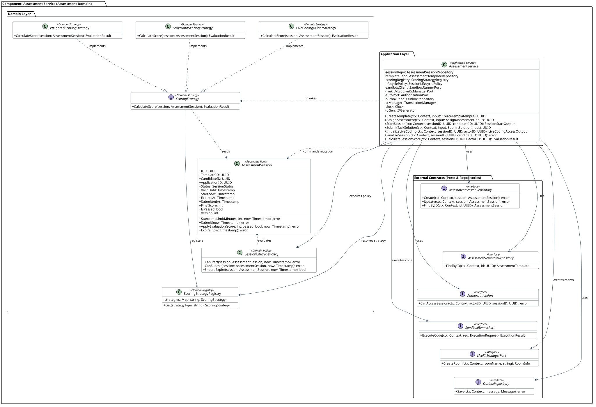

# Assessment Service (Assessment Domain) — детализация кода L4

Этот раздел описывает внутреннее устройство, классы, доменные сущности, контракты и стратегии компонента **Assessment Service**, входящего в контейнер `Assessment Service`.

> Каталог шаблонов испытаний, жизненный цикл индивидуальных сессий, интеграция со средой выполнения кода (Sandbox Runner) и медиакомнатами LiveKit, а также семейство алгоритмов скоринга (Strategy Pattern).



<details>
<summary>PlantUML Исходный код</summary>

```plantuml
@startuml
!include assessment-service.puml
@enduml
```
</details>

## 1. Архитектурные границы и принципы

1. **Изоляция Bounded Context (C4 L4):** Сервис изолирует функционал проверки компетенций соискателей от воронки найма. Внутренние классы не зависят от сущностей резюме или откликов, оперируя внешними UUID (`candidateID`, `applicationID`).
2. **Паттерн Стратегия (Strategy):** Расчет итогового балла отделен от агрегата сессии и динамически подменяется в рантайме:
   - `WeightedScoringStrategy` — взвешенная сумма автотестов и ручного ревью;
   - `StrictAutoScoringStrategy` — строгая 100% проверка автотестами;
   - `LiveCodingRubricStrategy` — оценка по матрице компетенций эксперта в реальном времени.
3. **Чистая архитектура (Ports & Adapters):** Доменный слой чист от I/O. Интеграции с раннером кода (`SandboxRunnerPort`), WebRTC (`LiveKitManagerPort`), ReBAC (`AuthorizationPort`) и БД объявлены как интерфейсы портов.
4. **Транзакционный Outbox:** Изменения состояния сессий фиксируются атомарно с событием в outbox (`AssessmentAssigned`, `AssessmentCompleted`, `AssessmentExpired`).

## 2. Слой приложения (Application Layer)

### `AssessmentService` <<Application Service>>
Оркестрирует жизненный цикл шаблонов, заданий и сессий:
- `CreateTemplate(ctx, input)`: создание шаблона с валидацией лимитов времени (10 мин – 72 ч) и тест-сьютов;
- `AssignAssessment(ctx, input)`: назначение теста кандидату в статусе `SCHEDULED`;
- `StartSession(ctx, sessionID, candidateID)`: старт сессии, фиксация дедлайна `expiresAt`, переход в `IN_PROGRESS`;
- `SubmitTaskSolution(ctx, input)`: отправка кода в `SandboxRunnerPort`;
- `InitializeLiveCoding(ctx, sessionID, actorID)`: создание WebRTC-комнаты в LiveKit и выпуск JWT-токенов;
- `FinalizeSession(ctx, sessionID, candidateID)`: завершение сессии кандидатом, переход в `SUBMITTED`;
- `CalculateSessionScore(ctx, sessionID, actorID)`: вычисление балла через `ScoringStrategy` и перевод в `EVALUATED`.

## 3. Доменный слой (Domain Layer)

### Агрегат `AssessmentSession` (Aggregate Root)
- `ID: UUID`, `TemplateID: UUID`, `CandidateID: UUID`, `ApplicationID: UUID`, `Status: SessionStatus`, `StartedAt`, `ExpiresAt`, `SubmittedAt`, `FinalScore: int`, `IsPassed: bool`, `Version: int`.
- Методы: `Start()`, `Submit()`, `ApplyEvaluation()`, `Expire()`.
- Инварианты: дедлайн не может быть продлен после старта; решения принимаются только в статусе `IN_PROGRESS` до наступления `ExpiresAt`.

### Доменная политика `SessionLifecyclePolicy`
- Валидация допустимости действий кандидата и экзаменатора (`CanStart`, `CanSubmit`, `ShouldExpire`).

### Паттерн «Стратегия» для скоринга (`ScoringStrategy`)
- Единый контракт `CalculateScore(session: AssessmentSession): EvaluationResult` и семейство стратегий (`WeightedScoringStrategy`, `StrictAutoScoringStrategy`, `LiveCodingRubricStrategy`), регистрируемых в `ScoringStrategyRegistry`.

## 4. Внешние порты и контракты (Ports & Repositories)

| Интерфейс | Назначение | Реализация L3 |
|---|---|---|
| `AssessmentSessionRepository` | Хранение сессий кандидатов | PostgreSQL (`session_repo`) |
| `AssessmentTemplateRepository` | Чтение шаблонов и задач | PostgreSQL (`template_repo`) |
| `AuthorizationPort` | ReBAC-проверка прав рекрутеров и кандидатов | OpenFGA SDK (`authorization_client`) |
| `SandboxRunnerPort` | Изолированное исполнение кода соискателей | Code Execution Runner (`sandbox_client`) |
| `LiveKitManagerPort` | Создание комнат и генерация токенов Live Coding | LiveKit SDK (`livekit_mgr`) |
| `OutboxRepository` | Атомарная публикация доменных событий | PostgreSQL (`transactional_outbox`) |
