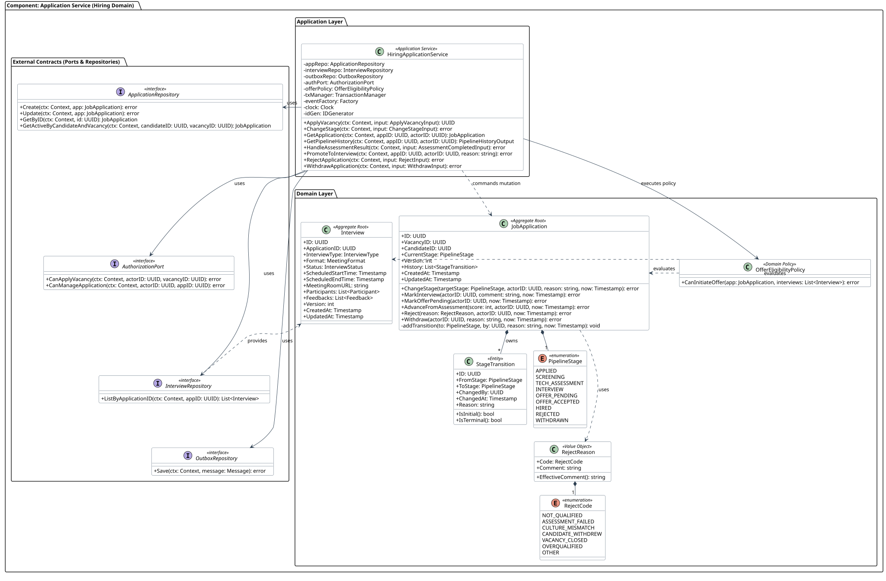

# Application Service (Hiring Domain) — детализация кода L4

Этот раздел описывает внутреннее устройство, классы, доменные сущности, контракты и структуры компонента **Application Service**, входящего в контейнер `Hiring Service`.

> Оркестрация воронки отклика, аудит переходов и межагрегатная доменная политика.



<details>
<summary>PlantUML Исходный код</summary>

```plantuml
@startuml
!include hiring-application-service.puml
@enduml
```
</details>

## 1. Архитектурные границы и принципы

1. **Изоляция Bounded Context:** Компонент владеет исключительно своими агрегатами и доменной логикой.
2. **Чистая архитектура (Ports & Adapters):** Вся внешняя инфраструктура (база данных, другие сервисы, брокер) представлена исключительно через исходящие интерфейсы.
3. **Транзакционная атомарность:** Оркестрация сценариев мутации агрегатов выполняется в рамках транзакций через Unit of Work (`TransactionManager`).

## 2. Доменная модель (Domain Layer)

### Корень агрегата `JobApplication` (Aggregate Root)

| Поле | Тип | Назначение |
|---|---|---|
| `ID` | `UUID` | Доменное свойство агрегата |
| `VacancyID` | `UUID` | Доменное свойство агрегата |
| `CandidateID` | `UUID` | Доменное свойство агрегата |
| `CurrentStage` | `PipelineStage` | Доменное свойство агрегата |
| `Version` | `int` | Доменное свойство агрегата |
| `History` | `List<StageTransition>` | Доменное свойство агрегата |
| `CreatedAt` | `Timestamp` | Доменное свойство агрегата |
| `UpdatedAt` | `Timestamp` | Доменное свойство агрегата |

**Ключевые методы агрегата:**

* `+ChangeStage(targetStage: PipelineStage, actorID: UUID, reason: string, now: Timestamp): error`
* `+MarkInterview(actorID: UUID, comment: string, now: Timestamp): error`
* `+MarkOfferPending(actorID: UUID, now: Timestamp): error`
* `+AdvanceFromAssessment(score: int, actorID: UUID, now: Timestamp): error`
* `+Reject(reason: RejectReason, actorID: UUID, now: Timestamp): error`
* `+Withdraw(actorID: UUID, reason: string, now: Timestamp): error`

### Дочерние сущности (Entities)

#### Сущность `StageTransition`

* `ID: UUID`
* `FromStage: PipelineStage`
* `ToStage: PipelineStage`
* `ChangedBy: UUID`
* `ChangedAt: Timestamp`
* `Reason: string`

### Объекты-значения (Value Objects)

#### Объект-значение `RejectReason`

* `Code: RejectCode`
* `Comment: string`

### Внешние агрегаты (External Aggregates)

#### Агрегат `Interview`

* `ID: UUID`
* `ApplicationID: UUID`
* `InterviewType: InterviewType`
* `Format: MeetingFormat`
* `Status: InterviewStatus`
* `ScheduledStartTime: Timestamp`
* `ScheduledEndTime: Timestamp`
* `MeetingRoomURL: string`
* `Participants: List<Participant>`
* `Feedbacks: List<Feedback>`
* `Version: int`
* `CreatedAt: Timestamp`
* `UpdatedAt: Timestamp`

### Доменные политики (Domain Policies)

#### Политика `OfferEligibilityPolicy`

* `+CanInitiateOffer(app: JobApplication, interviews: List<Interview>): error`

## 3. Сценарии использования (Application Layer)

Прикладной сервис `HiringApplicationService` оркестрирует выполнение бизнес-сценариев:

* `+ApplyVacancy(ctx: Context, input: ApplyVacancyInput): UUID`
* `+ChangeStage(ctx: Context, input: ChangeStageInput): error`
* `+GetApplication(ctx: Context, appID: UUID, actorID: UUID): JobApplication`
* `+GetPipelineHistory(ctx: Context, appID: UUID, actorID: UUID): PipelineHistoryOutput`
* `+HandleAssessmentResult(ctx: Context, input: AssessmentCompletedInput): error`
* `+PromoteToInterview(ctx: Context, appID: UUID, actorID: UUID, reason: string): error`
* `+RejectApplication(ctx: Context, input: RejectInput): error`
* `+WithdrawApplication(ctx: Context, input: WithdrawInput): error`

## 4. Внешние порты и контракты (Outbound Ports)

### Порт `ApplicationRepository`

* `+Create(ctx: Context, app: JobApplication): error`
* `+Update(ctx: Context, app: JobApplication): error`
* `+GetByID(ctx: Context, id: UUID): JobApplication`
* `+GetActiveByCandidateAndVacancy(ctx: Context, candidateID: UUID, vacancyID: UUID): JobApplication`

### Порт `AuthorizationPort`

* `+CanApplyVacancy(ctx: Context, actorID: UUID, vacancyID: UUID): error`
* `+CanManageApplication(ctx: Context, actorID: UUID, appID: UUID): error`

### Порт `InterviewRepository`

* `+ListByApplicationID(ctx: Context, appID: UUID): List<Interview>`

### Порт `OutboxRepository`

* `+Save(ctx: Context, message: Message): error`

