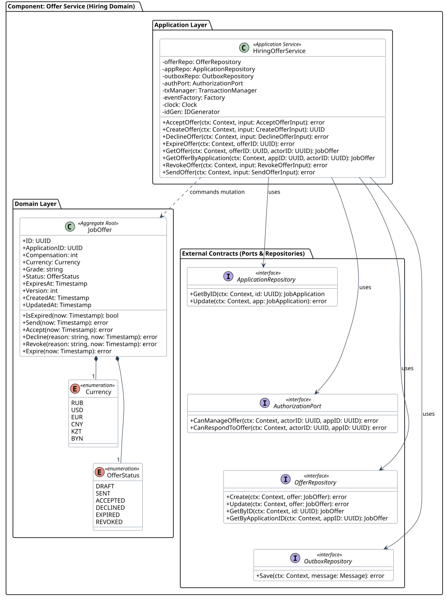

# Offer Service (Hiring Domain) — детализация кода L4

Этот раздел описывает внутреннее устройство, классы, доменные сущности, контракты и структуры компонента **Offer Service**, входящего в контейнер `Hiring Service`.

> Формирование, отправка и принятие предложений о работе с межагрегатной транзакционной атомарностью.



<details>
<summary>PlantUML Исходный код</summary>

```plantuml
@startuml
!include hiring-offer-service.puml
@enduml
```
</details>

## 1. Архитектурные границы и принципы

1. **Изоляция Bounded Context:** Компонент владеет исключительно своими агрегатами и доменной логикой.
2. **Чистая архитектура (Ports & Adapters):** Вся внешняя инфраструктура (база данных, другие сервисы, брокер) представлена исключительно через исходящие интерфейсы.
3. **Транзакционная атомарность:** Оркестрация сценариев мутации агрегатов выполняется в рамках транзакций через Unit of Work (`TransactionManager`).

## 2. Доменная модель (Domain Layer)

### Корень агрегата `JobOffer` (Aggregate Root)

| Поле | Тип | Назначение |
|---|---|---|
| `ID` | `UUID` | Доменное свойство агрегата |
| `ApplicationID` | `UUID` | Доменное свойство агрегата |
| `Compensation` | `int` | Доменное свойство агрегата |
| `Currency` | `Currency` | Доменное свойство агрегата |
| `Grade` | `string` | Доменное свойство агрегата |
| `Status` | `OfferStatus` | Доменное свойство агрегата |
| `ExpiresAt` | `Timestamp` | Доменное свойство агрегата |
| `Version` | `int` | Доменное свойство агрегата |
| `CreatedAt` | `Timestamp` | Доменное свойство агрегата |
| `UpdatedAt` | `Timestamp` | Доменное свойство агрегата |

**Ключевые методы агрегата:**

* `+IsExpired(now: Timestamp): bool`
* `+Send(now: Timestamp): error`
* `+Accept(now: Timestamp): error`
* `+Decline(reason: string, now: Timestamp): error`
* `+Revoke(reason: string, now: Timestamp): error`
* `+Expire(now: Timestamp): error`

## 3. Сценарии использования (Application Layer)

Прикладной сервис `HiringOfferService` оркестрирует выполнение бизнес-сценариев:

* `+AcceptOffer(ctx: Context, input: AcceptOfferInput): error`
* `+CreateOffer(ctx: Context, input: CreateOfferInput): UUID`
* `+DeclineOffer(ctx: Context, input: DeclineOfferInput): error`
* `+ExpireOffer(ctx: Context, offerID: UUID): error`
* `+GetOffer(ctx: Context, offerID: UUID, actorID: UUID): JobOffer`
* `+GetOfferByApplication(ctx: Context, appID: UUID, actorID: UUID): JobOffer`
* `+RevokeOffer(ctx: Context, input: RevokeOfferInput): error`
* `+SendOffer(ctx: Context, input: SendOfferInput): error`

## 4. Внешние порты и контракты (Outbound Ports)

### Порт `ApplicationRepository`

* `+GetByID(ctx: Context, id: UUID): JobApplication`
* `+Update(ctx: Context, app: JobApplication): error`

### Порт `AuthorizationPort`

* `+CanManageOffer(ctx: Context, actorID: UUID, appID: UUID): error`
* `+CanRespondToOffer(ctx: Context, actorID: UUID, appID: UUID): error`

### Порт `OfferRepository`

* `+Create(ctx: Context, offer: JobOffer): error`
* `+Update(ctx: Context, offer: JobOffer): error`
* `+GetByID(ctx: Context, id: UUID): JobOffer`
* `+GetByApplicationID(ctx: Context, appID: UUID): JobOffer`

### Порт `OutboxRepository`

* `+Save(ctx: Context, message: Message): error`

