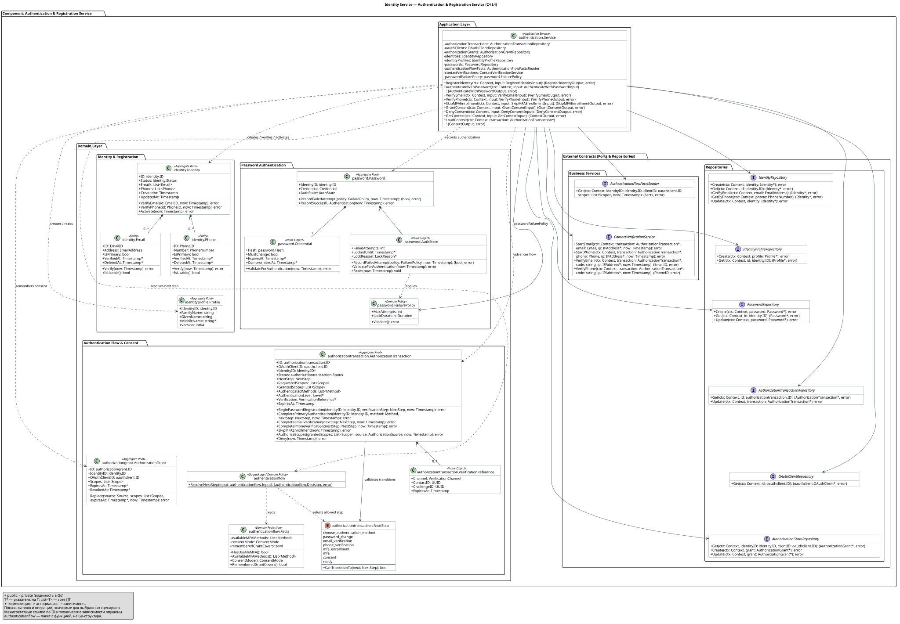

# Identity Service — диаграмма классов регистрации и аутентификации (L4)

Диаграмма раскрывает **Authentication & Registration Service** — компонент L3 внутри контейнера **Identity Service**. Она построена по реализации `services/identity/internal/usecase/authentication` и связанным доменным пакетам. Основные сценарии: регистрация по email или телефону, вход по паролю, подтверждение контакта, пропуск настройки MFA и управление согласием на OAuth-scopes.



<details>
<summary>Диаграмма из исходника PlantUML</summary>

```plantuml
@startuml
!include architecture/c4-plant-uml/plantuml/code/backend/identity-authentication-service.puml
@enduml
```

</details>

[Исходник PlantUML](identity-authentication-service.puml) · [Изображение SVG](identity-authentication-service.svg) · [Компоненты Identity Service, L3](../../component/backend/identity-service.md)

## Граница компонента

Согласно [правилам L4](../README.md), детализация относится к одному прикладному компоненту. Поэтому на схеме показаны `authentication.Service`, используемые им доменные агрегаты, политика выбора следующего шага и исходящие интерфейсы. Реализации репозиториев, SQL/Redis-модели хранения, gRPC-обработчики, криптографические адаптеры и соседний **OAuth & Token Service** остаются за этой границей.

Выпуск JWT, обмен authorization code, ротация refresh-токенов и федеративный вход относятся к другим компонентам L3. Их внутренние классы в этот вид не входят. Контракт `ContactVerificationService` скрывает генерацию и проверку одноразовых кодов.

Схема показывает значимые для бизнес-сценариев поля и операции. Например, у `Identity` опущены операции управления внешними аккаунтами и удаления контактов, у транзакции — параметры перенаправления и PKCE. `OAuthClient` используется как доменная модель на границе репозитория без раскрытия его внутренней структуры. Технические зависимости `Clock`, `IDGenerator`, `event.Factory`, `OutboxWriter`, `TransactionManager`, `PasswordHasher` и `PasswordVerifier` опущены вместе с соответствующими полями и стрелками. Репозитории оставлены как контракты работы с доменными агрегатами.

## Обозначения UML и соответствие Go

| Обозначение | Значение |
|---|---|
| `<<Application Service>>` | Структура, координирующая прикладные сценарии и I/O через порты. |
| `<<Aggregate Root>>` | Самостоятельно сохраняемая доменная модель с собственными инвариантами. |
| `<<Entity>>` | Дочерняя сущность с идентификатором внутри агрегата. |
| `<<Value Object>>` | Вложенное значение без самостоятельного идентификатора; в Go может изменяться методами владельца. |
| `<<Domain Policy>>` | Доменное правило, не выполняющее I/O. |
| `<<Domain Projection>>` | Проверенный снимок фактов, используемый доменной политикой. |
| `interface` | Исходящий интерфейс, объявленный в прикладном пакете. |
| `+` / `-` | Экспортируемый / неэкспортируемый член Go-типа. |
| `Timestamp`, `Duration`, `Context`, `UUID` | Сокращения для `time.Time`, `time.Duration`, `context.Context`, `uuid.UUID`. |
| `T*`, `List<T>` | Указатель `*T`, срез `[]T`. Типизированные доменные ID сохранены с именами пакетов. |

Структуры Go изображены UML-классами. Блок `authenticationflow` со стереотипом `Go package / Domain Policy` обозначает **пакет с чистой функцией** `ResolveNextStep`, а не вымышленную структуру или дополнительный сервис. Стереотипы описывают архитектурную роль существующих типов, а не ключевые слова Go.

Заполненный ромб показывает композицию: `Identity` владеет контактами, `Password` — значениями `Credential` и `AuthState`, `AuthorizationTransaction` — необязательной ссылкой `VerificationReference`. Стрелки между самостоятельными агрегатами опущены: ссылки на владельца отражены полями `IdentityID`. Перечисление `NextStep` связано обычной ассоциацией, поскольку значение перечисления не является самостоятельной частью с жизненным циклом.

## Доменная модель

| Тип | Ответственность и инварианты |
|---|---|
| `identity.Identity` | Владеет email и телефонами. `Activate` разрешён из `pending` при наличии пригодного способа входа; подтверждённый неудалённый контакт удовлетворяет этому условию. Допустимые статусы: `pending`, `active`, `disabled`, `deleted`. |
| `identity.Email`, `identity.Phone` | Хранят адрес/номер, признак основного контакта и время подтверждения. `Verify` подтверждает контакт; `IsUsable` требует подтверждения и отсутствия удаления. Форматы адреса и номера задают типы `EmailAddress` и `PhoneNumber`. |
| `identityprofile.Profile` | Хранит ФИО, источник и уровень подтверждения данных, версию профиля. При регистрации создаётся отдельным агрегатом и формирует снимок события `IdentityProfileUpdated`. Это профиль идентичности, а не резюме кандидата. |
| `password.Password` | Объединяет хеш и состояние парольной аутентификации. Записывает неуспешные попытки и сбрасывает счётчик после успешного входа с проверкой допустимости аутентификации. |
| `password.Credential` | Содержит хеш, требование смены пароля, срок действия и признак компрометации. Отклоняет просроченные и скомпрометированные credentials. |
| `password.AuthState` | Содержит число ошибок и срок блокировки. При достижении лимита устанавливает `LockedUntil`; успешная аутентификация сбрасывает состояние. |
| `password.FailurePolicy` | Значения `MaxAttempts` и `LockDuration` должны быть положительными. В `internal/app/usecases.go` настроены 5 попыток и блокировка на 15 минут; эти значения передаются сервису как зависимость. |
| `authorizationtransaction.AuthorizationTransaction` | Хранит текущий шаг, identity, методы и уровень аутентификации, запрошенные и выданные scopes, срок действия. Доменные методы проверяют статус, шаг и истечение срока транзакции. |
| `authorizationtransaction.VerificationReference` | Связывает транзакцию с каналом, контактом и конкретным челленджем. Завершение подтверждения проверяет канал и срок действия ссылки. |
| `authorizationgrant.AuthorizationGrant` | Хранит запомненное согласие пользователя для OAuth-клиента. `GrantConsent` создаёт грант или заменяет его scopes методом `Replace`. |
| `authenticationflow.Facts` | Снимок доступных способов MFA, режима согласия OAuth-клиента и покрытия scopes запомненным грантом. Поля закрыты; конструктор проверяет согласованность, методы возвращают данные для чтения. |

`Profile.IdentityID` указывает, чьи ФИО хранит профиль. Аналогично `Password.IdentityID` задаёт владельца пароля, а транзакция и грант хранят идентификатор пользователя, для которого выполняется авторизация. Такие ссылки допустимы между самостоятельными агрегатами: каждый сохраняется через собственный репозиторий, а совместные действия координирует прикладной сервис. Для читаемости ссылки по ID не дублируются стрелками. При регистрации сервис создаёт identity, профиль и пароль; до выбора пользователя у транзакции `IdentityID = nil`.

## Политика следующего шага и конечный автомат

`authenticationflow.ResolveNextStep(input)` получает доменный `Input` и возвращает `Decision` либо ошибку. Структуры, указанные в сигнатуре, имеют следующий состав:

| Модель доменной политики | Поля |
|---|---|
| `authenticationflow.Input` | `CurrentStep: NextStep`, `Requirements: Requirements`, `Facts: *Facts`. |
| `authenticationflow.Requirements` | `PasswordChangeRequired: bool`, `ContactVerification: ContactVerificationRequirement` (`""`, `email`, `phone`). |
| `authenticationflow.Decision` | `NextStep: NextStep`, `AuthorizationSource: *AuthorizationSource`. |

Приоритет выбора: обязательная смена пароля → подтверждение контакта → MFA или предложение настройки MFA → согласие. Каждый кандидат проверяется методом `NextStep.CanTransitionTo`. Если для решения нужны факты, а `Input.Facts == nil`, функция возвращает `ErrFactsRequired`; прикладной сервис загружает их через `AuthenticationFlowFactsReader` и повторяет вычисление. Политика не обращается к репозиториям.

| Текущий `NextStep` | Допустимые следующие шаги по `CanTransitionTo` |
|---|---|
| `choose_authentication_method` | `password_change`, `email_verification`, `phone_verification`, `mfa_enrollment`, `mfa`, `consent`. |
| `password_change` | `email_verification`, `phone_verification`, `mfa_enrollment`, `mfa`, `consent`. |
| `email_verification` | `phone_verification`, `mfa_enrollment`, `mfa`, `consent`. |
| `phone_verification` | `mfa_enrollment`, `mfa`, `consent`. |
| `mfa_enrollment`, `mfa` | `consent`. |
| `consent` | `ready`. |
| `ready` | Дальнейших переходов шага нет. |

`NextStep` и `Status` — разные свойства транзакции. Статусы: `pending`, `ready`, `completed`, `denied`. `AuthorizeScopes` переводит транзакцию из `pending/consent` в `ready/ready`, проверяя наличие уровня аутентификации и непустое подмножество запрошенных scopes. `Deny` завершает pending-транзакцию со статусом `denied`, очищая шаг. Завершение ready-транзакции выполняется соседним OAuth-компонентом.

Таблица отражает допустимые **доменные** переходы. Наличие `password_change` или `mfa` не означает, что в `authentication.Service` уже есть соответствующий прикладной метод: в текущей реализации есть `SkipMFAEnrollment`, но нет сценариев смены пароля и прохождения MFA. При режимах согласия `remember` и `trusted` политика может вернуть источник автоматического разрешения; его применение после пропуска настройки MFA реализовано в `SkipMFAEnrollment`.

## Прикладные Input и Output

Сервис принимает типизированные модели прикладного слоя; транспортные `Request`/`Response` на диаграмму не перенесены. Семь сценариев мутации используют отдельные выходные типы: `RegisterIdentityOutput`, `AuthenticateWithPasswordOutput`, `VerifyEmailOutput`, `VerifyPhoneOutput`, `SkipMFAEnrollmentOutput` и `GrantConsentOutput` содержат поле `AuthorizationTransaction: *AuthorizationTransaction`; `DenyConsentOutput` содержит `RedirectURI: string`.

| Операция | Входная модель | Результат |
|---|---|---|
| `RegisterIdentity` | `RegisterIdentityInput`: ID транзакции, ровно один из `Email`/`PhoneNumber`, пароль, `Profile`, необязательный `RequestedFromIP`. `RegistrationProfileInput`: `FamilyName`, `GivenName`, `MiddleName`. | Созданные identity, профиль и пароль; транзакция на шаге подтверждения контакта со связанным челленджем. |
| `AuthenticateWithPassword` | `AuthenticateWithPasswordInput`: ID транзакции, ровно один логин (email/телефон), пароль. | Изменённое состояние парольной аутентификации; при успехе — транзакция со следующим обязательным шагом. |
| `VerifyEmail` / `VerifyPhone` | `VerifyEmailInput` / `VerifyPhoneInput`: ID транзакции, шестизначный `Code`, необязательный `ConsumedFromIP`. | Подтверждённый контакт, при необходимости активированная identity и следующий шаг транзакции. |
| `SkipMFAEnrollment` | `SkipMFAEnrollmentInput`: ID транзакции. | Шаг `consent` либо `ready` при применимом автоматическом разрешении scopes. |
| `GrantConsent` | `GrantConsentInput`: ID транзакции, непустые `GrantedScopes`, флаг `Remember`. | Транзакция `ready`; при `Remember = true` создан или обновлён `AuthorizationGrant`. |
| `DenyConsent` | `DenyConsentInput`: ID транзакции. | Транзакция `denied`; URI перенаправления с `error=access_denied` и исходным `state`, если он был задан. |
| `GetContext` | `GetContextInput`: ID транзакции. | `ContextOutput`: транзакция, OAuth-клиент, необязательные identity и профиль, доступные MFA-методы. |
| `LoadContext` | Указатель на уже загруженную `AuthorizationTransaction`. | Та же `ContextOutput`; метод используется для сборки контекста без повторной загрузки транзакции. |

## Исходящие контракты

Все изображённые интерфейсы объявлены в `internal/usecase/authentication/service.go`. Репозитории принимают и возвращают доменные модели. Внутренние `Data (Raw)` и структуры хранения на эту границу не выходят.

| Интерфейс | Назначение |
|---|---|
| `IdentityRepository` | Создание, загрузка по ID/email/телефону и обновление identity с контактами. |
| `IdentityProfileRepository` | Создание и чтение отдельного профиля идентичности. |
| `PasswordRepository` | Сохранение и чтение пароля вместе с состоянием попыток входа. |
| `AuthorizationTransactionRepository` | Чтение и обновление существующей краткоживущей транзакции. Создание транзакции относится к OAuth-компоненту. |
| `OAuthClientRepository` | Чтение доменной модели OAuth-клиента для контекста входа. |
| `AuthorizationGrantRepository` | Чтение согласия по паре identity/client, создание и обновление гранта. |
| `AuthenticationFlowFactsReader` | Получение проверенного доменного снимка фактов для выбора шага. |
| `ContactVerificationService` | Начало подтверждения контакта и проверка кода; возвращает ID подтверждаемого контакта. |

## Соответствие исходным файлам и проверка

Пути ниже указаны от корня репозитория.

| Элемент диаграммы | Исходники |
|---|---|
| Прикладной сервис и порты | `services/identity/internal/usecase/authentication/service.go`. |
| Сценарии и модели Input/Output | Остальные `.go`-файлы в `services/identity/internal/usecase/authentication/`, включая `context.go` и `resolve_next_step.go`. |
| Identity и контакты | `services/identity/internal/domain/identity/{identity,email,phone,types}.go`. |
| Профиль и событие | `services/identity/internal/domain/identityprofile/{profile,events}.go`. |
| Пароль и политика блокировки | `services/identity/internal/domain/password/{password,credential,auth_state,types}.go`. |
| Транзакция и переходы | `services/identity/internal/domain/authorizationtransaction/{authorization_transaction,authentication,registration,mfa_enrollment,next_step,types}.go`. |
| Политика и факты | `services/identity/internal/domain/authenticationflow/{policy,facts}.go`. |
| Запомненное согласие | `services/identity/internal/domain/authorizationgrant/grant.go`. |
| Сборка зависимостей | `services/identity/internal/app/{usecases,repositories}.go`. |

Спецификация сопровождается вручную. `docs/architecture/c4-l4.yaml` содержит настройки генерации Hiring-компонентов; эта схема не включена в автогенерацию, чтобы сохранить выборочную детализацию, пакетную функцию политики и различие одноимённых типов `Status`/`ID` из разных Go-пакетов.

Проверка синтаксиса и генерация SVG рядом с исходником из корня проекта:

```sh
./docs/tools/plantuml.sh validate docs/architecture/c4-plant-uml/plantuml/code/backend/identity-authentication-service.puml
./docs/tools/plantuml.sh pipe -tsvg -pipe -failfast2 \
  < docs/architecture/c4-plant-uml/plantuml/code/backend/identity-authentication-service.puml \
  > docs/architecture/c4-plant-uml/plantuml/code/backend/identity-authentication-service.svg
```

Команда обновляет только SVG в `code/backend`. При сборке MkDocs блок PlantUML также рендерится непосредственно из исходника. Общая проверка документации: `make docs-test`.
