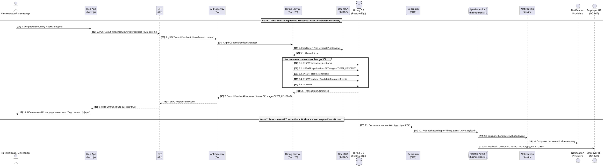

# Сквозной динамический процесс найма (Dynamic Diagram)

Динамическая диаграмма C4 (**Dynamic Diagram**) фиксирует поведение программной системы во времени, наглядно раскрывая хронологическую цепочку вызовов между компонентами, сервисами и внешними платформами при выполнении критически важного пользовательского сценария.

В рамках домена найма (**Hiring Domain**) ключевым сквозным процессом выступает:  
**«Фиксация результатов технического собеседования, отправка структурированного отзыва интервьюера (`SubmitFeedback`), ReBAC-авторизация прав оценщика, вычисление доменной политики готовности к офферу (`OfferEligibilityPolicy`), атомарный переход конечного автомата (FSM) заявки в стадию `OFFER_PENDING`, создание записи аудита `StageTransition`, возврат синхронного подтверждения пользователю (200 OK) и гарантированная публикация доменного события через паттерн `Transactional Outbox` (CDC Debezium / Apache Kafka) с нотификацией соискателя и синхронизацией внешней HR-системы»**.

```plantuml
@startuml
!include architecture/c4/plantuml/dynamic/member2-dynamic.puml
@enduml
```

---

## 1. Архитектурный контекст сценария

Сценарий органично объединяет два потока обработки данных:
1. **Синхронный контур (Request-Response, Шаги 1–10)**: Обработка действия нанимающего менеджера в веб-интерфейсе, проверка прав, выполнение транзакции изменения состояния воронки и обязательный возврат актуального статуса в пользовательский интерфейс.
2. **Асинхронный контур (Event-Driven, Шаги 11–15)**: Фоновая доставка доменного события через Transactional Outbox, CDC Debezium и шину Kafka с оповещением соискателя и обновлением кадровой системы предприятия.

В цепочке задействованы следующие контейнеры и узлы:
* **Web Application** (Next.js / React) — фронтенд-интерфейс нанимающего менеджера.
* **BFF (Backend for Frontend)** — сессионный фасад, валидирующий `HttpOnly`-куки и авторизационные заголовки.
* **API Gateway** — шлюз платформы, обеспечивающий rate limiting, распределённую трассировку W3C и передачу доверенного identity context.
* **Hiring Service** — микросервис бизнес-логики найма на Go 1.23+, управляющий жизненным циклом откликов, собеседований и офферов.
* **OpenFGA** — специализированный движок авторизации на основе отношений (ReBAC).
* **Hiring DB** (PostgreSQL 16) — реляционная база данных, хранящая состояние агрегатов и таблицу `outbox`.
* **Debezium Connector** — сервис захвата изменений данных (Change Data Capture, CDC), считывающий журнал `PostgreSQL WAL`.
* **Apache Kafka (KRaft)** — распределённый брокер сообщений, обеспечивающий надёжную доставку доменных событий.
* **Notification Service** — сервис мультиканальной рассылки оповещений.
* **Notification Providers** (SendGrid, FCM) — внешние коммуникационные платформы.
* **Employer HR System** (1С:ЗУП / Workday) — внешняя учётная HR-система предприятия.

---

## 2. Подробная хронология и спецификация этапов (Шаги 1–15)

### Фаза А. Синхронный поток обработки запроса (Шаги 1–6)

#### Шаг 1. Отправка фидбека интервьюера (Web Application)
* **Инициатор**: Нанимающий руководитель (Hiring Manager) / Ведущий интервьюер.
* **Получатель**: `Web Application` (Next.js).
* **Протокол и порт**: `HTTPS / TLS 1.3`, порт `443`.
* **Операция**: Клиентское действие отправки формы в браузере `submitFeedbackForm()`.
* **Входные данные (Payload)**:
  ```json
  {
    "interviewId": "a8c9b2e1-4567-489a-bcde-123456789abc",
    "score": 5,
    "summary": "Кандидат продемонстрировал глубокие знания Go, многопоточности и архитектуры C4.",
    "recommendation": "STRONG_HIRE"
  }
  ```

#### Шаг 2. Проксирование вызова через сессионный слой (BFF)
* **Инициатор**: `Web Application`.
* **Получатель**: `BFF (Backend for Frontend)`.
* **Протокол и порт**: `HTTPS / JSON`, порт `443` (внутренняя сеть).
* **Операция**: `POST /api/hiring/interviews/{interviewId}/feedback`.
* **Логика**: BFF извлекает сессионную куку `__Host-Careeria-Session`, расшифровывает её, проверяет наличие CSRF-токена в заголовке `X-CSRF-Token`, извлекает действующий access token и формирует внутренний gRPC-запрос.

#### Шаг 3. Авторизованный вызов шлюза платформы (API Gateway)
* **Инициатор**: `BFF`.
* **Получатель**: `API Gateway`.
* **Протокол и порт**: `gRPC / HTTP2`, порт `50051`.
* **Операция**: `careeria.api.v1.GatewayService/RouteHiringCall`.
* **Логика**: API Gateway генерирует сквозной `X-Request-ID`, считывает заголовки W3C Trace Context (`traceparent`), выполняет проверку rate limiting на основе IP/Tenant и передаёт доверенные метаданные в gRPC Metadata (`x-user-id`, `x-company-id`, `x-roles`).

#### Шаг 4. Вызов RPC-метода Hiring Service
* **Инициатор**: `API Gateway`.
* **Получатель**: `Hiring Service` (`gRPC Server`).
* **Протокол и порт**: `gRPC / HTTP2`, сетевой порт `:50053`.
* **Операция**: `careeria.hiring.v1.HiringService/SubmitFeedback`.
* **Контракт вызова (Protobuf DTO)**:
  ```protobuf
  message SubmitFeedbackRequest {
    string interview_id = 1 [(validate.rules).string.uuid = true];
    int32 score = 2 [(validate.rules).int32 = {gte: 1, lte: 5}];
    string comment = 3 [(validate.rules).string.min_len = 10];
  }
  ```

#### Шаг 5. Проверка гранулярных прав ReBAC (OpenFGA)
* **Инициатор**: `Hiring Service` (`Authorization Client`).
* **Получатель**: `OpenFGA`.
* **Протокол и порт**: `gRPC / mTLS`, сетевой порт `:8081`.
* **Операция**: `openfga.v1.OpenFGAService/Check`.
* **Контракт вызова**: `user: <UUID>, relation: "can_evaluate", object: "interview:<UUID>"`. При положительном ответе сервис переходит к транзакции.

#### Шаг 6. Доменные политики, FSM-переход и транзакция в Hiring DB
* **Инициатор**: `Hiring Service` (слой `Application / Domain`).
* **Получатель**: `Hiring DB` (PostgreSQL 16).
* **Протокол и порт**: `SQL / TCP`, порт `:5432`.
* **Операция**: Физическая транзакция PostgreSQL: `BEGIN ... COMMIT`.
* **Внутренняя логика**:
  1. Создаётся запись `interview_feedbacks`, статус интервью обновляется на `COMPLETED`.
  2. Вычисляется чистая доменная функция `policy.CanInitiateOffer(application, interviewSummaries)` (проходной балл `>= 4`).
  3. Конечный автомат (FSM) переводит заявку в статус `PipelineStage.OFFER_PENDING`.
  4. Создаётся неизменяемая запись аудита `stage_transitions`.
  5. В служебную таблицу `outbox` сериализуется событие `CandidateEvaluatedEvent`.
  6. Выполняется `COMMIT`.

---

### Фаза Б. Возврат ответа пользователю (Шаги 7–10)

#### Шаг 7. Возврат статуса операции из Hiring Service
* **Инициатор**: `Hiring Service`.
* **Получатель**: `API Gateway`.
* **Протокол и порт**: `gRPC / HTTP2`, порт `:50053`.
* **Ответ (Protobuf Response)**:
  ```protobuf
  message SubmitFeedbackResponse {
    string interview_id = 1;
    string application_id = 2;
    string current_stage = 3; // "OFFER_PENDING"
    google.protobuf.Timestamp updated_at = 4;
  }
  ```
* **Логика**: Сервис возвращает статус gRPC `codes.OK` вместе с обновлённым состоянием воронки найма.

#### Шаг 8. Трансляция ответа шлюзом API
* **Инициатор**: `API Gateway`.
* **Получатель**: `BFF`.
* **Протокол и порт**: `gRPC / HTTP2`.
* **Логика**: Gateway проверяет корректность завершения сеанса, добавляет метрики латентности в OpenTelemetry span и проксирует ответ клиенту BFF.

#### Шаг 9. Формирование HTTP-ответа клиенту (BFF)
* **Инициатор**: `BFF`.
* **Получатель**: `Web Application`.
* **Протокол и порт**: `HTTPS / JSON`, статус `200 OK`.
* **Тело ответа (JSON Payload)**:
  ```json
  {
    "success": true,
    "interviewId": "a8c9b2e1-4567-489a-bcde-123456789abc",
    "applicationId": "d4e5f6a7-1234-5678-9abc-def012345678",
    "stage": "OFFER_PENDING",
    "message": "Оценка успешно зафиксирована. Кандидат переведён на этап подготовки оффера."
  }
  ```

#### Шаг 10. Обновление пользовательского интерфейса (Web Application)
* **Инициатор**: `Web Application` (браузер клиента).
* **Получатель**: Нанимающий руководитель (Hiring Manager).
* **Логика**: Фронтенд (TanStack Query) инвалидирует кэш воронки найма, карточка кандидата автоматически перемещается в колонку `Подготовка оффера (Offer Pending)`, и отображается всплывающее уведомление (Toast) об успешном сохранении результатов.

---

### Фаза В. Асинхронная доставка событий и интеграция (Шаги 11–15)

#### Шаг 11. CDC-захват изменений из журнала WAL (Debezium)
* **Инициатор**: `Hiring DB` (PostgreSQL WAL).
* **Получатель**: `Debezium Connector`.
* **Протокол и порт**: `pgoutput Logical Replication`, порт `:5432`.
* **Логика**: Debezium вычитывает строку таблицы `outbox` из слота репликации `careeria_hiring_slot` без накладных расходов периодического polling-опроса.

#### Шаг 12. Публикация доменного события в Apache Kafka
* **Инициатор**: `Debezium Connector`.
* **Получатель**: `Apache Kafka` (топик `hiring.events`).
* **Протокол и порт**: `Kafka Protocol / TCP`, порт `:9092`.
* **Формат данных**: Бинарный Avro payload с подтверждением `acks=all`.

#### Шаг 13. Асинхронное получение события Notification Service
* **Инициатор**: `Apache Kafka`.
* **Получатель**: `Notification Service`.
* **Протокол и порт**: `Kafka Consumer Protocol / TCP`.
* **Логика**: Сервис вычитывает сообщение в группе `careeria.notifications.group`, проверяет ключ идемпотентности и коммитит offset.

#### Шаг 14. Оповещение соискателя (Notification Providers)
* **Инициатор**: `Notification Service`.
* **Получатель**: `Notification Providers` (SendGrid / FCM).
* **Протокол и порт**: `HTTPS / REST API`, порт `:443`.
* **Логика**: Соискателю отправляется персонализированное письмо и push-уведомление об успешном прохождении собеседования и переводе на этап формирования предложения о работе.

#### Шаг 15. Синхронизация статуса во внешней HR-системе работодателя
* **Инициатор**: `Kafka` / `Integration Service`.
* **Получатель**: `Employer HR System` (1С:ЗУП / Workday).
* **Протокол и порт**: `HTTPS / Webhooks`, порт `:443`.
* **Логика**: Запрос с заголовком подписи `X-Careeria-Signature` синхронизирует статус отклика в корпоративной системе кадрового учёта.

---

## 3. Сводная спецификация параметров динамического процесса

| № шага | Направление | Инициатор вызова | Целевой элемент | Вызываемый интерфейс / операция | Протокол / Порт | Формат данных | Тип взаимодействия | SLA / Таймаут |
|:---:|:---:|---|---|---|:---:|---|:---:|:---:|
| **1** | Запрос | Нанимающий менеджер | Web Application | `submitFeedbackForm()` | HTTPS / 443 | JSON DTO | Синхронный | < 50 мс |
| **2** | Запрос | Web Application | BFF | `POST /api/hiring/interviews/{id}/feedback` | HTTPS / 443 | JSON + Cookie | Синхронный | < 100 мс |
| **3** | Запрос | BFF | API Gateway | `GatewayService/RouteHiringCall` | gRPC / 50051 | Protobuf + Metadata | Синхронный | < 150 мс |
| **4** | Запрос | API Gateway | Hiring Service | `HiringService/SubmitFeedback` | gRPC / 50053 | Protobuf DTO | Синхронный | < 200 мс |
| **5** | Запрос | Hiring Service | OpenFGA | `OpenFGAService/Check` | gRPC / 8081 | Protobuf ReBAC Tuple | Синхронный | < 20 мс |
| **6** | Запрос | Hiring Service | Hiring DB | `SQL Transaction (BEGIN ... COMMIT)` | SQL / 5432 | SQL Statements | Синхронный | < 50 мс |
| **7** | **Ответ** | **Hiring Service** | **API Gateway** | **`SubmitFeedbackResponse`** | **gRPC / 50053** | **Protobuf Response** | **Синхронный** | **< 30 мс** |
| **8** | **Ответ** | **API Gateway** | **BFF** | **gRPC Response forward** | **gRPC / 50051** | **Protobuf Response** | **Синхронный** | **< 30 мс** |
| **9** | **Ответ** | **BFF** | **Web Application** | **`HTTP 200 OK (JSON Status)`** | **HTTPS / 443** | **JSON Payload** | **Синхронный** | **< 50 мс** |
| **10** | **Ответ** | **Web Application** | **Нанимающий менеджер** | **Рендеринг UI (Toast + воронка)** | **UI Event** | **DOM / React State** | **Клиентский** | **< 16 мс** |
| **11** | Событие | Hiring DB | Debezium Connector | Потоковое чтение PostgreSQL WAL | WAL / 5432 | Бинарный pgoutput WAL | Асинхронный (CDC) | < 100 мс |
| **12** | Событие | Debezium Connector | Apache Kafka | `ProduceRecord(hiring.events)` | Kafka / 9092 | Apache Avro Binary | Асинхронный | < 50 мс |
| **13** | Событие | Apache Kafka | Notification Service | `FetchRecord(hiring.events)` | Kafka / 9092 | Apache Avro Binary | Асинхронный | < 50 мс |
| **14** | Событие | Notification Service | Notification Providers | `SendTransactionalEmail / Push` | HTTPS / 443 | JSON Payload | Асинхронный | < 1.5 с |
| **15** | Событие | Integration Service | Employer HR System | `POST /webhooks/careeria/status` | HTTPS / 443 | JSON + HMAC SHA-256 | Асинхронный | < 2.0 с |

---

## 4. Сквозная диаграмма последовательности (Sequence Diagram)

Полная сквозная диаграмма наглядно демонстрирует обе фазы — завершённый цикл синхронного ответа клиенту и параллельную фоновую доставку событий:



---

## 5. Граничные сценарии и матрица обработки ошибок

| Возникающая исключительная ситуация | Слой обнаружения | Доменная ошибка | HTTP / gRPC код ответа | Архитектурная реакция и компенсация |
|---|---|---|---|---|
| Интервьюер не привязан к собеседованию или не имеет роли оценщика | OpenFGA / Authz Client | `ErrUnauthorizedEvaluator` | `403 Forbidden` / `codes.PermissionDenied` | Прерывание транзакции. Логирование попытки несанкционированного доступа в журнал аудита безопасности. |
| Оценка за данное интервью уже была выставлена ранее | Domain Aggregate (Interview) | `ErrFeedbackAlreadySubmitted` | `409 Conflict` / `codes.FailedPrecondition` | Повторное выставление запрещено бизнес-инвариантом. Возврат подробностей ошибки `google.rpc.ErrorInfo`. |
| Параллельная смена этапа другим оператором (несовпадение `version`) | Infrastructure (pgx/sqlc) | `ErrOptimisticLockConflict` | `409 Conflict` / `codes.Aborted` | Откат транзакции. Клиенту возвращается предложение обновить данные воронки и повторить операцию. |
| Собеседование завершено с оценкой ниже проходного балла (`score < 4`) | Domain Policy (`OfferEligibilityPolicy`) | `ErrCandidateNotEligibleForOffer` | `422 Unprocessable Entity` / `codes.FailedPrecondition` | Оценка сохраняется в базе, однако автопереход в `OFFER_PENDING` блокируется. Рекрутеру направляется предложение перевести кандидата в архив или назначить повторный раунд. |
| Сетевой сбой доставки письма через SendGrid | Notification Service | `ErrExternalGatewayTimeout` | Внутренняя ошибка консьюмера | Сообщение в Kafka не коммитится, отправляется в очередь отложенной повторной доставки (Retry Topic) с экспоненциальной задержкой. |

---

[Ландшафт L0](../members/member2/landscape/member2-l0-landscape.md) · [Контекст L1](../members/member2/context%28L1%29/index.md) · [Контейнеры L2](../members/member2/context%28L1%29/containers%28L2%29/index.md) · [Развёртывание](../members/member2/deployment/member2-deployment.md) · [Раздел Member 2](../members/member2/README.md)
