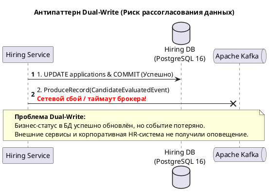
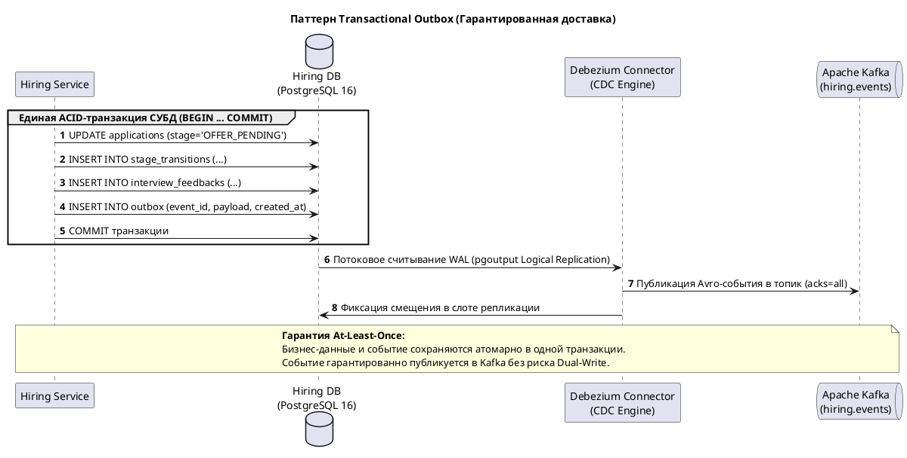

# Сквозной динамический процесс найма (Dynamic Diagram)

Динамическая диаграмма C4 (**Dynamic Diagram**) фиксирует поведение программной системы во времени, наглядно раскрывая хронологическую цепочку вызовов между компонентами, сервисами и внешними платформами при выполнении критически важного пользовательского сценария.

В рамках домена найма (**Hiring Domain**) ключевым сквозным процессом выступает:  
**«Фиксация результатов технического собеседования, отправка структурированного отзыва интервьюера (`SubmitFeedback`), ReBAC-авторизация прав оценщика, вычисление чистой доменной политики готовности к офферу (`OfferEligibilityPolicy`), атомарный переход конечного автомата (FSM) заявки в стадию `OFFER_PENDING`, создание записи аудита `StageTransition` и гарантированная публикация доменного события через паттерн `Transactional Outbox` (CDC Debezium / Apache Kafka) с нотификацией соискателя и синхронизацией внешней HR-системы»**.

```plantuml
@startuml
!include architecture/c4/plantuml/dynamic/member2-dynamic.puml
@enduml
```

---

## 1. Архитектурный контекст сценария

Сценарий демонстрирует переход от **синхронного пользовательского потока** (обработка HTTP-запроса от нанимающего менеджера и внутренний gRPC-вызов) к **асинхронной событийно-ориентированной интеграции** (Event-Driven Architecture) через гарантированную шину сообщений.

В цепочке задействованы следующие контейнеры и узлы:
* **Web Application** (Next.js / React) — фронтенд-интерфейс нанимающего менеджера.
* **BFF (Backend for Frontend)** — сессионный фасад, валидирующий `HttpOnly`-куки и авторизационные заголовки.
* **API Gateway** — шлюз платформы, обеспечивающий rate limiting, распределённую трассировку W3C и передачу доверенного identity context.
* **Hiring Service** — микросервис бизнес-логики найма на Go 1.23+, управляющий жизненным циклом откликов, собеседований и офферов.
* **OpenFGA** — специализированный движок авторизации на основе отношений (ReBAC).
* **Hiring DB** (PostgreSQL 16) — реляционная база данных, хранящая состояние агрегатов и таблицу `outbox`.
* **Debezium Connector** — сервис захвата изменений данных (Change Data Capture, CDC), считывающий журнал `PostgreSQL WAL`.
* **Apache Kafka (KRaft)** — распределённый брокер сообщений, обеспечивающий надёжную доставку доменных событий.
* **Notification Service** — сервис мультиканальной рассылки оповещений.
* **Notification Providers** (SendGrid, FCM) — внешние коммуникационные платформы.
* **Employer HR System** (1С:ЗУП / Workday) — внешняя учётная HR-система предприятия.

---

## 2. Подробная хронология и спецификация этапов (Шаги 1–11)

### Шаг 1. Отправка фидбека интервьюера (Web Application)
* **Инициатор**: Нанимающий руководитель (Hiring Manager) / Ведущий интервьюер.
* **Получатель**: `Web Application` (Next.js).
* **Протокол и порт**: `HTTPS / TLS 1.3`, порт `443`.
* **Операция**: Клиентское действие отправки формы в браузере `submitFeedbackForm()`.
* **Входные данные (Payload)**:
  ```json
  {
    "interviewId": "a8c9b2e1-4567-489a-bcde-123456789abc",
    "score": 5,
    "summary": "Кандидат продемонстрировал глубокие знания Go, многопоточности и архитектуры C4.",
    "recommendation": "STRONG_HIRE"
  }
  ```
* **Логика**: На стороне браузера библиотека Zod производит валидацию формы: оценка `score` обязана быть целым числом в интервале `[1..5]`, текстовый комментарий не должен быть пустым.

### Шаг 2. Проксирование вызова через сессионный слой (BFF)
* **Инициатор**: `Web Application`.
* **Получатель**: `BFF (Backend for Frontend)`.
* **Протокол и порт**: `HTTPS / JSON`, порт `443` (внутренняя сеть).
* **Операция**: `POST /api/hiring/interviews/{interviewId}/feedback`.
* **Логика**: BFF извлекает сессионную куку `__Host-Careeria-Session`, расшифровывает её, проверяет наличие CSRF-токена в заголовке `X-CSRF-Token`, извлекает действующий access token (или выполняет refresh токена при необходимости) и формирует внутренний gRPC-запрос.

### Шаг 3. Авторизованный вызов шлюза платформы (API Gateway)
* **Инициатор**: `BFF`.
* **Получатель**: `API Gateway`.
* **Протокол и порт**: `gRPC / HTTP2`, порт `50051`.
* **Операция**: `careeria.api.v1.GatewayService/RouteHiringCall`.
* **Логика**: API Gateway генерирует сквозной `X-Request-ID`, считывает заголовки W3C Trace Context (`traceparent`), выполняет проверку rate limiting на основе IP/Tenant и транслирует запрос в доверенный внутренний контекст:
  ```protobuf
  // Доверенные метаданные, передаваемые в gRPC Metadata:
  // x-user-id: "77d2c3e4-...."
  // x-company-id: "33b1a2c3-...."
  // x-roles: "HIRING_MANAGER"
  ```

### Шаг 4. Вызов RPC-метода Hiring Service
* **Инициатор**: `API Gateway`.
* **Получатель**: `Hiring Service` (`gRPC Server` / Inbound Presentation Handler).
* **Протокол и порт**: `gRPC / HTTP2`, сетевой порт `:50053`.
* **Операция**: `careeria.hiring.v1.HiringService/SubmitFeedback`.
* **Контракт вызова (Protobuf DTO)**:
  ```protobuf
  message SubmitFeedbackRequest {
    string interview_id = 1 [(validate.rules).string.uuid = true];
    int32 score = 2 [(validate.rules).int32 = {gte: 1, lte: 5}];
    string comment = 3 [(validate.rules).string.min_len = 10];
  }
  ```
* **Логика**: gRPC Interceptor перехватывает вызов, проверяет валидацию Protobuf Validate (PGV) и передаёт управление в прикладной сценарий `usecase.InterviewService.SubmitFeedback()`.

### Шаг 5. Проверка гранулярных прав ReBAC (OpenFGA)
* **Инициатор**: `Hiring Service` (`Authorization Client`).
* **Получатель**: `OpenFGA`.
* **Протокол и порт**: `gRPC / mTLS`, сетевой порт `:8081`.
* **Операция**: `openfga.v1.OpenFGAService/Check`.
* **Контракт вызова**:
  ```protobuf
  message CheckRequest {
    string tuple_key_user = "user:77d2c3e4-....";
    string tuple_key_relation = "can_evaluate";
    string tuple_key_object = "interview:a8c9b2e1-....";
  }
  ```
* **Инварианты**:
  * Кандидаты (`role: CANDIDATE`) и наблюдатели (`role: OBSERVER`) не обладают правом выставления оценок (правило доменного Value Object `ParticipantRole.CanEvaluate() == false`).
  * Если пользователь не прикреплён к интервью в роли `LEAD_INTERVIEWER` или `HIRING_MANAGER`, OpenFGA возвращает `allowed: false`.
  * В случае отказа `Hiring Service` прерывает сценарий с ошибкой `apperr.Forbidden` (gRPC статус `codes.PermissionDenied`).

### Шаг 6. Доменные политики, FSM-переход и транзакция в Hiring DB
* **Инициатор**: `Hiring Service` (слой `Application / Domain`).
* **Получатель**: `Hiring DB` (PostgreSQL 16).
* **Протокол и порт**: `SQL / TCP`, порт `:5432`.
* **Операция**: Единая физическая транзакция PostgreSQL: `BEGIN ... COMMIT`.
* **Внутренняя логика обработки**:
  1. **Фиксация Feedback**: `Interview Service` загружает агрегат `Interview` из репозитория. Проверяется инвариант: статус встречи обязан быть `SCHEDULED`. Вызывается доменный метод `interview.SubmitFeedback(authorID, score, comment)`. Создаётся дочерняя сущность `Feedback`, статус интервью обновляется на `COMPLETED`. Запрещено повторное редактирование уже отправленной оценки.
  2. **Вычисление политики допуска (`OfferEligibilityPolicy`)**: `Interview Service` передаёт факт завершения встречи в `Application Service`. Компонент загружает агрегат `JobApplication` и коллекцию всех проекций интервью по отклику `[]InterviewSummary`. Вызывается чистая доменная функция:
     ```go
     // Чистая функция без I/O:
     canPromote := policy.CanInitiateOffer(application, interviewSummaries)
     ```
     Политика возвращает `true`, если:
     * Текущая стадия отклика строго равна `PipelineStage.INTERVIEW`;
     * Присутствует хотя бы одно собеседование в статусе `COMPLETED` с признаком `hasFeedback == true`;
     * Средний балл удовлетворяет проходному критерию (`score >= 4`).
  3. **Переход конечного автомата (FSM)**:
     * Вызывается метод агрегата `application.ChangeStage(PipelineStage.OFFER_PENDING, actorID, "Interview passed successfully")`.
     * Метод агрегата проверяет допустимость перехода через таблицу матричных переходов `canTransitionTo(target)`.
     * В коллекцию агрегата добавляется неизменяемая сущность аудита `StageTransition` (from: `INTERVIEW`, to: `OFFER_PENDING`, changedBy: UUID, timestamp: NOW).
     * Значение поля версии инкрементируется: `version = version + 1` (Optimistic Concurrency Control).
  4. **Запись в Transactional Outbox**: В служебную таблицу `outbox` в этой же транзакции сериализуется доменное событие:
     ```sql
     INSERT INTO outbox (id, aggregate_type, aggregate_id, event_type, payload, created_at)
     VALUES (gen_random_uuid(), 'application', 'app-uuid', 'CandidateEvaluatedEvent', '{...}', NOW());
     ```
  5. **Фиксация**: Выполняется SQL `COMMIT`. При конфликте версий отклика транзакция откатывается (`ROLLBACK`) с ошибкой `apperr.Conflict` (`codes.FailedPrecondition`).

### Шаг 7. CDC-захват изменений из журнала WAL (Debezium)
* **Инициатор**: `Hiring DB` (PostgreSQL WAL).
* **Получатель**: `Debezium Connector`.
* **Протокол и порт**: `PostgreSQL Logical Replication Protocol (pgoutput)`, порт `:5432`.
* **Операция**: Потоковое непрерывное чтение журнала упреждающей записи WAL.
* **Логика**: Debezium подписан на слот репликации `careeria_hiring_slot`. Как только транзакция из Шага 6 фиксируется в WAL, коннектор мгновенно десериализует строку таблицы `outbox` без выполнения тяжелых периодических SQL-опросов (Polling-free CDC).

### Шаг 8. Публикация доменного события в Apache Kafka
* **Инициатор**: `Debezium Connector`.
* **Получатель**: `Apache Kafka` (Cluster Brokers).
* **Протокол и порт**: `Kafka Protocol / TCP`, порт `:9092`.
* **Операция**: `ProduceRecord(topic="hiring.events")`.
* **Формат данных**: Бинарный Avro payload, валидированный реестром схем Apicurio Schema Registry:
  ```json
  {
    "eventId": "e9b1c2d3-4567-89ab-cdef-0123456789ab",
    "eventType": "careeria.hiring.CandidateEvaluatedEvent",
    "aggregateId": "app-uuid",
    "candidateId": "cand-uuid",
    "vacancyId": "vac-uuid",
    "previousStage": "INTERVIEW",
    "newStage": "OFFER_PENDING",
    "finalScore": 5,
    "timestamp": 1730725200000
  }
  ```
* **Гарантии**: Доставка производится с подтверждением `acks=all` (все реплики брокера синхронизированы), обеспечивая гарантию доставки **At-Least-Once**.

### Шаг 9. Асинхронное получение события Notification Service
* **Инициатор**: `Apache Kafka`.
* **Получатель**: `Notification Service`.
* **Протокол и порт**: `Kafka Consumer Protocol / TCP`, топик `hiring.events`.
* **Операция**: `FetchRecord()`.
* **Логика**: Воркер сервиса уведомлений вычитывает сообщение в рамках консьюмер-группы `careeria.notifications.group`, проверяет ключ дедупликации (Idempotency Key) во избежание повторной отправки и подтверждает смещение (Commit Offset).

### Шаг 10. Оповещение соискателя (Notification Providers)
* **Инициатор**: `Notification Service`.
* **Получатель**: `Notification Providers` (SendGrid / FCM).
* **Протокол и порт**: `HTTPS / REST API`, порт `:443`.
* **Операция**: `POST https://api.sendgrid.com/v3/mail/send`.
* **Логика**: Сервис формирует персонализированное письмо соискателю с темой: *«Успешное завершение технического собеседования в компанию Careeria»*, информируя, что кандидатура переведена на этап подготовки условий джоб-оффера.

### Шаг 11. Синхронизация статуса во внешней HR-системе работодателя
* **Инициатор**: `Kafka` / `Integration Service`.
* **Получатель**: `Employer HR System` (1С:ЗУП / Workday).
* **Протокол и порт**: `HTTPS / Webhooks`, порт `:443`.
* **Операция**: `POST /webhooks/careeria/application-status`.
* **Безопасность**: Запрос снабжается заголовком `X-Careeria-Signature: sha256=...` (вычисленный HMAC от тела запроса с использованием корпоративного секрета). Корпоративная кадровая система обновляет внутреннюю карточку претендента на открытую вакансию.

---

## 3. Сводная спецификация параметров динамического процесса

| № шага | Инициатор вызова | Целевой элемент | Вызываемый интерфейс / операция | Сетевой протокол | Порт назначения | Формат данных | Тип взаимодействия | SLA / Таймаут |
|:---:|---|---|---|---|:---:|---|:---:|:---:|
| **1** | Нанимающий менеджер | Web Application | `submitFeedbackForm()` | HTTPS / TLS 1.3 | 443 | JSON DTO | Синхронный | < 50 мс |
| **2** | Web Application | BFF | `POST /api/hiring/interviews/{id}/feedback` | HTTPS / JSON | 443 | JSON + Cookie | Синхронный | < 100 мс |
| **3** | BFF | API Gateway | `GatewayService/RouteHiringCall` | gRPC / HTTP2 | 50051 | Protobuf + W3C Context | Синхронный | < 150 мс |
| **4** | API Gateway | Hiring Service | `HiringService/SubmitFeedback` | gRPC / HTTP2 | 50053 | Protobuf DTO | Синхронный | < 200 мс |
| **5** | Hiring Service | OpenFGA | `OpenFGAService/Check` | gRPC / mTLS | 8081 | Protobuf ReBAC Tuple | Синхронный | < 20 мс |
| **6** | Hiring Service | Hiring DB | `SQL Transaction (BEGIN ... COMMIT)` | SQL / TCP | 5432 | SQL Statements | Синхронный | < 50 мс |
| **7** | Hiring DB | Debezium Connector | Потоковое чтение PostgreSQL WAL | Logical Replication | 5432 | Бинарный pgoutput WAL | Асинхронный (CDC) | < 100 мс |
| **8** | Debezium Connector | Apache Kafka | `ProduceRecord(hiring.events)` | Kafka Protocol | 9092 | Apache Avro Binary | Асинхронный | < 50 мс |
| **9** | Apache Kafka | Notification Service | `FetchRecord(hiring.events)` | Kafka Protocol | 9092 | Apache Avro Binary | Асинхронный | < 50 мс |
| **10** | Notification Service | Notification Providers | `SendTransactionalEmail` | HTTPS / REST API | 443 | JSON Payload | Асинхронный | < 1.5 с |
| **11** | Integration Service | Employer HR System | `POST /webhooks/careeria/status` | HTTPS / Webhook | 443 | JSON + HMAC SHA-256 | Асинхронный | < 2.0 с |

---

## 4. Транзакционная модель и реализация Transactional Outbox

В высоконагруженных распределённых архитектурах прямое обращение к брокеру сообщений из кода прикладного сервиса (**Dual-Write Pattern**) является грубым антипаттерном:



Для обеспечения строгой согласованности данных в Hiring Service реализован паттерн **Transactional Outbox**:



### Преимущества архитектурного решения:
1. **Атомарность**: Бизнес-изменения и событие публикации фиксируются в едином коммите СУБД. Либо сохраняются все сущности, либо ни одна.
2. **Нулевой оверхед на опрос (No Polling)**: В отличие от устаревших Outbox-воркеров, выполняющих `SELECT ... FROM outbox FOR UPDATE`, Debezium считывает бинарный поток WAL на уровне физического движка PostgreSQL, не создавая нагрузки на процессор и диск СУБД.
3. **Гарантия упорядоченности (Strict Ordering)**: События по одному отклику шардируются в Kafka по ключу `aggregateId` (`candidateId`), гарантируя сохранение строго хронологического порядка их обработки консьюмерами в рамках одного раздела (partition).

---

## 5. Граничные сценарии и матрица обработки ошибок

| Возникающая исключительная ситуация | Слой обнаружения | Доменная ошибка | HTTP / gRPC код ответа | Архитектурная реакция и компенсация |
|---|---|---|---|---|
| Интервьюер не привязан к собеседованию или не имеет роли оценщика | OpenFGA / Authz Client | `ErrUnauthorizedEvaluator` | `403 Forbidden` / `codes.PermissionDenied` | Прерывание транзакции. Логирование попытки несанкционированного доступа в журнал аудита безопасности. |
| Оценка за данное интервью уже была выставлена ранее | Domain Aggregate (Interview) | `ErrFeedbackAlreadySubmitted` | `409 Conflict` / `codes.FailedPrecondition` | Повторное выставление запрещено бизнес-инвариантом. Возврат подробностей ошибки `google.rpc.ErrorInfo`. |
| Параллельная смена этапа другим оператором (несовпадение `version`) | Infrastructure (pgx/sqlc) | `ErrOptimisticLockConflict` | `409 Conflict` / `codes.Aborted` | Откат транзакции. Клиенту возвращается предложение обновить данные воронки и повторить операцию. |
| Собеседование завершено с оценкой ниже проходного балла (`score < 4`) | Domain Policy (`OfferEligibilityPolicy`) | `ErrCandidateNotEligibleForOffer` | `422 Unprocessable Entity` / `codes.FailedPrecondition` | Оценка сохраняется в базе, однако автопереход в `OFFER_PENDING` блокируется. Рекрутеру направляется предложение перевести кандидата в архив или назначить повторный раунд. |
| Сетевой сбой доставки письма через SendGrid | Notification Service | `ErrExternalGatewayTimeout` | Внутренняя ошибка консьюмера | Сообщение в Kafka не коммитится, отправляется в очередь отложенной повторной доставки (Retry Topic) с экспоненциальной задержкой. |

---

[Ландшафт L0](member2-l0-landscape.md) · [Контекст L1](member2-l1-context.md) · [Контейнеры L2](member2-l2-containers.md) · [Развёртывание](member2-deployment.md)
