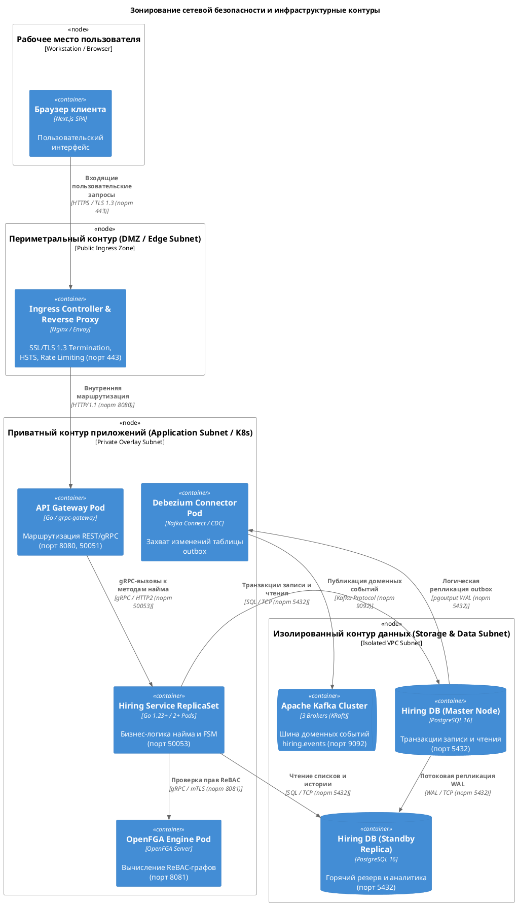

# Диаграмма развёртывания подсистемы Hiring Service (Level 2: Deployment)

Диаграмма развёртывания C4 (**Deployment Diagram, Level 2**) отображает отображение программных контейнеров подсистемы найма (**Hiring Domain** платформы **Careeria**) на физическую и виртуальную вычислительную инфраструктуру, топологию сетевых контуров, узлы отказоустойчивости и параметры сетевой безопасности.

Диаграмма разработана в соответствии с требованиями индустриального стандарта к облачным микросервисным решениям, раскрывая топологию распределения сервисов в кластере **Kubernetes**, репликацию СУБД **PostgreSQL (Patroni HA)**, кластеризацию **Apache Kafka (KRaft)** и граничные шлюзы взаимодействия с внешними SaaS-платформами.

```plantuml
@startuml
!include architecture/c4/plantuml/members/member2/deployment/member2-deployment.puml
@enduml
```

---

## 1. Архитектура инфраструктурных зон и сетевой периметр

Инфраструктура платформы разделена на три изолированные зоны безопасности (**Security Zones**) с детерминированными правилами сетевой фильтрации (Kubernetes `NetworkPolicies` и Cloud Security Groups):



---

## 2. Спецификация вычислительных узлов и сред выполнения (Deployment Nodes)

| Узел инфраструктуры | Тип среды выполнения | Хостовая платформа / Ресурсы | Размещённые контейнеры и поды | Служебная роль и зона ответственности |
|---|---|---|---|---|
| **Рабочее место пользователя** | Физическое устройство | Windows / macOS / Linux / iOS / Android | `Web Client (Next.js SPA)` | Интерактивный интерфейс браузера соискателя и сотрудников нанимающей команды. |
| **Периметральный шлюз (DMZ)** | Виртуальный шлюз | Linux VM / K8s Edge Ingress (2 vCPU, 4 GB RAM) | `Ingress Controller (Nginx / Envoy)` | Фронтальный обратный прокси, SSL-терминация сертификатов, защита от DDoS, маршрутизация HTTP(S). |
| **Контур приложений: API Gateway** | Kubernetes Pod | K8s Worker Node (cgroups v2, 2 vCPU, 2 GB RAM) | `api-gateway` (Go 1.23) | Трансляция внешних REST-запросов в gRPC-вызовы микросервисов, инжекция трассировки OpenTelemetry. |
| **Контур приложений: Hiring Service** | Kubernetes Deployment | K8s Worker Nodes (High CPU, 4 vCPU, 4 GB RAM per pod) | `hiring-service` (Pod 1 & Pod 2) | Горизонтально масштабируемый инстанс бизнес-логики найма. Обработка RPC, FSM, фоновые воркеры. |
| **Контур приложений: OpenFGA** | Kubernetes Pod | K8s Worker Node (2 vCPU, 2 GB RAM) | `openfga` (OpenFGA Server) | Высокопроизводительный сервер вычисления графов ReBAC-авторизации отношений доступа. |
| **Контур приложений: Debezium** | Kubernetes Pod | K8s Worker Node (2 vCPU, 4 GB RAM) | `debezium-connector` | Потоковый агент Change Data Capture (CDC), непрерывно считывающий журнал упреждающей записи СУБД. |
| **Контур данных: PostgreSQL Master** | Выделенная ВМ / StatefulSet | Managed PostgreSQL VM (8 vCPU, 32 GB RAM, NVMe SSD) | `Hiring DB (Primary Node)` | Основной инстанс СУБД PostgreSQL 16. Приём транзакций на запись и чтение, генерация WAL-логов. |
| **Контур данных: PostgreSQL Replica** | Выделенная ВМ / StatefulSet | Managed PostgreSQL VM (8 vCPU, 32 GB RAM, NVMe SSD) | `Hiring DB (Standby Read Replica)` | Реплика горячего резерва в режиме Read-Only. Разгрузка мастера от тяжёлых аналитических выборок. |
| **Контур данных: Apache Kafka Cluster** | Кластер брокеров (3 узла) | Dedicated Storage VMs (4 vCPU, 16 GB RAM per broker) | `Kafka Brokers (KRaft)` | Отказоустойчивый распределённый журнал доменных событий. Хранение топика `hiring.events`. |
| **Внешняя медиаплатформа** | Распределённое SaaS-облако | LiveKit Cloud Global SFU Network | `LiveKit Server & Media Node` | Облачная медиаинфраструктура WebRTC для проведения защищённых видеособеседований. |
| **Корпоративная HR-система** | Корпоративный контур | On-Premise Enterprise VM / Private Cloud | `1С:ЗУП 8.3 / Workday HCM` | Главная система кадрового учёта компании-работодателя. |

---

## 3. Спецификация сетевых интерфейсов, портов и протоколов безопасности

| Исходный узел | Целевой узел | Описание сетевого взаимодействия | Протокол взаимодействия | Сетевой порт | Зона безопасности / Сегмент | Требования к шифрованию |
|---|---|---|---|:---:|---|---|
| Браузер пользователя | Ingress Controller | Доставка статики фронтенда, REST-запросы к API платформы | HTTPS / TLS 1.3 | 443 | Глобальная сеть (Internet) | TLS 1.3, шифр-сьюты ECDHE-RSA-AES256-GCM, HSTS |
| Ingress Controller | API Gateway Pod | Внутреннее проксирование запросов к API | HTTP / 1.1 | 8080 | Приватная сеть K8s Cluster | Внутрикластерный трафик (ClusterIP) |
| API Gateway Pod | Hiring Service Pods | Вызовы RPC-методов домена найма (`SubmitFeedback`, `ChangeStage` и др.) | gRPC / HTTP2 | 50053 | K8s Service Mesh / Overlay | Балансировка Round-Robin, mTLS (взаимные сертификаты) |
| Hiring Service Pod | OpenFGA Pod | Проверка ReBAC-полномочий на действия над объектами найма | gRPC / HTTP2 | 8081 | Внутренняя сеть K8s | Взаимный mTLS, корпоративный Root CA |
| Hiring Service Pod | PostgreSQL Master | Транзакции бизнес-логики: создание откликов, смена этапов, Outbox | SQL / TCP | 5432 | Приватная подсеть данных (VPC) | TLS Encrypted Socket, аутентификация SCRAM-SHA-256 |
| Hiring Service Pod | PostgreSQL Replica | Выборка списков кандидатов, истории переходов и воронки | SQL / TCP | 5432 | Приватная подсеть данных (VPC) | TLS Encrypted Socket, read-only pool connection |
| PostgreSQL Master | PostgreSQL Replica | Потоковая физическая репликация журнала транзакций | PostgreSQL WAL Streaming | 5432 | Изолированная сеть репликации | TLS 1.3, выделенный репликационный пользователь `replicator` |
| PostgreSQL Master | Debezium Connector | Логическая репликация строк служебной таблицы `outbox` | Logical Streaming (pgoutput) | 5432 | Приватная подсеть данных | TLS 1.3, слот логической репликации `careeria_hiring_slot` |
| Debezium Connector | Kafka Brokers | Публикация сериализованных Avro-событий найма в топик `hiring.events` | Kafka Protocol / TCP | 9092 | Сеть брокеров сообщений | SASL_SSL (SCRAM-SHA-512 + TLS 1.3), acks=all |
| Hiring Service Pod | LiveKit Cloud | Инициализация переговорных комнат, выпуск JWT-токенов участников | HTTPS / REST API | 7880 | Защищённый Egress в Интернет | TLS 1.3, авторизация по LiveKit API Key & Secret |
| Браузер пользователя | LiveKit Cloud | Аудио- и видеопотоки собеседования, демонстрация экрана | WebRTC / UDP & TCP | 7881 | Публичная сеть Интернет | DTLS-SRTP шифрование медиатрафика |
| API Gateway Pod | Корпоративная HR-система | Передача кадровых статусов и данных кандидатов | HTTPS / REST API | 443 | Защищённый корпоративный канал | Корпоративный VPN (IPsec) / mTLS, API Key |

---

## 4. Архитектура высокой доступности и отказоустойчивости (HA Topology)

### 4.1. Отказоустойчивость уровня приложений (Hiring Service ReplicaSet)
* Контейнер `Hiring Service` развёрнут как Kubernetes Deployment с минимальным количеством реплик **2** (распределены по разным физическим серверам K8s через правила `podAntiAffinity`).
* В кластере настроен **Horizontal Pod Autoscaler (HPA)**, масштабирующий количество подов до 10 при превышении порога загрузки CPU > 70% или задержки gRPC-запросов > 200 мс.
* Трафик распределяется через абстракцию `Kubernetes Service` (L4 балансировщик `kube-proxy` в режиме IPVS) с поддержкой протокола `gRPC keepalive` для долгоживущих HTTP/2 соединений.
* Проверки жизнеспособности подов:
  * `livenessProbe`: gRPC Health Checking Protocol (`/grpc.health.v1.Health/Check`) каждые 10 секунд.
  * `readinessProbe`: проверка доступности пула соединений PostgreSQL Master каждые 5 секунд.

### 4.2. Отказоустойчивость уровня данных (PostgreSQL Patroni Cluster)
* Кластер СУБД развёрнут на базе архитектуры **Patroni HA**:
  * **Master (Primary Node)**: принимает все транзакции на чтение и запись.
  * **Replica (Standby Node)**: непрерывно синхронизируется через асинхронную физическую потоковую репликацию WAL. Задержка репликации (Replication Lag) контролируется метриками Prometheus и не превышает 100 мс.
  * **DCS (Distributed Configuration Store)**: etcd-консорциум обеспечивает автоматический выбор нового мастера (Automatic Failover) менее чем за 10 секунд в случае аварии основного сервера.

### 4.3. Отказоустойчивость событийного контура (Apache Kafka KRaft)
* Кластер брокеров Kafka состоит из **3 независимых узлов**, функционирующих в режиме **KRaft** (Kafka Raft Metadata Mode без зависимости от устаревшего ZooKeeper).
* Топик `hiring.events` имеет фактор репликации **3** (`replication.factor=3`) и минимальное число синхронных реплик **2** (`min.insufficient.replicas=2`). Это гарантирует, что даже при полном выходе из строя одного брокера запись и чтение доменных событий продолжаются без простоя.

---

[Ландшафт L0](member2-l0-landscape.md) · [Контекст L1](member2-l1-context.md) · [Контейнеры L2](member2-l2-containers.md) · [Динамический процесс](member2-dynamic.md)

