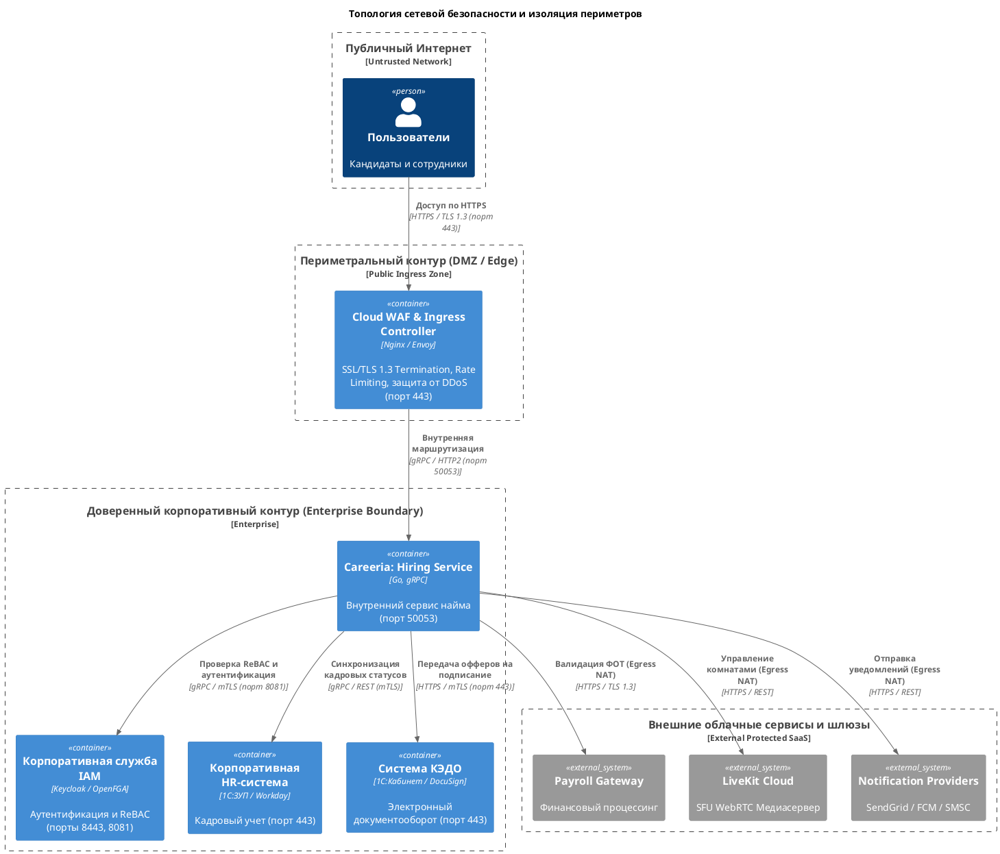

# Системный ландшафт домена найма и управления персоналом (Level 0)

Диаграмма системного ландшафта (**System Landscape Diagram, Level 0**) определяет макроархитектурное положение домена найма и управления персоналом (**Hiring Domain** платформы **Careeria**) в общей корпоративной ИТ-инфраструктуре современного предприятия. 

В соответствии с методологией **C4 Model** Саймона Брауна, уровень ландшафта решает задачу контекстуализации: он абстрагируется от внутренней компонентной реализации и демонстрирует, как целевой программный продукт встраивается в экосистему смежных корпоративных систем, взаимодействует с внешними финансовыми шлюзами, провайдерами связи и обслуживает ключевые категории пользователей в рамках сквозных бизнес-процессов подбора кадров.

```plantuml
@startuml
!include architecture/c4/plantuml/members/member2/landscape/member2-l0-landscape.puml
@enduml
```

---

## 1. Архитектурные границы и макроконтекст

В архитектуре уровня L0 ключевым принципом является строгое разделение ответственности между доверенным внутренним периметром организации (**Enterprise Boundary**) и внешними облачными провайдерами и шлюзами (**External Systems**).

### 1.1. Внутренний корпоративный контур (Enterprise Boundary)
Граница `Корпоративная среда работодателя / HR-экосистема` объединяет информационные системы, развёрнутые в защищённом периметре компании-работодателя (корпоративный ЦОД / Private Cloud) или доверенном закрытом сетевом сегменте:

1. **Careeria: Подсистема найма (Hiring Domain)**  
   *Целевая система проектирования*. Является ядром автоматизации рекрутинговых операций полного цикла. Включает в себя:
   * ведение сквозной воронки отбора соискателей на базе строгого конечного автомата состояний (**Finite State Machine, FSM**);
   * координацию и расписание онлайн- и офлайн-собеседований с фиксацией участников и их ролей;
   * сбор структурированных оценок компетенций (**Feedback**) от членов нанимающей команды;
   * вычисление бизнес-политик готовности кандидата к предложению о работе (**OfferEligibilityPolicy**);
   * подготовку, согласование и контроль жизненного цикла джоб-офферов (**Job Offers**);
   * гарантированную публикацию интеграционных событий через паттерн **Transactional Outbox**.

2. **Корпоративная HR-система / HCM (1С:ЗУП / Workday / SAP SuccessFactors)**  
   *Смежная мастер-система кадрового учёта*. Выступает первоисточником утверждённого штатного расписания, структуры департаментов, грейдов и лимитов открытых штатных позиций. После успешного акцепта оффера в Careeria принимает финальный статус соискателя для издания официального приказа о приёме на работу и формирования личной карточки сотрудника (Т-2).

3. **Корпоративная служба безопасности и IAM (Keycloak / OpenFGA)**  
   *Смежная система идентификации и контроля доступа*. Обеспечивает сквозную аутентификацию корпоративных пользователей по стандартам **SSO (Single Sign-On)** на базе **OAuth 2.0 / OpenID Connect (OIDC)**, выпуск доверенных JWT-токенов, а также централизованное хранение и валидацию гранулярных отношений доступа к ресурсам найма на основе модели **ReBAC (Relationship-Based Access Control)**.

4. **Корпоративная система кадрового электронного документооборота (КЭДО / 1С:Кабинет сотрудника / DocuSign)**  
   *Смежная система юридически значимого документооборота*. Автоматизирует формирование официальных юридических документов на базе согласованных в Careeria условий Job Offer, передачу документов кандидату на ознакомление и подписание с использованием простой или усиленной квалифицированной электронной подписи (ПЭП / КЭП).

### 1.2. Внешний контур интеграций (External Systems)
Системы, находящиеся за пределами доверенного корпоративного сетевого периметра и взаимодействующие с Careeria через публичную сеть Интернет с применением защищённых криптографических протоколов:

1. **Внешняя финансовая система расчётов и выплат (Payroll & Compensation Gateway)**  
   *Финансовый шлюз*. Отвечает за проверку доступных лимитов фондов оплаты труда (ФОТ) при согласовании офферов с нестандартными компенсационными пакетами, расчёт реферальных премий рекрутеров и нанимающих менеджеров, а также процессинг корпоративного эквайринга при оплате расширенных тарифных планов платформы Careeria.
2. **Внешние провайдеры уведомлений (SendGrid / FCM / SMSC)**  
   *Мультиканальная коммуникационная платформа*. Обеспечивает гарантированную доставку сервисных уведомлений, кодов подтверждения, приглашений на интервью и ссылок на джоб-офферы соискателям и сотрудникам по каналам Email (SendGrid / SMTP TLS), мобильных Push-уведомлений (Firebase Cloud Messaging) и SMS (SMPP / HTTPS SMS Gateway).
3. **Платформа видеоконференций реального времени (LiveKit Cloud / WebRTC)**  
   *Медиасерверная инфраструктура*. Предоставляет распределённые SFU-узлы (Selective Forwarding Unit) для проведения защищённых видеособеседований с низкой задержкой (Ultra-low latency WebRTC), поддержкой многопользовательского аудио/видео, демонстрации экрана и опциональной облачной записи встреч.

---

## 2. Каталог персон (User Personas) и матрица ответственности

Система обслуживает четыре ключевые пользовательские роли с чётким разграничением зон ответственности и прав в жизненном цикле подбора:

| Персона / Роль | Категория актора | Назначение и сценарии взаимодействия | Сетевая среда и клиенты |
|---|---|---|---|
| **Кандидат (Соискатель)** | Внешнее физическое лицо | Поиск вакансий, отправка откликов и резюме, согласование временных слотов собеседований, подключение к виртуальным комнатам онлайн-интервью, получение и акцепт джоб-офферов. | Публичный интернет, браузер (Desktop/Mobile Web App) |
| **Рекрутер (HR-специалист)** | Корпоративный сотрудник | Первичная обработка и скрининг откликов, перевод соискателей по стадиям воронки, координация расписания собеседований, подготовка условий и драфтов Job Offer, коммуникация с кандидатами. | Корпоративная сеть / VPN, Web Application |
| **Нанимающий руководитель (Hiring Manager)** | Корпоративный сотрудник | Формирование требований к открываемым вакансиям, проведение профильных и технических интервью, оценка кандидатов по шкале компетенций (Feedback), согласование условий найма. | Корпоративная сеть / VPN, Web Application |
| **Администратор компании** | Привилегированный сотрудник | Управление профилем работодателя, филиалами, привязкой корпоративных ролей сотрудников, настройка политик безопасности, интеграционных токенов и биллинга. | Защищённая корпоративная сеть, Web Application |

### Матрица прав доступа к доменным сущностям (ReBAC / Role Matrix)

| Роль | Просмотр воронки | Смена этапа FSM | Оценивание интервью (Feedback) | Формирование оффера | Согласование оффера | Акцепт оффера |
|---|:---:|:---:|:---:|:---:|:---:|:---:|
| **Кандидат** | Только свой отклик | ❌ (только отзыв заявки) | ❌ | ❌ | ❌ | ✔ (Принять / Отклонить) |
| **Рекрутер** | ✔ (Полный доступ) | ✔ (Скрининг / Назначение) | ❌ (только организационные поля) | ✔ (Создание драфта) | ❌ | ❌ |
| **Нанимающий руководитель** | ✔ (В рамках своего отдела) | ✔ (Технический этап) | ✔ (Выставление оценки 1–5) | ✔ (Инициация условий) | ✔ (Утверждение) | ❌ |
| **Администратор компании** | ✔ (Полный аудит) | ✔ (В случае эскалации) | ❌ | ✔ | ✔ | ❌ |

---

## 3. Спецификация элементов системного ландшафта

| Идентификатор | Категория C4 | Наименование системы / сущности | Граница принадлежности | Служебное назначение и функции | Базовый стек технологий |
|---|---|---|---|---|---|
| `candidate` | Person | Кандидат (Соискатель) | Внешний мир | Соискатель, участвующий в конкурсе на замещение открытой вакансии компании. | Web / Mobile Browser |
| `recruiter` | Person | Рекрутер (HR-специалист) | Внутренний персонал | Специалист по подбору персонала компании-работодателя. | Корпоративный ПК / Браузер |
| `hiringManager` | Person | Нанимающий руководитель | Внутренний персонал | Руководитель профильного подразделения (Team Lead, Head of Dept). | Корпоративный ПК / Браузер |
| `companyAdmin` | Person | Администратор компании | Внутренний персонал | Корпоративный администратор учётной записи компании в Careeria. | Корпоративный ПК / Браузер |
| `careeriaHiring` | System | Careeria: Hiring Domain | Enterprise Boundary | Целевой бэкенд управления воронкой найма, интервью и офферами. | Go 1.23+, gRPC, Protobuf, PostgreSQL 16 |
| `hrSystem` | System | Корпоративная HR-система / HCM | Enterprise Boundary | Главная система кадрового учёта и штатного расписания работодателя. | 1С:Предприятие 8.3 / Workday / SAP |
| `iamSystem` | System | Корпоративная служба IAM | Enterprise Boundary | Единая служба SSO-аутентификации и ReBAC-авторизации прав доступа. | Keycloak 24, OpenFGA, OAuth 2.0 / OIDC |
| `kedoSystem` | System | Корпоративная система КЭДО | Enterprise Boundary | Платформа формирования и юридического подписания трудовых договоров. | 1С:Кабинет сотрудника / DocuSign API |
| `payrollGateway` | System_Ext | Внешняя финансовая система | Внешний сервис | Платформа верификации зарплатных лимитов ФОТ и финансовых транзакций. | Cloud Banking API / REST / ISO 20022 |
| `notificationProviders` | System_Ext | Провайдеры уведомлений | Внешний сервис | Мультиканальные внешние шлюзы отправки транзакционных сообщений. | SendGrid API, FCM HTTP v1, SMPP SMS |
| `livekitMedia` | System_Ext | Платформа видеоконференций | Внешний сервис | SFU-медиасерверная ферма для проведения онлайн-интервью в реальном времени. | LiveKit Server, WebRTC, Go LiveKit SDK |

---

## 4. Спецификация межсистемных интерфейсов и протоколов передачи данных

Все связи между элементами диаграммы строго типизированы, направлены от инициатора сетевого сеанса к исполнителю и специфицированы с указанием сетевых протоколов, портов и механизмов криптографической защиты:

| № | Инициатор | Целевой узел | Бизнес-назначение информационного потока | Сетевой протокол | Порт назначения | Формат полезной нагрузки (Payload) | Механизмы безопасности |
|---|---|---|---|---|---|---|---|
| **1** | Кандидат | Careeria Hiring | Отправка резюме, откликов на вакансии, акцепт оффера | HTTPS / TLS 1.3 | TCP 443 | JSON / Multipart Form | WAF, TLS 1.3, HttpOnly JWT Cookie, CSRF-токены |
| **2** | Рекрутер | Careeria Hiring | Ведение кандидатов по воронке, планирование слотов встреч, оформление оффера | HTTPS / TLS 1.3 | TCP 443 | JSON REST / WebSockets | Корпоративный VPN, SSO Keycloak OIDC, RBAC-проверка |
| **3** | Нанимающий менеджер | Careeria Hiring | Подключение к интервью, отправка оценок (Feedback), согласование офферов | HTTPS / TLS 1.3 | TCP 443 | JSON REST / WebSockets | Корпоративный VPN, SSO Keycloak OIDC, ReBAC-проверка |
| **4** | Администратор компании | Careeria Hiring | Конфигурация филиалов, управление составом рекрутеров и правами | HTTPS / TLS 1.3 | TCP 443 | JSON REST | Двухфакторная аутентификация (2FA/TOTP), mTLS |
| **5** | Careeria Hiring | Служба IAM | Валидация access-токенов пользователей, синхронизация ключей JWKS | HTTPS / OIDC | TCP 8443 | JSON / JWT Claims | TLS 1.3, OAuth 2.0 Bearer Token, асимметричная подпись RS256 |
| **6** | Careeria Hiring | Служба IAM | Проверка гранулярных отношений доступа к объектам найма (ReBAC Check) | gRPC / HTTP2 | TCP 8081 | Protobuf `openfga.v1.CheckRequest` | Внутрисетевой mTLS, взаимные X.509 сертификаты |
| **7** | Careeria Hiring | Корпоративная HR-система | Синхронизация профилей кандидатов, прошедших отбор, и открытие штатных позиций | gRPC / REST | TCP 50051 / 443 | Protobuf / JSON | Внутренний корпоративный контур, mTLS, авторизация по API Key |
| **8** | Корпоративная HR-система | Careeria Hiring | Асинхронное оповещение об изменении штатного расписания и закрытии ставок | HTTPS / Webhooks | TCP 443 | JSON Payload | Электронная подпись HMAC-SHA256 в заголовке `X-Signature` |
| **9** | Careeria Hiring | Система КЭДО | Передача условий утверждённого Job Offer для генерации трудового договора | HTTPS / REST API | TCP 443 | JSON / PDF Template | Взаимный TLS (mTLS), зашифрованный канал, OAuth 2.0 Client Credentials |
| **10** | Система КЭДО | Careeria Hiring | Обратное уведомление о факте подписания трудового договора кандидатом | HTTPS / Webhooks | TCP 443 | JSON Payload | HMAC-SHA256 цифровая подпись, проверка временной метки (Timestamp) |
| **11** | Careeria Hiring | Внешняя финансовая система | Проверка доступного лимита ФОТ, авторизация компенсаций и бонусов | HTTPS / REST API | TCP 443 | JSON ISO 20022 DTO | Двусторонний mTLS (Mutual TLS), приватный шлюз, IP Whitelisting |
| **12** | Careeria Hiring | Провайдеры уведомлений | Отправка транзакционных email-писем, SMS-кодов и push-уведомлений | HTTPS / REST API | TCP 443 | JSON (SendGrid / FCM v1) | TLS 1.3, Bearer API Token с ограниченными правами отправки |
| **13** | Careeria Hiring | Платформа видеоконференций | Создание виртуальных комнат для интервью, генерация токенов доступа участников | HTTPS / REST API | TCP 7880 | JSON / LiveKit Room API | Подпись JWT-токенов секретным ключом LiveKit API Key & Secret |

---

## 5. Политики сетевой безопасности и изоляция периметров

Архитектура системного ландшафта реализует концепцию глубокоэшелонированной защиты (**Defense in Depth**):



1. **Демилитаризованная зона (DMZ / Edge)**: Прямой доступ из глобальной сети разрешён исключительно на периметральные балансировщики по порту `443` с принудительным шифрованием TLS 1.3. Сервисы бизнес-логики и базы данных не имеют публичных IP-адресов.
2. **Изоляция корпоративного контура (Corporate Subnet)**: Все взаимодействия между сервисом найма, IAM и кадровой системой протекают в изолированной подсети с обязательной взаимной аутентификацией узлов (**mTLS** на базе корпоративного центра сертификации CA).
3. **Безопасность внешних вызовов (Egress Security)**: Исходящие вызовы к внешним провайдерам (LiveKit, SendGrid, Payroll) маршрутизируются через выделенные Egress-прокси с контролем белых списков доменов и контролем утечки конфиденциальных персональных данных (DLP-политики).
4. **Защита вебхуков (Webhook Verification)**: Все входящие события от внешней HR-системы и КЭДО снабжаются заголовком электронной подписи `X-Signature: sha256=...`. Шлюз Careeria вычисляет HMAC-хэш от сырого тела запроса с использованием разделяемого секрета (shared secret) до передачи запроса во внутренние очереди, исключая атаки подделки запросов (Tampering).

---

## 6. Анализ отказоустойчивости и сценарии деградации (Graceful Degradation)

При проектировании интеграций макроуровня заложены механизмы бесперебойного функционирования при сбоях смежных систем:

| Смежная система | Характер сбоя | Архитектурная реакция Careeria (Graceful Degradation) |
|---|---|---|
| **Корпоративная HR-система** | Временная недоступность API / тайм-аут | Сервис найма сохраняет события изменения статусов кандидатов в локальной таблице `Transactional Outbox`. После восстановления доступности коннектор Debezium автоматически доставляет накопленные события без потерь данных. |
| **Служба IAM (Keycloak)** | Сбой центра аутентификации | API Gateway и Hiring Service используют локальное кэширование открытых ключей JWKS с временем жизни (TTL) 1 час. Уже выпущенные JWT-токены продолжают успешно валидироваться локально без обращения к упавшему серверу SSO. |
| **Внешняя финансовая система (Payroll)** | Сетевой сбой шлюза выплат | Создаваемый Job Offer фиксируется во внутреннем статусе `DRAFT` с пометкой `PENDING_FINANCIAL_APPROVAL`. Операция не прерывается фатальной ошибкой; фоновый воркер производит повторные попытки верификации бюджета с экспоненциальной задержкой (Exponential Backoff). |
| **Медиаплатформа LiveKit** | Сбой SFU-кластера видеосвязи | Модуль `Conference Service` переключается на резервную стратегию формирования ссылки на корпоративный сервер видеоконференций (Onsite / External Link), сохраняя возможность проведения запланированного собеседования. |
| **Провайдеры уведомлений** | Деградация SendGrid / FCM | Задачи на отправку уведомлений буферизируются в персистентной очереди Kafka. Сервис уведомлений автоматически переключает маршрутизацию на резервный SMS-шлюз или повторно отправляет email при восстановлении основного шлюза. |

---

[Контекст L1](member2-l1-context.md) · [Контейнеры L2](member2-l2-containers.md) · [Динамический процесс](member2-dynamic.md) · [Развёртывание](member2-deployment.md)
