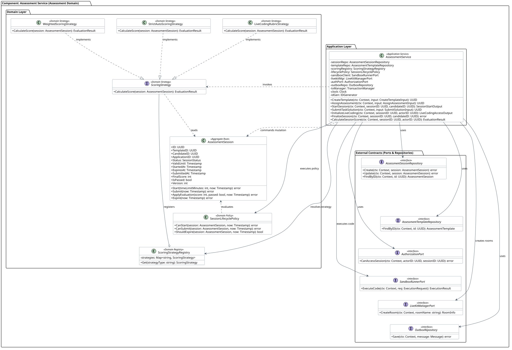

# Assessment Service (Assessment Domain) — детализация кода (L4)

<!-- excerpt -->

В Assessment Service агрегат AssessmentSession хранит состояние попытки. Политика жизненного цикла определяет допустимые переходы, а выбранная стратегия рассчитывает балл по результатам проверки.

AssessmentService управляет агрегатом AssessmentSession и применяет SessionLifecyclePolicy при изменении состояния попытки. Реестр стратегий выбирает взвешенную оценку, строгую автоматическую проверку или рубрику Live Coding. Выходные порты предоставляют шаблон задания, хранилище попытки, исполнение кода и медиакомнату. Результат вычисления сохраняется вместе с событием через репозитории.



<p align="center">Рисунок - Попытка выполнения задания и расчёт оценки</p>

<p align="right">Таблица - Элементы. Попытка выполнения задания и расчёт оценки</p>

| Элемент | Тип или технология | Назначение и ответственность |
|---|---|---|
| AssessmentService | Класс | Прикладной сервис оценивания. Организует попытку выполнения задания, проверку решения и расчёт результата. |
| AssessmentSession | Класс | Агрегат попытки выполнения задания. Хранит состояние прохождения и результаты оценивания. |
| SessionLifecyclePolicy | Класс | Политика жизненного цикла попытки. Проверяет допустимость завершения и других переходов состояния. |
| ScoringStrategy | Интерфейс | Контракт расчёта балла. Принимает данные попытки и определяет способ оценки результата. |
| ScoringStrategyRegistry | Класс | Реестр алгоритмов оценки. Выбирает подходящую реализацию ScoringStrategy для задания. |
| WeightedScoringStrategy | Класс | Стратегия взвешенного расчёта оценки. Объединяет результаты согласно заданным весам. |
| StrictAutoScoringStrategy | Класс | Стратегия строгой автоматической проверки. Рассчитывает результат по условиям успешного выполнения тестов. |
| LiveCodingRubricStrategy | Класс | Стратегия оценки Live Coding по рубрике. Применяет критерии экспертного оценивания. |
| AssessmentSessionRepository | Интерфейс | Порт чтения и сохранения попыток выполнения заданий и результатов. Предоставляет прикладному сервису доступ к данным агрегата. |
| AssessmentTemplateRepository | Интерфейс | Порт чтения и сохранения шаблонов заданий. Предоставляет прикладному сервису доступ к данным агрегата. |
| AuthorizationPort | Интерфейс | Порт проверки полномочий. Прикладной сервис передаёт пользователя, ресурс и действие для принятия решения о доступе. |
| SandboxRunnerPort | Интерфейс | Порт исполнения кода. Передаёт решение и тесты раннеру и получает результаты проверки. |
| LiveKitManagerPort | Интерфейс | Порт управления медиакомнатами. Предоставляет операции организации сессии Live Coding. |
| OutboxRepository | Интерфейс | Порт сохранения событий. Обеспечивает запись события вместе с изменением бизнес-состояния в одной локальной транзакции. |

<p align="right">Таблица - Связи. Попытка выполнения задания и расчёт оценки</p>

| Источник | Получатель | Содержание взаимодействия | Тип связи |
|---|---|---|---|
| AssessmentService | AssessmentSession | Вызывает доменные операции получателя для изменения состояния агрегата. | Зависимость |
| AssessmentService | SessionLifecyclePolicy | Применяет доменную политику перед изменением состояния. | Ассоциация |
| AssessmentService | ScoringStrategyRegistry | Выбирает алгоритм обработки через реестр стратегий. | Ассоциация |
| AssessmentService | ScoringStrategy | Вызывает выбранную стратегию для расчёта результата. | Зависимость |
| AssessmentService | AssessmentSessionRepository | Использует контракт получателя для выполнения прикладной операции. | Ассоциация |
| AssessmentService | AssessmentTemplateRepository | Использует контракт получателя для выполнения прикладной операции. | Ассоциация |
| AssessmentService | AuthorizationPort | Использует контракт получателя для выполнения прикладной операции. | Ассоциация |
| AssessmentService | SandboxRunnerPort | Передаёт решение и тесты в изолированную среду и получает результат проверки. | Ассоциация |
| AssessmentService | LiveKitManagerPort | Создаёт медиакомнату для проведения сессии. | Ассоциация |
| AssessmentService | OutboxRepository | Использует контракт получателя для выполнения прикладной операции. | Ассоциация |
| ScoringStrategyRegistry | ScoringStrategy | Хранит доступные алгоритмы расчёта оценки. | Агрегация |
| WeightedScoringStrategy | ScoringStrategy | Реализует контракт получателя и предоставляет конкретный алгоритм его выполнения. | Реализация интерфейса |
| StrictAutoScoringStrategy | ScoringStrategy | Реализует контракт получателя и предоставляет конкретный алгоритм его выполнения. | Реализация интерфейса |
| LiveCodingRubricStrategy | ScoringStrategy | Реализует контракт получателя и предоставляет конкретный алгоритм его выполнения. | Реализация интерфейса |
| ScoringStrategy | AssessmentSession | Читает данные получателя для формирования результата операции. | Зависимость |
| SessionLifecyclePolicy | AssessmentSession | Проверяет состояние получателя по правилам доменной политики. | Зависимость |

<!-- /excerpt -->

<details>
<summary>PlantUML Исходный код</summary>

```plantuml
@startuml
!include architecture/c4/plantuml/system-context(L1)/full-system(L2)/assessment-service(L3)/assessment-service(L4)/assessment-service.puml
@enduml
```
</details>

## 1. Архитектурные границы и принципы

1. **Изоляция Bounded Context (C4 L4):** Сервис изолирует функционал проверки компетенций соискателей от воронки найма. Внутренние классы не зависят от сущностей резюме или откликов, оперируя внешними UUID (`candidateID`, `applicationID`).
2. **Паттерн Стратегия (Strategy):** Расчет итогового балла отделен от агрегата сессии и динамически подменяется в рантайме:
   - `WeightedScoringStrategy` — взвешенная сумма автотестов и ручного ревью;
   - `StrictAutoScoringStrategy` — строгая 100% проверка автотестами;
   - `LiveCodingRubricStrategy` — оценка по матрице компетенций эксперта в реальном времени.
3. **Чистая архитектура (Ports & Adapters):** Доменный слой чист от I/O. Интеграции с раннером кода (`SandboxRunnerPort`), WebRTC (`LiveKitManagerPort`), ReBAC (`AuthorizationPort`) и БД объявлены как интерфейсы портов.
4. **Транзакционный Outbox:** Изменения состояния сессий фиксируются атомарно с событием в outbox (`AssessmentAssigned`, `AssessmentCompleted`, `AssessmentExpired`).

## 2. Слой приложения (Application Layer)

### `AssessmentService` <<Application Service>>
Оркестрирует жизненный цикл шаблонов, заданий и сессий:
- `CreateTemplate(ctx, input)`: создание шаблона с валидацией лимитов времени (10 мин – 72 ч) и тест-сьютов;
- `AssignAssessment(ctx, input)`: назначение теста кандидату в статусе `SCHEDULED`;
- `StartSession(ctx, sessionID, candidateID)`: старт сессии, фиксация дедлайна `expiresAt`, переход в `IN_PROGRESS`;
- `SubmitTaskSolution(ctx, input)`: отправка кода в `SandboxRunnerPort`;
- `InitializeLiveCoding(ctx, sessionID, actorID)`: создание WebRTC-комнаты в LiveKit и выпуск JWT-токенов;
- `FinalizeSession(ctx, sessionID, candidateID)`: завершение сессии кандидатом, переход в `SUBMITTED`;
- `CalculateSessionScore(ctx, sessionID, actorID)`: вычисление балла через `ScoringStrategy` и перевод в `EVALUATED`.

## 3. Доменный слой (Domain Layer)

### Агрегат `AssessmentSession` (Aggregate Root)
- `ID: UUID`, `TemplateID: UUID`, `CandidateID: UUID`, `ApplicationID: UUID`, `Status: SessionStatus`, `StartedAt`, `ExpiresAt`, `SubmittedAt`, `FinalScore: int`, `IsPassed: bool`, `Version: int`.
- Методы: `Start()`, `Submit()`, `ApplyEvaluation()`, `Expire()`.
- Инварианты: дедлайн не может быть продлен после старта; решения принимаются только в статусе `IN_PROGRESS` до наступления `ExpiresAt`.

### Доменная политика `SessionLifecyclePolicy`
- Валидация допустимости действий кандидата и экзаменатора (`CanStart`, `CanSubmit`, `ShouldExpire`).

### Паттерн «Стратегия» для скоринга (`ScoringStrategy`)
- Единый контракт `CalculateScore(session: AssessmentSession): EvaluationResult` и семейство стратегий (`WeightedScoringStrategy`, `StrictAutoScoringStrategy`, `LiveCodingRubricStrategy`), регистрируемых в `ScoringStrategyRegistry`.

## 4. Внешние порты и контракты (Ports & Repositories)

<p align="right">Таблица - Внешние порты и контракты (Ports &amp; Repositories) (Assessment Service (Assessment Domain) - детализация кода (L4))</p>

| Интерфейс | Назначение | Реализация L3 |
|---|---|---|
| `AssessmentSessionRepository` | Хранение сессий кандидатов | PostgreSQL (`session_repo`) |
| `AssessmentTemplateRepository` | Чтение шаблонов и задач | PostgreSQL (`template_repo`) |
| `AuthorizationPort` | ReBAC-проверка прав рекрутеров и кандидатов | OpenFGA SDK (`authorization_client`) |
| `SandboxRunnerPort` | Изолированное исполнение кода соискателей | Code Execution Runner (`sandbox_client`) |
| `LiveKitManagerPort` | Создание комнат и генерация токенов Live Coding | LiveKit SDK (`livekit_mgr`) |
| `OutboxRepository` | Атомарная публикация доменных событий | PostgreSQL (`transactional_outbox`) |
