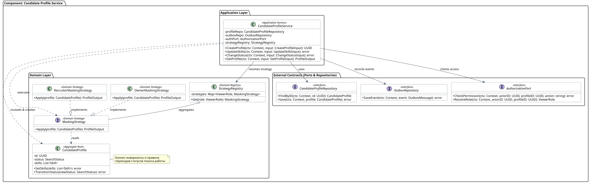

# Candidate Profile Service — детализация кода (L4)

<!-- excerpt -->

Компонент профиля объединяет данные кандидата в агрегате CandidateProfile. Стратегия видимости определяет, какие поля вправе увидеть запрашивающий пользователь.

Прикладной сервис загружает CandidateProfile через репозиторий и вызывает операции изменения навыков или статуса поиска. При чтении AuthorizationPort определяет доступ и роль пользователя, а реестр выбирает стратегию представления профиля. Реализации для владельца и рекрутера формируют доступный им набор сведений. Изменения сопровождаются сохранением доменных событий через OutboxRepository.



<p align="center">Рисунок - Модель профиля кандидата в Candidate Service</p>

<p align="right">Таблица - Элементы. Модель профиля кандидата в Candidate Service</p>

| Элемент | Тип или технология | Назначение и ответственность |
|---|---|---|
| CandidateProfileService | Класс | Прикладной сервис профиля кандидата. Создаёт профиль, изменяет навыки и статус поиска, формирует доступное пользователю представление. |
| CandidateProfile | Класс | Агрегат профессионального профиля. Хранит статус поиска и навыки, проверяет правила их изменения. |
| MaskingStrategy | Интерфейс | Контракт стратегии видимости профиля. Определяет, какие сведения включаются в результат чтения. |
| StrategyRegistry | Класс | Реестр стратегий видимости. Выбирает стратегию по роли пользователя, запрашивающего профиль. |
| OwnerMaskingStrategy | Класс | Стратегия представления профиля его владельцу. Реализует общий контракт MaskingStrategy. |
| RecruiterMaskingStrategy | Класс | Стратегия представления профиля рекрутеру. Применяет ограничения видимости сведений кандидата. |
| CandidateProfileRepository | Интерфейс | Порт чтения и сохранения профессионального профиля кандидата. Предоставляет прикладному сервису доступ к данным агрегата. |
| OutboxRepository | Интерфейс | Порт сохранения событий. Обеспечивает запись события вместе с изменением бизнес-состояния в одной локальной транзакции. |
| AuthorizationPort | Интерфейс | Порт проверки полномочий. Прикладной сервис передаёт пользователя, ресурс и действие для принятия решения о доступе. |

<p align="right">Таблица - Связи. Модель профиля кандидата в Candidate Service</p>

| Источник | Получатель | Содержание взаимодействия | Тип связи |
|---|---|---|---|
| CandidateProfileService | CandidateProfile | Создаёт агрегат и выполняет допустимые изменения его состояния. | Зависимость |
| CandidateProfileService | StrategyRegistry | Выбирает алгоритм обработки через реестр стратегий. | Ассоциация |
| CandidateProfileService | MaskingStrategy | Применяет выбранный алгоритм обработки. | Зависимость |
| StrategyRegistry | MaskingStrategy | Хранит набор доступных стратегий и предоставляет их вызывающей стороне. | Агрегация |
| OwnerMaskingStrategy | MaskingStrategy | Реализует контракт получателя и предоставляет конкретный алгоритм его выполнения. | Реализация интерфейса |
| RecruiterMaskingStrategy | MaskingStrategy | Реализует контракт получателя и предоставляет конкретный алгоритм его выполнения. | Реализация интерфейса |
| MaskingStrategy | CandidateProfile | Читает данные получателя для формирования результата операции. | Зависимость |
| CandidateProfileService | CandidateProfileRepository | Использует контракт получателя для выполнения прикладной операции. | Ассоциация |
| CandidateProfileService | OutboxRepository | Записывает события изменения агрегата в transactional outbox. | Ассоциация |
| CandidateProfileService | AuthorizationPort | Проверяет право пользователя выполнить действие над ресурсом. | Ассоциация |

<!-- /excerpt -->

<details>
<summary>PlantUML Исходный код</summary>

```plantuml
@startuml
!include architecture/c4/plantuml/system-context(L1)/full-system(L2)/candidate-service(L3)/candidate-profile-service(L4)/candidate-profile-service.puml
@enduml
```
</details>

## Архитектурные принципы компонента

1. **Изоляция в границах компонента (C4 L4):**
   * Внутренняя схема кода не содержит адаптеров внешних систем (`PostgresCandidateRepository`, `CandidateGRPCHandler`, `OpenFGA Client`), так как они вынесены в самостоятельные L3-компоненты.
   * Контракты взаимодействия объявлены в виде интерфейсов `CandidateProfileRepository`, `OutboxRepository`, `AuthorizationPort`.
2. **Идиоматичный сервис в Go:**
   * Сценарии работы с профилем не разбиты на десятки микроструктур, а объединены в связный прикладной сервис `CandidateProfileService`.
   * Каждое действие имеет типизированную входную модель (`CreateProfileInput`, `UpdateSkillsInput`, `ChangeStatusInput`, `GetProfileInput`), а запросы возвращают типизированную выходную модель `ProfileOutput`. Это исключает засорение сигнатур примитивными типами.
3. **Паттерн Стратегия в Доменном слое (`MaskingStrategy`):**
   * Правила проекции профиля под роли (`OWNER`, `RECRUITER`, `ANONYMOUS`) инкапсулированы в семейство доменных стратегий с реестром, исключая ветвление через `switch-case`.
   * Стратегии формируют выходную модель `ProfileOutput`.

---

## Доменная модель (Domain Layer)

### 1. Корень агрегата `CandidateProfile` (Aggregate Root)

Управляет профессиональным профилем соискателя, карьерными предпочтениями, навыками и статусом поиска работы.

* **Поля агрегата:**
  * `id: UUID` — уникальный идентификатор профиля.
  * `userID: UUID` — владелец профиля (пользователь платформы).
  * `status: SearchStatus` — статус поиска работы.
  * `skills: List<Skill>` — перечень подтвержденных профессиональных навыков соискателя.
* **Бизнес-методы агрегата:**
  * `SetSkills(skills: List<Skill>): error` — валидирует и обновляет список навыков кандидата.
  * `TransitionStatus(newStatus: SearchStatus): error` — выполняет переход статуса поиска работы с проверкой допустимости переходов (например, архивный профиль не может стать `ACTIVELY_LOOKING` без предварительного восстановления).

### 2. Паттерн Стратегия для маскирования данных

* **`MaskingStrategy` (интерфейс стратегии):**  
  Определяет единый контракт проекции агрегата в выходную модель: `Apply(profile: CandidateProfile): ProfileOutput`.
* **Конкретные стратегии:**
  * `OwnerMaskingStrategy` — отдает владельцу профиля полные данные, включая приватные поля и контакты.
  * `RecruiterMaskingStrategy` — фильтрует контактные данные согласно настройке видимости (`HIDDEN` / `AUTHORIZED_RECRUITERS`).
* **`StrategyRegistry` (реестр стратегий):**  
  Хранит соответствие ролей пользователей и стратегий (`map[ViewerRole]MaskingStrategy`), позволяя юзкейсу резолвить нужный алгоритм без ветвлений.

---

## Внешние контракты (Ports & Repositories)

<p align="right">Таблица - Внешние контракты (Ports &amp; Repositories) (Candidate Profile Service - детализация кода (L4))</p>

| Интерфейс | Назначение | Реализующий L3-компонент |
|---|---|---|
| `CandidateProfileRepository` | Поиск и сохранение агрегата `CandidateProfile` в БД. | `Candidate Repo` (Go / pgx, sqlc) |
| `OutboxRepository` | Фиксация доменных событий изменения профиля для публикации через Transactional Outbox. | `Transactional Outbox` (Go / pgx, sqlc) |
| `AuthorizationPort` | Проверка прав доступа и определение роли запрашивающего пользователя. | `Authorization Client` (Go / OpenFGA SDK) |

