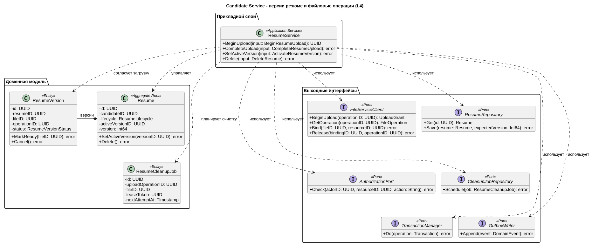

# Candidate Service - версии резюме и файловые операции (L4)

<!-- excerpt -->

Диаграмма раскрывает Resume Service. Resume определяет текущее резюме, ResumeVersion хранит состояние отдельной загрузки и ссылку на файл. Содержимое документа обслуживает File Service, идентификатор операции связывает его результат с локальной версией.

Сервис сначала сохраняет намерение, затем обращается к файловому API и фиксирует полученный результат отдельным изменением. Отмена и удаление создают устойчивую задачу очистки. Поздний ответ файлового сервиса проверяется по состоянию версии и направляется на освобождение привязки при необходимости.



<p align="center">Рисунок - Candidate Service - версии резюме и файловые операции (L4)</p>

<p align="right">Таблица - Элементы. Candidate Service - версии резюме и файловые операции (L4)</p>

| Элемент | Тип | Назначение и ответственность |
|---|---|---|
| ResumeService | Прикладной сервис | Управляет загрузкой, выбором текущей версии и удалением резюме. Координирует локальные изменения с файловыми операциями по идентификатору операции. |
| Resume | Корень агрегата | Представляет резюме кандидата и выбранную текущую версию. Проверяет принадлежность версии и её готовность перед переключением. |
| ResumeVersion | Сущность | Хранит состояние загрузки отдельной версии, ссылку на файл и устойчивую операцию. Готовые метаданные относятся к конкретному проверенному файлу. |
| ResumeCleanupJob | Сущность | Хранит работу по освобождению файловой привязки после отмены или удаления. Учитывает позднее получение результата начальной загрузки. |
| ResumeRepository | Выходной интерфейс | Хранит резюме и его версии. Обновляет состояние и текущую версию с контролем версии агрегата. |
| FileServiceClient | Выходной интерфейс | Начинает файловую операцию и получает её состояние по устойчивому идентификатору. Проверяет готовность файла, создаёт и освобождает привязку. |
| CleanupJobRepository | Выходной интерфейс | Сохраняет устойчивые задачи освобождения привязок. Задача остаётся доступной фоновому обработчику после завершения запроса пользователя. |
| AuthorizationPort | Выходной интерфейс | Проверяет право пользователя или вызывающего сервиса на действие с ресурсом. При отказе прикладная операция завершается без изменения данных. |
| TransactionManager | Выходной интерфейс | Выполняет изменения нескольких локальных записей в одной транзакции. Сетевые операции выполняются за её пределами. |
| OutboxWriter | Выходной интерфейс | Записывает доменное событие в локальной транзакции вместе с бизнес-изменением. Дальнейшая публикация выполняется событийной инфраструктурой. |

<p align="right">Таблица - Связи. Candidate Service - версии резюме и файловые операции (L4)</p>

| Источник | Получатель | Содержание взаимодействия | Тип связи |
|---|---|---|---|
| ResumeService | Resume | Выбирает готовую версию и изменяет жизненный цикл резюме. | Зависимость |
| Resume | ResumeVersion | Содержит версии одного резюме и проверяет выбор активной версии. | Композиция |
| ResumeService | ResumeVersion | Связывает результат файловой операции с конкретной попыткой загрузки. | Зависимость |
| ResumeService | ResumeCleanupJob | Создаёт задачу освобождения привязки при отмене или удалении. | Зависимость |
| ResumeService | ResumeRepository | Хранит резюме и его версии. Обновляет состояние и текущую версию с контролем версии агрегата. | Зависимость |
| ResumeService | FileServiceClient | Начинает файловую операцию и получает её состояние по устойчивому идентификатору. Проверяет готовность файла, создаёт и освобождает привязку. | Зависимость |
| ResumeService | CleanupJobRepository | Сохраняет устойчивые задачи освобождения привязок. Задача остаётся доступной фоновому обработчику после завершения запроса пользователя. | Зависимость |
| ResumeService | AuthorizationPort | Проверяет право пользователя или вызывающего сервиса на действие с ресурсом. При отказе прикладная операция завершается без изменения данных. | Зависимость |
| ResumeService | TransactionManager | Выполняет изменения нескольких локальных записей в одной транзакции. Сетевые операции выполняются за её пределами. | Зависимость |
| ResumeService | OutboxWriter | Записывает доменное событие в локальной транзакции вместе с бизнес-изменением. Дальнейшая публикация выполняется событийной инфраструктурой. | Зависимость |

<!-- /excerpt -->

<details>
<summary>Исходник PlantUML</summary>

```plantuml
@startuml
!include architecture/c4/plantuml/system-context(L1)/full-system(L2)/candidate-service(L3)/candidate-resume(L4)/candidate-resume.puml
@enduml
```
</details>
