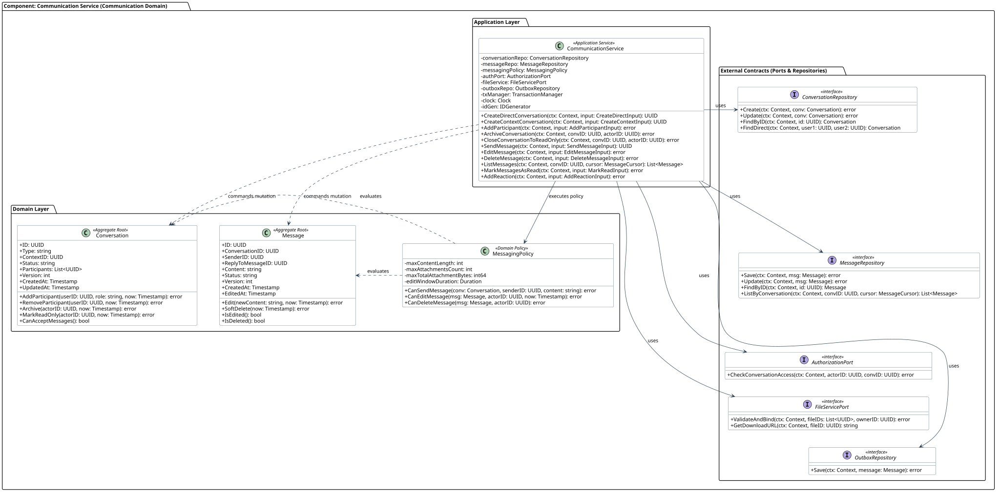

# Communication Service (Communication Domain) — детализация кода (L4)

<!-- excerpt -->

В Communication Service агрегаты Conversation и Message представляют диалог и сообщение. При отправке и редактировании политика MessagingPolicy проверяет правила переписки.

CommunicationService загружает диалог и сообщение через соответствующие репозитории. MessagingPolicy проверяет, допускают ли состояние беседы и параметры сообщения запрошенное действие. AuthorizationPort проверяет доступ пользователя, FileServicePort обслуживает вложения. После изменения агрегатов событие записывается через OutboxRepository.



<p align="center">Рисунок - Диалоги, сообщения и правила переписки</p>

<p align="right">Таблица - Элементы. Диалоги, сообщения и правила переписки</p>

| Элемент | Тип или технология | Назначение и ответственность |
|---|---|---|
| CommunicationService | Класс | Прикладной сервис переписки. Организует работу с диалогами, отправку и изменение сообщений. |
| Conversation | Класс | Агрегат диалога. Определяет контекст общения, участников и состояние беседы. |
| Message | Класс | Агрегат сообщения. Хранит содержимое и данные, необходимые для изменения сообщения. |
| MessagingPolicy | Класс | Доменная политика переписки. Проверяет состояние диалога, участие отправителя и ограничения сообщений. |
| ConversationRepository | Интерфейс | Порт чтения и сохранения диалогов и их участников. Предоставляет прикладному сервису доступ к данным агрегата. |
| MessageRepository | Интерфейс | Порт чтения и сохранения сообщений и данных переписки. Предоставляет прикладному сервису доступ к данным агрегата. |
| AuthorizationPort | Интерфейс | Порт проверки полномочий. Прикладной сервис передаёт пользователя, ресурс и действие для принятия решения о доступе. |
| FileServicePort | Интерфейс | Порт работы с файлами. Обеспечивает проверку и привязку вложений к сообщениям. |
| OutboxRepository | Интерфейс | Порт сохранения событий. Обеспечивает запись события вместе с изменением бизнес-состояния в одной локальной транзакции. |

<p align="right">Таблица - Связи. Диалоги, сообщения и правила переписки</p>

| Источник | Получатель | Содержание взаимодействия | Тип связи |
|---|---|---|---|
| CommunicationService | Conversation | Вызывает доменные операции получателя для изменения состояния агрегата. | Зависимость |
| CommunicationService | Message | Вызывает доменные операции получателя для изменения состояния агрегата. | Зависимость |
| CommunicationService | MessagingPolicy | Применяет доменную политику перед изменением состояния. | Ассоциация |
| CommunicationService | ConversationRepository | Использует контракт получателя для выполнения прикладной операции. | Ассоциация |
| CommunicationService | MessageRepository | Использует контракт получателя для выполнения прикладной операции. | Ассоциация |
| CommunicationService | AuthorizationPort | Использует контракт получателя для выполнения прикладной операции. | Ассоциация |
| CommunicationService | FileServicePort | Использует контракт получателя для выполнения прикладной операции. | Ассоциация |
| CommunicationService | OutboxRepository | Использует контракт получателя для выполнения прикладной операции. | Ассоциация |
| MessagingPolicy | Conversation | Проверяет состояние получателя по правилам доменной политики. | Зависимость |
| MessagingPolicy | Message | Проверяет состояние получателя по правилам доменной политики. | Зависимость |

<!-- /excerpt -->

<details>
<summary>PlantUML Исходный код</summary>

```plantuml
@startuml
!include architecture/c4/plantuml/system-context(L1)/full-system(L2)/communication-service(L3)/communication-service(L4)/communication-service.puml
@enduml
```
</details>

## 1. Архитектурные границы и принципы

1. **Изоляция Bounded Context (C4 L4):** Сервис владеет диалогами и сообщениями в контексте найма. Не хранит бинарные файлы (они делегированы в S3 через File Service) и учетные данные пользователей (Identity Service).
2. **Декомпозиция агрегатов:** Во избежание блокировок БД монолитным чатом, агрегаты `Conversation` и `Message` разделены:
   - `Conversation` отвечает за состав участников, их роли, статус беседы (ACTIVE, READ_ONLY, ARCHIVED);
   - `Message` отвечает за текст, версионирование правок, мягкое удаление.
3. **Межагрегатная валидация (`MessagingPolicy`):** Вынесена в чистый доменный слой: проверяет активность беседы, членство автора, тайм-аут редактирования (24 часа) и лимиты вложений.
4. **Транзакционный Outbox:** Изменения диалогов и сообщений сохраняются в PostgreSQL атомарно с событием в outbox для последующей репликации в Centrifugo и Notification Service.

## 2. Слой приложения (Application Layer)

### `CommunicationService` <<Application Service>>
Оркестрирует диалоги и обмен сообщениями:
- `CreateDirectConversation(ctx, input)`: создание или идемпотентное возвращение существующего диалога 1-на-1;
- `CreateContextConversation(ctx, input)`: групповой диалог по отклику или интервью;
- `AddParticipant(ctx, input)`: добавление участника с ReBAC-проверкой;
- `ArchiveConversation(ctx, convID, actorID)`: архивирование диалога;
- `CloseConversationToReadOnly(ctx, convID, actorID)`: перевод в Read-Only по событию найма;
- `SendMessage(ctx, input)`: валидация через `MessagingPolicy`, привязка файлов в `FileServicePort`, атомарное сохранение и outbox;
- `EditMessage(ctx, input)`: редактирование текста автором в течение 24 часов;
- `DeleteMessage(ctx, input)`: мягкое удаление (SOFT_DELETED) с сохранением целостности треда;
- `ListMessages(ctx, convID, cursor)`: получение истории сообщений с курсорной пагинацией;
- `MarkMessagesAsRead(ctx, input)`: сдвиг указателя прочтения;
- `AddReaction(ctx, input)`: управление эмоциональными реакциями (эмодзи).

## 3. Доменный слой (Domain Layer)

### Агрегат `Conversation` (Aggregate Root)
- `ID: UUID`, `Type: string`, `ContextID: UUID`, `Status: string`, `Participants: List<UUID>`, `Version: int`.
- Методы: `AddParticipant()`, `RemoveParticipant()`, `Archive()`, `MarkReadOnly()`, `CanAcceptMessages()`.

### Агрегат `Message` (Aggregate Root)
- `ID: UUID`, `ConversationID: UUID`, `SenderID: UUID`, `ReplyToMessageID: UUID`, `Content: string`, `Status: string`, `Version: int`.
- Методы: `Edit()`, `SoftDelete()`, `IsEdited()`, `IsDeleted()`.

### Доменная политика `MessagingPolicy`
- Контроль лимитов текста (1–4000 символов), квот файлов, окна редактирования и прав отправки.

## 4. Внешние порты и контракты (Ports & Repositories)

<p align="right">Таблица - Внешние порты и контракты (Ports &amp; Repositories) (Communication Service (Communication Domain) - детализация кода (L4))</p>

| Интерфейс | Назначение | Реализация L3 |
|---|---|---|
| `ConversationRepository` | Хранение диалогов и состава участников | PostgreSQL (`conversation_repo`) |
| `MessageRepository` | Хранение сообщений и метаданных | PostgreSQL (`message_repo`) |
| `AuthorizationPort` | Проверка ReBAC-прав доступа к беседам | OpenFGA SDK (`authorization_client`) |
| `FileServicePort` | Валидация, binding и генерация presigned download URLs | File Service Client (`file_client`) |
| `OutboxRepository` | Атомарная публикация доменных событий | PostgreSQL (`transactional_outbox`) |
