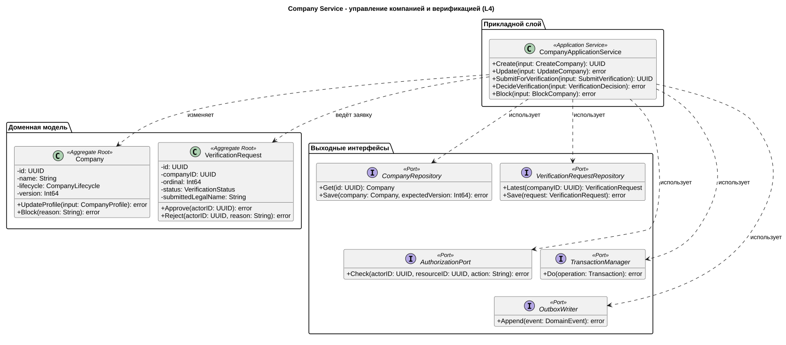

# Company Service - управление компанией и верификацией (L4)

<!-- excerpt -->

Диаграмма раскрывает прикладной компонент управления компанией. Company хранит актуальные сведения работодателя, VerificationRequest фиксирует реквизиты, переданные на проверку. Решение проверяющего относится к определённой заявке и учитывает её состояние.

Прикладной сервис проверяет полномочия, загружает агрегаты и применяет изменения с контролем версии. Компания, заявка и событие сохраняются в локальной транзакции. Снимок реквизитов позволяет отличить проверенные сведения от последующего редактирования карточки.



<p align="center">Рисунок - Company Service - управление компанией и верификацией (L4)</p>

<p align="right">Таблица - Элементы. Company Service - управление компанией и верификацией (L4)</p>

| Элемент | Тип | Назначение и ответственность |
|---|---|---|
| CompanyApplicationService | Прикладной сервис | Координирует изменение карточки компании и проверку реквизитов. Проверяет полномочия и сохраняет компанию, заявку и событие согласованно. |
| Company | Корень агрегата | Хранит реквизиты работодателя, состояние доступности и версию. Правила изменения компании применяются до сохранения агрегата. |
| VerificationRequest | Корень агрегата | Хранит неизменяемый снимок реквизитов, порядковый номер заявки и решение проверяющего. Решение относится к конкретной поданной заявке. |
| CompanyRepository | Выходной интерфейс | Загружает компанию и сохраняет её с проверкой ожидаемой версии. Конфликт версии предотвращает перезапись параллельного изменения. |
| VerificationRequestRepository | Выходной интерфейс | Хранит заявки проверки и получает последнюю по порядковому номеру. Создание и решение по заявке согласуются с состоянием компании в одной транзакции. |
| AuthorizationPort | Выходной интерфейс | Проверяет право пользователя или вызывающего сервиса на действие с ресурсом. При отказе прикладная операция завершается без изменения данных. |
| TransactionManager | Выходной интерфейс | Выполняет изменения нескольких локальных записей в одной транзакции. Сетевые операции выполняются за её пределами. |
| OutboxWriter | Выходной интерфейс | Записывает доменное событие в локальной транзакции вместе с бизнес-изменением. Дальнейшая публикация выполняется событийной инфраструктурой. |

<p align="right">Таблица - Связи. Company Service - управление компанией и верификацией (L4)</p>

| Источник | Получатель | Содержание взаимодействия | Тип связи |
|---|---|---|---|
| CompanyApplicationService | Company | Создаёт компанию и применяет допустимые изменения реквизитов или доступности. | Зависимость |
| CompanyApplicationService | VerificationRequest | Создаёт заявку со снимком реквизитов и фиксирует решение проверяющего. | Зависимость |
| CompanyApplicationService | CompanyRepository | Загружает компанию и сохраняет её с проверкой ожидаемой версии. Конфликт версии предотвращает перезапись параллельного изменения. | Зависимость |
| CompanyApplicationService | VerificationRequestRepository | Хранит заявки проверки и получает последнюю по порядковому номеру. Создание и решение по заявке согласуются с состоянием компании в одной транзакции. | Зависимость |
| CompanyApplicationService | AuthorizationPort | Проверяет право пользователя или вызывающего сервиса на действие с ресурсом. При отказе прикладная операция завершается без изменения данных. | Зависимость |
| CompanyApplicationService | TransactionManager | Выполняет изменения нескольких локальных записей в одной транзакции. Сетевые операции выполняются за её пределами. | Зависимость |
| CompanyApplicationService | OutboxWriter | Записывает доменное событие в локальной транзакции вместе с бизнес-изменением. Дальнейшая публикация выполняется событийной инфраструктурой. | Зависимость |

<!-- /excerpt -->

<details>
<summary>Исходник PlantUML</summary>

```plantuml
@startuml
!include architecture/c4/plantuml/system-context(L1)/full-system(L2)/company-service(L3)/company-management(L4)/company-management.puml
@enduml
```
</details>
