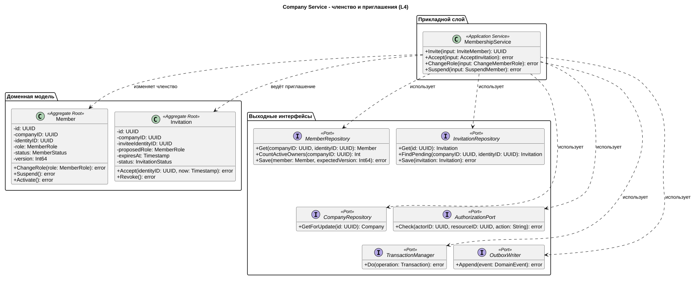

# Company Service - членство и приглашения (L4)

<!-- excerpt -->

Диаграмма раскрывает Membership Service. Членство и приглашение представлены отдельными агрегатами. Invitation определяет адресата, предлагаемую роль и срок принятия, Member хранит действующее состояние участия пользователя в компании.

При принятии приглашения сервис проверяет личность получателя и состояние компании, затем согласованно изменяет приглашение и членство. Смена роли учитывает состав активных владельцев. Репозитории, контроль версии и локальная транзакция защищают результат от конкурирующих изменений.



<p align="center">Рисунок - Company Service - членство и приглашения (L4)</p>

<p align="right">Таблица - Элементы. Company Service - членство и приглашения (L4)</p>

| Элемент | Тип | Назначение и ответственность |
|---|---|---|
| MembershipService | Прикладной сервис | Координирует приглашение, принятие, смену роли и приостановку участия. Согласует действие с состоянием компании и защитой последнего владельца. |
| Member | Корень агрегата | Представляет одно членство учётной записи в компании. Хранит роль, статус и версию, проверяет локальные переходы состояния. |
| Invitation | Корень агрегата | Представляет приглашение конкретной существующей учётной записи. Хранит назначаемую роль, срок и состояние принятия. |
| MemberRepository | Выходной интерфейс | Хранит членство пользователя в компании и выполняет условное обновление версии. Позволяет проверить состав владельцев при изменении роли. |
| InvitationRepository | Выходной интерфейс | Хранит адресное приглашение и находит действующее приглашение для пользователя компании. Повтор операции создания сопоставляется с устойчивым идентификатором. |
| CompanyRepository | Выходной интерфейс | Предоставляет состояние компании для проверки допустимости операции членства. Участвует в транзакционной координации изменения состава владельцев. |
| AuthorizationPort | Выходной интерфейс | Проверяет право пользователя или вызывающего сервиса на действие с ресурсом. При отказе прикладная операция завершается без изменения данных. |
| TransactionManager | Выходной интерфейс | Выполняет изменения нескольких локальных записей в одной транзакции. Сетевые операции выполняются за её пределами. |
| OutboxWriter | Выходной интерфейс | Записывает доменное событие в локальной транзакции вместе с бизнес-изменением. Дальнейшая публикация выполняется событийной инфраструктурой. |

<p align="right">Таблица - Связи. Company Service - членство и приглашения (L4)</p>

| Источник | Получатель | Содержание взаимодействия | Тип связи |
|---|---|---|---|
| MembershipService | Member | Изменяет состояние и роль конкретного участника после проверки полномочий. | Зависимость |
| MembershipService | Invitation | Создаёт, принимает или отзывает адресное приглашение с проверкой срока. | Зависимость |
| MembershipService | MemberRepository | Хранит членство пользователя в компании и выполняет условное обновление версии. Позволяет проверить состав владельцев при изменении роли. | Зависимость |
| MembershipService | InvitationRepository | Хранит адресное приглашение и находит действующее приглашение для пользователя компании. Повтор операции создания сопоставляется с устойчивым идентификатором. | Зависимость |
| MembershipService | CompanyRepository | Предоставляет состояние компании для проверки допустимости операции членства. Участвует в транзакционной координации изменения состава владельцев. | Зависимость |
| MembershipService | AuthorizationPort | Проверяет право пользователя или вызывающего сервиса на действие с ресурсом. При отказе прикладная операция завершается без изменения данных. | Зависимость |
| MembershipService | TransactionManager | Выполняет изменения нескольких локальных записей в одной транзакции. Сетевые операции выполняются за её пределами. | Зависимость |
| MembershipService | OutboxWriter | Записывает доменное событие в локальной транзакции вместе с бизнес-изменением. Дальнейшая публикация выполняется событийной инфраструктурой. | Зависимость |

<!-- /excerpt -->

<details>
<summary>Исходник PlantUML</summary>

```plantuml
@startuml
!include architecture/c4/plantuml/system-context(L1)/full-system(L2)/company-service(L3)/company-membership(L4)/company-membership.puml
@enduml
```
</details>
