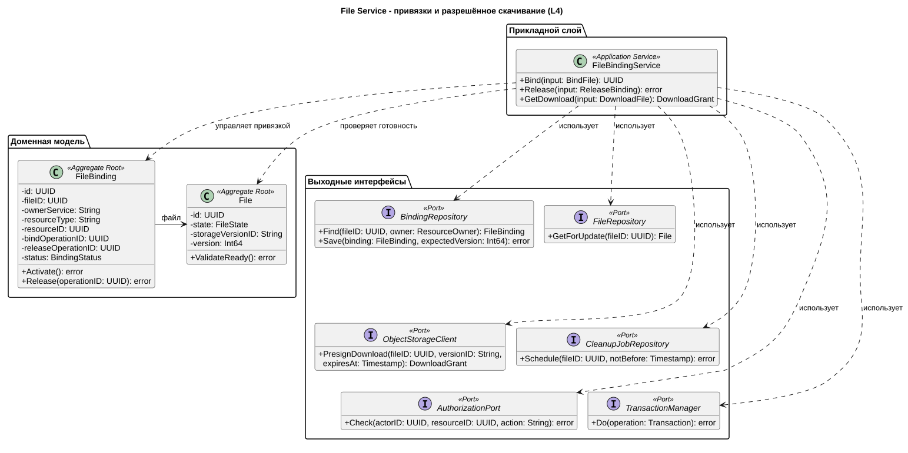

# File Service - привязки и разрешённое скачивание (L4)

<!-- excerpt -->

Диаграмма раскрывает компонент управления привязками. FileBinding определяет сервис-владелец, тип и идентификатор ресурса, который удерживает файл. Несколько ресурсов могут независимо ссылаться на один проверенный объект.

При создании привязки сервис проверяет полномочия и готовность File, при скачивании использует активную привязку и точную версию объекта. Освобождение одной связи сохраняется идемпотентно и может инициировать очистку. Физическое удаление выполняется после повторной проверки оставшихся связей и сроков выданных разрешений.



<p align="center">Рисунок - File Service - привязки и разрешённое скачивание (L4)</p>

<p align="right">Таблица - Элементы. File Service - привязки и разрешённое скачивание (L4)</p>

| Элемент | Тип | Назначение и ответственность |
|---|---|---|
| FileBindingService | Прикладной сервис | Создаёт и освобождает привязки, выдаёт ограниченный доступ к скачиванию. Проверяет ресурс владельца, полномочия сервиса и состояние конкретного файла. |
| FileBinding | Корень агрегата | Стабильная связь файла с ресурсом доменного сервиса. Хранит состояние и устойчивые идентификаторы операций, запрещает повторную активацию освобождённой связи. |
| File | Корень агрегата | Техническое состояние и проверенная версия файла. Новая привязка и ссылка на скачивание допускаются только в разрешённом состоянии. |
| BindingRepository | Выходной интерфейс | Хранит стабильную привязку файла к ресурсу и идентификаторы Bind и Release. Повтор команды возвращает сохранённый результат после проверки её параметров. |
| FileRepository | Выходной интерфейс | Получает состояние файла и закреплённую проверенную версию. Координирует создание привязки с началом удаления файла. |
| ObjectStorageClient | Выходной интерфейс | Выдаёт временную ссылку чтения конкретной версии объекта. Срок действия ограничивает период доступа по ранее выданному разрешению. |
| CleanupJobRepository | Выходной интерфейс | Планирует проверку и физическое удаление освобождённого файла. Обработчик повторно проверяет привязки и сроки ранее выданных прав. |
| AuthorizationPort | Выходной интерфейс | Проверяет право пользователя или вызывающего сервиса на действие с ресурсом. При отказе прикладная операция завершается без изменения данных. |
| TransactionManager | Выходной интерфейс | Выполняет изменения нескольких локальных записей в одной транзакции. Сетевые операции выполняются за её пределами. |

<p align="right">Таблица - Связи. File Service - привязки и разрешённое скачивание (L4)</p>

| Источник | Получатель | Содержание взаимодействия | Тип связи |
|---|---|---|---|
| FileBindingService | FileBinding | Создаёт или освобождает связь конкретного ресурса с файлом. | Зависимость |
| FileBindingService | File | Проверяет готовность версии перед созданием связи или ссылкой на скачивание. | Зависимость |
| FileBinding | File | Удерживает файл от удаления, пока привязка активна. | Ассоциация |
| FileBindingService | BindingRepository | Хранит стабильную привязку файла к ресурсу и идентификаторы Bind и Release. Повтор команды возвращает сохранённый результат после проверки её параметров. | Зависимость |
| FileBindingService | FileRepository | Получает состояние файла и закреплённую проверенную версию. Координирует создание привязки с началом удаления файла. | Зависимость |
| FileBindingService | ObjectStorageClient | Выдаёт временную ссылку чтения конкретной версии объекта. Срок действия ограничивает период доступа по ранее выданному разрешению. | Зависимость |
| FileBindingService | CleanupJobRepository | Планирует проверку и физическое удаление освобождённого файла. Обработчик повторно проверяет привязки и сроки ранее выданных прав. | Зависимость |
| FileBindingService | AuthorizationPort | Проверяет право пользователя или вызывающего сервиса на действие с ресурсом. При отказе прикладная операция завершается без изменения данных. | Зависимость |
| FileBindingService | TransactionManager | Выполняет изменения нескольких локальных записей в одной транзакции. Сетевые операции выполняются за её пределами. | Зависимость |

<!-- /excerpt -->

<details>
<summary>Исходник PlantUML</summary>

```plantuml
@startuml
!include architecture/c4/plantuml/system-context(L1)/full-system(L2)/file-service(L3)/file-binding(L4)/file-binding.puml
@enduml
```
</details>
