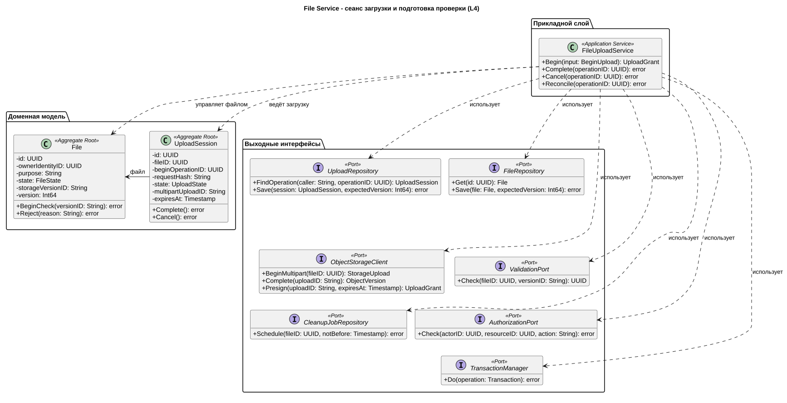

# File Service - сеанс загрузки и подготовка проверки (L4)

<!-- excerpt -->

Диаграмма раскрывает компонент управления загрузкой. UploadSession связывает устойчивую операцию клиента с multipart upload, File хранит техническое состояние и проверяемую версию объекта. Завершение передачи байтов запускает проверку содержимого.

Начало операции сначала фиксируется локально. Вызов хранилища выполняется за пределами транзакции, затем его результат согласуется с актуальным состоянием сеанса. При потере ответа Reconcile восстанавливает результат по идентификатору операции. Отмена сохраняет задачу очистки и учитывает срок ранее выданного права записи.



<p align="center">Рисунок - File Service - сеанс загрузки и подготовка проверки (L4)</p>

<p align="right">Таблица - Элементы. File Service - сеанс загрузки и подготовка проверки (L4)</p>

| Элемент | Тип | Назначение и ответственность |
|---|---|---|
| FileUploadService | Прикладной сервис | Организует начало, завершение и отмену загрузки. Координирует устойчивое локальное состояние с результатами внешних операций хранилища. |
| File | Корень агрегата | Технический агрегат файла. Хранит назначение, владельца, состояние и точную версию объекта, к которой относятся проверки. |
| UploadSession | Корень агрегата | Сеанс одной загрузки. Хранит вызывающий сервис, идентификатор операции, hash параметров, multipart ID и сроки прав записи. |
| UploadRepository | Выходной интерфейс | Сохраняет сеанс загрузки и устойчивый begin operation ID. Сопоставляет повтор запроса с первоначальными параметрами и состоянием операции. |
| FileRepository | Выходной интерфейс | Хранит техническое состояние файла и проверенную версию объекта. Условное обновление предотвращает возврат отменённого файла в активное состояние. |
| ObjectStorageClient | Выходной интерфейс | Создаёт и завершает multipart upload, выдаёт ограниченные права записи и получает версию объекта. Использует внутренний ключ хранилища, сформированный сервером. |
| ValidationPort | Выходной интерфейс | Запускает проверку точной версии объекта. Успешное завершение загрузки передаёт файл в состояние ожидания заключения. |
| CleanupJobRepository | Выходной интерфейс | Сохраняет задачу физической очистки. Учитывает срок выданных прав записи и возможное позднее завершение файловой операции. |
| AuthorizationPort | Выходной интерфейс | Проверяет право пользователя или вызывающего сервиса на действие с ресурсом. При отказе прикладная операция завершается без изменения данных. |
| TransactionManager | Выходной интерфейс | Выполняет изменения нескольких локальных записей в одной транзакции. Сетевые операции выполняются за её пределами. |

<p align="right">Таблица - Связи. File Service - сеанс загрузки и подготовка проверки (L4)</p>

| Источник | Получатель | Содержание взаимодействия | Тип связи |
|---|---|---|---|
| FileUploadService | File | Создаёт техническую запись и передаёт точную версию объекта на проверку. | Зависимость |
| FileUploadService | UploadSession | Проверяет повтор операции и изменяет состояние сеанса. | Зависимость |
| UploadSession | File | Указывает файл, для которого выдано право загрузки. | Ассоциация |
| FileUploadService | UploadRepository | Сохраняет сеанс загрузки и устойчивый begin operation ID. Сопоставляет повтор запроса с первоначальными параметрами и состоянием операции. | Зависимость |
| FileUploadService | FileRepository | Хранит техническое состояние файла и проверенную версию объекта. Условное обновление предотвращает возврат отменённого файла в активное состояние. | Зависимость |
| FileUploadService | ObjectStorageClient | Создаёт и завершает multipart upload, выдаёт ограниченные права записи и получает версию объекта. Использует внутренний ключ хранилища, сформированный сервером. | Зависимость |
| FileUploadService | ValidationPort | Запускает проверку точной версии объекта. Успешное завершение загрузки передаёт файл в состояние ожидания заключения. | Зависимость |
| FileUploadService | CleanupJobRepository | Сохраняет задачу физической очистки. Учитывает срок выданных прав записи и возможное позднее завершение файловой операции. | Зависимость |
| FileUploadService | AuthorizationPort | Проверяет право пользователя или вызывающего сервиса на действие с ресурсом. При отказе прикладная операция завершается без изменения данных. | Зависимость |
| FileUploadService | TransactionManager | Выполняет изменения нескольких локальных записей в одной транзакции. Сетевые операции выполняются за её пределами. | Зависимость |

<!-- /excerpt -->

<details>
<summary>Исходник PlantUML</summary>

```plantuml
@startuml
!include architecture/c4/plantuml/system-context(L1)/full-system(L2)/file-service(L3)/file-upload(L4)/file-upload.puml
@enduml
```
</details>
