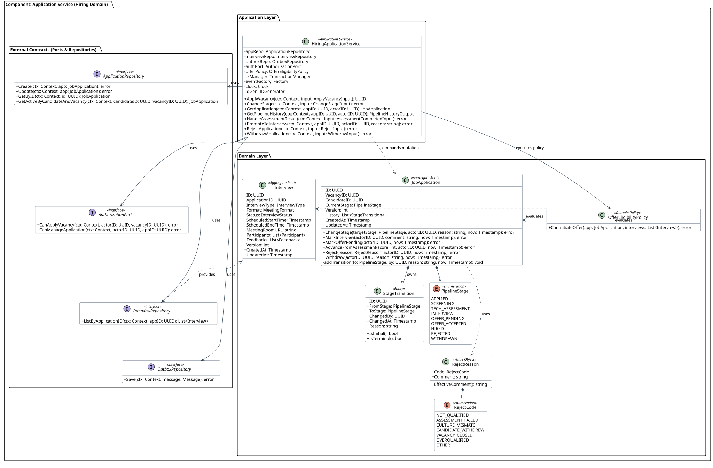

# Application Service (Hiring Domain) — детализация кода (L4)

<!-- excerpt -->

Агрегат JobApplication хранит текущий этап отклика и историю переходов. Прикладной сервис проверяет допустимость смены этапа и сохраняет результат в одной транзакции.

HiringApplicationService загружает отклик и проверяет доступ через выходные интерфейсы. Агрегат JobApplication управляет текущим этапом и историей StageTransition, перечисления задают этапы и причины отказа. OfferEligibilityPolicy учитывает состояние интервью при проверке готовности к предложению. Репозитории и порт outbox обеспечивают сохранение результата прикладной операции.



<p align="center">Рисунок - Отклик и переходы между этапами найма</p>

<p align="right">Таблица - Элементы. Отклик и переходы между этапами найма</p>

| Элемент | Тип или технология | Назначение и ответственность |
|---|---|---|
| HiringApplicationService | Класс | Прикладной сервис откликов. Управляет переходами этапов найма, проверяет полномочия и готовность к предложению. |
| JobApplication | Класс | Агрегат отклика. Хранит текущий этап найма и управляет допустимыми изменениями состояния. |
| StageTransition | Класс | Запись о переходе отклика между этапами. Принадлежит истории JobApplication. |
| OfferEligibilityPolicy | Класс | Политика готовности отклика к предложению. Проверяет состояние отклика и результаты интервью. |
| PipelineStage | Перечисление | Допустимые этапы воронки найма. Определяет значение текущего состояния отклика. |
| RejectCode | Перечисление | Допустимые коды причин отказа. Используются при формировании причины завершения отбора. |
| RejectReason | Класс | Значение причины отказа. Связывает пояснение с допустимым кодом RejectCode. |
| Interview | Класс | Агрегат собеседования. Хранит параметры встречи, участников и полученные оценки. |
| ApplicationRepository | Интерфейс | Порт чтения и сохранения откликов и истории переходов. Предоставляет прикладному сервису доступ к данным агрегата. |
| AuthorizationPort | Интерфейс | Порт проверки полномочий. Прикладной сервис передаёт пользователя, ресурс и действие для принятия решения о доступе. |
| InterviewRepository | Интерфейс | Порт чтения и сохранения собеседований и обратной связи. Предоставляет прикладному сервису доступ к данным агрегата. |
| OutboxRepository | Интерфейс | Порт сохранения событий. Обеспечивает запись события вместе с изменением бизнес-состояния в одной локальной транзакции. |

<p align="right">Таблица - Связи. Отклик и переходы между этапами найма</p>

| Источник | Получатель | Содержание взаимодействия | Тип связи |
|---|---|---|---|
| HiringApplicationService | JobApplication | Вызывает доменные операции получателя для изменения состояния агрегата. | Зависимость |
| HiringApplicationService | ApplicationRepository | Использует контракт получателя для выполнения прикладной операции. | Ассоциация |
| HiringApplicationService | AuthorizationPort | Использует контракт получателя для выполнения прикладной операции. | Ассоциация |
| HiringApplicationService | InterviewRepository | Использует контракт получателя для выполнения прикладной операции. | Ассоциация |
| HiringApplicationService | OutboxRepository | Использует контракт получателя для выполнения прикладной операции. | Ассоциация |
| JobApplication | StageTransition | Владеет составной частью StageTransition. Кратность включения несколько элементов. | Композиция |
| JobApplication | RejectReason | Использует контракт получателя для выполнения прикладной операции. | Зависимость |
| InterviewRepository | Interview | Загружает и сохраняет агрегат, предоставляя его прикладному сервису. | Зависимость |
| JobApplication | PipelineStage | Владеет составной частью PipelineStage. Кратность включения один элемент. | Композиция |
| RejectReason | RejectCode | Владеет составной частью RejectCode. Кратность включения один элемент. | Композиция |
| HiringApplicationService | OfferEligibilityPolicy | Применяет доменную политику перед изменением состояния. | Ассоциация |
| OfferEligibilityPolicy | JobApplication | Проверяет состояние получателя по правилам доменной политики. | Зависимость |
| OfferEligibilityPolicy | Interview | Проверяет состояние получателя по правилам доменной политики. | Зависимость |

<!-- /excerpt -->

<details>
<summary>PlantUML Исходный код</summary>

```plantuml
@startuml
!include architecture/c4/plantuml/system-context(L1)/full-system(L2)/hiring-service(L3)/hiring-application-service(L4)/hiring-application-service.puml
@enduml
```
</details>

## 1. Архитектурные границы и принципы

1. **Изоляция Bounded Context:** Компонент владеет исключительно своими агрегатами и доменной логикой.
2. **Чистая архитектура (Ports & Adapters):** Вся внешняя инфраструктура (база данных, другие сервисы, брокер) представлена исключительно через исходящие интерфейсы.
3. **Транзакционная атомарность:** Оркестрация сценариев мутации агрегатов выполняется в рамках транзакций через Unit of Work (`TransactionManager`).

## 2. Доменная модель (Domain Layer)

### Корень агрегата `JobApplication` (Aggregate Root)

<p align="right">Таблица - Корень агрегата JobApplication (Aggregate Root) (Application Service (Hiring Domain) - детализация кода (L4))</p>

| Поле | Тип | Назначение |
|---|---|---|
| `ID` | `UUID` | Доменное свойство агрегата |
| `VacancyID` | `UUID` | Доменное свойство агрегата |
| `CandidateID` | `UUID` | Доменное свойство агрегата |
| `CurrentStage` | `PipelineStage` | Доменное свойство агрегата |
| `Version` | `int` | Доменное свойство агрегата |
| `History` | `List<StageTransition>` | Доменное свойство агрегата |
| `CreatedAt` | `Timestamp` | Доменное свойство агрегата |
| `UpdatedAt` | `Timestamp` | Доменное свойство агрегата |

**Ключевые методы агрегата:**

* `+ChangeStage(targetStage: PipelineStage, actorID: UUID, reason: string, now: Timestamp): error`
* `+MarkInterview(actorID: UUID, comment: string, now: Timestamp): error`
* `+MarkOfferPending(actorID: UUID, now: Timestamp): error`
* `+AdvanceFromAssessment(score: int, actorID: UUID, now: Timestamp): error`
* `+Reject(reason: RejectReason, actorID: UUID, now: Timestamp): error`
* `+Withdraw(actorID: UUID, reason: string, now: Timestamp): error`

### Дочерние сущности (Entities)

#### Сущность `StageTransition`

* `ID: UUID`
* `FromStage: PipelineStage`
* `ToStage: PipelineStage`
* `ChangedBy: UUID`
* `ChangedAt: Timestamp`
* `Reason: string`

### Объекты-значения (Value Objects)

#### Объект-значение `RejectReason`

* `Code: RejectCode`
* `Comment: string`

### Внешние агрегаты (External Aggregates)

#### Агрегат `Interview`

* `ID: UUID`
* `ApplicationID: UUID`
* `InterviewType: InterviewType`
* `Format: MeetingFormat`
* `Status: InterviewStatus`
* `ScheduledStartTime: Timestamp`
* `ScheduledEndTime: Timestamp`
* `MeetingRoomURL: string`
* `Participants: List<Participant>`
* `Feedbacks: List<Feedback>`
* `Version: int`
* `CreatedAt: Timestamp`
* `UpdatedAt: Timestamp`

### Доменные политики (Domain Policies)

#### Политика `OfferEligibilityPolicy`

* `+CanInitiateOffer(app: JobApplication, interviews: List<Interview>): error`

## 3. Сценарии использования (Application Layer)

Прикладной сервис `HiringApplicationService` оркестрирует выполнение бизнес-сценариев:

* `+ApplyVacancy(ctx: Context, input: ApplyVacancyInput): UUID`
* `+ChangeStage(ctx: Context, input: ChangeStageInput): error`
* `+GetApplication(ctx: Context, appID: UUID, actorID: UUID): JobApplication`
* `+GetPipelineHistory(ctx: Context, appID: UUID, actorID: UUID): PipelineHistoryOutput`
* `+HandleAssessmentResult(ctx: Context, input: AssessmentCompletedInput): error`
* `+PromoteToInterview(ctx: Context, appID: UUID, actorID: UUID, reason: string): error`
* `+RejectApplication(ctx: Context, input: RejectInput): error`
* `+WithdrawApplication(ctx: Context, input: WithdrawInput): error`

## 4. Внешние порты и контракты (Outbound Ports)

### Порт `ApplicationRepository`

* `+Create(ctx: Context, app: JobApplication): error`
* `+Update(ctx: Context, app: JobApplication): error`
* `+GetByID(ctx: Context, id: UUID): JobApplication`
* `+GetActiveByCandidateAndVacancy(ctx: Context, candidateID: UUID, vacancyID: UUID): JobApplication`

### Порт `AuthorizationPort`

* `+CanApplyVacancy(ctx: Context, actorID: UUID, vacancyID: UUID): error`
* `+CanManageApplication(ctx: Context, actorID: UUID, appID: UUID): error`

### Порт `InterviewRepository`

* `+ListByApplicationID(ctx: Context, appID: UUID): List<Interview>`

### Порт `OutboxRepository`

* `+Save(ctx: Context, message: Message): error`

