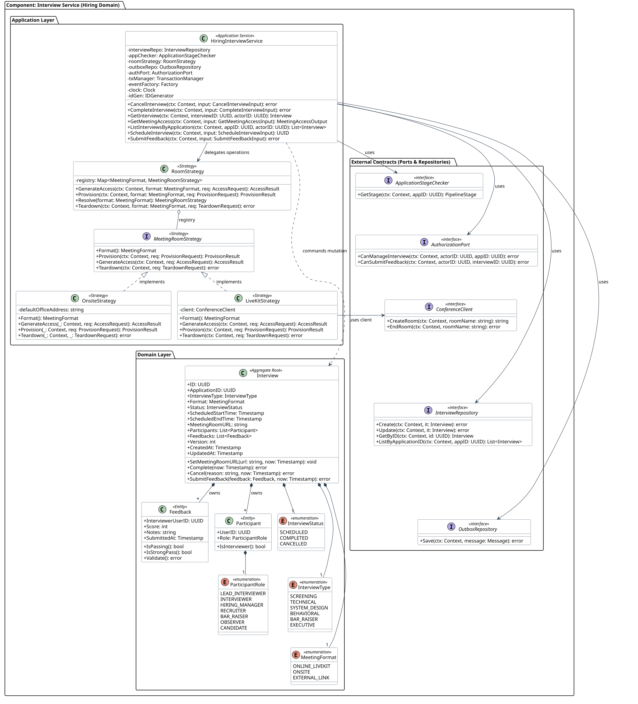

# Interview Service (Hiring Domain) — детализация кода (L4)

<!-- excerpt -->

Interview Service связывает собеседование с откликом, проверяет этап найма и сохраняет оценки участников. Стратегия работы с комнатой определяет, как организовать встречу.

Прикладной сервис управляет агрегатом Interview, в состав которого входят участники и обратная связь. Перечисления определяют статус, тип, формат встречи и роли участников. RoomStrategy выбирает реализацию очной или дистанционной встречи, LiveKitStrategy использует порт конференций. Проверка этапа отклика, полномочий и сохранение интервью выполняются через отдельные интерфейсы.



<p align="center">Рисунок - Планирование и проведение собеседования</p>

<p align="right">Таблица - Элементы. Планирование и проведение собеседования</p>

| Элемент | Тип или технология | Назначение и ответственность |
|---|---|---|
| HiringInterviewService | Класс | Прикладной сервис собеседований. Планирует встречи, изменяет их состояние и сохраняет обратную связь. |
| RoomStrategy | Класс | Реестр способов проведения интервью. Передаёт операции стратегии, выбранной для формата встречи. |
| MeetingRoomStrategy | Интерфейс | Контракт организации встречи. Определяет общий способ создания и обслуживания места проведения интервью. |
| OnsiteStrategy | Класс | Стратегия очного собеседования. Реализует операции организации встречи в выбранном месте. |
| LiveKitStrategy | Класс | Стратегия дистанционного интервью. Использует ConferenceClient для управления медиакомнатой. |
| Interview | Класс | Агрегат собеседования. Хранит параметры встречи, участников и полученные оценки. |
| Feedback | Класс | Оценка и обратная связь по собеседованию. Принадлежит агрегату Interview. |
| Participant | Класс | Участник собеседования с назначенной ролью. Хранится в составе Interview. |
| InterviewStatus | Перечисление | Допустимые состояния собеседования. Используются при изменении его жизненного цикла. |
| InterviewType | Перечисление | Тип собеседования. Задаёт назначение встречи в процессе отбора. |
| MeetingFormat | Перечисление | Формат проведения собеседования. Определяет способ организации встречи. |
| ParticipantRole | Перечисление | Роль участника встречи. Используется при формировании состава собеседования. |
| ApplicationStageChecker | Интерфейс | Порт проверки текущего этапа отклика. Позволяет согласовать проведение интервью с процессом найма. |
| AuthorizationPort | Интерфейс | Порт проверки полномочий. Прикладной сервис передаёт пользователя, ресурс и действие для принятия решения о доступе. |
| ConferenceClient | Интерфейс | Порт управления конференциями. Предоставляет операции, необходимые стратегии дистанционного интервью. |
| InterviewRepository | Интерфейс | Порт чтения и сохранения собеседований и обратной связи. Предоставляет прикладному сервису доступ к данным агрегата. |
| OutboxRepository | Интерфейс | Порт сохранения событий. Обеспечивает запись события вместе с изменением бизнес-состояния в одной локальной транзакции. |

<p align="right">Таблица - Связи. Планирование и проведение собеседования</p>

| Источник | Получатель | Содержание взаимодействия | Тип связи |
|---|---|---|---|
| HiringInterviewService | Interview | Вызывает доменные операции получателя для изменения состояния агрегата. | Зависимость |
| HiringInterviewService | ApplicationStageChecker | Использует контракт получателя для выполнения прикладной операции. | Ассоциация |
| HiringInterviewService | AuthorizationPort | Использует контракт получателя для выполнения прикладной операции. | Ассоциация |
| HiringInterviewService | InterviewRepository | Использует контракт получателя для выполнения прикладной операции. | Ассоциация |
| HiringInterviewService | OutboxRepository | Использует контракт получателя для выполнения прикладной операции. | Ассоциация |
| Interview | Feedback | Владеет составной частью Feedback. Кратность включения несколько элементов. | Композиция |
| Interview | Participant | Владеет составной частью Participant. Кратность включения несколько элементов. | Композиция |
| Interview | InterviewStatus | Владеет составной частью InterviewStatus. Кратность включения один элемент. | Композиция |
| Interview | InterviewType | Владеет составной частью InterviewType. Кратность включения один элемент. | Композиция |
| Interview | MeetingFormat | Владеет составной частью MeetingFormat. Кратность включения один элемент. | Композиция |
| Participant | ParticipantRole | Владеет составной частью ParticipantRole. Кратность включения один элемент. | Композиция |
| HiringInterviewService | RoomStrategy | Передаёт операции организации встречи выбранной стратегии. | Ассоциация |
| RoomStrategy | MeetingRoomStrategy | Хранит стратегии организации встречи для выбора по формату интервью. | Агрегация |
| OnsiteStrategy | MeetingRoomStrategy | Реализует контракт получателя и предоставляет конкретный алгоритм его выполнения. | Реализация интерфейса |
| LiveKitStrategy | MeetingRoomStrategy | Реализует контракт получателя и предоставляет конкретный алгоритм его выполнения. | Реализация интерфейса |
| LiveKitStrategy | ConferenceClient | Вызывает клиент конференций для управления медиакомнатой. | Ассоциация |

<!-- /excerpt -->

<details>
<summary>PlantUML Исходный код</summary>

```plantuml
@startuml
!include architecture/c4/plantuml/system-context(L1)/full-system(L2)/hiring-service(L3)/hiring-interview-service(L4)/hiring-interview-service.puml
@enduml
```
</details>

## 1. Архитектурные границы и принципы

1. **Изоляция Bounded Context:** Компонент владеет исключительно своими агрегатами и доменной логикой.
2. **Чистая архитектура (Ports & Adapters):** Вся внешняя инфраструктура (база данных, другие сервисы, брокер) представлена исключительно через исходящие интерфейсы.
3. **Транзакционная атомарность:** Оркестрация сценариев мутации агрегатов выполняется в рамках транзакций через Unit of Work (`TransactionManager`).

## 2. Доменная модель (Domain Layer)

### Корень агрегата `Interview` (Aggregate Root)

<p align="right">Таблица - Корень агрегата Interview (Aggregate Root) (Interview Service (Hiring Domain) - детализация кода (L4))</p>

| Поле | Тип | Назначение |
|---|---|---|
| `ID` | `UUID` | Доменное свойство агрегата |
| `ApplicationID` | `UUID` | Доменное свойство агрегата |
| `InterviewType` | `InterviewType` | Доменное свойство агрегата |
| `Format` | `MeetingFormat` | Доменное свойство агрегата |
| `Status` | `InterviewStatus` | Доменное свойство агрегата |
| `ScheduledStartTime` | `Timestamp` | Доменное свойство агрегата |
| `ScheduledEndTime` | `Timestamp` | Доменное свойство агрегата |
| `MeetingRoomURL` | `string` | Доменное свойство агрегата |
| `Participants` | `List<Participant>` | Доменное свойство агрегата |
| `Feedbacks` | `List<Feedback>` | Доменное свойство агрегата |
| `Version` | `int` | Доменное свойство агрегата |
| `CreatedAt` | `Timestamp` | Доменное свойство агрегата |
| `UpdatedAt` | `Timestamp` | Доменное свойство агрегата |

**Ключевые методы агрегата:**

* `+SetMeetingRoomURL(url: string, now: Timestamp): void`
* `+Complete(now: Timestamp): error`
* `+Cancel(reason: string, now: Timestamp): error`
* `+SubmitFeedback(feedback: Feedback, now: Timestamp): error`

### Дочерние сущности (Entities)

#### Сущность `Feedback`

* `InterviewerUserID: UUID`
* `Score: int`
* `Notes: string`
* `SubmittedAt: Timestamp`

#### Сущность `Participant`

* `UserID: UUID`
* `Role: ParticipantRole`

## 3. Сценарии использования (Application Layer)

Прикладной сервис `HiringInterviewService` оркестрирует выполнение бизнес-сценариев:

* `+CancelInterview(ctx: Context, input: CancelInterviewInput): error`
* `+CompleteInterview(ctx: Context, input: CompleteInterviewInput): error`
* `+GetInterview(ctx: Context, interviewID: UUID, actorID: UUID): Interview`
* `+GetMeetingAccess(ctx: Context, input: GetMeetingAccessInput): MeetingAccessOutput`
* `+ListInterviewsByApplication(ctx: Context, appID: UUID, actorID: UUID): List<Interview>`
* `+ScheduleInterview(ctx: Context, input: ScheduleInterviewInput): UUID`
* `+SubmitFeedback(ctx: Context, input: SubmitFeedbackInput): error`

### Стратегии прикладного уровня (RoomStrategy)

Для оркестрации стратегий используется объект стратегии `RoomStrategy`.

Интерфейс стратегии `MeetingRoomStrategy` реализуют:

* `OnsiteStrategy`
* `LiveKitStrategy`

## 4. Внешние порты и контракты (Outbound Ports)

### Порт `ApplicationStageChecker`

* `+GetStage(ctx: Context, appID: UUID): PipelineStage`

### Порт `AuthorizationPort`

* `+CanManageInterview(ctx: Context, actorID: UUID, appID: UUID): error`
* `+CanSubmitFeedback(ctx: Context, actorID: UUID, interviewID: UUID): error`

### Порт `ConferenceClient`

* `+CreateRoom(ctx: Context, roomName: string): string`
* `+EndRoom(ctx: Context, roomName: string): error`

### Порт `InterviewRepository`

* `+Create(ctx: Context, it: Interview): error`
* `+Update(ctx: Context, it: Interview): error`
* `+GetByID(ctx: Context, id: UUID): Interview`
* `+ListByApplicationID(ctx: Context, appID: UUID): List<Interview>`

### Порт `OutboxRepository`

* `+Save(ctx: Context, message: Message): error`

