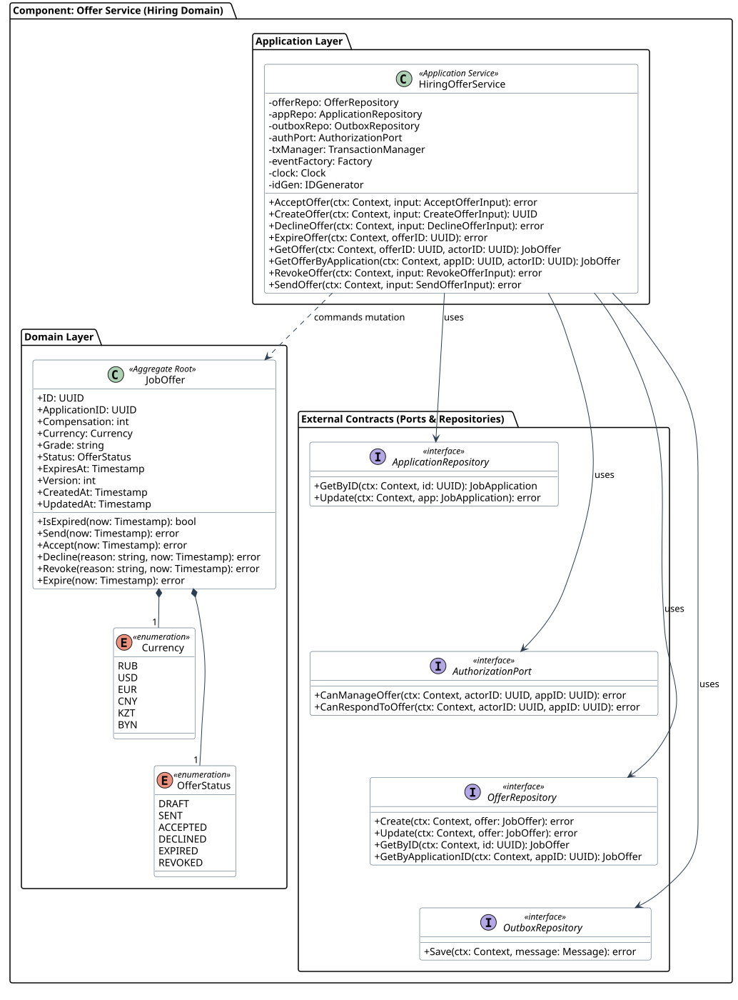

# Offer Service (Hiring Domain) — детализация кода (L4)

<!-- excerpt -->

Агрегат JobOffer хранит условия предложения и его статус. При принятии предложения прикладной сервис согласованно обновляет предложение и связанный отклик.

HiringOfferService проверяет полномочия и состояние связанного отклика перед изменением предложения. Агрегат JobOffer хранит условия, валюту и статус, определяя допустимые переходы. Репозитории предложения и отклика обеспечивают доступ к двум участникам операции принятия. События сохраняются через отдельный порт outbox для последующего уведомления заинтересованных сервисов.



<p align="center">Рисунок - Предложение о работе и его связь с откликом</p>

<p align="right">Таблица - Элементы. Предложение о работе и его связь с откликом</p>

| Элемент | Тип или технология | Назначение и ответственность |
|---|---|---|
| HiringOfferService | Класс | Прикладной сервис предложений о работе. Управляет созданием, отправкой, принятием и завершением предложения. |
| JobOffer | Класс | Агрегат предложения о работе. Хранит условия и проверяет допустимые переходы его состояния. |
| Currency | Перечисление | Допустимые валюты предложения. Используются для представления денежных условий JobOffer. |
| OfferStatus | Перечисление | Допустимые состояния предложения. Используются агрегатом JobOffer при проверке переходов. |
| ApplicationRepository | Интерфейс | Порт чтения и сохранения откликов и истории переходов. Предоставляет прикладному сервису доступ к данным агрегата. |
| AuthorizationPort | Интерфейс | Порт проверки полномочий. Прикладной сервис передаёт пользователя, ресурс и действие для принятия решения о доступе. |
| OfferRepository | Интерфейс | Порт чтения и сохранения предложений о работе и их условий. Предоставляет прикладному сервису доступ к данным агрегата. |
| OutboxRepository | Интерфейс | Порт сохранения событий. Обеспечивает запись события вместе с изменением бизнес-состояния в одной локальной транзакции. |

<p align="right">Таблица - Связи. Предложение о работе и его связь с откликом</p>

| Источник | Получатель | Содержание взаимодействия | Тип связи |
|---|---|---|---|
| HiringOfferService | JobOffer | Вызывает доменные операции получателя для изменения состояния агрегата. | Зависимость |
| HiringOfferService | ApplicationRepository | Использует контракт получателя для выполнения прикладной операции. | Ассоциация |
| HiringOfferService | AuthorizationPort | Использует контракт получателя для выполнения прикладной операции. | Ассоциация |
| HiringOfferService | OfferRepository | Использует контракт получателя для выполнения прикладной операции. | Ассоциация |
| HiringOfferService | OutboxRepository | Использует контракт получателя для выполнения прикладной операции. | Ассоциация |
| JobOffer | Currency | Владеет составной частью Currency. Кратность включения один элемент. | Композиция |
| JobOffer | OfferStatus | Владеет составной частью OfferStatus. Кратность включения один элемент. | Композиция |

<!-- /excerpt -->

<details>
<summary>PlantUML Исходный код</summary>

```plantuml
@startuml
!include architecture/c4/plantuml/system-context(L1)/full-system(L2)/hiring-service(L3)/hiring-offer-service(L4)/hiring-offer-service.puml
@enduml
```
</details>

## 1. Архитектурные границы и принципы

1. **Изоляция Bounded Context:** Компонент владеет исключительно своими агрегатами и доменной логикой.
2. **Чистая архитектура (Ports & Adapters):** Вся внешняя инфраструктура (база данных, другие сервисы, брокер) представлена исключительно через исходящие интерфейсы.
3. **Транзакционная атомарность:** Оркестрация сценариев мутации агрегатов выполняется в рамках транзакций через Unit of Work (`TransactionManager`).

## 2. Доменная модель (Domain Layer)

### Корень агрегата `JobOffer` (Aggregate Root)

<p align="right">Таблица - Корень агрегата JobOffer (Aggregate Root) (Offer Service (Hiring Domain) - детализация кода (L4))</p>

| Поле | Тип | Назначение |
|---|---|---|
| `ID` | `UUID` | Доменное свойство агрегата |
| `ApplicationID` | `UUID` | Доменное свойство агрегата |
| `Compensation` | `int` | Доменное свойство агрегата |
| `Currency` | `Currency` | Доменное свойство агрегата |
| `Grade` | `string` | Доменное свойство агрегата |
| `Status` | `OfferStatus` | Доменное свойство агрегата |
| `ExpiresAt` | `Timestamp` | Доменное свойство агрегата |
| `Version` | `int` | Доменное свойство агрегата |
| `CreatedAt` | `Timestamp` | Доменное свойство агрегата |
| `UpdatedAt` | `Timestamp` | Доменное свойство агрегата |

**Ключевые методы агрегата:**

* `+IsExpired(now: Timestamp): bool`
* `+Send(now: Timestamp): error`
* `+Accept(now: Timestamp): error`
* `+Decline(reason: string, now: Timestamp): error`
* `+Revoke(reason: string, now: Timestamp): error`
* `+Expire(now: Timestamp): error`

## 3. Сценарии использования (Application Layer)

Прикладной сервис `HiringOfferService` оркестрирует выполнение бизнес-сценариев:

* `+AcceptOffer(ctx: Context, input: AcceptOfferInput): error`
* `+CreateOffer(ctx: Context, input: CreateOfferInput): UUID`
* `+DeclineOffer(ctx: Context, input: DeclineOfferInput): error`
* `+ExpireOffer(ctx: Context, offerID: UUID): error`
* `+GetOffer(ctx: Context, offerID: UUID, actorID: UUID): JobOffer`
* `+GetOfferByApplication(ctx: Context, appID: UUID, actorID: UUID): JobOffer`
* `+RevokeOffer(ctx: Context, input: RevokeOfferInput): error`
* `+SendOffer(ctx: Context, input: SendOfferInput): error`

## 4. Внешние порты и контракты (Outbound Ports)

### Порт `ApplicationRepository`

* `+GetByID(ctx: Context, id: UUID): JobApplication`
* `+Update(ctx: Context, app: JobApplication): error`

### Порт `AuthorizationPort`

* `+CanManageOffer(ctx: Context, actorID: UUID, appID: UUID): error`
* `+CanRespondToOffer(ctx: Context, actorID: UUID, appID: UUID): error`

### Порт `OfferRepository`

* `+Create(ctx: Context, offer: JobOffer): error`
* `+Update(ctx: Context, offer: JobOffer): error`
* `+GetByID(ctx: Context, id: UUID): JobOffer`
* `+GetByApplicationID(ctx: Context, appID: UUID): JobOffer`

### Порт `OutboxRepository`

* `+Save(ctx: Context, message: Message): error`

