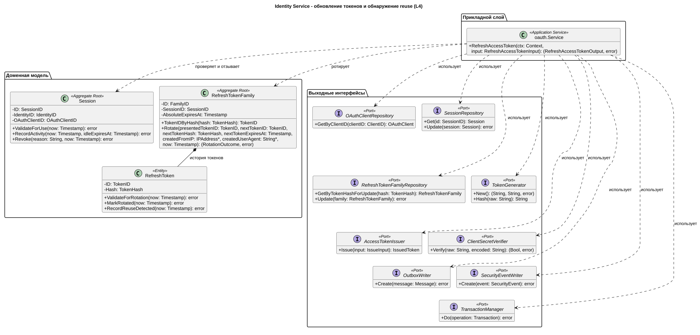

# Identity Service - обновление токенов и обнаружение reuse (L4)

<!-- excerpt -->

Диаграмма раскрывает сценарий RefreshAccessToken компонента OAuth & Token Service. Долговременная Session связывает пользователя с клиентом OAuth, RefreshTokenFamily хранит последовательность заменяемых токенов. Каждый предъявленный refresh-токен ищется по hash и проверяется в контексте семейства.

Обработчик аутентифицирует клиента, блокирует семейство для изменения и проверяет сессию. Успешная ротация заменяет текущий токен и выпускает access token. При повторном использовании уже заменённого токена семейство и сессия отзываются, события сохраняются, после commit клиент получает отказ. На схеме показаны зависимости, участвующие в этом сценарии.



<p align="center">Рисунок - Identity Service - обновление токенов и обнаружение reuse (L4)</p>

<p align="right">Таблица - Элементы. Identity Service - обновление токенов и обнаружение reuse (L4)</p>

| Элемент | Тип | Назначение и ответственность |
|---|---|---|
| oauth.Service | Прикладной сервис | Прикладной компонент обмена OAuth-токенов. При обновлении проверяет клиента и сессию, ротирует refresh-токен и выпускает новый access token. |
| Session | Корень агрегата | Долговременная сессия пользователя, привязанная к клиенту OAuth. Проверяет возможность использования и сохраняет причину отзыва. |
| RefreshTokenFamily | Корень агрегата | Семейство последовательно заменяемых refresh-токенов. Находит предъявленный токен, проверяет ротацию и обнаруживает повторное использование. |
| RefreshToken | Сущность | Один токен в истории семейства. Хранит hash и состояние использования, позволяет отличить активный токен от уже заменённого. |
| OAuthClientRepository | Выходной интерфейс | Получает клиента OAuth по client ID. Используется для проверки разрешённого способа обмена и принадлежности сессии клиенту. |
| SessionRepository | Выходной интерфейс | Загружает и обновляет долговременную пользовательскую сессию. Отзыв после обнаруженного reuse сохраняется в общей транзакции с семейством токенов. |
| RefreshTokenFamilyRepository | Выходной интерфейс | Загружает семейство по hash предъявленного токена с блокировкой для ротации. Сохраняет новое состояние и историю токенов. |
| TokenGenerator | Выходной интерфейс | Создаёт непрозрачный refresh-токен и hash для хранения. Hash предъявленного значения используется при поиске семейства. |
| AccessTokenIssuer | Выходной интерфейс | Выпускает подписанный access token для подтверждённой сессии и согласованных областей доступа. Возвращает токен и срок действия. |
| ClientSecretVerifier | Выходной интерфейс | Проверяет секрет конфиденциального клиента. Используется при аутентификации клиента перед обменом токена. |
| OutboxWriter | Выходной интерфейс | Записывает события ротации и обнаружения повторного использования. Изменение сессии и семейства фиксируется вместе с событием. |
| SecurityEventWriter | Выходной интерфейс | Сохраняет результат чувствительной операции и сведения для аудита. Используется для фиксации отказов и обнаружения злоупотребления токеном. |
| TransactionManager | Выходной интерфейс | Выполняет обработку ротации в локальной транзакции. Обнаруженный reuse фиксируется вместе с отзывом и событием до возврата ошибки клиенту. |

<p align="right">Таблица - Связи. Identity Service - обновление токенов и обнаружение reuse (L4)</p>

| Источник | Получатель | Содержание взаимодействия | Тип связи |
|---|---|---|---|
| oauth.Service | Session | Проверяет действительность сессии и отзывает её при обнаружении повторного использования refresh-токена. | Зависимость |
| oauth.Service | RefreshTokenFamily | Находит предъявленный токен и выполняет переход ротации. | Зависимость |
| RefreshTokenFamily | RefreshToken | Содержит историю токенов семейства и контролирует их состояния использования. | Композиция |
| oauth.Service | OAuthClientRepository | Получает клиента OAuth по client ID. Используется для проверки разрешённого способа обмена и принадлежности сессии клиенту. | Зависимость |
| oauth.Service | SessionRepository | Загружает и обновляет долговременную пользовательскую сессию. Отзыв после обнаруженного reuse сохраняется в общей транзакции с семейством токенов. | Зависимость |
| oauth.Service | RefreshTokenFamilyRepository | Загружает семейство по hash предъявленного токена с блокировкой для ротации. Сохраняет новое состояние и историю токенов. | Зависимость |
| oauth.Service | TokenGenerator | Создаёт непрозрачный refresh-токен и hash для хранения. Hash предъявленного значения используется при поиске семейства. | Зависимость |
| oauth.Service | AccessTokenIssuer | Выпускает подписанный access token для подтверждённой сессии и согласованных областей доступа. Возвращает токен и срок действия. | Зависимость |
| oauth.Service | ClientSecretVerifier | Проверяет секрет конфиденциального клиента. Используется при аутентификации клиента перед обменом токена. | Зависимость |
| oauth.Service | OutboxWriter | Записывает события ротации и обнаружения повторного использования. Изменение сессии и семейства фиксируется вместе с событием. | Зависимость |
| oauth.Service | SecurityEventWriter | Сохраняет результат чувствительной операции и сведения для аудита. Используется для фиксации отказов и обнаружения злоупотребления токеном. | Зависимость |
| oauth.Service | TransactionManager | Выполняет обработку ротации в локальной транзакции. Обнаруженный reuse фиксируется вместе с отзывом и событием до возврата ошибки клиенту. | Зависимость |

<!-- /excerpt -->

<details>
<summary>Исходник PlantUML</summary>

```plantuml
@startuml
!include architecture/c4/plantuml/system-context(L1)/full-system(L2)/identity-service(L3)/identity-token-rotation(L4)/identity-token-rotation.puml
@enduml
```
</details>
