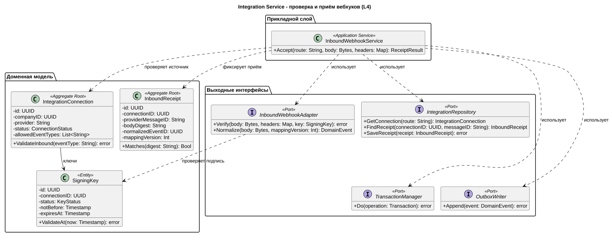

# Integration Service - проверка и приём вебхуков (L4)

<!-- excerpt -->

Диаграмма раскрывает Inbound Webhook Service. Подключение задаёт владельца и разрешённые события, ключ используется для проверки исходных байтов запроса, InboundReceipt фиксирует результат приёма внешнего сообщения.

Сервис проверяет подключение, подпись и допустимость типа события, после чего адаптер выполняет нормализацию. Квитанция и outbox сохраняются одной транзакцией. Повтор идентификатора с другим содержимым отклоняется. Подтверждение приёма возвращается после фиксации, бизнес-изменение в сервисе найма выполняется при обработке опубликованного события.



<p align="center">Рисунок - Integration Service - проверка и приём вебхуков (L4)</p>

<p align="right">Таблица - Элементы. Integration Service - проверка и приём вебхуков (L4)</p>

| Элемент | Тип | Назначение и ответственность |
|---|---|---|
| InboundWebhookService | Прикладной сервис | Координирует проверку и надёжную фиксацию вебхука. Повтор исходного сообщения возвращает сохранённый результат при совпадении контрольной суммы. |
| IntegrationConnection | Корень агрегата | Определяет компанию, провайдера и допустимые типы входящих сообщений. Проверяет состояние подключения перед приёмом. |
| InboundReceipt | Корень агрегата | Квитанция надёжного приёма внешнего сообщения. Хранит его идентификатор, digest, нормализованное событие и версии преобразования. |
| SigningKey | Сущность | Ключ проверки входящего сообщения с периодом действия и состоянием. Секрет предоставляется адаптеру только для проверки подписи. |
| IntegrationRepository | Выходной интерфейс | Получает подключение и сохраняет квитанцию по идентификатору сообщения провайдера. Уникальность подключения и номера сообщения защищает от повторного приёма. |
| InboundWebhookAdapter | Выходной интерфейс | Проверяет подпись над исходными байтами и преобразует допустимый внешний контракт в доменное событие. Сохраняет версии схемы и преобразования. |
| TransactionManager | Выходной интерфейс | Выполняет изменения нескольких локальных записей в одной транзакции. Сетевые операции выполняются за её пределами. |
| OutboxWriter | Выходной интерфейс | Записывает доменное событие в локальной транзакции вместе с бизнес-изменением. Дальнейшая публикация выполняется событийной инфраструктурой. |

<p align="right">Таблица - Связи. Integration Service - проверка и приём вебхуков (L4)</p>

| Источник | Получатель | Содержание взаимодействия | Тип связи |
|---|---|---|---|
| InboundWebhookService | IntegrationConnection | Проверяет компанию, состояние подключения и допустимый тип события. | Зависимость |
| InboundWebhookService | InboundReceipt | Находит повтор или создаёт квитанцию принятого сообщения. | Зависимость |
| IntegrationConnection | SigningKey | Связывает ключ проверки с конкретным входящим подключением. | Ассоциация |
| InboundWebhookAdapter | SigningKey | Проверяет срок использования ключа и подпись над исходным телом. | Зависимость |
| InboundWebhookService | IntegrationRepository | Получает подключение и сохраняет квитанцию по идентификатору сообщения провайдера. Уникальность подключения и номера сообщения защищает от повторного приёма. | Зависимость |
| InboundWebhookService | InboundWebhookAdapter | Проверяет подпись над исходными байтами и преобразует допустимый внешний контракт в доменное событие. Сохраняет версии схемы и преобразования. | Зависимость |
| InboundWebhookService | TransactionManager | Выполняет изменения нескольких локальных записей в одной транзакции. Сетевые операции выполняются за её пределами. | Зависимость |
| InboundWebhookService | OutboxWriter | Записывает доменное событие в локальной транзакции вместе с бизнес-изменением. Дальнейшая публикация выполняется событийной инфраструктурой. | Зависимость |

<!-- /excerpt -->

<details>
<summary>Исходник PlantUML</summary>

```plantuml
@startuml
!include architecture/c4/plantuml/system-context(L1)/full-system(L2)/integration-service(L3)/integration-inbound-webhook(L4)/integration-inbound-webhook.puml
@enduml
```
</details>
