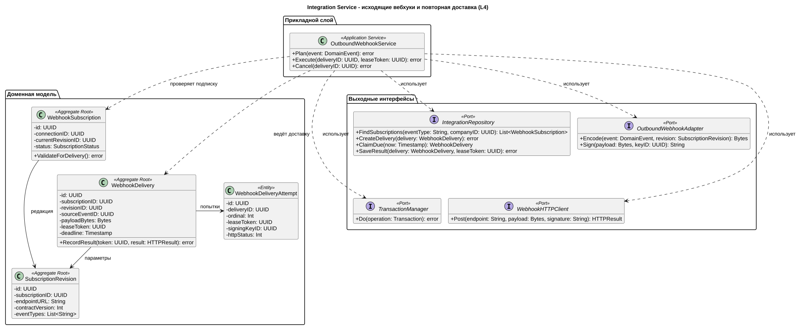

# Integration Service - исходящие вебхуки и повторная доставка (L4)

<!-- excerpt -->

Диаграмма раскрывает Outbound Webhook Service. Подписка определяет разрешённое назначение, редакция закрепляет параметры внешнего контракта, WebhookDelivery хранит точные байты сообщения. Попытки отправки записываются в журнал отдельно от состояния доставки.

По доменному событию сервис создаёт доставки только для разрешённых подписок соответствующей компании. Обработчик захватывает доставку на ограниченный срок, подписывает сообщение и вызывает HTTP-клиент вне транзакции. Результат сохраняется по актуальному lease token. При потере ответа повтор использует прежний идентификатор доставки и payload, получатель должен учитывать повторные сообщения.



<p align="center">Рисунок - Integration Service - исходящие вебхуки и повторная доставка (L4)</p>

<p align="right">Таблица - Элементы. Integration Service - исходящие вебхуки и повторная доставка (L4)</p>

| Элемент | Тип | Назначение и ответственность |
|---|---|---|
| OutboundWebhookService | Прикладной сервис | Планирует доставки по активным подпискам и исполняет попытку отправки. Согласует состояние подписки, неизменяемый payload и результат актуального обработчика. |
| WebhookSubscription | Корень агрегата | Подписка компании на внешнее назначение. Хранит состояние и выбранную редакцию параметров отправки. |
| SubscriptionRevision | Корень агрегата | Неизменяемая редакция адреса, версии контракта и типов событий. Доставка закрепляет её при планировании. |
| WebhookDelivery | Корень агрегата | Одна доставка события по подписке с закреплённой редакцией и payload. Контролирует состояние, срок и актуальность аренды. |
| WebhookDeliveryAttempt | Сущность | Запись одной сетевой попытки с номером, ключом подписи и lease token. Сохраняет HTTP-статус или класс ошибки. |
| IntegrationRepository | Выходной интерфейс | Хранит подписки, редакции и доставки. Захватывает готовую доставку и применяет результат с проверкой lease token. |
| OutboundWebhookAdapter | Выходной интерфейс | Сериализует согласованный внешний контракт и формирует подпись попытки. Повтор доставки использует закреплённые байты сообщения. |
| WebhookHTTPClient | Выходной интерфейс | Отправляет HTTPS-запрос к разрешённому назначению с ограничениями времени и размера ответа. Проверяет адрес назначения при установлении соединения. |
| TransactionManager | Выходной интерфейс | Выполняет изменения нескольких локальных записей в одной транзакции. Сетевые операции выполняются за её пределами. |

<p align="right">Таблица - Связи. Integration Service - исходящие вебхуки и повторная доставка (L4)</p>

| Источник | Получатель | Содержание взаимодействия | Тип связи |
|---|---|---|---|
| OutboundWebhookService | WebhookSubscription | Отбирает подписки и проверяет их доступность для отправки. | Зависимость |
| WebhookSubscription | SubscriptionRevision | Указывает выбранные параметры адреса и формата сообщения. | Ассоциация |
| OutboundWebhookService | WebhookDelivery | Планирует доставку и применяет результат сетевой попытки. | Зависимость |
| WebhookDelivery | SubscriptionRevision | Закрепляет редакцию, действовавшую при создании доставки. | Ассоциация |
| WebhookDelivery | WebhookDeliveryAttempt | Связывает историю попыток с одной доставкой. | Ассоциация |
| OutboundWebhookService | IntegrationRepository | Хранит подписки, редакции и доставки. Захватывает готовую доставку и применяет результат с проверкой lease token. | Зависимость |
| OutboundWebhookService | OutboundWebhookAdapter | Сериализует согласованный внешний контракт и формирует подпись попытки. Повтор доставки использует закреплённые байты сообщения. | Зависимость |
| OutboundWebhookService | WebhookHTTPClient | Отправляет HTTPS-запрос к разрешённому назначению с ограничениями времени и размера ответа. Проверяет адрес назначения при установлении соединения. | Зависимость |
| OutboundWebhookService | TransactionManager | Выполняет изменения нескольких локальных записей в одной транзакции. Сетевые операции выполняются за её пределами. | Зависимость |

<!-- /excerpt -->

<details>
<summary>Исходник PlantUML</summary>

```plantuml
@startuml
!include architecture/c4/plantuml/system-context(L1)/full-system(L2)/integration-service(L3)/integration-outbound-webhook(L4)/integration-outbound-webhook.puml
@enduml
```
</details>
