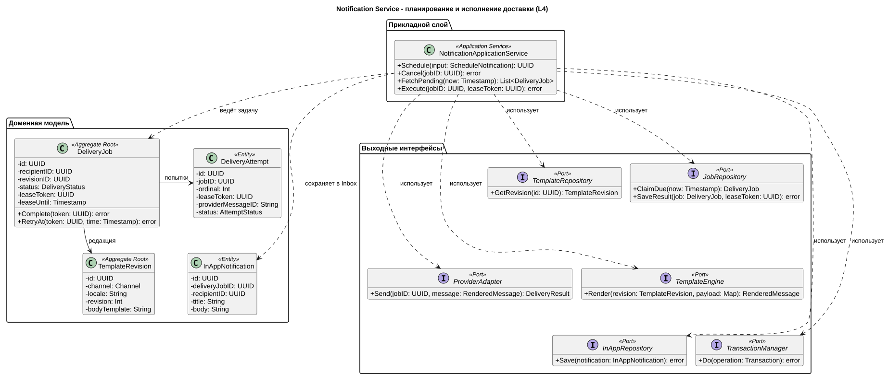

# Notification Service - планирование и исполнение доставки (L4)

<!-- excerpt -->

Диаграмма раскрывает прикладной компонент Notification Service. DeliveryJob связывает получателя, редакцию шаблона и состояние доставки. Попытки фиксируются отдельно, а InAppNotification сохраняет снимок сообщения в личном кабинете.

Обработчик захватывает задачу на ограниченный срок, формирует и фиксирует текст, затем выполняет внешний вызов. Результат применяется с проверкой lease token. При временном сбое планируется следующая попытка с тем же снимком сообщения. Получатель внешнего канала может получить повтор при потере подтверждения провайдера.



<p align="center">Рисунок - Notification Service - планирование и исполнение доставки (L4)</p>

<p align="right">Таблица - Элементы. Notification Service - планирование и исполнение доставки (L4)</p>

| Элемент | Тип | Назначение и ответственность |
|---|---|---|
| NotificationApplicationService | Прикладной сервис | Планирует, отменяет и исполняет задачи уведомлений. Координирует выбор редакции, рендеринг, захват задачи и применение результата попытки. |
| DeliveryJob | Корень агрегата | Описывает доставку одному получателю по одной редакции. Хранит расписание, снимок текста, состояние и аренду обработчика. |
| DeliveryAttempt | Сущность | Фиксирует одну попытку доставки, её номер, исполнителя и результат. Позволяет различать повторные отправки одной задачи. |
| TemplateRevision | Корень агрегата | Опубликованная редакция текста для канала и локали. После закрепления задачи её содержимое используется при рендеринге уведомления. |
| InAppNotification | Сущность | Снимок показанного уведомления в личном кабинете. Связан с получателем и единственной задачей доставки. |
| TemplateRepository | Выходной интерфейс | Получает неизменяемую опубликованную редакцию шаблона. Выбранная редакция закрепляется за задачей доставки. |
| JobRepository | Выходной интерфейс | Сохраняет задачи, захватывает готовые к исполнению и фиксирует результат по действующему lease token. Устаревший обработчик не перезаписывает новую попытку. |
| TemplateEngine | Выходной интерфейс | Формирует тему и текст по редакции шаблона и данным задачи. Результат фиксируется для повторного использования при следующих попытках. |
| ProviderAdapter | Выходной интерфейс | Передаёт подготовленное сообщение внешнему провайдеру. Возвращает идентификатор доставки и классифицированный результат попытки. |
| InAppRepository | Выходной интерфейс | Сохраняет снимок уведомления для пользователя. Одна задача in-app создаёт один элемент Inbox. |
| TransactionManager | Выходной интерфейс | Выполняет изменения нескольких локальных записей в одной транзакции. Сетевые операции выполняются за её пределами. |

<p align="right">Таблица - Связи. Notification Service - планирование и исполнение доставки (L4)</p>

| Источник | Получатель | Содержание взаимодействия | Тип связи |
|---|---|---|---|
| NotificationApplicationService | DeliveryJob | Создаёт задачу, отменяет её и применяет результат актуальной попытки. | Зависимость |
| DeliveryJob | DeliveryAttempt | Имеет журнал попыток доставки с порядковыми номерами. | Ассоциация |
| DeliveryJob | TemplateRevision | Закрепляет неизменяемую редакцию шаблона по идентификатору. | Ассоциация |
| NotificationApplicationService | InAppNotification | Создаёт сохранённый снимок для задачи канала in-app. | Зависимость |
| NotificationApplicationService | TemplateRepository | Получает неизменяемую опубликованную редакцию шаблона. Выбранная редакция закрепляется за задачей доставки. | Зависимость |
| NotificationApplicationService | JobRepository | Сохраняет задачи, захватывает готовые к исполнению и фиксирует результат по действующему lease token. Устаревший обработчик не перезаписывает новую попытку. | Зависимость |
| NotificationApplicationService | TemplateEngine | Формирует тему и текст по редакции шаблона и данным задачи. Результат фиксируется для повторного использования при следующих попытках. | Зависимость |
| NotificationApplicationService | ProviderAdapter | Передаёт подготовленное сообщение внешнему провайдеру. Возвращает идентификатор доставки и классифицированный результат попытки. | Зависимость |
| NotificationApplicationService | InAppRepository | Сохраняет снимок уведомления для пользователя. Одна задача in-app создаёт один элемент Inbox. | Зависимость |
| NotificationApplicationService | TransactionManager | Выполняет изменения нескольких локальных записей в одной транзакции. Сетевые операции выполняются за её пределами. | Зависимость |

<!-- /excerpt -->

<details>
<summary>Исходник PlantUML</summary>

```plantuml
@startuml
!include architecture/c4/plantuml/system-context(L1)/full-system(L2)/notification-service(L3)/notification-delivery(L4)/notification-delivery.puml
@enduml
```
</details>
