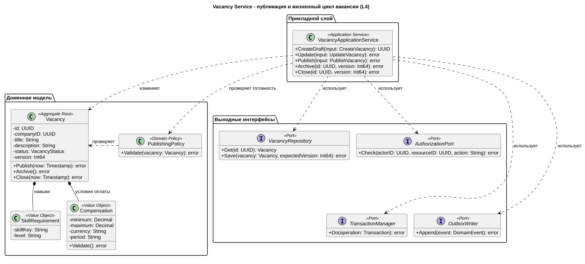

# Vacancy Service - публикация и жизненный цикл вакансии (L4)

<!-- excerpt -->

Диаграмма раскрывает компонент изменения вакансий. Vacancy объединяет содержание объявления, навыки и условия компенсации. PublishingPolicy проверяет готовность к публикации, а агрегат контролирует допустимый переход состояния.

Прикладной сервис проверяет полномочия и актуальную версию, применяет доменные правила и сохраняет вакансию вместе с событием. Архивирование и закрытие изменяют доступность публикации. Навыки и компенсация сохраняются в составе вакансии.



<p align="center">Рисунок - Vacancy Service - публикация и жизненный цикл вакансии (L4)</p>

<p align="right">Таблица - Элементы. Vacancy Service - публикация и жизненный цикл вакансии (L4)</p>

| Элемент | Тип | Назначение и ответственность |
|---|---|---|
| VacancyApplicationService | Прикладной сервис | Координирует редактирование и переходы жизненного цикла вакансии. Проверяет доступ, применяет PublishingPolicy и сохраняет результат с событием. |
| Vacancy | Корень агрегата | Хранит содержание, требования, состояние публикации и версию вакансии. Проверяет допустимость переходов между черновиком, публикацией, архивом и закрытием. |
| PublishingPolicy | Доменная политика | Проверяет готовность вакансии к публикации. Учитывает полноту заголовка, описания и набора навыков перед открытием публичного просмотра. |
| SkillRequirement | Объект-значение | Представляет требуемый навык внутри вакансии. Ключ навыка нормализуется и проверяется на повтор в наборе требований. |
| Compensation | Объект-значение | Представляет денежные условия вакансии. Проверяет согласованность границ суммы, валюты и периода выплаты. |
| VacancyRepository | Выходной интерфейс | Загружает агрегат вакансии вместе с навыками. Сохраняет состояние и вложенные значения с проверкой ожидаемой версии. |
| AuthorizationPort | Выходной интерфейс | Проверяет право пользователя или вызывающего сервиса на действие с ресурсом. При отказе прикладная операция завершается без изменения данных. |
| TransactionManager | Выходной интерфейс | Выполняет изменения нескольких локальных записей в одной транзакции. Сетевые операции выполняются за её пределами. |
| OutboxWriter | Выходной интерфейс | Записывает доменное событие в локальной транзакции вместе с бизнес-изменением. Дальнейшая публикация выполняется событийной инфраструктурой. |

<p align="right">Таблица - Связи. Vacancy Service - публикация и жизненный цикл вакансии (L4)</p>

| Источник | Получатель | Содержание взаимодействия | Тип связи |
|---|---|---|---|
| VacancyApplicationService | Vacancy | Вызывает операции создания, изменения и смены состояния вакансии. | Зависимость |
| VacancyApplicationService | PublishingPolicy | Проверяет готовность данных перед публикацией или восстановлением. | Зависимость |
| PublishingPolicy | Vacancy | Читает содержимое и требования вакансии для проверки условий публикации. | Зависимость |
| Vacancy | SkillRequirement | Содержит набор требований к навыкам в составе агрегата. | Композиция |
| Vacancy | Compensation | Содержит денежные условия публикации. | Композиция |
| VacancyApplicationService | VacancyRepository | Загружает агрегат вакансии вместе с навыками. Сохраняет состояние и вложенные значения с проверкой ожидаемой версии. | Зависимость |
| VacancyApplicationService | AuthorizationPort | Проверяет право пользователя или вызывающего сервиса на действие с ресурсом. При отказе прикладная операция завершается без изменения данных. | Зависимость |
| VacancyApplicationService | TransactionManager | Выполняет изменения нескольких локальных записей в одной транзакции. Сетевые операции выполняются за её пределами. | Зависимость |
| VacancyApplicationService | OutboxWriter | Записывает доменное событие в локальной транзакции вместе с бизнес-изменением. Дальнейшая публикация выполняется событийной инфраструктурой. | Зависимость |

<!-- /excerpt -->

<details>
<summary>Исходник PlantUML</summary>

```plantuml
@startuml
!include architecture/c4/plantuml/system-context(L1)/full-system(L2)/vacancy-service(L3)/vacancy-publication(L4)/vacancy-publication.puml
@enduml
```
</details>
