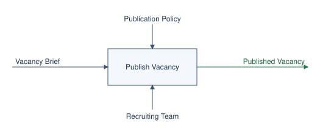
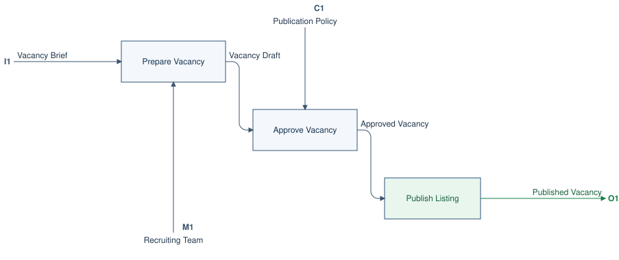
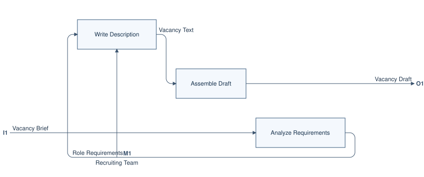
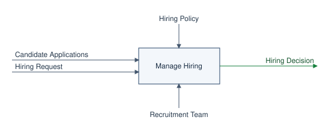
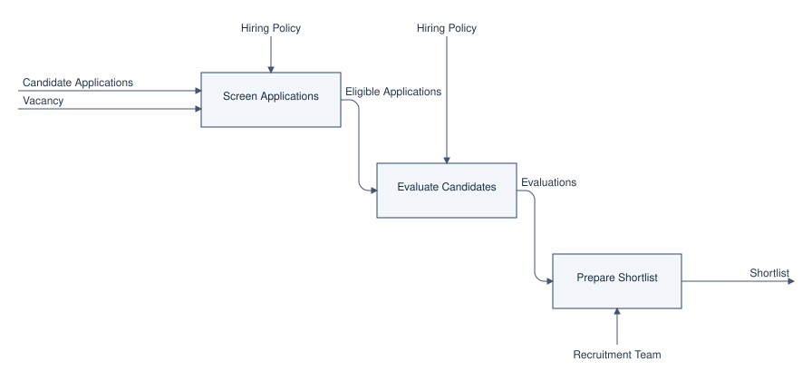

# Примеры IDEF0: уровни, границы и туннели

Ниже две работающие модели: публикация вакансии с тремя уровнями без туннелей и наём с туннелями на обеих сторонах границы. Все изображения получаются из `.idef0` и соседнего `.idef0.json`; их можно открыть отдельно в полном размере. Если хотите писать диаграмму прямо в Markdown, начните с [подробных примеров на русском](03-practical-examples.md): там есть готовый код, результат и разбор каждой границы.

## Пример 1. Публикация вакансии без туннелей

[Исходник](../../idef0-svg/models/vacancy-publication.idef0) · [настройки видов и цветов](../../idef0-svg/models/vacancy-publication.idef0.json)

В модели одно дерево функций:

```text
Publish Vacancy
├── Prepare Vacancy
│   ├── Analyze Requirements
│   ├── Write Description
│   └── Assemble Draft
├── Approve Vacancy
└── Publish Listing
```

### Контекст A-0: один блок и его граница

```text
Publish Vacancy receives Vacancy Brief
Publish Vacancy respects Publication Policy
Publish Vacancy requires Recruiting Team
Publish Vacancy produces Published Vacancy
```

Слева входит задание на вакансию, сверху действует правило публикации, снизу участвует команда, справа получается опубликованная вакансия.



### Уровень A0: три дочерние функции

```text
Publish Vacancy is composed of Prepare Vacancy
Publish Vacancy is composed of Approve Vacancy
Publish Vacancy is composed of Publish Listing

Prepare Vacancy receives Vacancy Brief
Prepare Vacancy requires Recruiting Team
Prepare Vacancy produces Vacancy Draft
Approve Vacancy receives Vacancy Draft
Approve Vacancy respects Publication Policy
Approve Vacancy produces Approved Vacancy
Publish Listing receives Approved Vacancy
Publish Listing produces Published Vacancy
```

`Vacancy Draft` связывает подготовку с согласованием, а `Approved Vacancy` — согласование с публикацией. Они остаются **внутри** A0, поэтому на границе A0 нет стрелок с такими именами.



| Стрелка блока `Publish Vacancy` | Граница A0 | Код |
| --- | --- | --- |
| Input `Vacancy Brief` | Входит в `Prepare Vacancy`. | `I1` |
| Control `Publication Policy` | Входит в `Approve Vacancy`. | `C1` |
| Mechanism `Recruiting Team` | Входит в `Prepare Vacancy`. | `M1` |
| Output `Published Vacancy` | Выходит из `Publish Listing`. | `O1` |

### Уровень A1: раскрываем `Prepare Vacancy`

```text
Prepare Vacancy is composed of Analyze Requirements
Prepare Vacancy is composed of Write Description
Prepare Vacancy is composed of Assemble Draft

Analyze Requirements receives Vacancy Brief
Analyze Requirements produces Role Requirements
Write Description receives Role Requirements
Write Description requires Recruiting Team
Write Description produces Vacancy Text
Assemble Draft receives Vacancy Text
Assemble Draft produces Vacancy Draft
```



На этом уровне `Vacancy Brief` (`I1`), `Recruiting Team` (`M1`) и `Vacancy Draft` (`O1`) совпадают с границей блока `Prepare Vacancy` на A0. `Role Requirements` и `Vacancy Text` — только внутренние связи A1. В [отдельном виде блока `Approve Vacancy`](../../idef0-svg/models/vacancy-publication-approve-vacancy.svg) можно посмотреть, как режим `focus` показывает конечную функцию без дочерней диаграммы.

В JSON для этих изображений достаточно перечислить виды. Поле `boundaries` отсутствует, потому что стрелки каждого раскрываемого блока и соответствующей дочерней диаграммы совпадают:

```json
{
  "mode": "decompose",
  "process": "Publish Vacancy",
  "views": [
    { "name": "context", "mode": "focus", "process": "Publish Vacancy" },
    { "name": "prepare-vacancy", "mode": "decompose", "process": "Prepare Vacancy" },
    { "name": "approve-vacancy", "mode": "focus", "process": "Approve Vacancy" }
  ]
}
```

## Пример 2. Наём: туннель у родителя и у ребёнка

[Исходник](../../idef0-svg/models/hiring.idef0) · [настройки с туннелями](../../idef0-svg/models/hiring.idef0.json)

Контекст задаёт интерфейс `Manage Hiring`, A0 раскрывает его в `Publish Vacancy`, `Review Applications` и `Make Decision`.




Дочерний блок `Review Applications` на A0 имеет `Vacancy`, `Candidate Applications`, `Hiring Policy`, `Recruitment Team` и `Shortlist`. Его декомпозиция содержит `Screen Applications`, `Evaluate Candidates` и `Prepare Shortlist`.

```text
Review Applications receives Vacancy
Review Applications receives Candidate Applications
Review Applications respects Hiring Policy
Review Applications requires Recruitment Team
Review Applications produces Shortlist

Review Applications is composed of Screen Applications
Review Applications is composed of Evaluate Candidates
Review Applications is composed of Prepare Shortlist

Screen Applications receives Vacancy
Screen Applications receives Candidate Applications
Screen Applications requires Screening Tool
Screen Applications produces Eligible Applications
Evaluate Candidates receives Eligible Applications
Evaluate Candidates produces Evaluations
Prepare Shortlist receives Evaluations
Prepare Shortlist requires Recruitment Team
Prepare Shortlist produces Shortlist
```



| Пара «роль + понятие» | Блок `Review Applications` на A0 | Граница дочерней диаграммы | Решение |
| --- | --- | --- | --- |
| Input `Vacancy` | Есть. | Есть, `I1`. | Обычная граница. |
| Input `Candidate Applications` | Есть. | Есть, `I2`. | Обычная граница. |
| Mechanism `Recruitment Team` | Есть. | Есть, `M1`. | Обычная граница. |
| Output `Shortlist` | Есть. | Есть, `O1`. | Обычная граница. |
| Control `Hiring Policy` | Есть; у блока стоят скобки. | Опущена. | Туннель на стороне родителя. |
| Mechanism `Screening Tool` | Нет. | Есть со скобками у границы, без ICOM-кода. | Туннель на стороне ребёнка. |

Скобки — явная пометка исключения, а не оборванная стрелка. Для этой пары видов настройка выглядит так:

```json
{
  "boundaries": {
    "Review Applications": {
      "parent_tunnels": { "control": ["Hiring Policy"] },
      "child_tunnels": { "mechanism": ["Screening Tool"] }
    }
  }
}
```

Если убрать объявление `Screening Tool` из `child_tunnels`, сборка остановится с сообщением `boundary mismatch` и назовёт лишнюю граничную стрелку `mechanism:Screening Tool`. Если добавить туннель в JSON, но оставить обычную совпадающую стрелку в модели, сборка тоже остановится: исключение должно соответствовать реальному различию уровней.

## Как сделать свой пример

1. Запишите корневую функцию и её четыре типа ICOM-стрелок в `<имя>.idef0`.
2. Добавьте строки `is composed of` и ICOM-стрелки каждой дочерней функции. Для следующего уровня повторите шаг.
3. Сравните интерфейс каждого раскрываемого блока с внешними стрелками его дочерней диаграммы. Обычные стрелки должны иметь одинаковые роль и имя. Оставшиеся различия внесите в `boundaries` как туннели.
4. Добавьте нужные `views` в `<имя>.idef0.json`, запустите `make idef0-render` и откройте все созданные SVG. Подключите их в Markdown относительными ссылками.

Подробное описание DSL, настроек цвета, синхронизации и подключения находится в [руководстве по IDEF0](index.md).
