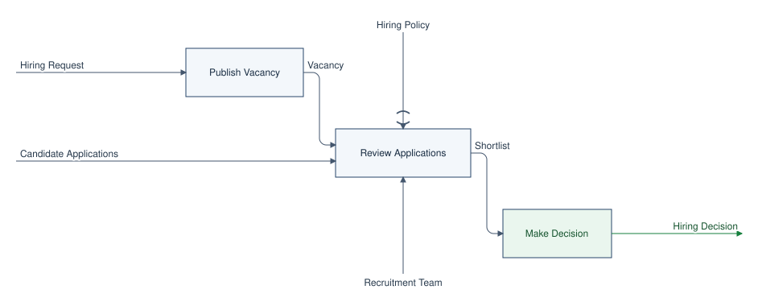

# IDEF0: модель, вложенность и подключение

IDEF0 показывает **что делает функция** и какие входы, правила, результаты и исполнители с ней связаны. Блок обозначает функцию, стрелки — её интерфейс. Декомпозиция раскрывает функцию в несколько дочерних блоков. Так удобно описывать бизнес-процессы Careeria на разных уровнях, не смешивая их с порядком экранных действий или технической структурой сервисов.

Схемы строятся из текста через [IDEF0-SVG](https://github.com/jimmyjazz/IDEF0-SVG). В репозитории закреплён исходный Ruby-генератор; локальный адаптер добавляет цвета, несколько представлений одной модели, проверку границ, ICOM-коды и обозначение туннелей.

Подробный синтаксис каждой строки и настройки находится в [справочнике команд IDEF0](01-commands.md). Для начала с копируемого кода откройте [пошаговые примеры на русском](03-practical-examples.md); отдельные многоуровневые модели с разбором стрелок — в [примерах](02-examples.md).

Если в исходнике есть ошибка, `make docs` покажет её прямо на странице или в заметном предупреждении для отдельной модели. Формат сообщений и порядок исправления описаны в [разделе об ошибках](01-commands.md#как-показываются-ошибки).

## Самый простой способ: схема прямо на странице

Вставьте блок `idef0` в нужную Markdown-страницу. Ни `.idef0`, ни JSON, ни путь к SVG указывать не требуется. Имена функций, стрелок и предикаты можно писать по-русски:

````markdown
```idef0
@export obrabotka-zayavki.svg
Обработать заявку получает Заявка кандидата
Обработать заявку подчиняется Правила отбора
Обработать заявку требует Команда подбора
Обработать заявку создаёт Решение по кандидату
Обработать заявку состоит из Проверить опыт кандидата и соответствие требованиям вакансии
Обработать заявку состоит из Подготовить итоговое решение по результатам рассмотрения
Проверить опыт кандидата и соответствие требованиям вакансии получает Заявка кандидата
Проверить опыт кандидата и соответствие требованиям вакансии подчиняется Правила отбора
Проверить опыт кандидата и соответствие требованиям вакансии использует Команда подбора
Проверить опыт кандидата и соответствие требованиям вакансии создаёт Результаты проверки
Подготовить итоговое решение по результатам рассмотрения получает Результаты проверки
Подготовить итоговое решение по результатам рассмотрения создаёт Решение по кандидату
```
````

Это рабочий пример; ниже — результат того же блока:

```idef0
@export obrabotka-zayavki.svg
Обработать заявку получает Заявка кандидата
Обработать заявку подчиняется Правила отбора
Обработать заявку требует Команда подбора
Обработать заявку создаёт Решение по кандидату
Обработать заявку состоит из Проверить опыт кандидата и соответствие требованиям вакансии
Обработать заявку состоит из Подготовить итоговое решение по результатам рассмотрения
Проверить опыт кандидата и соответствие требованиям вакансии получает Заявка кандидата
Проверить опыт кандидата и соответствие требованиям вакансии подчиняется Правила отбора
Проверить опыт кандидата и соответствие требованиям вакансии использует Команда подбора
Проверить опыт кандидата и соответствие требованиям вакансии создаёт Результаты проверки
Подготовить итоговое решение по результатам рассмотрения получает Результаты проверки
Подготовить итоговое решение по результатам рассмотрения создаёт Решение по кандидату
```

При `make docs` страница и встроенная SVG пересобираются после сохранения Markdown. Статическая сборка `make docs-build` делает то же. Длинные названия блоков переносятся на несколько строк. Исходником схемы служит блок на странице.

Строка `@export obrabotka-zayavki.svg` дополнительно сохраняет файл **рядом с этой Markdown-страницей**: [открыть SVG примера](obrabotka-zayavki.svg). Его можно вставить на другую страницу обычной ссылкой с относительным путём. Для страницы с несколькими `@view` появятся `obrabotka-zayavki.svg`, `obrabotka-zayavki-2.svg` и так далее в порядке строк `@view`. Если отдельный файл не нужен, удалите `@export` и прежний SVG. Команда `make idef0-render` обновляет экспортированные SVG и без сборки сайта.

Чтобы из **одного блока** показать контекст и несколько уровней, добавьте строки `@view` перед описанием функций. Без `@view` показывается корневая декомпозиция; для функции без дочерних блоков автоматически выбирается вид `focus`.

### Полный пример: вложенность, цвета и туннели

Этот блок можно целиком вставить на любую Markdown-страницу в `docs/`. Он создаст три схемы из одной модели: контекст найма, декомпозицию найма и декомпозицию проверки откликов.

````markdown
```idef0
@view focus Manage Hiring
@view decompose Manage Hiring
@view decompose Review Applications

@defaults arrow=#43566D arrow_text=#26384B block_fill=#F3F7FB block_stroke=#27466A block_text=#172B41
@block Make Decision | fill=#EAF6EE text=#14532D
@arrow Hiring Decision | stroke=#15803D text=#14532D

@tunnel parent | Review Applications | control | Hiring Policy
@tunnel child | Review Applications | mechanism | Screening Tool

Manage Hiring receives Запрос на найм
Manage Hiring receives Candidate Applications
Manage Hiring respects Hiring Policy
Manage Hiring requires Recruitment Team
Manage Hiring produces Hiring Decision
Manage Hiring is composed of Publish Vacancy
Manage Hiring is composed of Review Applications
Manage Hiring is composed of Make Decision

Publish Vacancy receives Запрос на найм
Publish Vacancy produces Вакансия

Review Applications receives Вакансия
Review Applications receives Candidate Applications
Review Applications respects Hiring Policy
Review Applications requires Recruitment Team
Review Applications produces Shortlist
Review Applications is composed of Screen Applications
Review Applications is composed of Evaluate Candidates
Review Applications is composed of Prepare Shortlist

Screen Applications receives Вакансия
Screen Applications receives Candidate Applications
Screen Applications requires Screening Tool
Screen Applications produces Eligible Applications
Evaluate Candidates receives Eligible Applications
Evaluate Candidates produces Evaluations
Prepare Shortlist receives Evaluations
Prepare Shortlist requires Recruitment Team
Prepare Shortlist produces Shortlist

Make Decision receives Shortlist
Make Decision produces Hiring Decision
```
````

Результат этого кода:
```idef0
@view focus Manage Hiring
@view decompose Manage Hiring
@view decompose Review Applications

@defaults arrow=#43566D arrow_text=#26384B block_fill=#F3F7FB block_stroke=#27466A block_text=#172B41
@block Make Decision | fill=#EAF6EE text=#14532D
@arrow Hiring Decision | stroke=#15803D text=#14532D

@tunnel parent | Review Applications | control | Hiring Policy
@tunnel child | Review Applications | mechanism | Screening Tool

Manage Hiring receives Запрос на найм
Manage Hiring receives Candidate Applications
Manage Hiring respects Hiring Policy
Manage Hiring requires Recruitment Team
Manage Hiring produces Hiring Decision
Manage Hiring is composed of Publish Vacancy
Manage Hiring is composed of Review Applications
Manage Hiring is composed of Make Decision

Publish Vacancy receives Запрос на найм
Publish Vacancy produces Вакансия

Review Applications receives Вакансия
Review Applications receives Candidate Applications
Review Applications respects Hiring Policy
Review Applications requires Recruitment Team
Review Applications produces Shortlist
Review Applications is composed of Screen Applications
Review Applications is composed of Evaluate Candidates
Review Applications is composed of Prepare Shortlist

Screen Applications receives Вакансия
Screen Applications receives Candidate Applications
Screen Applications requires Screening Tool
Screen Applications produces Eligible Applications
Evaluate Candidates receives Eligible Applications
Evaluate Candidates produces Evaluations
Prepare Shortlist receives Evaluations
Prepare Shortlist requires Recruitment Team
Prepare Shortlist produces Shortlist

Make Decision receives Shortlist
Make Decision produces Hiring Decision
```

Строки `is composed of` задают дерево функций. Каждая строка `@view` выводит один уровень: `focus` — один блок с границей, `decompose` — его непосредственные дочерние блоки. Чтобы раскрыть ещё один уровень, добавьте функции в модель и строку `@view decompose Имя Функции`.

`@defaults` задаёт общие цвета; `@block` меняет `fill`, `stroke` или `text` у блока по точному имени; `@arrow` меняет `stroke` и `text` стрелки. `@tunnel parent` отмечает стрелку на родительском блоке, опущенную на дочерней схеме; `@tunnel child` — стрелку только на дочерней схеме. Нельзя оставлять такие различия без `@tunnel`: проверка границ остановит сборку. Подробности цветов и ролей стрелок — ниже на этой странице.

## Когда модель нужна в отдельном файле

Выбирайте этот способ, если модель должна храниться отдельно от любой конкретной страницы и использоваться в нескольких местах. Для экспорта встроенной схемы достаточно `@export`.

| Файл | Роль |
| --- | --- |
| `docs/idef0-svg/models/hiring.idef0` | Единственный редактируемый источник функций, стрелок и вложенности процесса найма. |
| `docs/idef0-svg/models/hiring.idef0.json` | Выбор функции и режима для каждого вида, цвета и явные туннели. Необязателен, если границы сбалансированы без туннелей. |
| `docs/idef0-svg/models/hiring.svg` | Сгенерированная главная схема. |
| `docs/idef0-svg/models/hiring-review-applications.svg` | Сгенерированный вложенный вид из того же `.idef0`. |
| Markdown-страница | Объясняет цель и границы модели, подключает SVG и связывает уровни ссылками. |

Сохраняйте собственные модели в `docs/idef0-svg/models/`. Имя файла делайте коротким и понятным по процессу, например `candidate-assessment.idef0`.

### Как добавить отдельную модель

**1. Создайте модель** `docs/idef0-svg/models/candidate-assessment.idef0`. Регистрация в `mkdocs.yml` или списке генератора не нужна: он ищет все файлы `*.idef0` в этом каталоге и его вложенных папках.

```text
Assess Candidate receives Application
Assess Candidate produces Assessment
Assess Candidate is composed of Review Profile
Assess Candidate is composed of Record Result
Review Profile receives Application
Review Profile produces Findings
Record Result receives Findings
Record Result produces Assessment
```

Здесь вход `Application` и выход `Assessment` совпадают на границах родительского блока и его декомпозиции. `Findings` связывает дочерние блоки внутри схемы.

**2. Если нужны контекст, вложенные виды, цвета или туннели, создайте рядом** `candidate-assessment.idef0.json`. Для главной декомпозиции и отдельного контекста достаточно:

```json
{
  "mode": "decompose",
  "process": "Assess Candidate",
  "views": [
    { "name": "context", "mode": "focus", "process": "Assess Candidate" }
  ]
}
```

Имя JSON должно совпадать с полным именем исходника плюс `.json`: `<имя>.idef0.json`. Если нужен только главный вид корневой функции в режиме `decompose`, JSON можно не создавать. Если у корневой функции нет дочерних блоков, укажите в JSON `"mode": "focus"`.

**3. Запустите генерацию** из корня репозитория:

```sh
make idef0-render
```

Для этого примера появятся `candidate-assessment.svg` и `candidate-assessment-context.svg` рядом с исходником. Новая запись в `views` создаст ещё один файл `<имя>-<суффикс>.svg`. Ошибка `boundary mismatch` означает, что внешние стрелки дочерней схемы не совпали с интерфейсом родительского блока; исправьте модель или объявите точные различия в `boundaries` как туннели.

**4. Подключите SVG на Markdown-странице.** Например, из `docs/project/candidate-assessment.md` путь будет таким:

```markdown


[Контекст функции](../../idef0-svg/models/candidate-assessment-context.svg)
```

**5. Продолжайте редактировать `.idef0` и JSON.** При `make docs` MkDocs следит за файлами внутри `docs/` и пересобирает сайт; хук перед каждой сборкой снова находит модели и обновляет изменившиеся SVG. `make docs-build` делает то же при статической сборке. Для обновления SVG без запуска сайта повторите `make idef0-render`. Сохраняйте в Git модель, JSON (если он есть), Markdown-страницу и созданные SVG. При удалении вида из `views` удалите его старый SVG вручную.

## Как записать функцию и ICOM-стрелки

Строка DSL имеет вид `Функция предикат Понятие`. Функцию и понятие можно называть по-русски или по-английски; повторяющиеся имена должны совпадать точно. Каждая связь занимает отдельную строку; строка с `#` в начале — комментарий.

| Предикат | Вид стрелки | Смысл | Сторона блока |
| --- | --- | --- | --- |
| `receives` / `получает` | Input | Что функция получает и преобразует. | Слева |
| `respects` / `подчиняется` | Control | Правило или ограничение, которое определяет выполнение. | Сверху |
| `produces` / `создаёт`, `создает`, `производит` | Output | Результат выполнения. | Справа |
| `requires` / `использует`, `требует` | Mechanism | Кто или что выполняет работу. | Снизу |
| `is composed of` / `состоит из` | Декомпозиция | Дочерняя функция следующего уровня. | Создаёт блок внутри выбранного вида |

```text
Manage Hiring receives Hiring Request
Manage Hiring respects Hiring Policy
Manage Hiring requires Recruitment Team
Manage Hiring produces Hiring Decision
Manage Hiring is composed of Review Applications
```

Повторяйте одно и то же имя понятия **точно**, если оно связывает блоки: например, `Screen Applications produces Eligible Applications` и `Evaluate Candidates receives Eligible Applications`. Разные названия образуют разные стрелки. Разным функциям давайте разные имена: одинаковые имена генератор объединяет.

## Как устроена вложенность

Для каждого блока следующего уровня добавьте отдельную строку `Parent is composed of Child`. Затем опишите ICOM-стрелки дочерних функций. Дочернюю функцию можно раскрыть ещё на один уровень тем же способом.

```text
Manage Hiring is composed of Review Applications
Review Applications is composed of Screen Applications
Review Applications is composed of Evaluate Candidates
Review Applications is composed of Prepare Shortlist
Screen Applications receives Candidate Applications
Screen Applications produces Eligible Applications
Evaluate Candidates receives Eligible Applications
Evaluate Candidates produces Evaluations
Prepare Shortlist receives Evaluations
Prepare Shortlist produces Shortlist
```

В [модели найма](../../idef0-svg/models/hiring.idef0) это дерево выглядит так:

```text
Manage Hiring
├── Publish Vacancy
├── Review Applications
│   ├── Screen Applications
│   ├── Evaluate Candidates
│   └── Prepare Shortlist
└── Make Decision
```

Не создавайте циклов вложенности. Локальный генератор сравнивает внешние стрелки дочерней диаграммы с интерфейсом раскрываемого блока по роли и точному имени понятия. Несовпадение останавливает сборку, пока вы не исправите модель или явно не объявите туннель. Примеры двух и трёх уровней есть в разделе [«Примеры IDEF0»](02-examples.md).

## Границы, ICOM-коды и туннели

На диаграмме декомпозиции обычная граничная стрелка обязана соответствовать стрелке раскрываемого блока. Генератор ставит ей код `I1`, `C1`, `O1` или `M1` по роли и порядку на родительском блоке. Внутренние стрелки между дочерними блоками не получают ICOM-код. Смысл кодов и туннелей описан в [FIPS PUB 183, раздел 3.2.2](https://nvlpubs.nist.gov/nistpubs/Legacy/FIPS/fipspub183.pdf).

| Случай | Родительский блок | Дочерняя диаграмма | Что указать в JSON |
| --- | --- | --- | --- |
| Обычная граница | Стрелка есть. | Стрелка с тем же именем и ролью есть; показан ICOM-код. | Ничего. |
| Туннель на стороне родителя | Стрелка есть; у блока показаны скобки. | Стрелка опущена. | `parent_tunnels`. |
| Туннель на стороне ребёнка | Стрелки нет. | Стрелка есть, но у границы показаны скобки; ICOM-кода нет. | `child_tunnels`. |

Например, политика найма входит сверху в блок `Review Applications`, но не раскрывается на его дочерней схеме. Инструмент отбора, напротив, нужен только дочернему блоку `Screen Applications`. Оба случая записаны в [настройках модели найма](../../idef0-svg/models/hiring.idef0.json):

```json
{
  "boundaries": {
    "Review Applications": {
      "parent_tunnels": { "control": ["Hiring Policy"] },
      "child_tunnels": { "mechanism": ["Screening Tool"] }
    }
  }
}
```

Ключ после `boundaries` — **точное имя раскрываемой функции**, ключ `input`, `control`, `output` или `mechanism` — роль стрелки, элемент массива — **точное имя понятия**. Нельзя указать туннель «на всякий случай»: перечисленные в JSON пары должны точно совпасть с реальными различиями границ. Если различий нет, `boundaries` не нужен. При ошибке генератор сообщает отсутствующие и лишние стрелки в виде `роль:имя`.

Проверка сейчас требует совпадения роли и имени на двух уровнях. Если модель намеренно меняет роль стрелки при декомпозиции, адаптер не сможет представить это как обычную границу; такую модель нужно согласовать отдельно. Помимо автоматической проверки, проверьте смысл связей: генератор не определяет, действительно ли два одинаково названных понятия означают одно и то же.

## Виды для отдельной модели

| Режим | Что показывает | Когда выбирать |
| --- | --- | --- |
| `decompose` | Непосредственные дочерние функции выбранного процесса. | Основной вид для перехода на следующий уровень. |
| `focus` | Один блок с его ICOM-стрелками. | Контекст функции без дочерних блоков. |
| `schematic` | Конечные функции выбранной ветки вместе. | Общий обзор ветки, когда нужен один SVG. |

Без JSON создаётся один `<имя>.svg` для корневой функции в режиме `decompose`. Чтобы показать несколько уровней без копирования DSL, положите рядом `<имя>.idef0.json`:

```json
{
  "mode": "decompose",
  "process": "Manage Hiring",
  "views": [
    { "name": "context", "mode": "focus", "process": "Manage Hiring" },
    { "name": "review-applications", "mode": "decompose", "process": "Review Applications" }
  ]
}
```

Первый вид создаст `hiring.svg`, дополнительные — `hiring-context.svg` и `hiring-review-applications.svg`. `process` должен точно совпадать с именем функции в `.idef0`. `name` дополнительного вида — уникальная последовательность строчных латинских слов, цифр и дефисов. Для функции без детей выбирайте `focus`.

| Поле JSON | Значение |
| --- | --- |
| `mode` | Режим основного `<имя>.svg`; по умолчанию `decompose`. |
| `process` | Функция для основного SVG; без поля выбирается корень модели. |
| `views` | Список дополнительных SVG, генерируемых из того же `.idef0`. |
| `views[].name` | Уникальный суффикс имени файла: `<имя>-<name>.svg`. |
| `views[].mode` | Режим дополнительного SVG; по умолчанию `decompose`. |
| `views[].process` | Функция, которую показывает дополнительный SVG. |
| `boundaries` | Явно отмеченные различия границ родителя и дочерней диаграммы; см. раздел выше. |
| `defaults` | Общая палитра блоков, стрелок и подписей. |
| `blocks`, `arrows` | Переопределения цветов по точному имени функции или понятия. |

## Цвета блоков и стрелок

Для отдельной модели цвета задаются в JSON рядом с `.idef0`. Для блока прямо в Markdown используйте `@defaults`, `@block` и `@arrow`, как показано выше. `defaults` действует на всю схему; `blocks` и `arrows` переопределяют его для элементов по точному имени из DSL.

```json
{
  "defaults": {
    "arrow": "#43566D",
    "arrow_text": "#26384B",
    "block_fill": "#F3F7FB",
    "block_stroke": "#27466A",
    "block_text": "#172B41"
  },
  "blocks": {
    "Make Decision": { "fill": "#EAF6EE", "text": "#14532D" }
  },
  "arrows": {
    "Hiring Decision": { "stroke": "#15803D", "text": "#14532D" }
  }
}
```

| Поле | Что окрашивает |
| --- | --- |
| `defaults.arrow` / `arrows.<имя>.stroke` | Линию и наконечник стрелки. |
| `defaults.arrow_text` / `arrows.<имя>.text` | Подпись стрелки. |
| `defaults.block_fill` / `blocks.<имя>.fill` | Фон блока. |
| `defaults.block_stroke` / `blocks.<имя>.stroke` | Контур блока. |
| `defaults.block_text` / `blocks.<имя>.text` | Текст функции в блоке. |

Используйте `#RGB`, `#RRGGBB` или имя CSS-цвета. Без настройки остаётся чёрно-белый стиль IDEF0-SVG. Если одно понятие показано несколькими стрелками, его настройка цвета применяется ко всем стрелкам с этим именем. [Полный JSON примера](../../idef0-svg/models/hiring.idef0.json) показывает виды и цвета вместе.

## Как происходит синхронизация

Для блока прямо на странице путь короткий: **Markdown с `idef0` → встроенная SVG при сборке**. Хук `docs/tools/idef0_inline.py` использует тот же закреплённый IDEF0-SVG, проверяет границы и вставляет результат в HTML страницы. При наличии `@export` он также сохраняет отдельный SVG рядом с Markdown-исходником.

Для отдельной модели путь такой: **`.idef0` + `.idef0.json` → `.svg` → Markdown-страница**. Перед сборкой MkDocs хук `docs/tools/idef0_render.py` находит модели в `docs/idef0-svg/models/`, запускает генератор и записывает SVG только при изменении результата. `make docs` повторяет сборку при правке модели или настроек; `make docs-build` делает то же при статической сборке. `make idef0-render` обновляет отдельные SVG без сборки всего сайта.

SVG не является источником модели: ручная правка пропадёт при следующей генерации. После изменения `.idef0` или JSON проверьте все виды и сохраните в Git исходник, настройки и SVG. При удалении записи из `views` удалите прежний SVG вручную: генератор не удаляет файлы исчезнувших видов.

```sh
make idef0-render
make docs
make docs-test
```

## Как подключить отдельный SVG на страницу

Для встроенного блока `idef0` ничего подключать не нужно. Если модель хранится отдельно, используйте обычную относительную ссылку на SVG. Путь считается от текущего `.md`-файла. Для этой страницы он выглядит так:

```markdown


[Вложенный уровень](../../idef0-svg/models/hiring-review-applications.svg) ·
[Исходник модели](../../idef0-svg/models/hiring.idef0)
```


Для пошагового разбора контекста, двух уровней декомпозиции, сопоставления ICOM-стрелок и обоих видов туннелей откройте [примеры IDEF0](02-examples.md).

На странице с диаграммой напишите, какую функцию она раскрывает, что находится вне её границы, что значат ICOM-стрелки и как читать дочерние блоки. Дайте переходы к родительскому и дочерним уровням. Если уровень должен иметь собственный пункт меню, создайте для него `.md`-страницу и подключите нужный SVG там; пример структуры страницы находится в разделе [«Структура и страницы»](../01-structure.md#page-structure).
