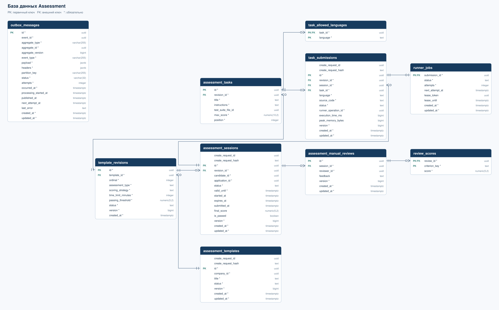

# База данных сервиса Assessment

База данных Assessment содержит шаблоны испытаний, их редакции и задания, назначенные кандидатам сессии, решения и результаты проверки. В ней также хранятся сведения о ручной оценке и фоновых заданиях, необходимых для обработки результатов.

## ER-диаграмма

Рисунок - Модель данных сервиса Assessment

[Открыть SVG полностью](erd.svg)

## Сущности

Таблица - Сущности сервиса Assessment

| Таблица | Псевдоним | Описание | Особенности |
|---|---|---|---|
| assessment_templates | Шаблон испытания | Карточка и жизненный цикл шаблона оценки. | PK: id |
| template_revisions | Редакция шаблона | Версия настроек испытания и правил оценки. | PK: id |
| assessment_tasks | Задание | Задача редакции, условия и допустимые языки. | PK: id |
| assessment_sessions | Сессия испытания | Назначенное кандидату прохождение и его результат. | PK: id |
| task_submissions | Решение задания | Отправленное решение и состояние его проверки. | PK: id |
| runner_jobs | Задание раннеру | Состояние и повторы отправки решения на выполнение. | PK: submission_id |
| assessment_manual_reviews | Ручной отзыв | Оценка сессии конкретным рецензентом. | PK: id |
| review_scores | Оценка критерия | Числовая оценка отдельного критерия отзыва. | PK: review_id, criterion_key |
| outbox_messages | Исходящее событие | Сообщение transactional outbox для последующей публикации. | PK: id |

## Связи

Таблица - Связи сущностей сервиса Assessment

| Родительская сущность и ключ | Дочерняя сущность и FK | Дочерних записей на одну родительскую | Родительских записей на одну дочернюю | Комментарий |
|---|---|---|---|---|
| assessment_templates (id) | template_revisions (template_id) | 0..N | 1 | Безусловная уникальность FK не указана; ссылка обязательна. Удаление родителя: не задано. |
| template_revisions (id) | assessment_tasks (revision_id) | 0..N | 1 | Безусловная уникальность FK не указана; ссылка обязательна. Удаление родителя: не задано. |
| template_revisions (id) | assessment_sessions (revision_id) | 0..N | 1 | Безусловная уникальность FK не указана; ссылка обязательна. Удаление родителя: не задано. |
| assessment_sessions (revision_id, id) | task_submissions (revision_id, session_id) | 0..N | 1 | Безусловная уникальность FK не указана; ссылка обязательна. Удаление родителя: не задано. |
| assessment_tasks (revision_id, id) | task_submissions (revision_id, task_id) | 0..N | 1 | Безусловная уникальность FK не указана; ссылка обязательна. Удаление родителя: не задано. |
| task_submissions (id) | runner_jobs (submission_id) | 0..1 | 1 | Не более одной дочерней записи; ссылка обязательна. Удаление родителя: не задано. |
| assessment_sessions (id) | assessment_manual_reviews (session_id) | 0..N | 1 | Безусловная уникальность FK не указана; ссылка обязательна. Удаление родителя: не задано. |
| assessment_manual_reviews (id) | review_scores (review_id) | 0..N | 1 | Безусловная уникальность FK не указана; ссылка обязательна. Удаление родителя: не задано. |

## Атрибуты

Таблица - Атрибуты сущностей сервиса Assessment

<table><thead><tr><th>Сущность</th><th>Поле</th><th>Тип</th><th>Описание</th></tr></thead><tbody>
<tr><td class="attribute-name" rowspan="9">assessment_templates</td><td class="attribute-name">create_request_id</td><td class="attribute-type">uuid</td><td class="attribute-description">Необязательно / не указано; UNIQUE; UUID операции создания; уникален в пределах этой таблицы</td></tr>
<tr><td class="attribute-name">create_request_hash</td><td class="attribute-type">text</td><td class="attribute-description">Необязательно / не указано; Хеш канонического запроса создания</td></tr>
<tr><td class="attribute-name">id</td><td class="attribute-type">uuid</td><td class="attribute-description">Обязательно; PK; Идентификатор записи.</td></tr>
<tr><td class="attribute-name">company_id</td><td class="attribute-type">uuid</td><td class="attribute-description">Обязательно; Внешний Company ID</td></tr>
<tr><td class="attribute-name">title</td><td class="attribute-type">text</td><td class="attribute-description">Обязательно; Название.</td></tr>
<tr><td class="attribute-name">status</td><td class="attribute-type">text</td><td class="attribute-description">Обязательно; Состояние записи; допустимые переходы описаны в проекте сервиса.</td></tr>
<tr><td class="attribute-name">version</td><td class="attribute-type">bigint</td><td class="attribute-description">Обязательно; Версия для контроля конкурентных изменений.</td></tr>
<tr><td class="attribute-name">created_at</td><td class="attribute-type">timestamptz</td><td class="attribute-description">Обязательно; Время создания.</td></tr>
<tr><td class="attribute-name">updated_at</td><td class="attribute-type">timestamptz</td><td class="attribute-description">Обязательно; Время последнего изменения.</td></tr>
<tr><td class="attribute-name" rowspan="10">template_revisions</td><td class="attribute-name">id</td><td class="attribute-type">uuid</td><td class="attribute-description">Обязательно; PK; Идентификатор записи.</td></tr>
<tr><td class="attribute-name">template_id</td><td class="attribute-type">uuid</td><td class="attribute-description">Обязательно; FK; Идентификатор связанного объекта; владелец и назначение определяются контекстом сервиса.</td></tr>
<tr><td class="attribute-name">ordinal</td><td class="attribute-type">integer</td><td class="attribute-description">Обязательно; Порядковый номер внутри родительского контекста.</td></tr>
<tr><td class="attribute-name">assessment_type</td><td class="attribute-type">text</td><td class="attribute-description">Обязательно; Тип испытания.</td></tr>
<tr><td class="attribute-name">scoring_strategy</td><td class="attribute-type">text</td><td class="attribute-description">Обязательно; Идентификатор стратегии расчёта результата.</td></tr>
<tr><td class="attribute-name">time_limit_minutes</td><td class="attribute-type">integer</td><td class="attribute-description">Обязательно; Ограничение времени в минутах.</td></tr>
<tr><td class="attribute-name">passing_threshold</td><td class="attribute-type">numeric(5,2)</td><td class="attribute-description">Обязательно; Порог прохождения.</td></tr>
<tr><td class="attribute-name">status</td><td class="attribute-type">text</td><td class="attribute-description">Обязательно; Опубликованная редакция неизменяема</td></tr>
<tr><td class="attribute-name">version</td><td class="attribute-type">bigint</td><td class="attribute-description">Обязательно; По умолчанию: 1; Версия для контроля конкурентных изменений.</td></tr>
<tr><td class="attribute-name">created_at</td><td class="attribute-type">timestamptz</td><td class="attribute-description">Обязательно; Время создания.</td></tr>
<tr><td class="attribute-name" rowspan="8">assessment_tasks</td><td class="attribute-name">id</td><td class="attribute-type">uuid</td><td class="attribute-description">Обязательно; PK; Идентификатор записи.</td></tr>
<tr><td class="attribute-name">revision_id</td><td class="attribute-type">uuid</td><td class="attribute-description">Обязательно; FK; Идентификатор связанного объекта; владелец и назначение определяются контекстом сервиса.</td></tr>
<tr><td class="attribute-name">title</td><td class="attribute-type">text</td><td class="attribute-description">Обязательно; Название.</td></tr>
<tr><td class="attribute-name">instructions</td><td class="attribute-type">text</td><td class="attribute-description">Обязательно; Инструкция к заданию.</td></tr>
<tr><td class="attribute-name">test_suite_file_id</td><td class="attribute-type">uuid</td><td class="attribute-description">Необязательно / не указано; Внешний File ID; привязка и доступ требуют контракта</td></tr>
<tr><td class="attribute-name">max_score</td><td class="attribute-type">numeric(10,2)</td><td class="attribute-description">Обязательно; Максимальный балл.</td></tr>
<tr><td class="attribute-name">position</td><td class="attribute-type">integer</td><td class="attribute-description">Обязательно; Позиция в упорядоченном наборе.</td></tr>
<tr><td class="attribute-name">allowed_languages</td><td class="attribute-type">text[]</td><td class="attribute-description">Обязательно; По умолчанию: {}; Допустимые языки решения задачи</td></tr>
<tr><td class="attribute-name" rowspan="16">assessment_sessions</td><td class="attribute-name">create_request_id</td><td class="attribute-type">uuid</td><td class="attribute-description">Необязательно / не указано; UNIQUE; UUID операции создания; уникален в пределах этой таблицы</td></tr>
<tr><td class="attribute-name">create_request_hash</td><td class="attribute-type">text</td><td class="attribute-description">Необязательно / не указано; Хеш канонического запроса создания</td></tr>
<tr><td class="attribute-name">id</td><td class="attribute-type">uuid</td><td class="attribute-description">Обязательно; PK; Идентификатор записи.</td></tr>
<tr><td class="attribute-name">revision_id</td><td class="attribute-type">uuid</td><td class="attribute-description">Обязательно; FK; Идентификатор связанного объекта; владелец и назначение определяются контекстом сервиса.</td></tr>
<tr><td class="attribute-name">candidate_id</td><td class="attribute-type">uuid</td><td class="attribute-description">Обязательно; Внешний Candidate ID, не Identity ID</td></tr>
<tr><td class="attribute-name">application_id</td><td class="attribute-type">uuid</td><td class="attribute-description">Обязательно; Внешний Hiring Application ID</td></tr>
<tr><td class="attribute-name">status</td><td class="attribute-type">text</td><td class="attribute-description">Обязательно; Состояние записи; допустимые переходы описаны в проекте сервиса.</td></tr>
<tr><td class="attribute-name">valid_until</td><td class="attribute-type">timestamptz</td><td class="attribute-description">Обязательно; Крайний срок действия.</td></tr>
<tr><td class="attribute-name">started_at</td><td class="attribute-type">timestamptz</td><td class="attribute-description">Необязательно / не указано; Время начала.</td></tr>
<tr><td class="attribute-name">expires_at</td><td class="attribute-type">timestamptz</td><td class="attribute-description">Необязательно / не указано; Время истечения.</td></tr>
<tr><td class="attribute-name">submitted_at</td><td class="attribute-type">timestamptz</td><td class="attribute-description">Необязательно / не указано; Время отправки.</td></tr>
<tr><td class="attribute-name">final_score</td><td class="attribute-type">numeric(5,2)</td><td class="attribute-description">Необязательно / не указано; Зафиксированный итоговый балл.</td></tr>
<tr><td class="attribute-name">is_passed</td><td class="attribute-type">boolean</td><td class="attribute-description">Необязательно / не указано; Зафиксированный результат прохождения.</td></tr>
<tr><td class="attribute-name">version</td><td class="attribute-type">bigint</td><td class="attribute-description">Обязательно; Версия для контроля конкурентных изменений.</td></tr>
<tr><td class="attribute-name">created_at</td><td class="attribute-type">timestamptz</td><td class="attribute-description">Обязательно; Время создания.</td></tr>
<tr><td class="attribute-name">updated_at</td><td class="attribute-type">timestamptz</td><td class="attribute-description">Обязательно; Время последнего изменения.</td></tr>
<tr><td class="attribute-name" rowspan="15">task_submissions</td><td class="attribute-name">create_request_id</td><td class="attribute-type">uuid</td><td class="attribute-description">Необязательно / не указано; UNIQUE; UUID операции создания; уникален в пределах этой таблицы</td></tr>
<tr><td class="attribute-name">create_request_hash</td><td class="attribute-type">text</td><td class="attribute-description">Необязательно / не указано; Хеш канонического запроса создания</td></tr>
<tr><td class="attribute-name">id</td><td class="attribute-type">uuid</td><td class="attribute-description">Обязательно; PK; Идентификатор записи.</td></tr>
<tr><td class="attribute-name">revision_id</td><td class="attribute-type">uuid</td><td class="attribute-description">Обязательно; FK; Идентификатор связанного объекта; владелец и назначение определяются контекстом сервиса.</td></tr>
<tr><td class="attribute-name">session_id</td><td class="attribute-type">uuid</td><td class="attribute-description">Обязательно; FK; Идентификатор связанного объекта; владелец и назначение определяются контекстом сервиса.</td></tr>
<tr><td class="attribute-name">task_id</td><td class="attribute-type">uuid</td><td class="attribute-description">Обязательно; FK; Идентификатор связанного объекта; владелец и назначение определяются контекстом сервиса.</td></tr>
<tr><td class="attribute-name">language</td><td class="attribute-type">text</td><td class="attribute-description">Обязательно; Язык, определённый контекстом записи.</td></tr>
<tr><td class="attribute-name">source_code</td><td class="attribute-type">text</td><td class="attribute-description">Обязательно; Чувствительные данные; ограничения размера и retention требуют решения</td></tr>
<tr><td class="attribute-name">status</td><td class="attribute-type">text</td><td class="attribute-description">Обязательно; Состояние записи; допустимые переходы описаны в проекте сервиса.</td></tr>
<tr><td class="attribute-name">runner_operation_id</td><td class="attribute-type">uuid</td><td class="attribute-description">Обязательно; UNIQUE; Идентификатор связанного объекта; владелец и назначение определяются контекстом сервиса.</td></tr>
<tr><td class="attribute-name">execution_time_ms</td><td class="attribute-type">bigint</td><td class="attribute-description">Необязательно / не указано; Время исполнения в миллисекундах.</td></tr>
<tr><td class="attribute-name">peak_memory_bytes</td><td class="attribute-type">bigint</td><td class="attribute-description">Необязательно / не указано; Пиковое использование памяти в байтах.</td></tr>
<tr><td class="attribute-name">version</td><td class="attribute-type">bigint</td><td class="attribute-description">Обязательно; Версия для контроля конкурентных изменений.</td></tr>
<tr><td class="attribute-name">created_at</td><td class="attribute-type">timestamptz</td><td class="attribute-description">Обязательно; Время создания.</td></tr>
<tr><td class="attribute-name">updated_at</td><td class="attribute-type">timestamptz</td><td class="attribute-description">Обязательно; Время последнего изменения.</td></tr>
<tr><td class="attribute-name" rowspan="8">runner_jobs</td><td class="attribute-name">submission_id</td><td class="attribute-type">uuid</td><td class="attribute-description">Обязательно; PK, FK; Идентификатор связанного объекта; владелец и назначение определяются контекстом сервиса.</td></tr>
<tr><td class="attribute-name">status</td><td class="attribute-type">text</td><td class="attribute-description">Обязательно; Состояние записи; допустимые переходы описаны в проекте сервиса.</td></tr>
<tr><td class="attribute-name">attempts</td><td class="attribute-type">integer</td><td class="attribute-description">Обязательно; По умолчанию: 0; Количество попыток.</td></tr>
<tr><td class="attribute-name">next_attempt_at</td><td class="attribute-type">timestamptz</td><td class="attribute-description">Необязательно / не указано; Время следующей попытки.</td></tr>
<tr><td class="attribute-name">lease_token</td><td class="attribute-type">uuid</td><td class="attribute-description">Необязательно / не указано; Токен захвата работы.</td></tr>
<tr><td class="attribute-name">lease_until</td><td class="attribute-type">timestamptz</td><td class="attribute-description">Необязательно / не указано; Окончание срока захвата.</td></tr>
<tr><td class="attribute-name">created_at</td><td class="attribute-type">timestamptz</td><td class="attribute-description">Обязательно; Время создания.</td></tr>
<tr><td class="attribute-name">updated_at</td><td class="attribute-type">timestamptz</td><td class="attribute-description">Обязательно; Время последнего изменения.</td></tr>
<tr><td class="attribute-name" rowspan="7">assessment_manual_reviews</td><td class="attribute-name">id</td><td class="attribute-type">uuid</td><td class="attribute-description">Обязательно; PK; Идентификатор записи.</td></tr>
<tr><td class="attribute-name">session_id</td><td class="attribute-type">uuid</td><td class="attribute-description">Обязательно; FK; Идентификатор связанного объекта; владелец и назначение определяются контекстом сервиса.</td></tr>
<tr><td class="attribute-name">reviewer_id</td><td class="attribute-type">uuid</td><td class="attribute-description">Обязательно; Внешний Identity ID</td></tr>
<tr><td class="attribute-name">feedback</td><td class="attribute-type">text</td><td class="attribute-description">Необязательно / не указано; Текст обратной связи.</td></tr>
<tr><td class="attribute-name">version</td><td class="attribute-type">bigint</td><td class="attribute-description">Обязательно; Версия для контроля конкурентных изменений.</td></tr>
<tr><td class="attribute-name">created_at</td><td class="attribute-type">timestamptz</td><td class="attribute-description">Обязательно; Время создания.</td></tr>
<tr><td class="attribute-name">updated_at</td><td class="attribute-type">timestamptz</td><td class="attribute-description">Обязательно; Время последнего изменения.</td></tr>
<tr><td class="attribute-name" rowspan="3">review_scores</td><td class="attribute-name">review_id</td><td class="attribute-type">uuid</td><td class="attribute-description">Обязательно; PK, FK; Идентификатор связанного объекта; владелец и назначение определяются контекстом сервиса.</td></tr>
<tr><td class="attribute-name">criterion_key</td><td class="attribute-type">text</td><td class="attribute-description">Обязательно; PK; Ключ критерия оценки.</td></tr>
<tr><td class="attribute-name">score</td><td class="attribute-type">numeric(5,2)</td><td class="attribute-description">Обязательно; Оценка.</td></tr>
<tr><td class="attribute-name" rowspan="18">outbox_messages</td><td class="attribute-name">id</td><td class="attribute-type">uuid</td><td class="attribute-description">Обязательно; PK; Идентификатор записи.</td></tr>
<tr><td class="attribute-name">event_id</td><td class="attribute-type">uuid</td><td class="attribute-description">Обязательно; UNIQUE; Идентификатор события.</td></tr>
<tr><td class="attribute-name">aggregate_type</td><td class="attribute-type">varchar(255)</td><td class="attribute-description">Обязательно; Тип агрегата — источника события.</td></tr>
<tr><td class="attribute-name">aggregate_id</td><td class="attribute-type">uuid</td><td class="attribute-description">Обязательно; Идентификатор связанного объекта; владелец и назначение определяются контекстом сервиса.</td></tr>
<tr><td class="attribute-name">aggregate_version</td><td class="attribute-type">bigint</td><td class="attribute-description">Необязательно / не указано; Версия агрегата — источника события.</td></tr>
<tr><td class="attribute-name">event_type</td><td class="attribute-type">varchar(255)</td><td class="attribute-description">Обязательно; Тип события.</td></tr>
<tr><td class="attribute-name">payload</td><td class="attribute-type">jsonb</td><td class="attribute-description">Обязательно; Содержимое события или операции.</td></tr>
<tr><td class="attribute-name">headers</td><td class="attribute-type">jsonb</td><td class="attribute-description">Обязательно; По умолчанию: {}; Заголовки события.</td></tr>
<tr><td class="attribute-name">partition_key</td><td class="attribute-type">varchar(255)</td><td class="attribute-description">Необязательно / не указано; Ключ распределения события.</td></tr>
<tr><td class="attribute-name">status</td><td class="attribute-type">varchar(32)</td><td class="attribute-description">Обязательно; По умолчанию: PENDING; Состояние записи; допустимые переходы описаны в проекте сервиса.</td></tr>
<tr><td class="attribute-name">attempts</td><td class="attribute-type">integer</td><td class="attribute-description">Обязательно; По умолчанию: 0; Количество попыток.</td></tr>
<tr><td class="attribute-name">occurred_at</td><td class="attribute-type">timestamptz</td><td class="attribute-description">Обязательно; Время события.</td></tr>
<tr><td class="attribute-name">processing_started_at</td><td class="attribute-type">timestamptz</td><td class="attribute-description">Необязательно / не указано; Время соответствующего действия или состояния.</td></tr>
<tr><td class="attribute-name">published_at</td><td class="attribute-type">timestamptz</td><td class="attribute-description">Необязательно / не указано; Время публикации.</td></tr>
<tr><td class="attribute-name">next_attempt_at</td><td class="attribute-type">timestamptz</td><td class="attribute-description">Необязательно / не указано; Время следующей попытки.</td></tr>
<tr><td class="attribute-name">last_error</td><td class="attribute-type">text</td><td class="attribute-description">Необязательно / не указано; Последняя зафиксированная ошибка.</td></tr>
<tr><td class="attribute-name">created_at</td><td class="attribute-type">timestamptz</td><td class="attribute-description">Обязательно; Время создания.</td></tr>
<tr><td class="attribute-name">updated_at</td><td class="attribute-type">timestamptz</td><td class="attribute-description">Обязательно; Время последнего изменения.</td></tr>
</tbody></table>

## Ограничения данных

- Название шаблона не пустое; номер редакции положителен. Допустимый лимит времени составляет от 10 до 4320 минут, проходной балл от 0 до 100.
- Максимальный балл задания положителен, позиция неотрицательна. Результат сессии и оценки критериев находятся в диапазоне от 0 до 100.
- Для оценённой сессии обязательны итоговый балл и признак прохождения. Время истечения следует за началом; отправка решения возможна после начала сессии.
- Время выполнения и использованная память попытки, если указаны, неотрицательны.

- Сессия испытания относится к конкретной редакции шаблона; решение должно относиться к задаче той же редакции.
- Опубликованная редакция испытания и её задачи должны оставаться неизменными; при публикации требуется хотя бы одна задача. Это правило требует обеспечения на уровне сервиса.

