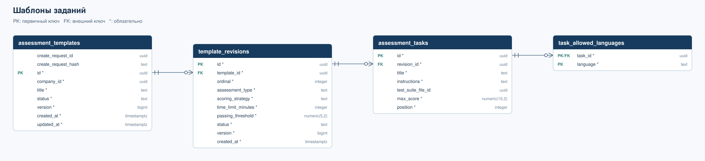
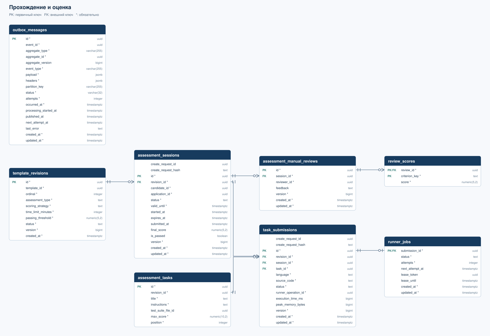

# База данных сервиса Assessment

Источник: проектная [DBML-схема](../schema.dbml). Смысл сценариев и незакрытые решения — в [описании сервиса](../../../services/assessment/index.md).

## ER-диаграмма

Таблицы показаны со всеми полями из DBML. PK — первичный ключ, FK — внешний ключ, звёздочка — обязательное поле. Связи обозначены нотацией «воронья лапка»: круг — необязательная связь, черта — один, лапка — многие. Линии подходят к строкам полей; для составного FK линия подходит к первому полю, а все поля перечислены ниже. Кратность выведена из FK, NOT NULL и уникальных ключей DBML; дополнительные SQL-ограничения смотрите в миграциях или проекте ограничений. Внешние идентификаторы других сервисов не соединены межбазовыми FK.

Схема разделена на части; общие таблицы повторяются там, где нужны для связей.

### Шаблоны заданий

[Открыть SVG: Шаблоны заданий](erd-templates.svg)

### Прохождение и оценка

[Открыть SVG: Прохождение и оценка](erd-execution.svg)

## Перечень связей

| № | Родительская таблица и поля | Дочерняя таблица и FK | Удаление родителя |
|---|---|---|---|
| 1 | assessment_templates (id) | template_revisions (template_id) | не указано |
| 2 | template_revisions (id) | assessment_tasks (revision_id) | не указано |
| 3 | assessment_tasks (id) | task_allowed_languages (task_id) | не указано |
| 4 | template_revisions (id) | assessment_sessions (revision_id) | не указано |
| 5 | assessment_sessions (revision_id, id) | task_submissions (revision_id, session_id) | не указано |
| 6 | assessment_tasks (revision_id, id) | task_submissions (revision_id, task_id) | не указано |
| 7 | task_submissions (id) | runner_jobs (submission_id) | не указано |
| 8 | assessment_sessions (id) | assessment_manual_reviews (session_id) | не указано |
| 9 | assessment_manual_reviews (id) | review_scores (review_id) | не указано |

## Таблицы и поля

Обязательность приведена по DBML: «да» означает `NOT NULL` или PK; «нет / не указано» не гарантирует отсутствие дополнительных SQL-ограничений. UNIQUE отдельно отмечен только для отдельного поля; составные ключи и индексы перечислены под таблицей. Пустое пояснение в исходной модели не дополняется вымышленными правилами.

### assessment_templates

| Поле | Тип | Обязательно | Ключ / уникальность | По умолчанию | Пояснение |
|---|---|---|---|---|---|
| create_request_id | uuid | нет / не указано | UNIQUE | — | UUID операции создания; уникален в пределах этой таблицы |
| create_request_hash | text | нет / не указано | — | — | Хеш канонического запроса создания |
| id | uuid | да | PK | — | Идентификатор записи. |
| company_id | uuid | да | — | — | Внешний Company ID |
| title | text | да | — | — | Название. |
| status | text | да | — | — | Состояние записи; допустимые переходы описаны в проекте сервиса. |
| version | bigint | да | — | — | Версия для контроля конкурентных изменений. |
| created_at | timestamptz | да | — | — | Время создания. |
| updated_at | timestamptz | да | — | — | Время последнего изменения. |

### template_revisions

| Поле | Тип | Обязательно | Ключ / уникальность | По умолчанию | Пояснение |
|---|---|---|---|---|---|
| id | uuid | да | PK | — | Идентификатор записи. |
| template_id | uuid | да | FK | — | Идентификатор связанного объекта; владелец и назначение определяются контекстом сервиса. |
| ordinal | integer | да | — | — | Порядковый номер внутри родительского контекста. |
| assessment_type | text | да | — | — | Тип испытания. |
| scoring_strategy | text | да | — | — | Идентификатор стратегии расчёта результата. |
| time_limit_minutes | integer | да | — | — | Ограничение времени в минутах. |
| passing_threshold | numeric(5,2) | да | — | — | Порог прохождения. |
| status | text | да | — | — | Опубликованная редакция неизменяема |
| version | bigint | да | — | 1 | Версия для контроля конкурентных изменений. |
| created_at | timestamptz | да | — | — | Время создания. |

Составные ключи и индексы DBML: `UNIQUE (template_id, ordinal)`.

### assessment_tasks

| Поле | Тип | Обязательно | Ключ / уникальность | По умолчанию | Пояснение |
|---|---|---|---|---|---|
| id | uuid | да | PK | — | Идентификатор записи. |
| revision_id | uuid | да | FK | — | Идентификатор связанного объекта; владелец и назначение определяются контекстом сервиса. |
| title | text | да | — | — | Название. |
| instructions | text | да | — | — | Инструкция к заданию. |
| test_suite_file_id | uuid | нет / не указано | — | — | Внешний File ID; привязка и доступ требуют контракта |
| max_score | numeric(10,2) | да | — | — | Максимальный балл. |
| position | integer | да | — | — | Позиция в упорядоченном наборе. |

Составные ключи и индексы DBML: `UNIQUE (revision_id, id)`; `UNIQUE (revision_id, position)`.

### task_allowed_languages

| Поле | Тип | Обязательно | Ключ / уникальность | По умолчанию | Пояснение |
|---|---|---|---|---|---|
| task_id | uuid | да | PK, FK | — | Идентификатор связанного объекта; владелец и назначение определяются контекстом сервиса. |
| language | text | да | PK | — | Язык, определённый контекстом записи. |

Составные ключи и индексы DBML: `PK (task_id, language)`.

### assessment_sessions

| Поле | Тип | Обязательно | Ключ / уникальность | По умолчанию | Пояснение |
|---|---|---|---|---|---|
| create_request_id | uuid | нет / не указано | UNIQUE | — | UUID операции создания; уникален в пределах этой таблицы |
| create_request_hash | text | нет / не указано | — | — | Хеш канонического запроса создания |
| id | uuid | да | PK | — | Идентификатор записи. |
| revision_id | uuid | да | FK | — | Идентификатор связанного объекта; владелец и назначение определяются контекстом сервиса. |
| candidate_id | uuid | да | — | — | Внешний Candidate ID, не Identity ID |
| application_id | uuid | да | — | — | Внешний Hiring Application ID |
| status | text | да | — | — | Состояние записи; допустимые переходы описаны в проекте сервиса. |
| valid_until | timestamptz | да | — | — | Крайний срок действия. |
| started_at | timestamptz | нет / не указано | — | — | Время начала. |
| expires_at | timestamptz | нет / не указано | — | — | Время истечения. |
| submitted_at | timestamptz | нет / не указано | — | — | Время отправки. |
| final_score | numeric(5,2) | нет / не указано | — | — | Зафиксированный итоговый балл. |
| is_passed | boolean | нет / не указано | — | — | Зафиксированный результат прохождения. |
| version | bigint | да | — | — | Версия для контроля конкурентных изменений. |
| created_at | timestamptz | да | — | — | Время создания. |
| updated_at | timestamptz | да | — | — | Время последнего изменения. |

Составные ключи и индексы DBML: `UNIQUE (revision_id, id)`; `INDEX (status, valid_until)`; `INDEX (status, expires_at)`.

### task_submissions

| Поле | Тип | Обязательно | Ключ / уникальность | По умолчанию | Пояснение |
|---|---|---|---|---|---|
| create_request_id | uuid | нет / не указано | UNIQUE | — | UUID операции создания; уникален в пределах этой таблицы |
| create_request_hash | text | нет / не указано | — | — | Хеш канонического запроса создания |
| id | uuid | да | PK | — | Идентификатор записи. |
| revision_id | uuid | да | FK | — | Идентификатор связанного объекта; владелец и назначение определяются контекстом сервиса. |
| session_id | uuid | да | FK | — | Идентификатор связанного объекта; владелец и назначение определяются контекстом сервиса. |
| task_id | uuid | да | FK | — | Идентификатор связанного объекта; владелец и назначение определяются контекстом сервиса. |
| language | text | да | — | — | Язык, определённый контекстом записи. |
| source_code | text | да | — | — | Чувствительные данные; ограничения размера и retention требуют решения |
| status | text | да | — | — | Состояние записи; допустимые переходы описаны в проекте сервиса. |
| runner_operation_id | uuid | да | UNIQUE | — | Идентификатор связанного объекта; владелец и назначение определяются контекстом сервиса. |
| execution_time_ms | bigint | нет / не указано | — | — | Время исполнения в миллисекундах. |
| peak_memory_bytes | bigint | нет / не указано | — | — | Пиковое использование памяти в байтах. |
| version | bigint | да | — | — | Версия для контроля конкурентных изменений. |
| created_at | timestamptz | да | — | — | Время создания. |
| updated_at | timestamptz | да | — | — | Время последнего изменения. |

Составные ключи и индексы DBML: `INDEX (session_id, task_id, created_at, id)`.

### runner_jobs

Предлагаемая устойчивая отправка в Runner; worker и контракт необходимо отразить в C4.

| Поле | Тип | Обязательно | Ключ / уникальность | По умолчанию | Пояснение |
|---|---|---|---|---|---|
| submission_id | uuid | да | PK, FK | — | Идентификатор связанного объекта; владелец и назначение определяются контекстом сервиса. |
| status | text | да | — | — | Состояние записи; допустимые переходы описаны в проекте сервиса. |
| attempts | integer | да | — | 0 | Количество попыток. |
| next_attempt_at | timestamptz | нет / не указано | — | — | Время следующей попытки. |
| lease_token | uuid | нет / не указано | — | — | Токен захвата работы. |
| lease_until | timestamptz | нет / не указано | — | — | Окончание срока захвата. |
| created_at | timestamptz | да | — | — | Время создания. |
| updated_at | timestamptz | да | — | — | Время последнего изменения. |

Составные ключи и индексы DBML: `INDEX (status, next_attempt_at)`.

### assessment_manual_reviews

| Поле | Тип | Обязательно | Ключ / уникальность | По умолчанию | Пояснение |
|---|---|---|---|---|---|
| id | uuid | да | PK | — | Идентификатор записи. |
| session_id | uuid | да | FK | — | Идентификатор связанного объекта; владелец и назначение определяются контекстом сервиса. |
| reviewer_id | uuid | да | — | — | Внешний Identity ID |
| feedback | text | нет / не указано | — | — | Текст обратной связи. |
| version | bigint | да | — | — | Версия для контроля конкурентных изменений. |
| created_at | timestamptz | да | — | — | Время создания. |
| updated_at | timestamptz | да | — | — | Время последнего изменения. |

Составные ключи и индексы DBML: `UNIQUE (session_id, reviewer_id)`.

### review_scores

| Поле | Тип | Обязательно | Ключ / уникальность | По умолчанию | Пояснение |
|---|---|---|---|---|---|
| review_id | uuid | да | PK, FK | — | Идентификатор связанного объекта; владелец и назначение определяются контекстом сервиса. |
| criterion_key | text | да | PK | — | Ключ критерия оценки. |
| score | numeric(5,2) | да | — | — | Оценка. |

Составные ключи и индексы DBML: `PK (review_id, criterion_key)`.

### outbox_messages

| Поле | Тип | Обязательно | Ключ / уникальность | По умолчанию | Пояснение |
|---|---|---|---|---|---|
| id | uuid | да | PK | — | Идентификатор записи. |
| event_id | uuid | да | UNIQUE | — | Идентификатор события. |
| aggregate_type | varchar(255) | да | — | — | Тип агрегата — источника события. |
| aggregate_id | uuid | да | — | — | Идентификатор связанного объекта; владелец и назначение определяются контекстом сервиса. |
| aggregate_version | bigint | нет / не указано | — | — | Версия агрегата — источника события. |
| event_type | varchar(255) | да | — | — | Тип события. |
| payload | jsonb | да | — | — | Содержимое события или операции. |
| headers | jsonb | да | — | {} | Заголовки события. |
| partition_key | varchar(255) | нет / не указано | — | — | Ключ распределения события. |
| status | varchar(32) | да | — | PENDING | Состояние записи; допустимые переходы описаны в проекте сервиса. |
| attempts | integer | да | — | 0 | Количество попыток. |
| occurred_at | timestamptz | да | — | — | Время события. |
| processing_started_at | timestamptz | нет / не указано | — | — | Время соответствующего действия или состояния. |
| published_at | timestamptz | нет / не указано | — | — | Время публикации. |
| next_attempt_at | timestamptz | нет / не указано | — | — | Время следующей попытки. |
| last_error | text | нет / не указано | — | — | Последняя зафиксированная ошибка. |
| created_at | timestamptz | да | — | — | Время создания. |
| updated_at | timestamptz | да | — | — | Время последнего изменения. |

Составные ключи и индексы DBML: `INDEX (aggregate_type, aggregate_id, aggregate_version)`.

