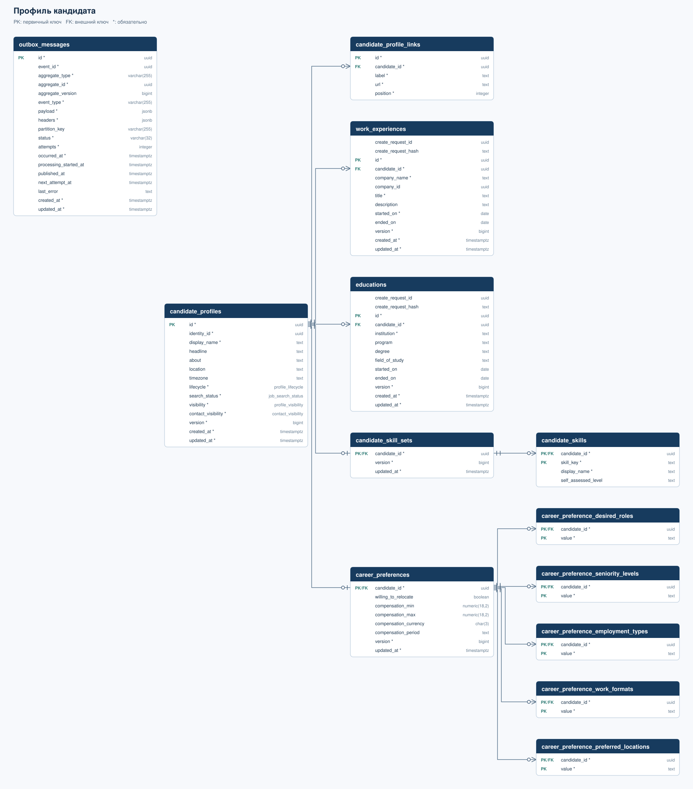
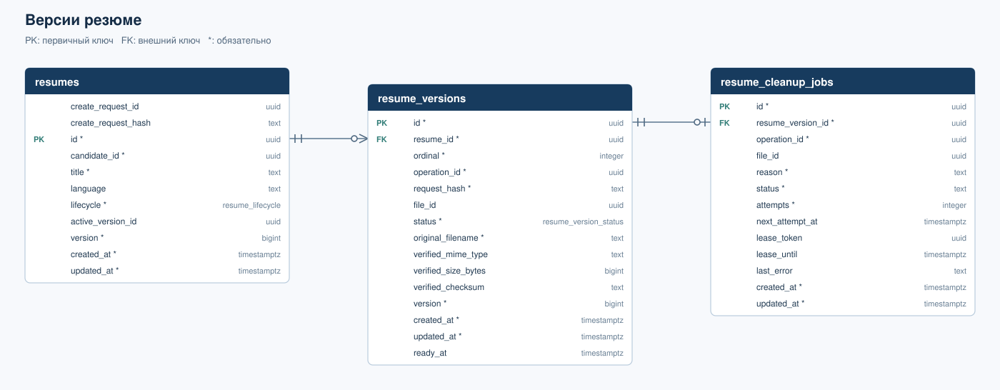
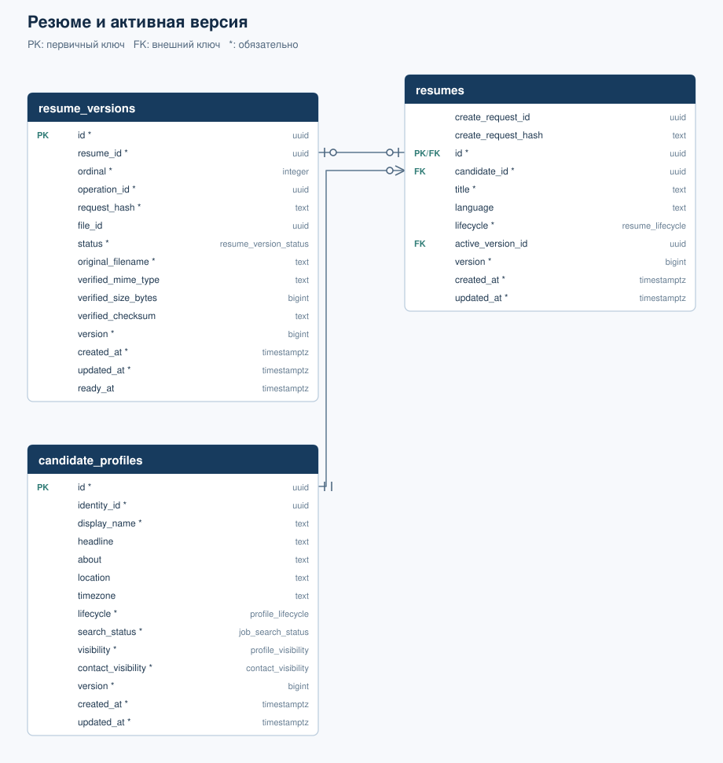
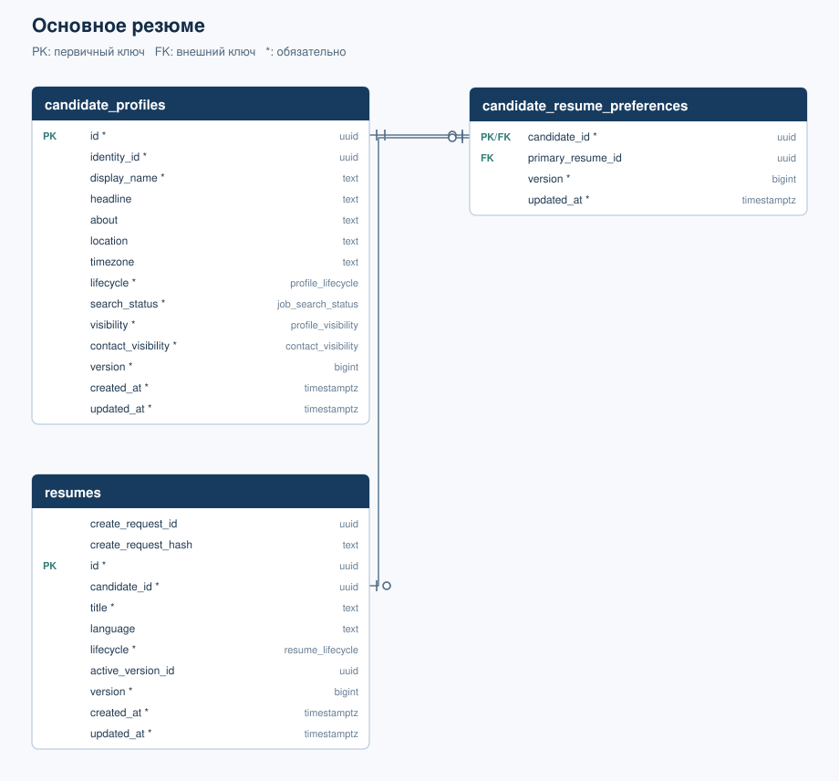

# База данных сервиса Candidate

Источник: проектная [DBML-схема](../schema.dbml). Смысл сценариев и незакрытые решения — в [описании сервиса](../../../services/candidate/index.md).

## ER-диаграмма

Таблицы показаны со всеми полями из DBML. PK — первичный ключ, FK — внешний ключ, звёздочка — обязательное поле. Связи обозначены нотацией «воронья лапка»: круг — необязательная связь, черта — один, лапка — многие. Линии подходят к строкам полей; для составного FK линия подходит к первому полю, а все поля перечислены ниже. Кратность выведена из FK, NOT NULL и уникальных ключей DBML; дополнительные SQL-ограничения смотрите в миграциях или проекте ограничений. Внешние идентификаторы других сервисов не соединены межбазовыми FK.

Схема разделена на части; общие таблицы повторяются там, где нужны для связей.

### Профиль кандидата

[Открыть SVG: Профиль кандидата](erd-profile.svg)

### Версии резюме

[Открыть SVG: Версии резюме](erd-resume_files.svg)

### Резюме и активная версия

[Открыть SVG: Резюме и активная версия](erd-resume_catalog.svg)

### Основное резюме

[Открыть SVG: Основное резюме](erd-resume_primary.svg)

## Перечень связей

| № | Родительская таблица и поля | Дочерняя таблица и FK | Удаление родителя |
|---|---|---|---|
| 1 | candidate_profiles (id) | candidate_profile_links (candidate_id) | не указано |
| 2 | candidate_profiles (id) | work_experiences (candidate_id) | не указано |
| 3 | candidate_profiles (id) | educations (candidate_id) | не указано |
| 4 | candidate_profiles (id) | candidate_skill_sets (candidate_id) | не указано |
| 5 | candidate_skill_sets (candidate_id) | candidate_skills (candidate_id) | не указано |
| 6 | candidate_profiles (id) | career_preferences (candidate_id) | не указано |
| 7 | career_preferences (candidate_id) | career_preference_desired_roles (candidate_id) | не указано |
| 8 | career_preferences (candidate_id) | career_preference_seniority_levels (candidate_id) | не указано |
| 9 | career_preferences (candidate_id) | career_preference_employment_types (candidate_id) | не указано |
| 10 | career_preferences (candidate_id) | career_preference_work_formats (candidate_id) | не указано |
| 11 | career_preferences (candidate_id) | career_preference_preferred_locations (candidate_id) | не указано |
| 12 | candidate_profiles (id) | resumes (candidate_id) | не указано |
| 13 | resumes (id) | resume_versions (resume_id) | не указано |
| 14 | resume_versions (resume_id, id) | resumes (id, active_version_id) | не указано |
| 15 | candidate_profiles (id) | candidate_resume_preferences (candidate_id) | не указано |
| 16 | resumes (candidate_id, id) | candidate_resume_preferences (candidate_id, primary_resume_id) | не указано |
| 17 | resume_versions (id) | resume_cleanup_jobs (resume_version_id) | не указано |

## Таблицы и поля

Обязательность приведена по DBML: «да» означает `NOT NULL` или PK; «нет / не указано» не гарантирует отсутствие дополнительных SQL-ограничений. UNIQUE отдельно отмечен только для отдельного поля; составные ключи и индексы перечислены под таблицей. Пустое пояснение в исходной модели не дополняется вымышленными правилами.

### candidate_profiles

| Поле | Тип | Обязательно | Ключ / уникальность | По умолчанию | Пояснение |
|---|---|---|---|---|---|
| id | uuid | да | PK | — | Идентификатор записи. |
| identity_id | uuid | да | UNIQUE | — | Внешний Identity ID; не межсервисный FK |
| display_name | text | да | — | — | Имя для отображения. |
| headline | text | нет / не указано | — | — | Краткий профессиональный заголовок. |
| about | text | нет / не указано | — | — | Описание кандидата. |
| location | text | нет / не указано | — | — | Местоположение. |
| timezone | text | нет / не указано | — | — | Часовой пояс. |
| lifecycle | profile_lifecycle | да | — | ACTIVE | Состояние жизненного цикла. |
| search_status | job_search_status | да | — | NOT_LOOKING | Статус поиска работы. |
| visibility | profile_visibility | да | — | PRIVATE | Настройка видимости. |
| contact_visibility | contact_visibility | да | — | HIDDEN | Настройка видимости контактов. |
| version | bigint | да | — | 1 | Версия для контроля конкурентных изменений. |
| created_at | timestamptz | да | — | — | Время создания. |
| updated_at | timestamptz | да | — | — | Время последнего изменения. |

Составные ключи и индексы DBML: `INDEX (lifecycle, visibility, search_status)`.

### candidate_profile_links

Ограниченная коллекция внутри CandidateProfile.

| Поле | Тип | Обязательно | Ключ / уникальность | По умолчанию | Пояснение |
|---|---|---|---|---|---|
| id | uuid | да | PK | — | Идентификатор записи. |
| candidate_id | uuid | да | FK | — | Идентификатор кандидата. |
| label | text | да | — | — | Подпись отображаемого значения. |
| url | text | да | — | — | Адрес ссылки. |
| position | integer | да | — | — | Позиция в упорядоченном наборе. |

Составные ключи и индексы DBML: `UNIQUE (candidate_id, position)`.

### work_experiences

| Поле | Тип | Обязательно | Ключ / уникальность | По умолчанию | Пояснение |
|---|---|---|---|---|---|
| create_request_id | uuid | нет / не указано | UNIQUE | — | UUID операции создания; уникален в пределах этой таблицы |
| create_request_hash | text | нет / не указано | — | — | Хеш канонического запроса создания |
| id | uuid | да | PK | — | Идентификатор записи. |
| candidate_id | uuid | да | FK | — | Идентификатор кандидата. |
| company_name | text | да | — | — | Название компании, указанное в опыте. |
| company_id | uuid | нет / не указано | — | — | Необязательная ссылка на Company Service |
| title | text | да | — | — | Название. |
| description | text | нет / не указано | — | — | Описание. |
| started_on | date | да | — | — | Дата начала. |
| ended_on | date | нет / не указано | — | — | NULL означает продолжающийся опыт |
| version | bigint | да | — | 1 | Версия для контроля конкурентных изменений. |
| created_at | timestamptz | да | — | — | Время создания. |
| updated_at | timestamptz | да | — | — | Время последнего изменения. |

Составные ключи и индексы DBML: `INDEX (candidate_id, started_on)`.

### educations

| Поле | Тип | Обязательно | Ключ / уникальность | По умолчанию | Пояснение |
|---|---|---|---|---|---|
| create_request_id | uuid | нет / не указано | UNIQUE | — | UUID операции создания; уникален в пределах этой таблицы |
| create_request_hash | text | нет / не указано | — | — | Хеш канонического запроса создания |
| id | uuid | да | PK | — | Идентификатор записи. |
| candidate_id | uuid | да | FK | — | Идентификатор кандидата. |
| institution | text | да | — | — | Название учебной организации. |
| program | text | нет / не указано | — | — | Название образовательной программы. |
| degree | text | нет / не указано | — | — | Квалификация или степень. |
| field_of_study | text | нет / не указано | — | — | Направление обучения. |
| started_on | date | нет / не указано | — | — | Дата начала. |
| ended_on | date | нет / не указано | — | — | Дата окончания; отсутствие значения определяется правилами модели. |
| version | bigint | да | — | 1 | Версия для контроля конкурентных изменений. |
| created_at | timestamptz | да | — | — | Время создания. |
| updated_at | timestamptz | да | — | — | Время последнего изменения. |

Составные ключи и индексы DBML: `INDEX (candidate_id, started_on)`.

### candidate_skill_sets

Корень ограниченного набора; SetSkills заменяет набор атомарно.

| Поле | Тип | Обязательно | Ключ / уникальность | По умолчанию | Пояснение |
|---|---|---|---|---|---|
| candidate_id | uuid | да | PK, FK | — | Идентификатор кандидата. |
| version | bigint | да | — | 1 | Версия для контроля конкурентных изменений. |
| updated_at | timestamptz | да | — | — | Время последнего изменения. |

### candidate_skills

| Поле | Тип | Обязательно | Ключ / уникальность | По умолчанию | Пояснение |
|---|---|---|---|---|---|
| candidate_id | uuid | да | PK, FK | — | Идентификатор кандидата. |
| skill_key | text | да | PK | — | Нормализованный ключ навыка. |
| display_name | text | да | — | — | Имя для отображения. |
| self_assessed_level | text | нет / не указано | — | — | Уровень, указанный владельцем профиля. |

Составные ключи и индексы DBML: `PK (candidate_id, skill_key)`.

### career_preferences

| Поле | Тип | Обязательно | Ключ / уникальность | По умолчанию | Пояснение |
|---|---|---|---|---|---|
| candidate_id | uuid | да | PK, FK | — | Идентификатор кандидата. |
| willing_to_relocate | boolean | нет / не указано | — | — | Готовность к переезду. |
| compensation_min | numeric(18,2) | нет / не указано | — | — | Нижняя граница компенсации. |
| compensation_max | numeric(18,2) | нет / не указано | — | — | Верхняя граница компенсации. |
| compensation_currency | char(3) | нет / не указано | — | — | Валюта компенсации. |
| compensation_period | text | нет / не указано | — | — | Период компенсации. |
| version | bigint | да | — | 1 | Версия для контроля конкурентных изменений. |
| updated_at | timestamptz | да | — | — | Время последнего изменения. |

### career_preference_desired_roles

| Поле | Тип | Обязательно | Ключ / уникальность | По умолчанию | Пояснение |
|---|---|---|---|---|---|
| candidate_id | uuid | да | PK, FK | — | Идентификатор кандидата. |
| value | text | да | PK | — | Значение элемента набора. |

Составные ключи и индексы DBML: `PK (candidate_id, value)`.

### career_preference_seniority_levels

| Поле | Тип | Обязательно | Ключ / уникальность | По умолчанию | Пояснение |
|---|---|---|---|---|---|
| candidate_id | uuid | да | PK, FK | — | Идентификатор кандидата. |
| value | text | да | PK | — | Значение элемента набора. |

Составные ключи и индексы DBML: `PK (candidate_id, value)`.

### career_preference_employment_types

| Поле | Тип | Обязательно | Ключ / уникальность | По умолчанию | Пояснение |
|---|---|---|---|---|---|
| candidate_id | uuid | да | PK, FK | — | Идентификатор кандидата. |
| value | text | да | PK | — | Значение элемента набора. |

Составные ключи и индексы DBML: `PK (candidate_id, value)`.

### career_preference_work_formats

| Поле | Тип | Обязательно | Ключ / уникальность | По умолчанию | Пояснение |
|---|---|---|---|---|---|
| candidate_id | uuid | да | PK, FK | — | Идентификатор кандидата. |
| value | text | да | PK | — | Значение элемента набора. |

Составные ключи и индексы DBML: `PK (candidate_id, value)`.

### career_preference_preferred_locations

| Поле | Тип | Обязательно | Ключ / уникальность | По умолчанию | Пояснение |
|---|---|---|---|---|---|
| candidate_id | uuid | да | PK, FK | — | Идентификатор кандидата. |
| value | text | да | PK | — | Значение элемента набора. |

Составные ключи и индексы DBML: `PK (candidate_id, value)`.

### resumes

| Поле | Тип | Обязательно | Ключ / уникальность | По умолчанию | Пояснение |
|---|---|---|---|---|---|
| create_request_id | uuid | нет / не указано | UNIQUE | — | UUID операции создания; уникален в пределах этой таблицы |
| create_request_hash | text | нет / не указано | — | — | Хеш канонического запроса создания |
| id | uuid | да | PK, FK | — | Идентификатор записи. |
| candidate_id | uuid | да | FK | — | Идентификатор кандидата. |
| title | text | да | — | — | Название. |
| language | text | нет / не указано | — | — | Язык, определённый контекстом записи. |
| lifecycle | resume_lifecycle | да | — | ACTIVE | Состояние жизненного цикла. |
| active_version_id | uuid | нет / не указано | FK | — | Композитный FK с id гарантирует принадлежность версии |
| version | bigint | да | — | 1 | Версия для контроля конкурентных изменений. |
| created_at | timestamptz | да | — | — | Время создания. |
| updated_at | timestamptz | да | — | — | Время последнего изменения. |

Составные ключи и индексы DBML: `UNIQUE (candidate_id, id)`.

### resume_versions

| Поле | Тип | Обязательно | Ключ / уникальность | По умолчанию | Пояснение |
|---|---|---|---|---|---|
| id | uuid | да | PK | — | Идентификатор записи. |
| resume_id | uuid | да | FK | — | Идентификатор связанного объекта; владелец и назначение определяются контекстом сервиса. |
| ordinal | integer | да | — | — | Порядковый номер внутри родительского контекста. |
| operation_id | uuid | да | UNIQUE | — | Идентификатор операции загрузки |
| request_hash | text | да | — | — | Хеш канонического запроса загрузки |
| file_id | uuid | нет / не указано | UNIQUE | — | Внешний ID; может отсутствовать до ответа File Service |
| status | resume_version_status | да | — | — | Состояние записи; допустимые переходы описаны в проекте сервиса. |
| original_filename | text | да | — | — | Недоверенное отображаемое имя, не путь |
| verified_mime_type | text | нет / не указано | — | — | Подтверждённый MIME-тип файла. |
| verified_size_bytes | bigint | нет / не указано | — | — | Подтверждённый размер файла в байтах. |
| verified_checksum | text | нет / не указано | — | — | Подтверждённая контрольная сумма файла. |
| version | bigint | да | — | 1 | Версия для контроля конкурентных изменений. |
| created_at | timestamptz | да | — | — | Время создания. |
| updated_at | timestamptz | да | — | — | Время последнего изменения. |
| ready_at | timestamptz | нет / не указано | — | — | Время перехода в готовое состояние. |

Составные ключи и индексы DBML: `UNIQUE (resume_id, ordinal)`; `UNIQUE (resume_id, id)`; `INDEX (status, updated_at)`.

### candidate_resume_preferences

| Поле | Тип | Обязательно | Ключ / уникальность | По умолчанию | Пояснение |
|---|---|---|---|---|---|
| candidate_id | uuid | да | PK, FK | — | Идентификатор кандидата. |
| primary_resume_id | uuid | нет / не указано | FK | — | Композитный FK гарантирует принадлежность кандидату |
| version | bigint | да | — | 1 | Версия для контроля конкурентных изменений. |
| updated_at | timestamptz | да | — | — | Время последнего изменения. |

### resume_cleanup_jobs

| Поле | Тип | Обязательно | Ключ / уникальность | По умолчанию | Пояснение |
|---|---|---|---|---|---|
| id | uuid | да | PK | — | Идентификатор записи. |
| resume_version_id | uuid | да | FK, UNIQUE | — | Идентификатор связанного объекта; владелец и назначение определяются контекстом сервиса. |
| operation_id | uuid | да | UNIQUE | — | Идемпотентная операция освобождения привязки |
| file_id | uuid | нет / не указано | — | — | Идентификатор файла. |
| reason | text | да | — | — | Причина действия или перехода. |
| status | text | да | — | — | Состояние записи; допустимые переходы описаны в проекте сервиса. |
| attempts | integer | да | — | 0 | Количество попыток. |
| next_attempt_at | timestamptz | нет / не указано | — | — | Время следующей попытки. |
| lease_token | uuid | нет / не указано | — | — | Токен захвата работы. |
| lease_until | timestamptz | нет / не указано | — | — | Окончание срока захвата. |
| last_error | text | нет / не указано | — | — | Без секретов и содержимого документа |
| created_at | timestamptz | да | — | — | Время создания. |
| updated_at | timestamptz | да | — | — | Время последнего изменения. |

Составные ключи и индексы DBML: `INDEX (status, next_attempt_at)`.

### outbox_messages

Форма по текущей миграции Identity; режим публикации требует согласования с packages/go/outbox.

| Поле | Тип | Обязательно | Ключ / уникальность | По умолчанию | Пояснение |
|---|---|---|---|---|---|
| id | uuid | да | PK | — | Идентификатор записи. |
| event_id | uuid | да | UNIQUE | — | Идентификатор события. |
| aggregate_type | varchar(255) | да | — | — | Тип агрегата — источника события. |
| aggregate_id | uuid | да | — | — | Идентификатор связанного объекта; владелец и назначение определяются контекстом сервиса. |
| aggregate_version | bigint | нет / не указано | — | — | Версия агрегата — источника события. |
| event_type | varchar(255) | да | — | — | Тип события. |
| payload | jsonb | да | — | — | Содержимое события или операции. |
| headers | jsonb | да | — | {} | Заголовки события. |
| partition_key | varchar(255) | нет / не указано | — | — | Ключ распределения события. |
| status | varchar(32) | да | — | PENDING | Состояние записи; допустимые переходы описаны в проекте сервиса. |
| attempts | integer | да | — | 0 | Количество попыток. |
| occurred_at | timestamptz | да | — | — | Время события. |
| processing_started_at | timestamptz | нет / не указано | — | — | Время соответствующего действия или состояния. |
| published_at | timestamptz | нет / не указано | — | — | Время публикации. |
| next_attempt_at | timestamptz | нет / не указано | — | — | Время следующей попытки. |
| last_error | text | нет / не указано | — | — | Последняя зафиксированная ошибка. |
| created_at | timestamptz | да | — | — | Время создания. |
| updated_at | timestamptz | да | — | — | Время последнего изменения. |

Составные ключи и индексы DBML: `INDEX (aggregate_type, aggregate_id, aggregate_version)`.

