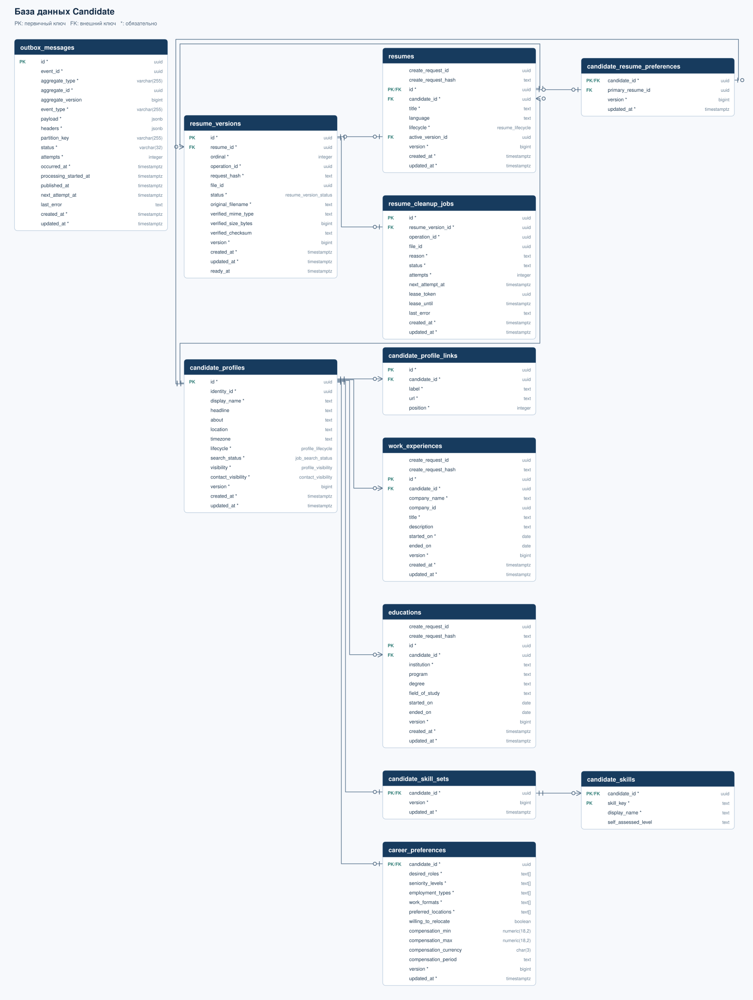

# База данных сервиса Candidate

База данных Candidate хранит профессиональные профили кандидатов, сведения об опыте работы, образовании и навыках, а также карьерные предпочтения и настройки видимости. Отдельные сущности описывают резюме, их версии и выбор основного резюме. Содержимое файлов хранится в файловом сервисе; в модели кандидата сохраняются необходимые идентификаторы и сведения о версиях документов.

## ER-диаграмма

Рисунок - Модель данных сервиса Candidate

[Открыть SVG полностью](erd.svg)

## Сущности

Таблица - Сущности сервиса Candidate

| Таблица | Псевдоним | Описание | Особенности |
|---|---|---|---|
| candidate_profiles | Профиль кандидата | Профессиональный профиль, видимость и статус поиска. | PK: id |
| candidate_profile_links | Ссылка профиля | Подписанная ссылка, размещённая в профиле. | PK: id |
| work_experiences | Опыт работы | Отдельная запись о месте и периоде работы. | PK: id |
| educations | Образование | Отдельная запись об обучении. | PK: id |
| candidate_skill_sets | Набор навыков | Версия ограниченного набора навыков кандидата. | PK: candidate_id |
| candidate_skills | Навык кандидата | Ключ, название и самооценка отдельного навыка. | PK: candidate_id, skill_key |
| career_preferences | Карьерные предпочтения | Желаемые условия работы и компенсации кандидата. | PK: candidate_id |
| resumes | Резюме | Карточка резюме и указатель активной версии. | PK: id |
| resume_versions | Версия резюме | Состояние загрузки и проверенные метаданные файла. | PK: id |
| candidate_resume_preferences | Выбор резюме | Основное резюме кандидата и версия выбора. | PK: candidate_id |
| resume_cleanup_jobs | Очистка резюме | Задание на освобождение внешней файловой привязки. | PK: id |
| outbox_messages | Исходящее событие | Сообщение transactional outbox для последующей публикации. | PK: id |

## Связи

Таблица - Связи сущностей сервиса Candidate

| Родительская сущность и ключ | Дочерняя сущность и FK | Дочерних записей на одну родительскую | Родительских записей на одну дочернюю | Комментарий |
|---|---|---|---|---|
| candidate_profiles (id) | candidate_profile_links (candidate_id) | 0..N | 1 | Безусловная уникальность FK не указана; ссылка обязательна. Удаление родителя: не задано. |
| candidate_profiles (id) | work_experiences (candidate_id) | 0..N | 1 | Безусловная уникальность FK не указана; ссылка обязательна. Удаление родителя: не задано. |
| candidate_profiles (id) | educations (candidate_id) | 0..N | 1 | Безусловная уникальность FK не указана; ссылка обязательна. Удаление родителя: не задано. |
| candidate_profiles (id) | candidate_skill_sets (candidate_id) | 0..1 | 1 | Не более одной дочерней записи; ссылка обязательна. Удаление родителя: не задано. |
| candidate_skill_sets (candidate_id) | candidate_skills (candidate_id) | 0..N | 1 | Безусловная уникальность FK не указана; ссылка обязательна. Удаление родителя: не задано. |
| candidate_profiles (id) | career_preferences (candidate_id) | 0..1 | 1 | Не более одной дочерней записи; ссылка обязательна. Удаление родителя: не задано. |
| candidate_profiles (id) | resumes (candidate_id) | 0..N | 1 | Безусловная уникальность FK не указана; ссылка обязательна. Удаление родителя: не задано. |
| resumes (id) | resume_versions (resume_id) | 0..N | 1 | Безусловная уникальность FK не указана; ссылка обязательна. Удаление родителя: не задано. |
| resume_versions (resume_id, id) | resumes (id, active_version_id) | 0..1 | 0..1 | Не более одной дочерней записи; ссылка может отсутствовать. Удаление родителя: не задано. |
| candidate_profiles (id) | candidate_resume_preferences (candidate_id) | 0..1 | 1 | Не более одной дочерней записи; ссылка обязательна. Удаление родителя: не задано. |
| resumes (candidate_id, id) | candidate_resume_preferences (candidate_id, primary_resume_id) | 0..1 | 0..1 | Не более одной дочерней записи; ссылка может отсутствовать. Удаление родителя: не задано. |
| resume_versions (id) | resume_cleanup_jobs (resume_version_id) | 0..1 | 1 | Не более одной дочерней записи; ссылка обязательна. Удаление родителя: не задано. |

## Атрибуты

Таблица - Атрибуты сущностей сервиса Candidate

<table><thead><tr><th>Сущность</th><th>Поле</th><th>Тип</th><th>Описание</th></tr></thead><tbody>
<tr><td class="attribute-name" rowspan="14">candidate_profiles</td><td class="attribute-name">id</td><td class="attribute-type">uuid</td><td class="attribute-description">Обязательно; PK; Идентификатор записи.</td></tr>
<tr><td class="attribute-name">identity_id</td><td class="attribute-type">uuid</td><td class="attribute-description">Обязательно; UNIQUE; Внешний Identity ID; не межсервисный FK</td></tr>
<tr><td class="attribute-name">display_name</td><td class="attribute-type">text</td><td class="attribute-description">Обязательно; Имя для отображения.</td></tr>
<tr><td class="attribute-name">headline</td><td class="attribute-type">text</td><td class="attribute-description">Необязательно / не указано; Краткий профессиональный заголовок.</td></tr>
<tr><td class="attribute-name">about</td><td class="attribute-type">text</td><td class="attribute-description">Необязательно / не указано; Описание кандидата.</td></tr>
<tr><td class="attribute-name">location</td><td class="attribute-type">text</td><td class="attribute-description">Необязательно / не указано; Местоположение.</td></tr>
<tr><td class="attribute-name">timezone</td><td class="attribute-type">text</td><td class="attribute-description">Необязательно / не указано; Часовой пояс.</td></tr>
<tr><td class="attribute-name">lifecycle</td><td class="attribute-type">profile_lifecycle</td><td class="attribute-description">Обязательно; По умолчанию: ACTIVE; Состояние жизненного цикла.</td></tr>
<tr><td class="attribute-name">search_status</td><td class="attribute-type">job_search_status</td><td class="attribute-description">Обязательно; По умолчанию: NOT_LOOKING; Статус поиска работы.</td></tr>
<tr><td class="attribute-name">visibility</td><td class="attribute-type">profile_visibility</td><td class="attribute-description">Обязательно; По умолчанию: PRIVATE; Настройка видимости.</td></tr>
<tr><td class="attribute-name">contact_visibility</td><td class="attribute-type">contact_visibility</td><td class="attribute-description">Обязательно; По умолчанию: HIDDEN; Настройка видимости контактов.</td></tr>
<tr><td class="attribute-name">version</td><td class="attribute-type">bigint</td><td class="attribute-description">Обязательно; По умолчанию: 1; Версия для контроля конкурентных изменений.</td></tr>
<tr><td class="attribute-name">created_at</td><td class="attribute-type">timestamptz</td><td class="attribute-description">Обязательно; Время создания.</td></tr>
<tr><td class="attribute-name">updated_at</td><td class="attribute-type">timestamptz</td><td class="attribute-description">Обязательно; Время последнего изменения.</td></tr>
<tr><td class="attribute-name" rowspan="5">candidate_profile_links</td><td class="attribute-name">id</td><td class="attribute-type">uuid</td><td class="attribute-description">Обязательно; PK; Идентификатор записи.</td></tr>
<tr><td class="attribute-name">candidate_id</td><td class="attribute-type">uuid</td><td class="attribute-description">Обязательно; FK; Идентификатор кандидата.</td></tr>
<tr><td class="attribute-name">label</td><td class="attribute-type">text</td><td class="attribute-description">Обязательно; Подпись отображаемого значения.</td></tr>
<tr><td class="attribute-name">url</td><td class="attribute-type">text</td><td class="attribute-description">Обязательно; Адрес ссылки.</td></tr>
<tr><td class="attribute-name">position</td><td class="attribute-type">integer</td><td class="attribute-description">Обязательно; Позиция в упорядоченном наборе.</td></tr>
<tr><td class="attribute-name" rowspan="13">work_experiences</td><td class="attribute-name">create_request_id</td><td class="attribute-type">uuid</td><td class="attribute-description">Необязательно / не указано; UNIQUE; UUID операции создания; уникален в пределах этой таблицы</td></tr>
<tr><td class="attribute-name">create_request_hash</td><td class="attribute-type">text</td><td class="attribute-description">Необязательно / не указано; Хеш канонического запроса создания</td></tr>
<tr><td class="attribute-name">id</td><td class="attribute-type">uuid</td><td class="attribute-description">Обязательно; PK; Идентификатор записи.</td></tr>
<tr><td class="attribute-name">candidate_id</td><td class="attribute-type">uuid</td><td class="attribute-description">Обязательно; FK; Идентификатор кандидата.</td></tr>
<tr><td class="attribute-name">company_name</td><td class="attribute-type">text</td><td class="attribute-description">Обязательно; Название компании, указанное в опыте.</td></tr>
<tr><td class="attribute-name">company_id</td><td class="attribute-type">uuid</td><td class="attribute-description">Необязательно / не указано; Необязательная ссылка на Company Service</td></tr>
<tr><td class="attribute-name">title</td><td class="attribute-type">text</td><td class="attribute-description">Обязательно; Название.</td></tr>
<tr><td class="attribute-name">description</td><td class="attribute-type">text</td><td class="attribute-description">Необязательно / не указано; Описание.</td></tr>
<tr><td class="attribute-name">started_on</td><td class="attribute-type">date</td><td class="attribute-description">Обязательно; Дата начала.</td></tr>
<tr><td class="attribute-name">ended_on</td><td class="attribute-type">date</td><td class="attribute-description">Необязательно / не указано; NULL означает продолжающийся опыт</td></tr>
<tr><td class="attribute-name">version</td><td class="attribute-type">bigint</td><td class="attribute-description">Обязательно; По умолчанию: 1; Версия для контроля конкурентных изменений.</td></tr>
<tr><td class="attribute-name">created_at</td><td class="attribute-type">timestamptz</td><td class="attribute-description">Обязательно; Время создания.</td></tr>
<tr><td class="attribute-name">updated_at</td><td class="attribute-type">timestamptz</td><td class="attribute-description">Обязательно; Время последнего изменения.</td></tr>
<tr><td class="attribute-name" rowspan="13">educations</td><td class="attribute-name">create_request_id</td><td class="attribute-type">uuid</td><td class="attribute-description">Необязательно / не указано; UNIQUE; UUID операции создания; уникален в пределах этой таблицы</td></tr>
<tr><td class="attribute-name">create_request_hash</td><td class="attribute-type">text</td><td class="attribute-description">Необязательно / не указано; Хеш канонического запроса создания</td></tr>
<tr><td class="attribute-name">id</td><td class="attribute-type">uuid</td><td class="attribute-description">Обязательно; PK; Идентификатор записи.</td></tr>
<tr><td class="attribute-name">candidate_id</td><td class="attribute-type">uuid</td><td class="attribute-description">Обязательно; FK; Идентификатор кандидата.</td></tr>
<tr><td class="attribute-name">institution</td><td class="attribute-type">text</td><td class="attribute-description">Обязательно; Название учебной организации.</td></tr>
<tr><td class="attribute-name">program</td><td class="attribute-type">text</td><td class="attribute-description">Необязательно / не указано; Название образовательной программы.</td></tr>
<tr><td class="attribute-name">degree</td><td class="attribute-type">text</td><td class="attribute-description">Необязательно / не указано; Квалификация или степень.</td></tr>
<tr><td class="attribute-name">field_of_study</td><td class="attribute-type">text</td><td class="attribute-description">Необязательно / не указано; Направление обучения.</td></tr>
<tr><td class="attribute-name">started_on</td><td class="attribute-type">date</td><td class="attribute-description">Необязательно / не указано; Дата начала.</td></tr>
<tr><td class="attribute-name">ended_on</td><td class="attribute-type">date</td><td class="attribute-description">Необязательно / не указано; Дата окончания; отсутствие значения определяется правилами модели.</td></tr>
<tr><td class="attribute-name">version</td><td class="attribute-type">bigint</td><td class="attribute-description">Обязательно; По умолчанию: 1; Версия для контроля конкурентных изменений.</td></tr>
<tr><td class="attribute-name">created_at</td><td class="attribute-type">timestamptz</td><td class="attribute-description">Обязательно; Время создания.</td></tr>
<tr><td class="attribute-name">updated_at</td><td class="attribute-type">timestamptz</td><td class="attribute-description">Обязательно; Время последнего изменения.</td></tr>
<tr><td class="attribute-name" rowspan="3">candidate_skill_sets</td><td class="attribute-name">candidate_id</td><td class="attribute-type">uuid</td><td class="attribute-description">Обязательно; PK, FK; Идентификатор кандидата.</td></tr>
<tr><td class="attribute-name">version</td><td class="attribute-type">bigint</td><td class="attribute-description">Обязательно; По умолчанию: 1; Версия для контроля конкурентных изменений.</td></tr>
<tr><td class="attribute-name">updated_at</td><td class="attribute-type">timestamptz</td><td class="attribute-description">Обязательно; Время последнего изменения.</td></tr>
<tr><td class="attribute-name" rowspan="4">candidate_skills</td><td class="attribute-name">candidate_id</td><td class="attribute-type">uuid</td><td class="attribute-description">Обязательно; PK, FK; Идентификатор кандидата.</td></tr>
<tr><td class="attribute-name">skill_key</td><td class="attribute-type">text</td><td class="attribute-description">Обязательно; PK; Нормализованный ключ навыка.</td></tr>
<tr><td class="attribute-name">display_name</td><td class="attribute-type">text</td><td class="attribute-description">Обязательно; Имя для отображения.</td></tr>
<tr><td class="attribute-name">self_assessed_level</td><td class="attribute-type">text</td><td class="attribute-description">Необязательно / не указано; Уровень, указанный владельцем профиля.</td></tr>
<tr><td class="attribute-name" rowspan="13">career_preferences</td><td class="attribute-name">candidate_id</td><td class="attribute-type">uuid</td><td class="attribute-description">Обязательно; PK, FK; Идентификатор кандидата.</td></tr>
<tr><td class="attribute-name">desired_roles</td><td class="attribute-type">text[]</td><td class="attribute-description">Обязательно; По умолчанию: {}; Желаемые роли; пустой массив означает отсутствие предпочтений</td></tr>
<tr><td class="attribute-name">seniority_levels</td><td class="attribute-type">text[]</td><td class="attribute-description">Обязательно; По умолчанию: {}; Предпочитаемые уровни</td></tr>
<tr><td class="attribute-name">employment_types</td><td class="attribute-type">text[]</td><td class="attribute-description">Обязательно; По умолчанию: {}; Предпочитаемые виды занятости</td></tr>
<tr><td class="attribute-name">work_formats</td><td class="attribute-type">text[]</td><td class="attribute-description">Обязательно; По умолчанию: {}; Предпочитаемые форматы работы</td></tr>
<tr><td class="attribute-name">preferred_locations</td><td class="attribute-type">text[]</td><td class="attribute-description">Обязательно; По умолчанию: {}; Предпочитаемые места работы</td></tr>
<tr><td class="attribute-name">willing_to_relocate</td><td class="attribute-type">boolean</td><td class="attribute-description">Необязательно / не указано; Готовность к переезду.</td></tr>
<tr><td class="attribute-name">compensation_min</td><td class="attribute-type">numeric(18,2)</td><td class="attribute-description">Необязательно / не указано; Нижняя граница компенсации.</td></tr>
<tr><td class="attribute-name">compensation_max</td><td class="attribute-type">numeric(18,2)</td><td class="attribute-description">Необязательно / не указано; Верхняя граница компенсации.</td></tr>
<tr><td class="attribute-name">compensation_currency</td><td class="attribute-type">char(3)</td><td class="attribute-description">Необязательно / не указано; Валюта компенсации.</td></tr>
<tr><td class="attribute-name">compensation_period</td><td class="attribute-type">text</td><td class="attribute-description">Необязательно / не указано; Период компенсации.</td></tr>
<tr><td class="attribute-name">version</td><td class="attribute-type">bigint</td><td class="attribute-description">Обязательно; По умолчанию: 1; Версия для контроля конкурентных изменений.</td></tr>
<tr><td class="attribute-name">updated_at</td><td class="attribute-type">timestamptz</td><td class="attribute-description">Обязательно; Время последнего изменения.</td></tr>
<tr><td class="attribute-name" rowspan="11">resumes</td><td class="attribute-name">create_request_id</td><td class="attribute-type">uuid</td><td class="attribute-description">Необязательно / не указано; UNIQUE; UUID операции создания; уникален в пределах этой таблицы</td></tr>
<tr><td class="attribute-name">create_request_hash</td><td class="attribute-type">text</td><td class="attribute-description">Необязательно / не указано; Хеш канонического запроса создания</td></tr>
<tr><td class="attribute-name">id</td><td class="attribute-type">uuid</td><td class="attribute-description">Обязательно; PK, FK; Идентификатор записи.</td></tr>
<tr><td class="attribute-name">candidate_id</td><td class="attribute-type">uuid</td><td class="attribute-description">Обязательно; FK; Идентификатор кандидата.</td></tr>
<tr><td class="attribute-name">title</td><td class="attribute-type">text</td><td class="attribute-description">Обязательно; Название.</td></tr>
<tr><td class="attribute-name">language</td><td class="attribute-type">text</td><td class="attribute-description">Необязательно / не указано; Язык, определённый контекстом записи.</td></tr>
<tr><td class="attribute-name">lifecycle</td><td class="attribute-type">resume_lifecycle</td><td class="attribute-description">Обязательно; По умолчанию: ACTIVE; Состояние жизненного цикла.</td></tr>
<tr><td class="attribute-name">active_version_id</td><td class="attribute-type">uuid</td><td class="attribute-description">Необязательно / не указано; FK; Композитный FK с id гарантирует принадлежность версии</td></tr>
<tr><td class="attribute-name">version</td><td class="attribute-type">bigint</td><td class="attribute-description">Обязательно; По умолчанию: 1; Версия для контроля конкурентных изменений.</td></tr>
<tr><td class="attribute-name">created_at</td><td class="attribute-type">timestamptz</td><td class="attribute-description">Обязательно; Время создания.</td></tr>
<tr><td class="attribute-name">updated_at</td><td class="attribute-type">timestamptz</td><td class="attribute-description">Обязательно; Время последнего изменения.</td></tr>
<tr><td class="attribute-name" rowspan="15">resume_versions</td><td class="attribute-name">id</td><td class="attribute-type">uuid</td><td class="attribute-description">Обязательно; PK; Идентификатор записи.</td></tr>
<tr><td class="attribute-name">resume_id</td><td class="attribute-type">uuid</td><td class="attribute-description">Обязательно; FK; Идентификатор связанного объекта; владелец и назначение определяются контекстом сервиса.</td></tr>
<tr><td class="attribute-name">ordinal</td><td class="attribute-type">integer</td><td class="attribute-description">Обязательно; Порядковый номер внутри родительского контекста.</td></tr>
<tr><td class="attribute-name">operation_id</td><td class="attribute-type">uuid</td><td class="attribute-description">Обязательно; UNIQUE; Идентификатор операции загрузки</td></tr>
<tr><td class="attribute-name">request_hash</td><td class="attribute-type">text</td><td class="attribute-description">Обязательно; Хеш канонического запроса загрузки</td></tr>
<tr><td class="attribute-name">file_id</td><td class="attribute-type">uuid</td><td class="attribute-description">Необязательно / не указано; UNIQUE; Внешний ID; может отсутствовать до ответа File Service</td></tr>
<tr><td class="attribute-name">status</td><td class="attribute-type">resume_version_status</td><td class="attribute-description">Обязательно; Состояние записи; допустимые переходы описаны в проекте сервиса.</td></tr>
<tr><td class="attribute-name">original_filename</td><td class="attribute-type">text</td><td class="attribute-description">Обязательно; Недоверенное отображаемое имя, не путь</td></tr>
<tr><td class="attribute-name">verified_mime_type</td><td class="attribute-type">text</td><td class="attribute-description">Необязательно / не указано; Подтверждённый MIME-тип файла.</td></tr>
<tr><td class="attribute-name">verified_size_bytes</td><td class="attribute-type">bigint</td><td class="attribute-description">Необязательно / не указано; Подтверждённый размер файла в байтах.</td></tr>
<tr><td class="attribute-name">verified_checksum</td><td class="attribute-type">text</td><td class="attribute-description">Необязательно / не указано; Подтверждённая контрольная сумма файла.</td></tr>
<tr><td class="attribute-name">version</td><td class="attribute-type">bigint</td><td class="attribute-description">Обязательно; По умолчанию: 1; Версия для контроля конкурентных изменений.</td></tr>
<tr><td class="attribute-name">created_at</td><td class="attribute-type">timestamptz</td><td class="attribute-description">Обязательно; Время создания.</td></tr>
<tr><td class="attribute-name">updated_at</td><td class="attribute-type">timestamptz</td><td class="attribute-description">Обязательно; Время последнего изменения.</td></tr>
<tr><td class="attribute-name">ready_at</td><td class="attribute-type">timestamptz</td><td class="attribute-description">Необязательно / не указано; Время перехода в готовое состояние.</td></tr>
<tr><td class="attribute-name" rowspan="4">candidate_resume_preferences</td><td class="attribute-name">candidate_id</td><td class="attribute-type">uuid</td><td class="attribute-description">Обязательно; PK, FK; Идентификатор кандидата.</td></tr>
<tr><td class="attribute-name">primary_resume_id</td><td class="attribute-type">uuid</td><td class="attribute-description">Необязательно / не указано; FK; Композитный FK гарантирует принадлежность кандидату</td></tr>
<tr><td class="attribute-name">version</td><td class="attribute-type">bigint</td><td class="attribute-description">Обязательно; По умолчанию: 1; Версия для контроля конкурентных изменений.</td></tr>
<tr><td class="attribute-name">updated_at</td><td class="attribute-type">timestamptz</td><td class="attribute-description">Обязательно; Время последнего изменения.</td></tr>
<tr><td class="attribute-name" rowspan="13">resume_cleanup_jobs</td><td class="attribute-name">id</td><td class="attribute-type">uuid</td><td class="attribute-description">Обязательно; PK; Идентификатор записи.</td></tr>
<tr><td class="attribute-name">resume_version_id</td><td class="attribute-type">uuid</td><td class="attribute-description">Обязательно; FK, UNIQUE; Идентификатор связанного объекта; владелец и назначение определяются контекстом сервиса.</td></tr>
<tr><td class="attribute-name">operation_id</td><td class="attribute-type">uuid</td><td class="attribute-description">Обязательно; UNIQUE; Идемпотентная операция освобождения привязки</td></tr>
<tr><td class="attribute-name">file_id</td><td class="attribute-type">uuid</td><td class="attribute-description">Необязательно / не указано; Идентификатор файла.</td></tr>
<tr><td class="attribute-name">reason</td><td class="attribute-type">text</td><td class="attribute-description">Обязательно; Причина действия или перехода.</td></tr>
<tr><td class="attribute-name">status</td><td class="attribute-type">text</td><td class="attribute-description">Обязательно; Состояние записи; допустимые переходы описаны в проекте сервиса.</td></tr>
<tr><td class="attribute-name">attempts</td><td class="attribute-type">integer</td><td class="attribute-description">Обязательно; По умолчанию: 0; Количество попыток.</td></tr>
<tr><td class="attribute-name">next_attempt_at</td><td class="attribute-type">timestamptz</td><td class="attribute-description">Необязательно / не указано; Время следующей попытки.</td></tr>
<tr><td class="attribute-name">lease_token</td><td class="attribute-type">uuid</td><td class="attribute-description">Необязательно / не указано; Токен захвата работы.</td></tr>
<tr><td class="attribute-name">lease_until</td><td class="attribute-type">timestamptz</td><td class="attribute-description">Необязательно / не указано; Окончание срока захвата.</td></tr>
<tr><td class="attribute-name">last_error</td><td class="attribute-type">text</td><td class="attribute-description">Необязательно / не указано; Без секретов и содержимого документа</td></tr>
<tr><td class="attribute-name">created_at</td><td class="attribute-type">timestamptz</td><td class="attribute-description">Обязательно; Время создания.</td></tr>
<tr><td class="attribute-name">updated_at</td><td class="attribute-type">timestamptz</td><td class="attribute-description">Обязательно; Время последнего изменения.</td></tr>
<tr><td class="attribute-name" rowspan="18">outbox_messages</td><td class="attribute-name">id</td><td class="attribute-type">uuid</td><td class="attribute-description">Обязательно; PK; Идентификатор записи.</td></tr>
<tr><td class="attribute-name">event_id</td><td class="attribute-type">uuid</td><td class="attribute-description">Обязательно; UNIQUE; Идентификатор события.</td></tr>
<tr><td class="attribute-name">aggregate_type</td><td class="attribute-type">varchar(255)</td><td class="attribute-description">Обязательно; Тип агрегата — источника события.</td></tr>
<tr><td class="attribute-name">aggregate_id</td><td class="attribute-type">uuid</td><td class="attribute-description">Обязательно; Идентификатор связанного объекта; владелец и назначение определяются контекстом сервиса.</td></tr>
<tr><td class="attribute-name">aggregate_version</td><td class="attribute-type">bigint</td><td class="attribute-description">Необязательно / не указано; Версия агрегата — источника события.</td></tr>
<tr><td class="attribute-name">event_type</td><td class="attribute-type">varchar(255)</td><td class="attribute-description">Обязательно; Тип события.</td></tr>
<tr><td class="attribute-name">payload</td><td class="attribute-type">jsonb</td><td class="attribute-description">Обязательно; Содержимое события или операции.</td></tr>
<tr><td class="attribute-name">headers</td><td class="attribute-type">jsonb</td><td class="attribute-description">Обязательно; По умолчанию: {}; Заголовки события.</td></tr>
<tr><td class="attribute-name">partition_key</td><td class="attribute-type">varchar(255)</td><td class="attribute-description">Необязательно / не указано; Ключ распределения события.</td></tr>
<tr><td class="attribute-name">status</td><td class="attribute-type">varchar(32)</td><td class="attribute-description">Обязательно; По умолчанию: PENDING; Состояние записи; допустимые переходы описаны в проекте сервиса.</td></tr>
<tr><td class="attribute-name">attempts</td><td class="attribute-type">integer</td><td class="attribute-description">Обязательно; По умолчанию: 0; Количество попыток.</td></tr>
<tr><td class="attribute-name">occurred_at</td><td class="attribute-type">timestamptz</td><td class="attribute-description">Обязательно; Время события.</td></tr>
<tr><td class="attribute-name">processing_started_at</td><td class="attribute-type">timestamptz</td><td class="attribute-description">Необязательно / не указано; Время соответствующего действия или состояния.</td></tr>
<tr><td class="attribute-name">published_at</td><td class="attribute-type">timestamptz</td><td class="attribute-description">Необязательно / не указано; Время публикации.</td></tr>
<tr><td class="attribute-name">next_attempt_at</td><td class="attribute-type">timestamptz</td><td class="attribute-description">Необязательно / не указано; Время следующей попытки.</td></tr>
<tr><td class="attribute-name">last_error</td><td class="attribute-type">text</td><td class="attribute-description">Необязательно / не указано; Последняя зафиксированная ошибка.</td></tr>
<tr><td class="attribute-name">created_at</td><td class="attribute-type">timestamptz</td><td class="attribute-description">Обязательно; Время создания.</td></tr>
<tr><td class="attribute-name">updated_at</td><td class="attribute-type">timestamptz</td><td class="attribute-description">Обязательно; Время последнего изменения.</td></tr>
</tbody></table>

## Перечисления

Допустимые значения перечислимых типов. Переходы между состояниями задаются правилами сервиса.

Таблица - Перечисления сервиса Candidate

| Тип | Допустимые значения |
|---|---|
| profile_lifecycle | ACTIVE, ARCHIVED |
| job_search_status | OPEN_TO_WORK, OPEN_TO_OFFERS, NOT_LOOKING |
| profile_visibility | PRIVATE, RECRUITERS |
| contact_visibility | HIDDEN, AUTHORIZED_RECRUITERS |
| resume_lifecycle | ACTIVE, DELETED |
| resume_version_status | UPLOADING, CHECKING, READY, REJECTED, EXPIRED, CANCELLED |

## Ограничения данных

- Имя профиля, названия опыта и учебного заведения, ключи и названия навыков и резюме не могут быть пустыми.
- Дата окончания опыта или образования не может предшествовать дате начала, если обе даты указаны.
- Размеры ожидаемой компенсации неотрицательны, минимум не больше максимума. При указании суммы обязательны валюта и период.
- Архивный профиль имеет закрытую видимость профиля и контактов и статус отсутствия поиска работы.
- Готовая версия резюме содержит идентификатор файла, проверенные тип, размер, контрольную сумму и время готовности. Размер положителен.

- Профиль кандидата связан с одной учётной записью Identity; одной учётной записи в Candidate соответствует не более одного профиля.
- Архивный профиль кандидата должен быть закрытым и не может обозначать активный поиск работы.
- Минимальная и максимальная ожидаемая компенсация кандидата неотрицательны; минимум не превышает максимум. При указании суммы нужны валюта и период.
- Основным может быть выбрано только собственное активное резюме кандидата с готовой версией.

