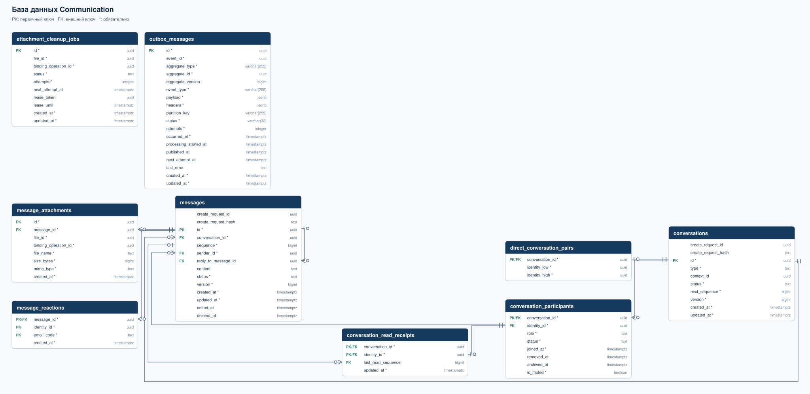

# База данных сервиса Communication

Источник: проектная [DBML-схема](../schema.dbml). Смысл сценариев и незакрытые решения — в [описании сервиса](../../../services/communication/index.md).

## ER-диаграмма

Таблицы показаны со всеми полями из DBML. PK — первичный ключ, FK — внешний ключ, звёздочка — обязательное поле. Связи обозначены нотацией «воронья лапка»: круг — необязательная связь, черта — один, лапка — многие. Линии подходят к строкам полей; для составного FK линия подходит к последнему полю, а все поля перечислены ниже. Кратность выведена из FK, NOT NULL и уникальных ключей DBML; дополнительные SQL-ограничения смотрите в миграциях или проекте ограничений. Внешние идентификаторы других сервисов не соединены межбазовыми FK.

[Открыть SVG полностью](erd.svg)

## Перечень связей

| № | Родительская таблица и поля | Дочерняя таблица и FK | Удаление родителя |
|---|---|---|---|
| 1 | conversations (id) | direct_conversation_pairs (conversation_id) | не указано |
| 2 | conversations (id) | conversation_participants (conversation_id) | не указано |
| 3 | conversations (id) | messages (conversation_id) | не указано |
| 4 | conversation_participants (conversation_id, identity_id) | messages (conversation_id, sender_id) | не указано |
| 5 | messages (conversation_id, id) | messages (conversation_id, reply_to_message_id) | не указано |
| 6 | messages (id) | message_attachments (message_id) | не указано |
| 7 | conversation_participants (conversation_id, identity_id) | conversation_read_receipts (conversation_id, identity_id) | не указано |
| 8 | messages (conversation_id, sequence) | conversation_read_receipts (conversation_id, last_read_sequence) | не указано |
| 9 | messages (id) | message_reactions (message_id) | не указано |

## Таблицы и поля

Обязательность приведена по DBML: «да» означает `NOT NULL` или PK; «нет / не указано» не гарантирует отсутствие дополнительных SQL-ограничений. UNIQUE отдельно отмечен только для отдельного поля; составные ключи и индексы перечислены под таблицей. Пустое пояснение в исходной модели не дополняется вымышленными правилами.

### conversations

| Поле | Тип | Обязательно | Ключ / уникальность | По умолчанию | Пояснение |
|---|---|---|---|---|---|
| create_request_id | uuid | нет / не указано | UNIQUE | — | UUID операции создания; уникален в пределах этой таблицы |
| create_request_hash | text | нет / не указано | — | — | Хеш канонического запроса создания |
| id | uuid | да | PK | — | Идентификатор записи. |
| type | text | да | — | — | Тип объекта согласно модели сервиса. |
| context_id | uuid | нет / не указано | — | — | Внешний ID отклика или интервью |
| status | text | да | — | — | Состояние записи; допустимые переходы описаны в проекте сервиса. |
| next_sequence | bigint | да | — | 1 | Следующий номер сообщения в диалоге. |
| version | bigint | да | — | 1 | Версия для контроля конкурентных изменений. |
| created_at | timestamptz | да | — | — | Время создания. |
| updated_at | timestamptz | да | — | — | Время последнего изменения. |

Составные ключи и индексы DBML: `INDEX (type, context_id)`.

### direct_conversation_pairs

Канонический порядок UUID; равенство паре участников обеспечивается транзакцией.

| Поле | Тип | Обязательно | Ключ / уникальность | По умолчанию | Пояснение |
|---|---|---|---|---|---|
| conversation_id | uuid | да | PK, FK | — | Идентификатор связанного объекта; владелец и назначение определяются контекстом сервиса. |
| identity_low | uuid | да | — | — | Внешний Identity ID |
| identity_high | uuid | да | — | — | Внешний Identity ID |

Составные ключи и индексы DBML: `UNIQUE (identity_low, identity_high)`.

### conversation_participants

| Поле | Тип | Обязательно | Ключ / уникальность | По умолчанию | Пояснение |
|---|---|---|---|---|---|
| conversation_id | uuid | да | PK, FK | — | Идентификатор связанного объекта; владелец и назначение определяются контекстом сервиса. |
| identity_id | uuid | да | PK | — | Внешний Identity ID |
| role | text | да | — | — | Роль в контексте записи. |
| status | text | да | — | — | Состояние записи; допустимые переходы описаны в проекте сервиса. |
| joined_at | timestamptz | да | — | — | Время соответствующего действия или состояния. |
| removed_at | timestamptz | нет / не указано | — | — | Время соответствующего действия или состояния. |
| archived_at | timestamptz | нет / не указано | — | — | Персональное скрытие из активного списка |
| is_muted | boolean | да | — | false | Настройка отключения уведомлений. |

Составные ключи и индексы DBML: `PK (conversation_id, identity_id)`.

### messages

| Поле | Тип | Обязательно | Ключ / уникальность | По умолчанию | Пояснение |
|---|---|---|---|---|---|
| create_request_id | uuid | нет / не указано | UNIQUE | — | UUID операции создания; уникален в пределах этой таблицы |
| create_request_hash | text | нет / не указано | — | — | Хеш канонического запроса создания |
| id | uuid | да | PK | — | Идентификатор записи. |
| conversation_id | uuid | да | FK | — | Идентификатор связанного объекта; владелец и назначение определяются контекстом сервиса. |
| sequence | bigint | да | — | — | Порядковый номер внутри родительского контекста. |
| sender_id | uuid | да | FK | — | Внешний Identity ID |
| reply_to_message_id | uuid | нет / не указано | FK | — | Идентификатор связанного объекта; владелец и назначение определяются контекстом сервиса. |
| content | text | нет / не указано | — | — | Содержимое, допустимое для этого объекта. |
| status | text | да | — | — | Состояние записи; допустимые переходы описаны в проекте сервиса. |
| version | bigint | да | — | 1 | Версия для контроля конкурентных изменений. |
| created_at | timestamptz | да | — | — | Время создания. |
| updated_at | timestamptz | да | — | — | Время последнего изменения. |
| edited_at | timestamptz | нет / не указано | — | — | Время соответствующего действия или состояния. |
| deleted_at | timestamptz | нет / не указано | — | — | Время удаления. |

Составные ключи и индексы DBML: `UNIQUE (conversation_id, sequence)`; `UNIQUE (conversation_id, id)`.

### message_attachments

| Поле | Тип | Обязательно | Ключ / уникальность | По умолчанию | Пояснение |
|---|---|---|---|---|---|
| id | uuid | да | PK | — | Идентификатор записи. |
| message_id | uuid | да | FK | — | Идентификатор связанного объекта; владелец и назначение определяются контекстом сервиса. |
| file_id | uuid | да | — | — | Внешний File ID |
| binding_operation_id | uuid | да | UNIQUE | — | Идентификатор связанного объекта; владелец и назначение определяются контекстом сервиса. |
| file_name | text | да | — | — | Отображаемое имя файла. |
| size_bytes | bigint | да | — | — | Размер файла в байтах. |
| mime_type | text | да | — | — | MIME-тип файла. |
| created_at | timestamptz | да | — | — | Время создания. |

Составные ключи и индексы DBML: `UNIQUE (message_id, file_id)`.

### conversation_read_receipts

| Поле | Тип | Обязательно | Ключ / уникальность | По умолчанию | Пояснение |
|---|---|---|---|---|---|
| conversation_id | uuid | да | PK, FK | — | Идентификатор связанного объекта; владелец и назначение определяются контекстом сервиса. |
| identity_id | uuid | да | PK, FK | — | Идентификатор учётной записи Identity. |
| last_read_sequence | bigint | нет / не указано | FK | — | NULL до первого прочтения |
| updated_at | timestamptz | да | — | — | Время последнего изменения. |

Составные ключи и индексы DBML: `PK (conversation_id, identity_id)`.

### message_reactions

| Поле | Тип | Обязательно | Ключ / уникальность | По умолчанию | Пояснение |
|---|---|---|---|---|---|
| message_id | uuid | да | PK, FK | — | Идентификатор связанного объекта; владелец и назначение определяются контекстом сервиса. |
| identity_id | uuid | да | PK | — | Внешний Identity ID; активное членство проверяется сервисом |
| emoji_code | text | да | PK | — | Код реакции. |
| created_at | timestamptz | да | — | — | Время создания. |

Составные ключи и индексы DBML: `PK (message_id, identity_id, emoji_code)`.

### attachment_cleanup_jobs

Не зависит FK от удаляемой строки вложения; служит для восстановления внешнего освобождения.

| Поле | Тип | Обязательно | Ключ / уникальность | По умолчанию | Пояснение |
|---|---|---|---|---|---|
| id | uuid | да | PK | — | Идентификатор записи. |
| file_id | uuid | да | — | — | Идентификатор файла. |
| binding_operation_id | uuid | да | UNIQUE | — | Идентификатор связанного объекта; владелец и назначение определяются контекстом сервиса. |
| status | text | да | — | — | Состояние записи; допустимые переходы описаны в проекте сервиса. |
| attempts | integer | да | — | 0 | Количество попыток. |
| next_attempt_at | timestamptz | нет / не указано | — | — | Время следующей попытки. |
| lease_token | uuid | нет / не указано | — | — | Токен захвата работы. |
| lease_until | timestamptz | нет / не указано | — | — | Окончание срока захвата. |
| created_at | timestamptz | да | — | — | Время создания. |
| updated_at | timestamptz | да | — | — | Время последнего изменения. |

Составные ключи и индексы DBML: `INDEX (status, next_attempt_at)`.

### outbox_messages

| Поле | Тип | Обязательно | Ключ / уникальность | По умолчанию | Пояснение |
|---|---|---|---|---|---|
| id | uuid | да | PK | — | Идентификатор записи. |
| event_id | uuid | да | UNIQUE | — | Идентификатор события. |
| aggregate_type | varchar(255) | да | — | — | Тип агрегата — источника события. |
| aggregate_id | uuid | да | — | — | Идентификатор связанного объекта; владелец и назначение определяются контекстом сервиса. |
| aggregate_version | bigint | нет / не указано | — | — | Версия агрегата — источника события. |
| event_type | varchar(255) | да | — | — | Тип события. |
| payload | jsonb | да | — | — | Содержимое события или операции. |
| headers | jsonb | да | — | {} | Заголовки события. |
| partition_key | varchar(255) | нет / не указано | — | — | Ключ распределения события. |
| status | varchar(32) | да | — | PENDING | Состояние записи; допустимые переходы описаны в проекте сервиса. |
| attempts | integer | да | — | 0 | Количество попыток. |
| occurred_at | timestamptz | да | — | — | Время события. |
| processing_started_at | timestamptz | нет / не указано | — | — | Время соответствующего действия или состояния. |
| published_at | timestamptz | нет / не указано | — | — | Время публикации. |
| next_attempt_at | timestamptz | нет / не указано | — | — | Время следующей попытки. |
| last_error | text | нет / не указано | — | — | Последняя зафиксированная ошибка. |
| created_at | timestamptz | да | — | — | Время создания. |
| updated_at | timestamptz | да | — | — | Время последнего изменения. |

Составные ключи и индексы DBML: `INDEX (aggregate_type, aggregate_id, aggregate_version)`.

