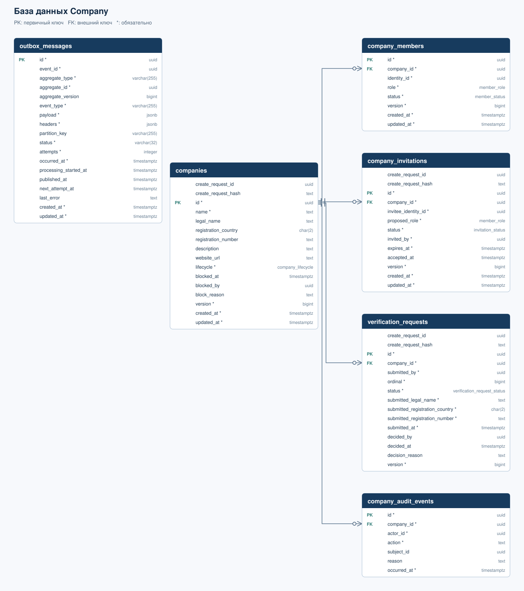

# База данных сервиса Company

База данных Company содержит сведения о компаниях и их участниках, корпоративных ролях, приглашениях и заявках на верификацию. Модель позволяет управлять членством пользователей в компаниях и хранить результаты проверки сведений о работодателях.

## ER-диаграмма

Рисунок - Модель данных сервиса Company

[Открыть SVG полностью](erd.svg)

## Сущности

Таблица - Сущности сервиса Company

| Таблица | Псевдоним | Описание | Особенности |
|---|---|---|---|
| companies | Компания | Карточка компании и состояние её жизненного цикла. | PK: id |
| company_members | Участник компании | Членство пользователя в компании и его состояние. | PK: id |
| company_invitations | Приглашение в компанию | Приглашение пользователя с состоянием обработки. | PK: id |
| verification_requests | Заявка на верификацию | Запрос проверки компании и результат рассмотрения. | PK: id |
| company_audit_events | Событие аудита компании | Запись о значимом действии в компании. | PK: id |
| outbox_messages | Исходящее событие | Сообщение transactional outbox для последующей публикации. | PK: id |

## Связи

Таблица - Связи сущностей сервиса Company

| Родительская сущность и ключ | Дочерняя сущность и FK | Дочерних записей на одну родительскую | Родительских записей на одну дочернюю | Комментарий |
|---|---|---|---|---|
| companies (id) | company_members (company_id) | 0..N | 1 | Безусловная уникальность FK не указана; ссылка обязательна. Удаление родителя: не задано. |
| companies (id) | company_invitations (company_id) | 0..N | 1 | Безусловная уникальность FK не указана; ссылка обязательна. Удаление родителя: не задано. |
| companies (id) | verification_requests (company_id) | 0..N | 1 | Безусловная уникальность FK не указана; ссылка обязательна. Удаление родителя: не задано. |
| companies (id) | company_audit_events (company_id) | 0..N | 1 | Безусловная уникальность FK не указана; ссылка обязательна. Удаление родителя: не задано. |

## Атрибуты

Таблица - Атрибуты сущностей сервиса Company

<table><thead><tr><th>Сущность</th><th>Поле</th><th>Тип</th><th>Описание</th></tr></thead><tbody>
<tr><td class="attribute-name" rowspan="16">companies</td><td class="attribute-name">create_request_id</td><td class="attribute-type">uuid</td><td class="attribute-description">Необязательно / не указано; UNIQUE; UUID операции создания; уникален в пределах этой таблицы</td></tr>
<tr><td class="attribute-name">create_request_hash</td><td class="attribute-type">text</td><td class="attribute-description">Необязательно / не указано; Хеш канонического запроса создания</td></tr>
<tr><td class="attribute-name">id</td><td class="attribute-type">uuid</td><td class="attribute-description">Обязательно; PK; Идентификатор записи.</td></tr>
<tr><td class="attribute-name">name</td><td class="attribute-type">text</td><td class="attribute-description">Обязательно; Название или имя.</td></tr>
<tr><td class="attribute-name">legal_name</td><td class="attribute-type">text</td><td class="attribute-description">Необязательно / не указано; Юридическое наименование.</td></tr>
<tr><td class="attribute-name">registration_country</td><td class="attribute-type">char(2)</td><td class="attribute-description">Необязательно / не указано; Код страны регистрации.</td></tr>
<tr><td class="attribute-name">registration_number</td><td class="attribute-type">text</td><td class="attribute-description">Необязательно / не указано; Регистрационный номер.</td></tr>
<tr><td class="attribute-name">description</td><td class="attribute-type">text</td><td class="attribute-description">Необязательно / не указано; Описание.</td></tr>
<tr><td class="attribute-name">website_url</td><td class="attribute-type">text</td><td class="attribute-description">Необязательно / не указано; Адрес сайта.</td></tr>
<tr><td class="attribute-name">lifecycle</td><td class="attribute-type">company_lifecycle</td><td class="attribute-description">Обязательно; По умолчанию: ACTIVE; Состояние жизненного цикла.</td></tr>
<tr><td class="attribute-name">blocked_at</td><td class="attribute-type">timestamptz</td><td class="attribute-description">Необязательно / не указано; Время соответствующего действия или состояния.</td></tr>
<tr><td class="attribute-name">blocked_by</td><td class="attribute-type">uuid</td><td class="attribute-description">Необязательно / не указано; Внешний Identity ID</td></tr>
<tr><td class="attribute-name">block_reason</td><td class="attribute-type">text</td><td class="attribute-description">Необязательно / не указано; Причина блокировки.</td></tr>
<tr><td class="attribute-name">version</td><td class="attribute-type">bigint</td><td class="attribute-description">Обязательно; По умолчанию: 1; Версия для контроля конкурентных изменений.</td></tr>
<tr><td class="attribute-name">created_at</td><td class="attribute-type">timestamptz</td><td class="attribute-description">Обязательно; Время создания.</td></tr>
<tr><td class="attribute-name">updated_at</td><td class="attribute-type">timestamptz</td><td class="attribute-description">Обязательно; Время последнего изменения.</td></tr>
<tr><td class="attribute-name" rowspan="8">company_members</td><td class="attribute-name">id</td><td class="attribute-type">uuid</td><td class="attribute-description">Обязательно; PK; Идентификатор записи.</td></tr>
<tr><td class="attribute-name">company_id</td><td class="attribute-type">uuid</td><td class="attribute-description">Обязательно; FK; Идентификатор компании.</td></tr>
<tr><td class="attribute-name">identity_id</td><td class="attribute-type">uuid</td><td class="attribute-description">Обязательно; Внешний Identity ID; не межсервисный FK</td></tr>
<tr><td class="attribute-name">role</td><td class="attribute-type">member_role</td><td class="attribute-description">Обязательно; Роль в контексте записи.</td></tr>
<tr><td class="attribute-name">status</td><td class="attribute-type">member_status</td><td class="attribute-description">Обязательно; Состояние записи; допустимые переходы описаны в проекте сервиса.</td></tr>
<tr><td class="attribute-name">version</td><td class="attribute-type">bigint</td><td class="attribute-description">Обязательно; По умолчанию: 1; Версия для контроля конкурентных изменений.</td></tr>
<tr><td class="attribute-name">created_at</td><td class="attribute-type">timestamptz</td><td class="attribute-description">Обязательно; Время создания.</td></tr>
<tr><td class="attribute-name">updated_at</td><td class="attribute-type">timestamptz</td><td class="attribute-description">Обязательно; Время последнего изменения.</td></tr>
<tr><td class="attribute-name" rowspan="13">company_invitations</td><td class="attribute-name">create_request_id</td><td class="attribute-type">uuid</td><td class="attribute-description">Необязательно / не указано; UNIQUE; UUID операции создания; уникален в пределах этой таблицы</td></tr>
<tr><td class="attribute-name">create_request_hash</td><td class="attribute-type">text</td><td class="attribute-description">Необязательно / не указано; Хеш канонического запроса создания</td></tr>
<tr><td class="attribute-name">id</td><td class="attribute-type">uuid</td><td class="attribute-description">Обязательно; PK; Идентификатор записи.</td></tr>
<tr><td class="attribute-name">company_id</td><td class="attribute-type">uuid</td><td class="attribute-description">Обязательно; FK; Идентификатор компании.</td></tr>
<tr><td class="attribute-name">invitee_identity_id</td><td class="attribute-type">uuid</td><td class="attribute-description">Обязательно; Приглашение существующей identity; внешний ID</td></tr>
<tr><td class="attribute-name">proposed_role</td><td class="attribute-type">member_role</td><td class="attribute-description">Обязательно; Роль, предлагаемая приглашённому участнику.</td></tr>
<tr><td class="attribute-name">status</td><td class="attribute-type">invitation_status</td><td class="attribute-description">Обязательно; Состояние записи; допустимые переходы описаны в проекте сервиса.</td></tr>
<tr><td class="attribute-name">invited_by</td><td class="attribute-type">uuid</td><td class="attribute-description">Обязательно; Внешний Identity ID</td></tr>
<tr><td class="attribute-name">expires_at</td><td class="attribute-type">timestamptz</td><td class="attribute-description">Обязательно; Время истечения.</td></tr>
<tr><td class="attribute-name">accepted_at</td><td class="attribute-type">timestamptz</td><td class="attribute-description">Необязательно / не указано; Время соответствующего действия или состояния.</td></tr>
<tr><td class="attribute-name">version</td><td class="attribute-type">bigint</td><td class="attribute-description">Обязательно; По умолчанию: 1; Версия для контроля конкурентных изменений.</td></tr>
<tr><td class="attribute-name">created_at</td><td class="attribute-type">timestamptz</td><td class="attribute-description">Обязательно; Время создания.</td></tr>
<tr><td class="attribute-name">updated_at</td><td class="attribute-type">timestamptz</td><td class="attribute-description">Обязательно; Время последнего изменения.</td></tr>
<tr><td class="attribute-name" rowspan="15">verification_requests</td><td class="attribute-name">create_request_id</td><td class="attribute-type">uuid</td><td class="attribute-description">Необязательно / не указано; UNIQUE; UUID операции создания; уникален в пределах этой таблицы</td></tr>
<tr><td class="attribute-name">create_request_hash</td><td class="attribute-type">text</td><td class="attribute-description">Необязательно / не указано; Хеш канонического запроса создания</td></tr>
<tr><td class="attribute-name">id</td><td class="attribute-type">uuid</td><td class="attribute-description">Обязательно; PK; Идентификатор записи.</td></tr>
<tr><td class="attribute-name">company_id</td><td class="attribute-type">uuid</td><td class="attribute-description">Обязательно; FK; Идентификатор компании.</td></tr>
<tr><td class="attribute-name">submitted_by</td><td class="attribute-type">uuid</td><td class="attribute-description">Обязательно; Идентификатор подавшего заявку пользователя.</td></tr>
<tr><td class="attribute-name">ordinal</td><td class="attribute-type">bigint</td><td class="attribute-description">Обязательно; Монотонный номер заявки в компании</td></tr>
<tr><td class="attribute-name">status</td><td class="attribute-type">verification_request_status</td><td class="attribute-description">Обязательно; Состояние записи; допустимые переходы описаны в проекте сервиса.</td></tr>
<tr><td class="attribute-name">submitted_legal_name</td><td class="attribute-type">text</td><td class="attribute-description">Обязательно; Снимок реквизитов на момент подачи</td></tr>
<tr><td class="attribute-name">submitted_registration_country</td><td class="attribute-type">char(2)</td><td class="attribute-description">Обязательно; Страна регистрации из представленного снимка реквизитов.</td></tr>
<tr><td class="attribute-name">submitted_registration_number</td><td class="attribute-type">text</td><td class="attribute-description">Обязательно; Регистрационный номер из представленного снимка реквизитов.</td></tr>
<tr><td class="attribute-name">submitted_at</td><td class="attribute-type">timestamptz</td><td class="attribute-description">Обязательно; Время отправки.</td></tr>
<tr><td class="attribute-name">decided_by</td><td class="attribute-type">uuid</td><td class="attribute-description">Необязательно / не указано; Идентификатор пользователя, принявшего решение.</td></tr>
<tr><td class="attribute-name">decided_at</td><td class="attribute-type">timestamptz</td><td class="attribute-description">Необязательно / не указано; Время соответствующего действия или состояния.</td></tr>
<tr><td class="attribute-name">decision_reason</td><td class="attribute-type">text</td><td class="attribute-description">Необязательно / не указано; Причина принятого решения.</td></tr>
<tr><td class="attribute-name">version</td><td class="attribute-type">bigint</td><td class="attribute-description">Обязательно; По умолчанию: 1; Версия для контроля конкурентных изменений.</td></tr>
<tr><td class="attribute-name" rowspan="7">company_audit_events</td><td class="attribute-name">id</td><td class="attribute-type">uuid</td><td class="attribute-description">Обязательно; PK; Идентификатор записи.</td></tr>
<tr><td class="attribute-name">company_id</td><td class="attribute-type">uuid</td><td class="attribute-description">Обязательно; FK; Идентификатор компании.</td></tr>
<tr><td class="attribute-name">actor_id</td><td class="attribute-type">uuid</td><td class="attribute-description">Обязательно; Идентификатор инициатора.</td></tr>
<tr><td class="attribute-name">action</td><td class="attribute-type">text</td><td class="attribute-description">Обязательно; Вид действия, зафиксированного в аудите.</td></tr>
<tr><td class="attribute-name">subject_id</td><td class="attribute-type">uuid</td><td class="attribute-description">Необязательно / не указано; Идентификатор связанного объекта; владелец и назначение определяются контекстом сервиса.</td></tr>
<tr><td class="attribute-name">reason</td><td class="attribute-type">text</td><td class="attribute-description">Необязательно / не указано; Причина действия или перехода.</td></tr>
<tr><td class="attribute-name">occurred_at</td><td class="attribute-type">timestamptz</td><td class="attribute-description">Обязательно; Время события.</td></tr>
<tr><td class="attribute-name" rowspan="18">outbox_messages</td><td class="attribute-name">id</td><td class="attribute-type">uuid</td><td class="attribute-description">Обязательно; PK; Идентификатор записи.</td></tr>
<tr><td class="attribute-name">event_id</td><td class="attribute-type">uuid</td><td class="attribute-description">Обязательно; UNIQUE; Идентификатор события.</td></tr>
<tr><td class="attribute-name">aggregate_type</td><td class="attribute-type">varchar(255)</td><td class="attribute-description">Обязательно; Тип агрегата — источника события.</td></tr>
<tr><td class="attribute-name">aggregate_id</td><td class="attribute-type">uuid</td><td class="attribute-description">Обязательно; Идентификатор связанного объекта; владелец и назначение определяются контекстом сервиса.</td></tr>
<tr><td class="attribute-name">aggregate_version</td><td class="attribute-type">bigint</td><td class="attribute-description">Необязательно / не указано; Версия агрегата — источника события.</td></tr>
<tr><td class="attribute-name">event_type</td><td class="attribute-type">varchar(255)</td><td class="attribute-description">Обязательно; Тип события.</td></tr>
<tr><td class="attribute-name">payload</td><td class="attribute-type">jsonb</td><td class="attribute-description">Обязательно; Содержимое события или операции.</td></tr>
<tr><td class="attribute-name">headers</td><td class="attribute-type">jsonb</td><td class="attribute-description">Обязательно; По умолчанию: {}; Заголовки события.</td></tr>
<tr><td class="attribute-name">partition_key</td><td class="attribute-type">varchar(255)</td><td class="attribute-description">Необязательно / не указано; Ключ распределения события.</td></tr>
<tr><td class="attribute-name">status</td><td class="attribute-type">varchar(32)</td><td class="attribute-description">Обязательно; По умолчанию: PENDING; Состояние записи; допустимые переходы описаны в проекте сервиса.</td></tr>
<tr><td class="attribute-name">attempts</td><td class="attribute-type">integer</td><td class="attribute-description">Обязательно; По умолчанию: 0; Количество попыток.</td></tr>
<tr><td class="attribute-name">occurred_at</td><td class="attribute-type">timestamptz</td><td class="attribute-description">Обязательно; Время события.</td></tr>
<tr><td class="attribute-name">processing_started_at</td><td class="attribute-type">timestamptz</td><td class="attribute-description">Необязательно / не указано; Время соответствующего действия или состояния.</td></tr>
<tr><td class="attribute-name">published_at</td><td class="attribute-type">timestamptz</td><td class="attribute-description">Необязательно / не указано; Время публикации.</td></tr>
<tr><td class="attribute-name">next_attempt_at</td><td class="attribute-type">timestamptz</td><td class="attribute-description">Необязательно / не указано; Время следующей попытки.</td></tr>
<tr><td class="attribute-name">last_error</td><td class="attribute-type">text</td><td class="attribute-description">Необязательно / не указано; Последняя зафиксированная ошибка.</td></tr>
<tr><td class="attribute-name">created_at</td><td class="attribute-type">timestamptz</td><td class="attribute-description">Обязательно; Время создания.</td></tr>
<tr><td class="attribute-name">updated_at</td><td class="attribute-type">timestamptz</td><td class="attribute-description">Обязательно; Время последнего изменения.</td></tr>
</tbody></table>

## Перечисления

Допустимые значения перечислимых типов. Переходы между состояниями задаются правилами сервиса.

Таблица - Перечисления сервиса Company

| Тип | Допустимые значения |
|---|---|
| company_lifecycle | ACTIVE, BLOCKED |
| member_role | OWNER, ADMIN, RECRUITER, HIRING_MANAGER |
| member_status | ACTIVE, SUSPENDED, REMOVED |
| invitation_status | PENDING, ACCEPTED, REVOKED, EXPIRED |
| verification_request_status | PENDING, APPROVED, REJECTED, CANCELLED, SUPERSEDED |

## Ограничения данных

- Название компании не может быть пустым. Для блокировки указываются время, инициатор и причина.
- Срок приглашения заканчивается после его создания; принятое приглашение содержит время принятия. Приглашением нельзя назначить роль владельца.
- Для одной пары компании и приглашённого пользователя допускается не более одного ожидающего приглашения. У компании может быть не более одной ожидающей заявки на верификацию.
- Решение по заявке на верификацию содержит сведения о принявшем решение и времени решения.

- Один пользователь может состоять в нескольких компаниях, а компания — иметь нескольких участников; для пары компании и учётной записи хранится не более одного членства.
- Создание компании само по себе не подтверждает её реквизиты и полномочия представителя; для верификации предусмотрена отдельная заявка.

