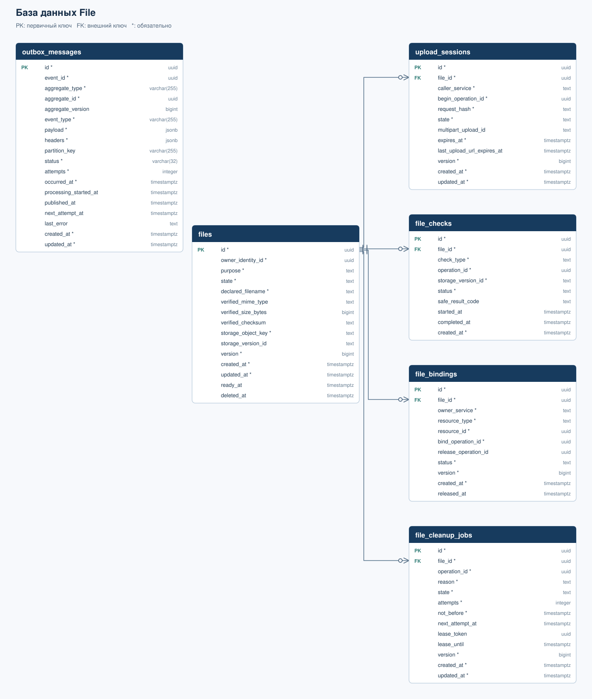

# База данных сервиса File

База данных File хранит метаданные файлов, сессии загрузки, результаты проверок и привязки файлов к ресурсам платформы. Отдельные задания используются для очистки данных. Содержимое файлов размещается в объектном хранилище, а база содержит сведения для управления доступом и жизненным циклом файла.

## ER-диаграмма

Рисунок - Модель данных сервиса File

[Открыть SVG полностью](erd.svg)

## Сущности

Таблица - Сущности сервиса File

| Таблица | Псевдоним | Описание | Особенности |
|---|---|---|---|
| files | Файл | Владелец, состояние и проверенные метаданные файла. | PK: id |
| upload_sessions | Сессия загрузки | Состояние отдельной попытки загрузки файла. | PK: id |
| file_checks | Проверка файла | Результат отдельной проверки загруженного файла. | PK: id |
| file_bindings | Привязка файла | Связь файла с ресурсом другого сервиса. | PK: id |
| file_cleanup_jobs | Очистка файла | Задание удаления объекта или незавершённой загрузки. | PK: id |
| outbox_messages | Исходящее событие | Сообщение transactional outbox для последующей публикации. | PK: id |

## Связи

Таблица - Связи сущностей сервиса File

| Родительская сущность и ключ | Дочерняя сущность и FK | Дочерних записей на одну родительскую | Родительских записей на одну дочернюю | Комментарий |
|---|---|---|---|---|
| files (id) | upload_sessions (file_id) | 0..N | 1 | Безусловная уникальность FK не указана; ссылка обязательна. Удаление родителя: не задано. |
| files (id) | file_checks (file_id) | 0..N | 1 | Безусловная уникальность FK не указана; ссылка обязательна. Удаление родителя: не задано. |
| files (id) | file_bindings (file_id) | 0..N | 1 | Безусловная уникальность FK не указана; ссылка обязательна. Удаление родителя: не задано. |
| files (id) | file_cleanup_jobs (file_id) | 0..N | 1 | Безусловная уникальность FK не указана; ссылка обязательна. Удаление родителя: не задано. |

## Атрибуты

Таблица - Атрибуты сущностей сервиса File

<table><thead><tr><th>Сущность</th><th>Поле</th><th>Тип</th><th>Описание</th></tr></thead><tbody>
<tr><td class="attribute-name" rowspan="15">files</td><td class="attribute-name">id</td><td class="attribute-type">uuid</td><td class="attribute-description">Обязательно; PK; Идентификатор записи.</td></tr>
<tr><td class="attribute-name">owner_identity_id</td><td class="attribute-type">uuid</td><td class="attribute-description">Обязательно; Внешний Identity ID; не межсервисный FK</td></tr>
<tr><td class="attribute-name">purpose</td><td class="attribute-type">text</td><td class="attribute-description">Обязательно; Назначение файла.</td></tr>
<tr><td class="attribute-name">state</td><td class="attribute-type">text</td><td class="attribute-description">Обязательно; Состояние записи; допустимые переходы описаны в проекте сервиса.</td></tr>
<tr><td class="attribute-name">declared_filename</td><td class="attribute-type">text</td><td class="attribute-description">Обязательно; Недоверенное имя для отображения, не object key</td></tr>
<tr><td class="attribute-name">verified_mime_type</td><td class="attribute-type">text</td><td class="attribute-description">Необязательно / не указано; Подтверждённый MIME-тип файла.</td></tr>
<tr><td class="attribute-name">verified_size_bytes</td><td class="attribute-type">bigint</td><td class="attribute-description">Необязательно / не указано; Подтверждённый размер файла в байтах.</td></tr>
<tr><td class="attribute-name">verified_checksum</td><td class="attribute-type">text</td><td class="attribute-description">Необязательно / не указано; Подтверждённая контрольная сумма файла.</td></tr>
<tr><td class="attribute-name">storage_object_key</td><td class="attribute-type">text</td><td class="attribute-description">Обязательно; UNIQUE; Генерируется сервером, не возвращается клиенту</td></tr>
<tr><td class="attribute-name">storage_version_id</td><td class="attribute-type">text</td><td class="attribute-description">Необязательно / не указано; Неизменяемая версия байтов, подтверждённая при проверке</td></tr>
<tr><td class="attribute-name">version</td><td class="attribute-type">bigint</td><td class="attribute-description">Обязательно; По умолчанию: 1; Версия для контроля конкурентных изменений.</td></tr>
<tr><td class="attribute-name">created_at</td><td class="attribute-type">timestamptz</td><td class="attribute-description">Обязательно; Время создания.</td></tr>
<tr><td class="attribute-name">updated_at</td><td class="attribute-type">timestamptz</td><td class="attribute-description">Обязательно; Время последнего изменения.</td></tr>
<tr><td class="attribute-name">ready_at</td><td class="attribute-type">timestamptz</td><td class="attribute-description">Необязательно / не указано; Время перехода в готовое состояние.</td></tr>
<tr><td class="attribute-name">deleted_at</td><td class="attribute-type">timestamptz</td><td class="attribute-description">Необязательно / не указано; Время удаления.</td></tr>
<tr><td class="attribute-name" rowspan="12">upload_sessions</td><td class="attribute-name">id</td><td class="attribute-type">uuid</td><td class="attribute-description">Обязательно; PK; Идентификатор записи.</td></tr>
<tr><td class="attribute-name">file_id</td><td class="attribute-type">uuid</td><td class="attribute-description">Обязательно; FK; Идентификатор файла.</td></tr>
<tr><td class="attribute-name">caller_service</td><td class="attribute-type">text</td><td class="attribute-description">Обязательно; Сервис из доверенной service identity</td></tr>
<tr><td class="attribute-name">begin_operation_id</td><td class="attribute-type">uuid</td><td class="attribute-description">Обязательно; Идентификатор связанного объекта; владелец и назначение определяются контекстом сервиса.</td></tr>
<tr><td class="attribute-name">request_hash</td><td class="attribute-type">text</td><td class="attribute-description">Обязательно; Хеш запроса для проверки повторов.</td></tr>
<tr><td class="attribute-name">state</td><td class="attribute-type">text</td><td class="attribute-description">Обязательно; Состояние записи; допустимые переходы описаны в проекте сервиса.</td></tr>
<tr><td class="attribute-name">multipart_upload_id</td><td class="attribute-type">text</td><td class="attribute-description">Необязательно / не указано; Внутренний ID хранилища; может отсутствовать до ответа хранилища</td></tr>
<tr><td class="attribute-name">expires_at</td><td class="attribute-type">timestamptz</td><td class="attribute-description">Обязательно; Время истечения.</td></tr>
<tr><td class="attribute-name">last_upload_url_expires_at</td><td class="attribute-type">timestamptz</td><td class="attribute-description">Необязательно / не указано; Для безопасной очистки после истечения ранее выданных прав записи</td></tr>
<tr><td class="attribute-name">version</td><td class="attribute-type">bigint</td><td class="attribute-description">Обязательно; По умолчанию: 1; Версия для контроля конкурентных изменений.</td></tr>
<tr><td class="attribute-name">created_at</td><td class="attribute-type">timestamptz</td><td class="attribute-description">Обязательно; Время создания.</td></tr>
<tr><td class="attribute-name">updated_at</td><td class="attribute-type">timestamptz</td><td class="attribute-description">Обязательно; Время последнего изменения.</td></tr>
<tr><td class="attribute-name" rowspan="10">file_checks</td><td class="attribute-name">id</td><td class="attribute-type">uuid</td><td class="attribute-description">Обязательно; PK; Идентификатор записи.</td></tr>
<tr><td class="attribute-name">file_id</td><td class="attribute-type">uuid</td><td class="attribute-description">Обязательно; FK; Идентификатор файла.</td></tr>
<tr><td class="attribute-name">check_type</td><td class="attribute-type">text</td><td class="attribute-description">Обязательно; Тип проверки.</td></tr>
<tr><td class="attribute-name">operation_id</td><td class="attribute-type">uuid</td><td class="attribute-description">Обязательно; UNIQUE; Идентификатор идемпотентной операции.</td></tr>
<tr><td class="attribute-name">storage_version_id</td><td class="attribute-type">text</td><td class="attribute-description">Обязательно; Проверка относится к точной версии объекта</td></tr>
<tr><td class="attribute-name">status</td><td class="attribute-type">text</td><td class="attribute-description">Обязательно; Состояние записи; допустимые переходы описаны в проекте сервиса.</td></tr>
<tr><td class="attribute-name">safe_result_code</td><td class="attribute-type">text</td><td class="attribute-description">Необязательно / не указано; Безопасный код результата проверки.</td></tr>
<tr><td class="attribute-name">started_at</td><td class="attribute-type">timestamptz</td><td class="attribute-description">Необязательно / не указано; Время начала.</td></tr>
<tr><td class="attribute-name">completed_at</td><td class="attribute-type">timestamptz</td><td class="attribute-description">Необязательно / не указано; Время соответствующего действия или состояния.</td></tr>
<tr><td class="attribute-name">created_at</td><td class="attribute-type">timestamptz</td><td class="attribute-description">Обязательно; Время создания.</td></tr>
<tr><td class="attribute-name" rowspan="11">file_bindings</td><td class="attribute-name">id</td><td class="attribute-type">uuid</td><td class="attribute-description">Обязательно; PK; Идентификатор записи.</td></tr>
<tr><td class="attribute-name">file_id</td><td class="attribute-type">uuid</td><td class="attribute-description">Обязательно; FK; Идентификатор файла.</td></tr>
<tr><td class="attribute-name">owner_service</td><td class="attribute-type">text</td><td class="attribute-description">Обязательно; Устанавливается по доверенной service identity</td></tr>
<tr><td class="attribute-name">resource_type</td><td class="attribute-type">text</td><td class="attribute-description">Обязательно; Тип внешнего ресурса.</td></tr>
<tr><td class="attribute-name">resource_id</td><td class="attribute-type">uuid</td><td class="attribute-description">Обязательно; Внешний ID ресурса владельца</td></tr>
<tr><td class="attribute-name">bind_operation_id</td><td class="attribute-type">uuid</td><td class="attribute-description">Обязательно; UNIQUE; Идентификатор связанного объекта; владелец и назначение определяются контекстом сервиса.</td></tr>
<tr><td class="attribute-name">release_operation_id</td><td class="attribute-type">uuid</td><td class="attribute-description">Необязательно / не указано; UNIQUE; Устойчивый ID освобождения</td></tr>
<tr><td class="attribute-name">status</td><td class="attribute-type">text</td><td class="attribute-description">Обязательно; Состояние записи; допустимые переходы описаны в проекте сервиса.</td></tr>
<tr><td class="attribute-name">version</td><td class="attribute-type">bigint</td><td class="attribute-description">Обязательно; По умолчанию: 1; Версия для контроля конкурентных изменений.</td></tr>
<tr><td class="attribute-name">created_at</td><td class="attribute-type">timestamptz</td><td class="attribute-description">Обязательно; Время создания.</td></tr>
<tr><td class="attribute-name">released_at</td><td class="attribute-type">timestamptz</td><td class="attribute-description">Необязательно / не указано; Время соответствующего действия или состояния.</td></tr>
<tr><td class="attribute-name" rowspan="13">file_cleanup_jobs</td><td class="attribute-name">id</td><td class="attribute-type">uuid</td><td class="attribute-description">Обязательно; PK; Идентификатор записи.</td></tr>
<tr><td class="attribute-name">file_id</td><td class="attribute-type">uuid</td><td class="attribute-description">Обязательно; FK; Идентификатор файла.</td></tr>
<tr><td class="attribute-name">operation_id</td><td class="attribute-type">uuid</td><td class="attribute-description">Обязательно; UNIQUE; Идентификатор идемпотентной операции.</td></tr>
<tr><td class="attribute-name">reason</td><td class="attribute-type">text</td><td class="attribute-description">Обязательно; Причина действия или перехода.</td></tr>
<tr><td class="attribute-name">state</td><td class="attribute-type">text</td><td class="attribute-description">Обязательно; Состояние записи; допустимые переходы описаны в проекте сервиса.</td></tr>
<tr><td class="attribute-name">attempts</td><td class="attribute-type">integer</td><td class="attribute-description">Обязательно; По умолчанию: 0; Количество попыток.</td></tr>
<tr><td class="attribute-name">not_before</td><td class="attribute-type">timestamptz</td><td class="attribute-description">Обязательно; Включает срок ранее выданных прав записи</td></tr>
<tr><td class="attribute-name">next_attempt_at</td><td class="attribute-type">timestamptz</td><td class="attribute-description">Необязательно / не указано; Время следующей попытки.</td></tr>
<tr><td class="attribute-name">lease_token</td><td class="attribute-type">uuid</td><td class="attribute-description">Необязательно / не указано; Токен захвата работы.</td></tr>
<tr><td class="attribute-name">lease_until</td><td class="attribute-type">timestamptz</td><td class="attribute-description">Необязательно / не указано; Окончание срока захвата.</td></tr>
<tr><td class="attribute-name">version</td><td class="attribute-type">bigint</td><td class="attribute-description">Обязательно; По умолчанию: 1; Версия для контроля конкурентных изменений.</td></tr>
<tr><td class="attribute-name">created_at</td><td class="attribute-type">timestamptz</td><td class="attribute-description">Обязательно; Время создания.</td></tr>
<tr><td class="attribute-name">updated_at</td><td class="attribute-type">timestamptz</td><td class="attribute-description">Обязательно; Время последнего изменения.</td></tr>
<tr><td class="attribute-name" rowspan="18">outbox_messages</td><td class="attribute-name">id</td><td class="attribute-type">uuid</td><td class="attribute-description">Обязательно; PK; Идентификатор записи.</td></tr>
<tr><td class="attribute-name">event_id</td><td class="attribute-type">uuid</td><td class="attribute-description">Обязательно; UNIQUE; Идентификатор события.</td></tr>
<tr><td class="attribute-name">aggregate_type</td><td class="attribute-type">varchar(255)</td><td class="attribute-description">Обязательно; Тип агрегата — источника события.</td></tr>
<tr><td class="attribute-name">aggregate_id</td><td class="attribute-type">uuid</td><td class="attribute-description">Обязательно; Идентификатор связанного объекта; владелец и назначение определяются контекстом сервиса.</td></tr>
<tr><td class="attribute-name">aggregate_version</td><td class="attribute-type">bigint</td><td class="attribute-description">Необязательно / не указано; Версия агрегата — источника события.</td></tr>
<tr><td class="attribute-name">event_type</td><td class="attribute-type">varchar(255)</td><td class="attribute-description">Обязательно; Тип события.</td></tr>
<tr><td class="attribute-name">payload</td><td class="attribute-type">jsonb</td><td class="attribute-description">Обязательно; Содержимое события или операции.</td></tr>
<tr><td class="attribute-name">headers</td><td class="attribute-type">jsonb</td><td class="attribute-description">Обязательно; По умолчанию: {}; Заголовки события.</td></tr>
<tr><td class="attribute-name">partition_key</td><td class="attribute-type">varchar(255)</td><td class="attribute-description">Необязательно / не указано; Ключ распределения события.</td></tr>
<tr><td class="attribute-name">status</td><td class="attribute-type">varchar(32)</td><td class="attribute-description">Обязательно; По умолчанию: PENDING; Состояние записи; допустимые переходы описаны в проекте сервиса.</td></tr>
<tr><td class="attribute-name">attempts</td><td class="attribute-type">integer</td><td class="attribute-description">Обязательно; По умолчанию: 0; Количество попыток.</td></tr>
<tr><td class="attribute-name">occurred_at</td><td class="attribute-type">timestamptz</td><td class="attribute-description">Обязательно; Время события.</td></tr>
<tr><td class="attribute-name">processing_started_at</td><td class="attribute-type">timestamptz</td><td class="attribute-description">Необязательно / не указано; Время соответствующего действия или состояния.</td></tr>
<tr><td class="attribute-name">published_at</td><td class="attribute-type">timestamptz</td><td class="attribute-description">Необязательно / не указано; Время публикации.</td></tr>
<tr><td class="attribute-name">next_attempt_at</td><td class="attribute-type">timestamptz</td><td class="attribute-description">Необязательно / не указано; Время следующей попытки.</td></tr>
<tr><td class="attribute-name">last_error</td><td class="attribute-type">text</td><td class="attribute-description">Необязательно / не указано; Последняя зафиксированная ошибка.</td></tr>
<tr><td class="attribute-name">created_at</td><td class="attribute-type">timestamptz</td><td class="attribute-description">Обязательно; Время создания.</td></tr>
<tr><td class="attribute-name">updated_at</td><td class="attribute-type">timestamptz</td><td class="attribute-description">Обязательно; Время последнего изменения.</td></tr>
</tbody></table>

## Ограничения данных

- Готовый файл содержит проверенные тип, положительный размер, контрольную сумму, версию объекта и время готовности. Для удалённого файла фиксируется время удаления.
- Срок загрузки заканчивается после её создания. Завершение проверки не предшествует её началу.
- Для освобождённой привязки фиксируются время и идентификатор операции освобождения.

- Файлом и его байтами управляет File Service; другие сервисы используют внешние идентификаторы и привязки, а доступ зависит от проверки полномочий.

