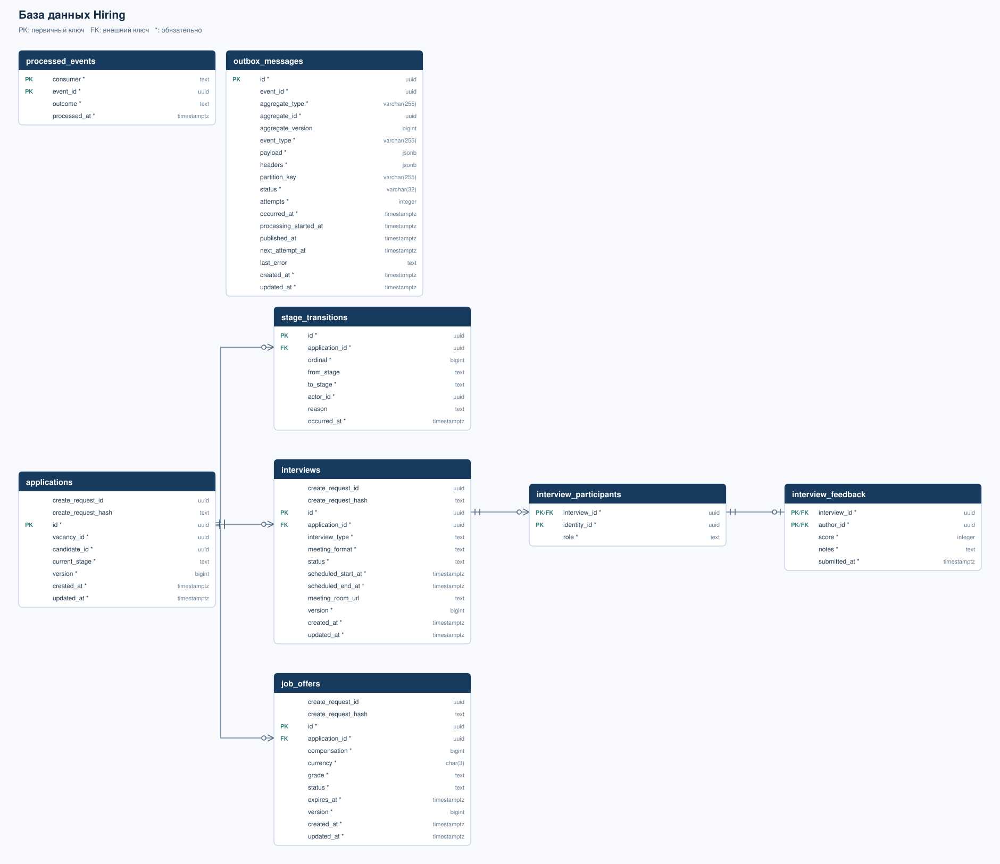

# База данных сервиса Hiring

Источник: проектная [DBML-схема](../schema.dbml). Смысл сценариев и незакрытые решения — в [описании сервиса](../../../services/hiring/index.md).

## ER-диаграмма

Таблицы показаны со всеми полями из DBML. PK — первичный ключ, FK — внешний ключ, звёздочка — обязательное поле. Связи обозначены нотацией «воронья лапка»: круг — необязательная связь, черта — один, лапка — многие. Линии подходят к строкам полей; для составного FK линия подходит к последнему полю, а все поля перечислены ниже. Кратность выведена из FK, NOT NULL и уникальных ключей DBML; дополнительные SQL-ограничения смотрите в миграциях или проекте ограничений. Внешние идентификаторы других сервисов не соединены межбазовыми FK.

[Открыть SVG полностью](erd.svg)

## Сущности

Здесь сущность — таблица локальной базы, включая технические таблицы. Название на русском — поясняющий псевдоним; физическое имя приведено в первом столбце.

| Таблица | Псевдоним | Описание | Особенности |
|---|---|---|---|
| applications | Отклик | Отклик кандидата на вакансию и текущий этап найма. | PK: id; Активность и уникальность активного отклика требуют согласованного частичного индекса. |
| stage_transitions | Переход этапа | История изменения этапа отклика. | PK: id |
| interviews | Интервью | Назначенное собеседование и его состояние. | PK: id |
| interview_participants | Участник интервью | Участие пользователя в конкретном интервью. | PK: interview_id, identity_id |
| interview_feedback | Отзыв об интервью | Оценка и комментарий участника интервью. | PK: interview_id, author_id |
| job_offers | Предложение о работе | Условия, срок и состояние предложения кандидату. | PK: id |
| processed_events | Обработанное событие | Запись о результате обработки входящего события потребителем. | PK: consumer, event_id; Предлагаемая дедупликация consumer; порядок и защита от устаревших событий требуют отдельной модели. |
| outbox_messages | Исходящее событие | Сообщение transactional outbox для последующей публикации. | PK: id; Предлагаемая форма; согласовать с общей инфраструктурой. |

## Связи

Одна строка соответствует одному локальному FK. Кратность указана в двух направлениях: сколько дочерних записей может относиться к одной родительской и сколько родительских — к одной дочерней. Минимум дочерних записей равен нулю: FK не требует наличия дочерней записи. Для составного nullable FK значение 0..1 означает, что ссылка может отсутствовать; частично заполненный ключ при стандартном MATCH SIMPLE также не проверяется. Указана кратность по DBML без учёта частичных уникальных индексов: 0..N — верхняя оценка, которую дополнительные ограничения могут сузить. В Identity приоритет имеют миграции.

| Родительская сущность и ключ | Дочерняя сущность и FK | Дочерних на родителя | Родителей на дочернюю | Комментарий |
|---|---|---|---|---|
| applications (id) | stage_transitions (application_id) | 0..N | 1 | Безусловная уникальность FK не указана; ссылка обязательна. Удаление родителя: не указано в DBML. |
| applications (id) | interviews (application_id) | 0..N | 1 | Безусловная уникальность FK не указана; ссылка обязательна. Удаление родителя: не указано в DBML. |
| interviews (id) | interview_participants (interview_id) | 0..N | 1 | Безусловная уникальность FK не указана; ссылка обязательна. Удаление родителя: не указано в DBML. |
| interview_participants (interview_id, identity_id) | interview_feedback (interview_id, author_id) | 0..1 | 1 | Не более одной дочерней записи; ссылка обязательна. Удаление родителя: не указано в DBML. |
| applications (id) | job_offers (application_id) | 0..N | 1 | Безусловная уникальность FK не указана; ссылка обязательна. Удаление родителя: не указано в DBML. |

## Атрибуты

В описании указаны обязательность по DBML, ключи, значение по умолчанию и смысл поля. «Необязательно / не указано» не исключает дополнительных SQL-ограничений. UNIQUE отмечен для отдельного поля; составные ключи и индексы перечислены под таблицей.

### applications

Активность и уникальность активного отклика требуют согласованного частичного индекса.

| Поле | Тип | Описание |
|---|---|---|
| create_request_id | uuid | Необязательно / не указано; UNIQUE; UUID операции создания; уникален в пределах этой таблицы |
| create_request_hash | text | Необязательно / не указано; Хеш канонического запроса создания |
| id | uuid | Обязательно; PK; Идентификатор записи. |
| vacancy_id | uuid | Обязательно; Внешний Vacancy ID |
| candidate_id | uuid | Обязательно; Внешний Candidate ID |
| current_stage | text | Обязательно; Текущий этап процесса. |
| version | bigint | Обязательно; Версия для контроля конкурентных изменений. |
| created_at | timestamptz | Обязательно; Время создания. |
| updated_at | timestamptz | Обязательно; Время последнего изменения. |

Составные ключи и индексы DBML: `INDEX (vacancy_id, candidate_id)`.

### stage_transitions

| Поле | Тип | Описание |
|---|---|---|
| id | uuid | Обязательно; PK; Идентификатор записи. |
| application_id | uuid | Обязательно; FK; Идентификатор отклика. |
| ordinal | bigint | Обязательно; Порядковый номер внутри родительского контекста. |
| from_stage | text | Необязательно / не указано; NULL при начальном переходе |
| to_stage | text | Обязательно; Новый этап процесса. |
| actor_id | uuid | Обязательно; Внешний инициатор или сервисная identity |
| reason | text | Необязательно / не указано; Причина действия или перехода. |
| occurred_at | timestamptz | Обязательно; Время события. |

Составные ключи и индексы DBML: `UNIQUE (application_id, ordinal)`.

### interviews

| Поле | Тип | Описание |
|---|---|---|
| create_request_id | uuid | Необязательно / не указано; UNIQUE; UUID операции создания; уникален в пределах этой таблицы |
| create_request_hash | text | Необязательно / не указано; Хеш канонического запроса создания |
| id | uuid | Обязательно; PK; Идентификатор записи. |
| application_id | uuid | Обязательно; FK; Идентификатор отклика. |
| interview_type | text | Обязательно; Тип собеседования. |
| meeting_format | text | Обязательно; Формат проведения встречи. |
| status | text | Обязательно; Состояние записи; допустимые переходы описаны в проекте сервиса. |
| scheduled_start_at | timestamptz | Обязательно; Запланированное время начала. |
| scheduled_end_at | timestamptz | Обязательно; Запланированное время окончания. |
| meeting_room_url | text | Необязательно / не указано; Состав и защита данных комнаты требуют решения |
| version | bigint | Обязательно; Версия для контроля конкурентных изменений. |
| created_at | timestamptz | Обязательно; Время создания. |
| updated_at | timestamptz | Обязательно; Время последнего изменения. |

Составные ключи и индексы DBML: `INDEX (application_id, status)`.

### interview_participants

| Поле | Тип | Описание |
|---|---|---|
| interview_id | uuid | Обязательно; PK, FK; Идентификатор связанного объекта; владелец и назначение определяются контекстом сервиса. |
| identity_id | uuid | Обязательно; PK; Внешний Identity ID |
| role | text | Обязательно; Роль в контексте записи. |

Составные ключи и индексы DBML: `PK (interview_id, identity_id)`.

### interview_feedback

| Поле | Тип | Описание |
|---|---|---|
| interview_id | uuid | Обязательно; PK, FK; Идентификатор связанного объекта; владелец и назначение определяются контекстом сервиса. |
| author_id | uuid | Обязательно; PK, FK; Идентификатор связанного объекта; владелец и назначение определяются контекстом сервиса. |
| score | integer | Обязательно; Оценка. |
| notes | text | Обязательно; Примечания. |
| submitted_at | timestamptz | Обязательно; Время отправки. |

Составные ключи и индексы DBML: `PK (interview_id, author_id)`.

### job_offers

| Поле | Тип | Описание |
|---|---|---|
| create_request_id | uuid | Необязательно / не указано; UNIQUE; UUID операции создания; уникален в пределах этой таблицы |
| create_request_hash | text | Необязательно / не указано; Хеш канонического запроса создания |
| id | uuid | Обязательно; PK; Идентификатор записи. |
| application_id | uuid | Обязательно; FK; Идентификатор отклика. |
| compensation | bigint | Обязательно; Единица и период суммы требуют согласования |
| currency | char(3) | Обязательно; Код валюты. |
| grade | text | Обязательно; Уровень или грейд предложения. |
| status | text | Обязательно; Состояние записи; допустимые переходы описаны в проекте сервиса. |
| expires_at | timestamptz | Обязательно; Время истечения. |
| version | bigint | Обязательно; Версия для контроля конкурентных изменений. |
| created_at | timestamptz | Обязательно; Время создания. |
| updated_at | timestamptz | Обязательно; Время последнего изменения. |

Составные ключи и индексы DBML: `INDEX (status, expires_at)`; `INDEX (application_id, created_at)`.

### processed_events

Предлагаемая дедупликация consumer; порядок и защита от устаревших событий требуют отдельной модели.

| Поле | Тип | Описание |
|---|---|---|
| consumer | text | Обязательно; PK; Идентификатор потребителя события. |
| event_id | uuid | Обязательно; PK; Идентификатор события. |
| outcome | text | Обязательно; Результат обработки. |
| processed_at | timestamptz | Обязательно; Время соответствующего действия или состояния. |

Составные ключи и индексы DBML: `PK (consumer, event_id)`.

### outbox_messages

Предлагаемая форма; согласовать с общей инфраструктурой.

| Поле | Тип | Описание |
|---|---|---|
| id | uuid | Обязательно; PK; Идентификатор записи. |
| event_id | uuid | Обязательно; UNIQUE; Идентификатор события. |
| aggregate_type | varchar(255) | Обязательно; Тип агрегата — источника события. |
| aggregate_id | uuid | Обязательно; Идентификатор связанного объекта; владелец и назначение определяются контекстом сервиса. |
| aggregate_version | bigint | Необязательно / не указано; Версия агрегата — источника события. |
| event_type | varchar(255) | Обязательно; Тип события. |
| payload | jsonb | Обязательно; Содержимое события или операции. |
| headers | jsonb | Обязательно; По умолчанию: {}; Заголовки события. |
| partition_key | varchar(255) | Необязательно / не указано; Ключ распределения события. |
| status | varchar(32) | Обязательно; По умолчанию: PENDING; Состояние записи; допустимые переходы описаны в проекте сервиса. |
| attempts | integer | Обязательно; По умолчанию: 0; Количество попыток. |
| occurred_at | timestamptz | Обязательно; Время события. |
| processing_started_at | timestamptz | Необязательно / не указано; Время соответствующего действия или состояния. |
| published_at | timestamptz | Необязательно / не указано; Время публикации. |
| next_attempt_at | timestamptz | Необязательно / не указано; Время следующей попытки. |
| last_error | text | Необязательно / не указано; Последняя зафиксированная ошибка. |
| created_at | timestamptz | Обязательно; Время создания. |
| updated_at | timestamptz | Обязательно; Время последнего изменения. |

Составные ключи и индексы DBML: `INDEX (aggregate_type, aggregate_id, aggregate_version)`.

