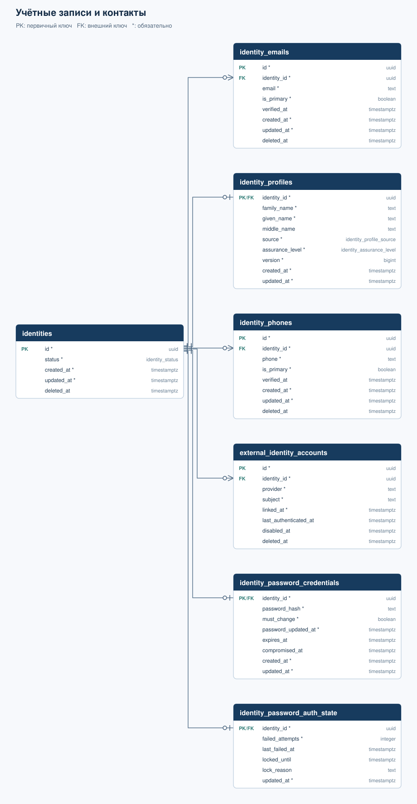
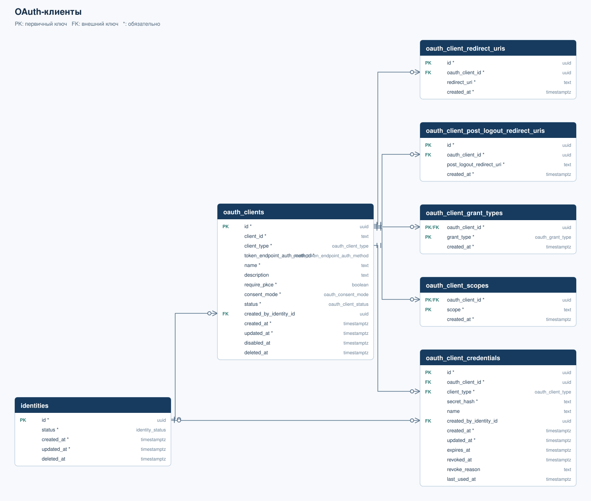
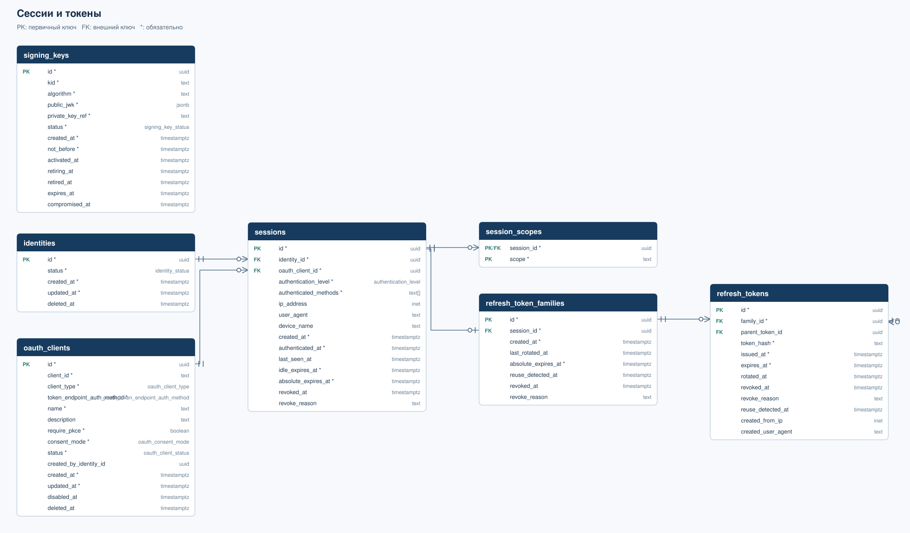
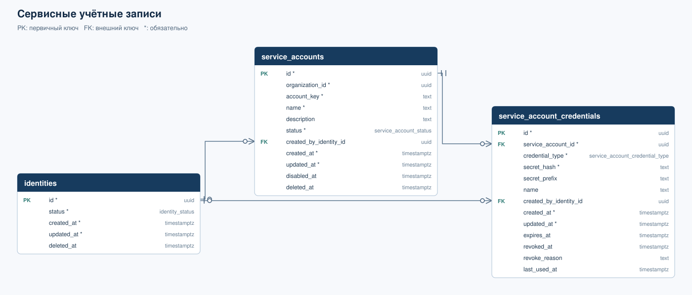
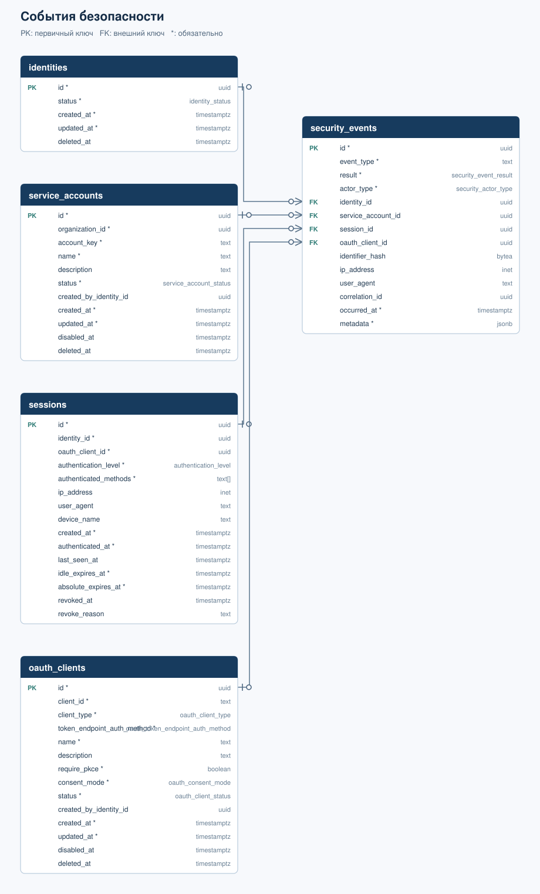
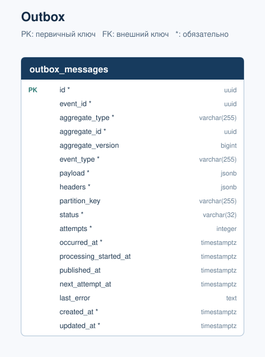

# База данных сервиса Identity

Источник: существующая DBML `services/identity/db/schema.dbml`; миграции Identity имеют приоритет. Смысл сценариев и незакрытые решения — в [описании сервиса](../../../services/identity/index.md).

## ER-диаграмма

Таблицы показаны со всеми полями из DBML. PK — первичный ключ, FK — внешний ключ, звёздочка — обязательное поле. Связи обозначены нотацией «воронья лапка»: круг — необязательная связь, черта — один, лапка — многие. Линии подходят к строкам полей; для составного FK линия подходит к последнему полю, а все поля перечислены ниже. Кратность выведена из FK, NOT NULL и уникальных ключей DBML; дополнительные SQL-ограничения смотрите в миграциях или проекте ограничений. Внешние идентификаторы других сервисов не соединены межбазовыми FK.

Identity разделена по существующим группам DBML; общие таблицы повторяются только в тех разделах, где они участвуют в связях.

### Учётные записи и контакты

[Открыть SVG: Учётные записи и контакты](erd-identity_core.svg)

### Многофакторная аутентификация и восстановление

[Открыть SVG: Многофакторная аутентификация и восстановление](erd-mfa_and_recovery.svg)

### Проверка контактов и сброс пароля

[Открыть SVG: Проверка контактов и сброс пароля](erd-verification_challenges.svg)

### OAuth-клиенты

[Открыть SVG: OAuth-клиенты](erd-oauth_config.svg)

### OAuth-согласия

[Открыть SVG: OAuth-согласия](erd-oauth_grants.svg)

### Сессии и токены

[Открыть SVG: Сессии и токены](erd-sessions_and_tokens.svg)

### Сервисные учётные записи

[Открыть SVG: Сервисные учётные записи](erd-service_accounts.svg)

### События безопасности

[Открыть SVG: События безопасности](erd-security_audit.svg)

### Outbox

[Открыть SVG: Outbox](erd-messaging.svg)

## Перечень связей

| № | Родительская таблица и поля | Дочерняя таблица и FK | Удаление родителя |
|---|---|---|---|
| 1 | identities (id) | identity_emails (identity_id) | cascade |
| 2 | identities (id) | identity_profiles (identity_id) | cascade |
| 3 | identities (id) | identity_phones (identity_id) | cascade |
| 4 | identities (id) | external_identity_accounts (identity_id) | cascade |
| 5 | identities (id) | identity_password_credentials (identity_id) | cascade |
| 6 | identities (id) | identity_password_auth_state (identity_id) | cascade |
| 7 | identities (id) | mfa_factors (identity_id) | cascade |
| 8 | mfa_factors (id, factor_type) | totp_factors (factor_id, factor_type) | cascade |
| 9 | mfa_factors (id, factor_type) | webauthn_credentials (factor_id, factor_type) | cascade |
| 10 | identities (id) | recovery_code_sets (identity_id) | cascade |
| 11 | recovery_code_sets (id) | recovery_codes (set_id) | cascade |
| 12 | identity_emails (id) | email_verification_challenges (email_id) | cascade |
| 13 | identity_phones (id) | phone_verification_challenges (phone_id) | cascade |
| 14 | identities (id) | password_reset_challenges (identity_id) | cascade |
| 15 | identities (id) | oauth_clients (created_by_identity_id) | set null |
| 16 | oauth_clients (id) | oauth_client_redirect_uris (oauth_client_id) | cascade |
| 17 | oauth_clients (id) | oauth_client_post_logout_redirect_uris (oauth_client_id) | cascade |
| 18 | oauth_clients (id) | oauth_client_grant_types (oauth_client_id) | cascade |
| 19 | oauth_clients (id) | oauth_client_scopes (oauth_client_id) | cascade |
| 20 | oauth_clients (id, client_type) | oauth_client_credentials (oauth_client_id, client_type) | cascade |
| 21 | identities (id) | oauth_client_credentials (created_by_identity_id) | set null |
| 22 | identities (id) | oauth_authorization_grants (identity_id) | cascade |
| 23 | oauth_clients (id) | oauth_authorization_grants (oauth_client_id) | cascade |
| 24 | oauth_authorization_grants (id) | oauth_authorization_grant_scopes (grant_id) | cascade |
| 25 | identities (id) | sessions (identity_id) | cascade |
| 26 | oauth_clients (id) | sessions (oauth_client_id) | restrict |
| 27 | sessions (id) | session_scopes (session_id) | cascade |
| 28 | sessions (id) | refresh_token_families (session_id) | cascade |
| 29 | refresh_token_families (id) | refresh_tokens (family_id) | cascade |
| 30 | refresh_tokens (id, family_id) | refresh_tokens (parent_token_id, family_id) | не указано |
| 31 | identities (id) | service_accounts (created_by_identity_id) | set null |
| 32 | service_accounts (id) | service_account_credentials (service_account_id) | cascade |
| 33 | identities (id) | service_account_credentials (created_by_identity_id) | set null |
| 34 | identities (id) | security_events (identity_id) | set null |
| 35 | service_accounts (id) | security_events (service_account_id) | set null |
| 36 | sessions (id) | security_events (session_id) | set null |
| 37 | oauth_clients (id) | security_events (oauth_client_id) | set null |

## Таблицы и поля

Обязательность приведена по DBML: «да» означает `NOT NULL` или PK; «нет / не указано» не гарантирует отсутствие дополнительных SQL-ограничений. UNIQUE отдельно отмечен только для отдельного поля; составные ключи и индексы перечислены под таблицей. Пустое пояснение в исходной модели не дополняется вымышленными правилами.

### identities

CHECK: deleted status requires deleted_at; updated_at >= created_at.

| Поле | Тип | Обязательно | Ключ / уникальность | По умолчанию | Пояснение |
|---|---|---|---|---|---|
| id | uuid | да | PK | — | Идентификатор записи. |
| status | public.identity_status | да | — | pending | Состояние записи; допустимые переходы описаны в проекте сервиса. |
| created_at | timestamptz | да | — | — | Время создания. |
| updated_at | timestamptz | да | — | — | Время последнего изменения. |
| deleted_at | timestamptz | нет / не указано | — | — | Время удаления. |

Составные ключи и индексы DBML: `INDEX (status)`; `INDEX (deleted_at) — WHERE deleted_at IS NOT NULL`.

### identity_profiles

One-to-one identity profile. Names are trimmed and must not be blank. The application increments version on every profile change.

| Поле | Тип | Обязательно | Ключ / уникальность | По умолчанию | Пояснение |
|---|---|---|---|---|---|
| identity_id | uuid | да | PK, FK | — | Идентификатор учётной записи Identity. |
| family_name | text | да | — | — | Фамилия. |
| given_name | text | да | — | — | Имя. |
| middle_name | text | нет / не указано | — | — | Отчество или второе имя. |
| source | public.identity_profile_source | да | — | self_declared | Источник данных. |
| assurance_level | public.identity_assurance_level | да | — | self_declared | Уровень подтверждения данных. |
| version | bigint | да | — | 1 | Версия для контроля конкурентных изменений. |
| created_at | timestamptz | да | — | — | Время создания. |
| updated_at | timestamptz | да | — | — | Время последнего изменения. |

### identity_emails

Email and identity_id are immutable. Email is normalized to lowercase; primary contact cannot be deleted.

| Поле | Тип | Обязательно | Ключ / уникальность | По умолчанию | Пояснение |
|---|---|---|---|---|---|
| id | uuid | да | PK | — | Идентификатор записи. |
| identity_id | uuid | да | FK | — | Идентификатор учётной записи Identity. |
| email | text | да | UNIQUE | — | Адрес электронной почты. |
| is_primary | boolean | да | — | false | Признак основного значения. |
| verified_at | timestamptz | нет / не указано | — | — | Время подтверждения. |
| created_at | timestamptz | да | — | — | Время создания. |
| updated_at | timestamptz | да | — | — | Время последнего изменения. |
| deleted_at | timestamptz | нет / не указано | — | — | Время удаления. |

Составные ключи и индексы DBML: `UNIQUE (email)`; `INDEX (identity_id)`; `UNIQUE (identity_id) — WHERE is_primary AND deleted_at IS NULL`.

### identity_phones

Phone and identity_id are immutable. Phone uses E.164 format; primary contact cannot be deleted.

| Поле | Тип | Обязательно | Ключ / уникальность | По умолчанию | Пояснение |
|---|---|---|---|---|---|
| id | uuid | да | PK | — | Идентификатор записи. |
| identity_id | uuid | да | FK | — | Идентификатор учётной записи Identity. |
| phone | text | да | UNIQUE | — | Номер телефона. |
| is_primary | boolean | да | — | false | Признак основного значения. |
| verified_at | timestamptz | нет / не указано | — | — | Время подтверждения. |
| created_at | timestamptz | да | — | — | Время создания. |
| updated_at | timestamptz | да | — | — | Время последнего изменения. |
| deleted_at | timestamptz | нет / не указано | — | — | Время удаления. |

Составные ключи и индексы DBML: `UNIQUE (phone)`; `INDEX (identity_id)`; `UNIQUE (identity_id) — WHERE is_primary AND deleted_at IS NULL`.

### external_identity_accounts

identity_id, provider, subject and linked_at are immutable.

| Поле | Тип | Обязательно | Ключ / уникальность | По умолчанию | Пояснение |
|---|---|---|---|---|---|
| id | uuid | да | PK | — | Идентификатор записи. |
| identity_id | uuid | да | FK | — | Идентификатор учётной записи Identity. |
| provider | text | да | — | — | Идентификатор провайдера. |
| subject | text | да | — | — | Идентификатор субъекта. |
| linked_at | timestamptz | да | — | — | Время соответствующего действия или состояния. |
| last_authenticated_at | timestamptz | нет / не указано | — | — | Время соответствующего действия или состояния. |
| disabled_at | timestamptz | нет / не указано | — | — | Время соответствующего действия или состояния. |
| deleted_at | timestamptz | нет / не указано | — | — | Время удаления. |

Составные ключи и индексы DBML: `UNIQUE (provider, subject)`; `INDEX (identity_id)`.

### identity_password_credentials

| Поле | Тип | Обязательно | Ключ / уникальность | По умолчанию | Пояснение |
|---|---|---|---|---|---|
| identity_id | uuid | да | PK, FK | — | Идентификатор учётной записи Identity. |
| password_hash | text | да | — | — | Хеш пароля. |
| must_change | boolean | да | — | false | Признак обязательной смены. |
| password_updated_at | timestamptz | да | — | — | Время соответствующего действия или состояния. |
| expires_at | timestamptz | нет / не указано | — | — | Время истечения. |
| compromised_at | timestamptz | нет / не указано | — | — | Время соответствующего действия или состояния. |
| created_at | timestamptz | да | — | — | Время создания. |
| updated_at | timestamptz | да | — | — | Время последнего изменения. |

### identity_password_auth_state

locked_until and lock_reason are set or cleared together.

| Поле | Тип | Обязательно | Ключ / уникальность | По умолчанию | Пояснение |
|---|---|---|---|---|---|
| identity_id | uuid | да | PK, FK | — | Идентификатор учётной записи Identity. |
| failed_attempts | integer | да | — | 0 | Число неудачных попыток. |
| last_failed_at | timestamptz | нет / не указано | — | — | Время соответствующего действия или состояния. |
| locked_until | timestamptz | нет / не указано | — | — | Время окончания блокировки. |
| lock_reason | text | нет / не указано | — | — | Причина блокировки. |
| updated_at | timestamptz | да | — | — | Время последнего изменения. |

Составные ключи и индексы DBML: `INDEX (locked_until) — WHERE locked_until IS NOT NULL`.

### mfa_factors

identity_id, factor_type and created_at are immutable.

| Поле | Тип | Обязательно | Ключ / уникальность | По умолчанию | Пояснение |
|---|---|---|---|---|---|
| id | uuid | да | PK | — | Идентификатор записи. |
| identity_id | uuid | да | FK | — | Идентификатор учётной записи Identity. |
| factor_type | public.mfa_factor_type | да | — | — | Тип фактора аутентификации. |
| name | text | нет / не указано | — | — | Название или имя. |
| is_primary | boolean | да | — | false | Признак основного значения. |
| confirmed_at | timestamptz | нет / не указано | — | — | Время соответствующего действия или состояния. |
| created_at | timestamptz | да | — | — | Время создания. |
| updated_at | timestamptz | да | — | — | Время последнего изменения. |
| last_used_at | timestamptz | нет / не указано | — | — | Время последнего использования. |
| disabled_at | timestamptz | нет / не указано | — | — | Время соответствующего действия или состояния. |

Составные ключи и индексы DBML: `UNIQUE (id, factor_type)`; `INDEX (identity_id)`; `UNIQUE (identity_id) — WHERE is_primary AND confirmed_at IS NOT NULL AND disabled_at IS NULL`; `UNIQUE (identity_id) — WHERE factor_type = 'totp' AND disabled_at IS NULL`.

### totp_factors

Subtype of mfa_factors; factor_type must be totp.

| Поле | Тип | Обязательно | Ключ / уникальность | По умолчанию | Пояснение |
|---|---|---|---|---|---|
| factor_id | uuid | да | PK, FK | — | Идентификатор связанного объекта; владелец и назначение определяются контекстом сервиса. |
| factor_type | public.mfa_factor_type | да | FK | totp | Тип фактора аутентификации. |
| secret_encrypted | bytea | да | — | — | Зашифрованный секрет. |
| encryption_key_ref | text | да | — | — | Ссылка на ключ шифрования. |
| algorithm | public.totp_algorithm | да | — | sha1 | Идентификатор алгоритма. |
| digits | smallint | да | — | 6 | Количество цифр одноразового кода. |
| period_seconds | smallint | да | — | 30 | Продолжительность периода в секундах. |
| last_used_time_step | bigint | нет / не указано | — | — | Последний использованный временной шаг. |
| updated_at | timestamptz | да | — | — | Время последнего изменения. |

### webauthn_credentials

Subtype of mfa_factors; factor_type must be webauthn.

| Поле | Тип | Обязательно | Ключ / уникальность | По умолчанию | Пояснение |
|---|---|---|---|---|---|
| factor_id | uuid | да | PK, FK | — | Идентификатор связанного объекта; владелец и назначение определяются контекстом сервиса. |
| factor_type | public.mfa_factor_type | да | FK | webauthn | Тип фактора аутентификации. |
| credential_id | bytea | да | UNIQUE | — | Идентификатор связанного объекта; владелец и назначение определяются контекстом сервиса. |
| public_key | bytea | да | — | — | Открытый ключ. |
| sign_count | bigint | да | — | 0 | Счётчик подписей. |
| aaguid | uuid | нет / не указано | — | — | Идентификатор типа аутентификатора AAGUID. |
| transports | text[] | да | — | {} | Способы взаимодействия с аутентификатором. |
| backup_eligible | boolean | да | — | false | Признак возможности резервирования. |
| backup_state | boolean | да | — | false | Признак состояния резервирования. |
| created_at | timestamptz | да | — | — | Время создания. |
| last_used_at | timestamptz | нет / не указано | — | — | Время последнего использования. |

Составные ключи и индексы DBML: `UNIQUE (credential_id)`.

### recovery_code_sets

identity_id and created_at are immutable.

| Поле | Тип | Обязательно | Ключ / уникальность | По умолчанию | Пояснение |
|---|---|---|---|---|---|
| id | uuid | да | PK | — | Идентификатор записи. |
| identity_id | uuid | да | FK | — | Идентификатор учётной записи Identity. |
| created_at | timestamptz | да | — | — | Время создания. |
| expires_at | timestamptz | нет / не указано | — | — | Время истечения. |
| disabled_at | timestamptz | нет / не указано | — | — | Время соответствующего действия или состояния. |

Составные ключи и индексы DBML: `INDEX (identity_id)`; `UNIQUE (identity_id) — WHERE disabled_at IS NULL`.

### recovery_codes

set_id, code_hash and created_at are immutable.

| Поле | Тип | Обязательно | Ключ / уникальность | По умолчанию | Пояснение |
|---|---|---|---|---|---|
| id | uuid | да | PK | — | Идентификатор записи. |
| set_id | uuid | да | FK | — | Идентификатор связанного объекта; владелец и назначение определяются контекстом сервиса. |
| code_hash | text | да | — | — | Хеш кода. |
| created_at | timestamptz | да | — | — | Время создания. |
| used_at | timestamptz | нет / не указано | — | — | Время соответствующего действия или состояния. |

Составные ключи и индексы DBML: `UNIQUE (set_id, code_hash)`; `INDEX (set_id) — WHERE used_at IS NULL`.

### email_verification_challenges

| Поле | Тип | Обязательно | Ключ / уникальность | По умолчанию | Пояснение |
|---|---|---|---|---|---|
| id | uuid | да | PK | — | Идентификатор записи. |
| email_id | uuid | да | FK | — | Идентификатор связанного объекта; владелец и назначение определяются контекстом сервиса. |
| token_hash | text | да | UNIQUE | — | Хеш токена. |
| attempts | integer | да | — | 0 | Количество попыток. |
| max_attempts | integer | да | — | — | Максимально допустимое число попыток. |
| expires_at | timestamptz | да | — | — | Время истечения. |
| last_attempt_at | timestamptz | нет / не указано | — | — | Время соответствующего действия или состояния. |
| consumed_at | timestamptz | нет / не указано | — | — | Время соответствующего действия или состояния. |
| revoked_at | timestamptz | нет / не указано | — | — | Время соответствующего действия или состояния. |
| requested_from_ip | inet | нет / не указано | — | — | IP-адрес источника запроса. |
| consumed_from_ip | inet | нет / не указано | — | — | IP-адрес источника использования. |
| created_at | timestamptz | да | — | — | Время создания. |

Составные ключи и индексы DBML: `UNIQUE (token_hash)`; `INDEX (email_id, created_at)`; `INDEX (expires_at) — WHERE consumed_at IS NULL AND revoked_at IS NULL`.

### phone_verification_challenges

| Поле | Тип | Обязательно | Ключ / уникальность | По умолчанию | Пояснение |
|---|---|---|---|---|---|
| id | uuid | да | PK | — | Идентификатор записи. |
| phone_id | uuid | да | FK | — | Идентификатор связанного объекта; владелец и назначение определяются контекстом сервиса. |
| token_hash | text | да | UNIQUE | — | Хеш токена. |
| attempts | integer | да | — | 0 | Количество попыток. |
| max_attempts | integer | да | — | — | Максимально допустимое число попыток. |
| expires_at | timestamptz | да | — | — | Время истечения. |
| last_attempt_at | timestamptz | нет / не указано | — | — | Время соответствующего действия или состояния. |
| consumed_at | timestamptz | нет / не указано | — | — | Время соответствующего действия или состояния. |
| revoked_at | timestamptz | нет / не указано | — | — | Время соответствующего действия или состояния. |
| requested_from_ip | inet | нет / не указано | — | — | IP-адрес источника запроса. |
| consumed_from_ip | inet | нет / не указано | — | — | IP-адрес источника использования. |
| created_at | timestamptz | да | — | — | Время создания. |

Составные ключи и индексы DBML: `UNIQUE (token_hash)`; `INDEX (phone_id, created_at)`; `INDEX (expires_at) — WHERE consumed_at IS NULL AND revoked_at IS NULL`.

### password_reset_challenges

| Поле | Тип | Обязательно | Ключ / уникальность | По умолчанию | Пояснение |
|---|---|---|---|---|---|
| id | uuid | да | PK | — | Идентификатор записи. |
| identity_id | uuid | да | FK | — | Идентификатор учётной записи Identity. |
| token_hash | text | да | UNIQUE | — | Хеш токена. |
| attempts | integer | да | — | 0 | Количество попыток. |
| max_attempts | integer | да | — | — | Максимально допустимое число попыток. |
| expires_at | timestamptz | да | — | — | Время истечения. |
| last_attempt_at | timestamptz | нет / не указано | — | — | Время соответствующего действия или состояния. |
| consumed_at | timestamptz | нет / не указано | — | — | Время соответствующего действия или состояния. |
| revoked_at | timestamptz | нет / не указано | — | — | Время соответствующего действия или состояния. |
| requested_from_ip | inet | нет / не указано | — | — | IP-адрес источника запроса. |
| consumed_from_ip | inet | нет / не указано | — | — | IP-адрес источника использования. |
| created_at | timestamptz | да | — | — | Время создания. |

Составные ключи и индексы DBML: `UNIQUE (token_hash)`; `INDEX (identity_id, created_at)`; `INDEX (expires_at) — WHERE consumed_at IS NULL AND revoked_at IS NULL`.

### oauth_clients

public clients require PKCE. client_id, client_type, auth method and created_at are immutable.

| Поле | Тип | Обязательно | Ключ / уникальность | По умолчанию | Пояснение |
|---|---|---|---|---|---|
| id | uuid | да | PK | — | Идентификатор записи. |
| client_id | text | да | UNIQUE | — | Идентификатор OAuth-клиента. |
| client_type | public.oauth_client_type | да | — | — | Тип клиента. |
| token_endpoint_auth_method | public.oauth_token_endpoint_auth_method | да | — | — | Способ аутентификации клиента на token endpoint. |
| name | text | да | — | — | Название или имя. |
| description | text | нет / не указано | — | — | Описание. |
| require_pkce | boolean | да | — | true | Признак обязательной проверки PKCE. |
| consent_mode | public.oauth_consent_mode | да | — | remember | Режим согласия. |
| status | public.oauth_client_status | да | — | active | Состояние записи; допустимые переходы описаны в проекте сервиса. |
| created_by_identity_id | uuid | нет / не указано | FK | — | Идентификатор связанного объекта; владелец и назначение определяются контекстом сервиса. |
| created_at | timestamptz | да | — | — | Время создания. |
| updated_at | timestamptz | да | — | — | Время последнего изменения. |
| disabled_at | timestamptz | нет / не указано | — | — | Время соответствующего действия или состояния. |
| deleted_at | timestamptz | нет / не указано | — | — | Время удаления. |

Составные ключи и индексы DBML: `UNIQUE (client_id)`; `UNIQUE (id, client_type)`; `INDEX (created_by_identity_id) — WHERE created_by_identity_id IS NOT NULL`.

### oauth_client_redirect_uris

| Поле | Тип | Обязательно | Ключ / уникальность | По умолчанию | Пояснение |
|---|---|---|---|---|---|
| id | uuid | да | PK | — | Идентификатор записи. |
| oauth_client_id | uuid | да | FK | — | Идентификатор связанного объекта; владелец и назначение определяются контекстом сервиса. |
| redirect_uri | text | да | — | — | Разрешённый адрес перенаправления. |
| created_at | timestamptz | да | — | — | Время создания. |

Составные ключи и индексы DBML: `UNIQUE (oauth_client_id, redirect_uri)`.

### oauth_client_post_logout_redirect_uris

| Поле | Тип | Обязательно | Ключ / уникальность | По умолчанию | Пояснение |
|---|---|---|---|---|---|
| id | uuid | да | PK | — | Идентификатор записи. |
| oauth_client_id | uuid | да | FK | — | Идентификатор связанного объекта; владелец и назначение определяются контекстом сервиса. |
| post_logout_redirect_uri | text | да | — | — | Адрес перенаправления после выхода. |
| created_at | timestamptz | да | — | — | Время создания. |

Составные ключи и индексы DBML: `UNIQUE (oauth_client_id, post_logout_redirect_uri)`.

### oauth_client_grant_types

| Поле | Тип | Обязательно | Ключ / уникальность | По умолчанию | Пояснение |
|---|---|---|---|---|---|
| oauth_client_id | uuid | да | PK, FK | — | Идентификатор связанного объекта; владелец и назначение определяются контекстом сервиса. |
| grant_type | public.oauth_grant_type | да | PK | — | Тип разрешённого OAuth grant. |
| created_at | timestamptz | да | — | — | Время создания. |

Составные ключи и индексы DBML: `PK (oauth_client_id, grant_type)`.

### oauth_client_scopes

Maximum scopes this OAuth client is allowed to request; this is not a user consent.

| Поле | Тип | Обязательно | Ключ / уникальность | По умолчанию | Пояснение |
|---|---|---|---|---|---|
| oauth_client_id | uuid | да | PK, FK | — | Идентификатор связанного объекта; владелец и назначение определяются контекстом сервиса. |
| scope | text | да | PK | — | Область доступа. |
| created_at | timestamptz | да | — | — | Время создания. |

Составные ключи и индексы DBML: `PK (oauth_client_id, scope)`.

### oauth_client_credentials

Only confidential clients can have credentials. Secret and protocol identity are immutable.

| Поле | Тип | Обязательно | Ключ / уникальность | По умолчанию | Пояснение |
|---|---|---|---|---|---|
| id | uuid | да | PK | — | Идентификатор записи. |
| oauth_client_id | uuid | да | FK | — | Идентификатор связанного объекта; владелец и назначение определяются контекстом сервиса. |
| client_type | public.oauth_client_type | да | FK | confidential | Тип клиента. |
| secret_hash | text | да | — | — | Хеш секрета. |
| name | text | нет / не указано | — | — | Название или имя. |
| created_by_identity_id | uuid | нет / не указано | FK | — | Идентификатор связанного объекта; владелец и назначение определяются контекстом сервиса. |
| created_at | timestamptz | да | — | — | Время создания. |
| updated_at | timestamptz | да | — | — | Время последнего изменения. |
| expires_at | timestamptz | нет / не указано | — | — | Время истечения. |
| revoked_at | timestamptz | нет / не указано | — | — | Время соответствующего действия или состояния. |
| revoke_reason | text | нет / не указано | — | — | Причина отзыва. |
| last_used_at | timestamptz | нет / не указано | — | — | Время последнего использования. |

Составные ключи и индексы DBML: `INDEX (oauth_client_id, created_at)`; `INDEX (created_by_identity_id) — WHERE created_by_identity_id IS NOT NULL`.

### oauth_authorization_grants

Current remembered authorization between one identity and one OAuth client. This is separate from client configuration and from a single authorization transaction.

| Поле | Тип | Обязательно | Ключ / уникальность | По умолчанию | Пояснение |
|---|---|---|---|---|---|
| id | uuid | да | PK | — | Идентификатор записи. |
| identity_id | uuid | да | FK | — | Идентификатор учётной записи Identity. |
| oauth_client_id | uuid | да | FK | — | Идентификатор связанного объекта; владелец и назначение определяются контекстом сервиса. |
| source | public.oauth_authorization_grant_source | да | — | — | Источник данных. |
| granted_at | timestamptz | да | — | — | Время соответствующего действия или состояния. |
| updated_at | timestamptz | да | — | — | Время последнего изменения. |
| expires_at | timestamptz | нет / не указано | — | — | Время истечения. |
| revoked_at | timestamptz | нет / не указано | — | — | Время соответствующего действия или состояния. |

Составные ключи и индексы DBML: `UNIQUE (identity_id, oauth_client_id)`; `INDEX (identity_id) — WHERE revoked_at IS NULL`; `INDEX (oauth_client_id) — WHERE revoked_at IS NULL`.

### oauth_authorization_grant_scopes

Scopes remembered for the identity-client authorization grant. They must remain a subset of oauth_client_scopes.

| Поле | Тип | Обязательно | Ключ / уникальность | По умолчанию | Пояснение |
|---|---|---|---|---|---|
| grant_id | uuid | да | PK, FK | — | Идентификатор связанного объекта; владелец и назначение определяются контекстом сервиса. |
| scope | text | да | PK | — | Область доступа. |
| granted_at | timestamptz | да | — | — | Время соответствующего действия или состояния. |

Составные ключи и индексы DBML: `PK (grant_id, scope)`.

### sessions

Authentication identity, client binding and absolute expiration are immutable.

| Поле | Тип | Обязательно | Ключ / уникальность | По умолчанию | Пояснение |
|---|---|---|---|---|---|
| id | uuid | да | PK | — | Идентификатор записи. |
| identity_id | uuid | да | FK | — | Идентификатор учётной записи Identity. |
| oauth_client_id | uuid | да | FK | — | Идентификатор связанного объекта; владелец и назначение определяются контекстом сервиса. |
| authentication_level | public.authentication_level | да | — | — | Уровень аутентификации. |
| authenticated_methods | text[] | да | — | — | Allowed values: password, totp, webauthn, recovery_code |
| ip_address | inet | нет / не указано | — | — | IP-адрес. |
| user_agent | text | нет / не указано | — | — | Идентификатор клиентского программного обеспечения. |
| device_name | text | нет / не указано | — | — | Название устройства. |
| created_at | timestamptz | да | — | — | Время создания. |
| authenticated_at | timestamptz | да | — | — | Время соответствующего действия или состояния. |
| last_seen_at | timestamptz | нет / не указано | — | — | Время соответствующего действия или состояния. |
| idle_expires_at | timestamptz | да | — | — | Время соответствующего действия или состояния. |
| absolute_expires_at | timestamptz | да | — | — | Время соответствующего действия или состояния. |
| revoked_at | timestamptz | нет / не указано | — | — | Время соответствующего действия или состояния. |
| revoke_reason | text | нет / не указано | — | — | Причина отзыва. |

Составные ключи и индексы DBML: `INDEX (identity_id, created_at)`; `INDEX (oauth_client_id, created_at)`; `INDEX (idle_expires_at) — WHERE revoked_at IS NULL`; `INDEX (absolute_expires_at) — WHERE revoked_at IS NULL`.

### session_scopes

Snapshot of scopes granted when the session was created.

| Поле | Тип | Обязательно | Ключ / уникальность | По умолчанию | Пояснение |
|---|---|---|---|---|---|
| session_id | uuid | да | PK, FK | — | Идентификатор связанного объекта; владелец и назначение определяются контекстом сервиса. |
| scope | text | да | PK | — | Область доступа. |

Составные ключи и индексы DBML: `PK (session_id, scope)`.

### refresh_token_families

Session binding, creation time and absolute expiration are immutable.

| Поле | Тип | Обязательно | Ключ / уникальность | По умолчанию | Пояснение |
|---|---|---|---|---|---|
| id | uuid | да | PK | — | Идентификатор записи. |
| session_id | uuid | да | FK, UNIQUE | — | Идентификатор связанного объекта; владелец и назначение определяются контекстом сервиса. |
| created_at | timestamptz | да | — | — | Время создания. |
| last_rotated_at | timestamptz | нет / не указано | — | — | Время соответствующего действия или состояния. |
| absolute_expires_at | timestamptz | да | — | — | Время соответствующего действия или состояния. |
| reuse_detected_at | timestamptz | нет / не указано | — | — | Время соответствующего действия или состояния. |
| revoked_at | timestamptz | нет / не указано | — | — | Время соответствующего действия или состояния. |
| revoke_reason | text | нет / не указано | — | — | Причина отзыва. |

Составные ключи и индексы DBML: `INDEX (absolute_expires_at) — WHERE revoked_at IS NULL`.

### refresh_tokens

Parent must belong to the same family. Token identity and issuance data are immutable.

| Поле | Тип | Обязательно | Ключ / уникальность | По умолчанию | Пояснение |
|---|---|---|---|---|---|
| id | uuid | да | PK | — | Идентификатор записи. |
| family_id | uuid | да | FK | — | Идентификатор связанного объекта; владелец и назначение определяются контекстом сервиса. |
| parent_token_id | uuid | нет / не указано | FK | — | Идентификатор связанного объекта; владелец и назначение определяются контекстом сервиса. |
| token_hash | text | да | UNIQUE | — | Хеш токена. |
| issued_at | timestamptz | да | — | — | Время соответствующего действия или состояния. |
| expires_at | timestamptz | да | — | — | Время истечения. |
| rotated_at | timestamptz | нет / не указано | — | — | Время соответствующего действия или состояния. |
| revoked_at | timestamptz | нет / не указано | — | — | Время соответствующего действия или состояния. |
| revoke_reason | text | нет / не указано | — | — | Причина отзыва. |
| reuse_detected_at | timestamptz | нет / не указано | — | — | Время соответствующего действия или состояния. |
| created_from_ip | inet | нет / не указано | — | — | IP-адрес источника создания. |
| created_user_agent | text | нет / не указано | — | — | Клиентское ПО источника создания. |

Составные ключи и индексы DBML: `UNIQUE (id, family_id)`; `UNIQUE (token_hash)`; `UNIQUE (family_id) — WHERE rotated_at IS NULL AND revoked_at IS NULL`; `UNIQUE (parent_token_id) — WHERE parent_token_id IS NOT NULL`; `INDEX (family_id, issued_at)`; `INDEX (expires_at) — WHERE rotated_at IS NULL AND revoked_at IS NULL`.

### signing_keys

public_jwk rejects private JWK parameters; private material is referenced externally.

| Поле | Тип | Обязательно | Ключ / уникальность | По умолчанию | Пояснение |
|---|---|---|---|---|---|
| id | uuid | да | PK | — | Идентификатор записи. |
| kid | text | да | UNIQUE | — | Идентификатор ключа подписи. |
| algorithm | text | да | — | — | Идентификатор алгоритма. |
| public_jwk | jsonb | да | — | — | Публичные параметры ключа в формате JWK. |
| private_key_ref | text | да | — | — | Ссылка на приватный ключ. |
| status | public.signing_key_status | да | — | pending | Состояние записи; допустимые переходы описаны в проекте сервиса. |
| created_at | timestamptz | да | — | — | Время создания. |
| not_before | timestamptz | да | — | — | Самое раннее допустимое время. |
| activated_at | timestamptz | нет / не указано | — | — | Время соответствующего действия или состояния. |
| retiring_at | timestamptz | нет / не указано | — | — | Время соответствующего действия или состояния. |
| retired_at | timestamptz | нет / не указано | — | — | Время соответствующего действия или состояния. |
| expires_at | timestamptz | нет / не указано | — | — | Время истечения. |
| compromised_at | timestamptz | нет / не указано | — | — | Время соответствующего действия или состояния. |

Составные ключи и индексы DBML: `UNIQUE (kid)`; `UNIQUE (algorithm) — WHERE status = 'active'`; `INDEX (status, not_before, expires_at) — WHERE status IN ('active', 'retiring')`.

### service_accounts

organization_id, account_key and created_at are immutable.

| Поле | Тип | Обязательно | Ключ / уникальность | По умолчанию | Пояснение |
|---|---|---|---|---|---|
| id | uuid | да | PK | — | Идентификатор записи. |
| organization_id | uuid | да | — | — | Owned by Organization Service |
| account_key | text | да | — | — | Ключ сервисной учётной записи. |
| name | text | да | — | — | Название или имя. |
| description | text | нет / не указано | — | — | Описание. |
| status | public.service_account_status | да | — | active | Состояние записи; допустимые переходы описаны в проекте сервиса. |
| created_by_identity_id | uuid | нет / не указано | FK | — | Идентификатор связанного объекта; владелец и назначение определяются контекстом сервиса. |
| created_at | timestamptz | да | — | — | Время создания. |
| updated_at | timestamptz | да | — | — | Время последнего изменения. |
| disabled_at | timestamptz | нет / не указано | — | — | Время соответствующего действия или состояния. |
| deleted_at | timestamptz | нет / не указано | — | — | Время удаления. |

Составные ключи и индексы DBML: `UNIQUE (organization_id, account_key)`; `INDEX (organization_id, id) — WHERE status = 'active'`; `INDEX (deleted_at) — WHERE deleted_at IS NOT NULL`; `INDEX (created_by_identity_id) — WHERE created_by_identity_id IS NOT NULL`.

### service_account_credentials

Credential binding, type, secret hash and created_at are immutable.

| Поле | Тип | Обязательно | Ключ / уникальность | По умолчанию | Пояснение |
|---|---|---|---|---|---|
| id | uuid | да | PK | — | Идентификатор записи. |
| service_account_id | uuid | да | FK | — | Идентификатор связанного объекта; владелец и назначение определяются контекстом сервиса. |
| credential_type | public.service_account_credential_type | да | — | shared_secret | Тип учётных данных. |
| secret_hash | text | да | — | — | Хеш секрета. |
| secret_prefix | text | нет / не указано | — | — | Префикс секрета для идентификации. |
| name | text | нет / не указано | — | — | Название или имя. |
| created_by_identity_id | uuid | нет / не указано | FK | — | Идентификатор связанного объекта; владелец и назначение определяются контекстом сервиса. |
| created_at | timestamptz | да | — | — | Время создания. |
| updated_at | timestamptz | да | — | — | Время последнего изменения. |
| expires_at | timestamptz | нет / не указано | — | — | Время истечения. |
| revoked_at | timestamptz | нет / не указано | — | — | Время соответствующего действия или состояния. |
| revoke_reason | text | нет / не указано | — | — | Причина отзыва. |
| last_used_at | timestamptz | нет / не указано | — | — | Время последнего использования. |

Составные ключи и индексы DBML: `INDEX (service_account_id, created_at)`; `INDEX (created_by_identity_id) — WHERE created_by_identity_id IS NOT NULL`; `INDEX (secret_prefix) — WHERE secret_prefix IS NOT NULL AND revoked_at IS NULL`.

### security_events

Actor type determines whether identity_id or service_account_id must be present.

| Поле | Тип | Обязательно | Ключ / уникальность | По умолчанию | Пояснение |
|---|---|---|---|---|---|
| id | uuid | да | PK | — | Идентификатор записи. |
| event_type | text | да | — | — | Тип события. |
| result | public.security_event_result | да | — | — | Результат операции. |
| actor_type | public.security_actor_type | да | — | — | Тип инициатора. |
| identity_id | uuid | нет / не указано | FK | — | Идентификатор учётной записи Identity. |
| service_account_id | uuid | нет / не указано | FK | — | Идентификатор связанного объекта; владелец и назначение определяются контекстом сервиса. |
| session_id | uuid | нет / не указано | FK | — | Идентификатор связанного объекта; владелец и назначение определяются контекстом сервиса. |
| oauth_client_id | uuid | нет / не указано | FK | — | Идентификатор связанного объекта; владелец и назначение определяются контекстом сервиса. |
| identifier_hash | bytea | нет / не указано | — | — | Хеш идентификатора. |
| ip_address | inet | нет / не указано | — | — | IP-адрес. |
| user_agent | text | нет / не указано | — | — | Идентификатор клиентского программного обеспечения. |
| correlation_id | uuid | нет / не указано | — | — | Идентификатор связанного объекта; владелец и назначение определяются контекстом сервиса. |
| occurred_at | timestamptz | да | — | — | Время события. |
| metadata | jsonb | да | — | {} | Дополнительные технические метаданные. |

Составные ключи и индексы DBML: `INDEX (identity_id, occurred_at) — WHERE identity_id IS NOT NULL`; `INDEX (service_account_id, occurred_at) — WHERE service_account_id IS NOT NULL`; `INDEX (session_id, occurred_at) — WHERE session_id IS NOT NULL`; `INDEX (oauth_client_id, occurred_at) — WHERE oauth_client_id IS NOT NULL`; `INDEX (event_type, occurred_at)`; `INDEX (identifier_hash, occurred_at) — WHERE identifier_hash IS NOT NULL`; `INDEX (occurred_at)`; `INDEX (correlation_id, occurred_at) — WHERE correlation_id IS NOT NULL`.

### outbox_messages

Transactional outbox. Payload and headers are JSON objects; processing state controls retries and publication.

| Поле | Тип | Обязательно | Ключ / уникальность | По умолчанию | Пояснение |
|---|---|---|---|---|---|
| id | uuid | да | PK | — | Идентификатор записи. |
| event_id | uuid | да | UNIQUE | — | Идентификатор события. |
| aggregate_type | varchar(255) | да | — | — | Тип агрегата — источника события. |
| aggregate_id | uuid | да | — | — | Идентификатор связанного объекта; владелец и назначение определяются контекстом сервиса. |
| aggregate_version | bigint | нет / не указано | — | — | Версия агрегата — источника события. |
| event_type | varchar(255) | да | — | — | Тип события. |
| payload | jsonb | да | — | — | Содержимое события или операции. |
| headers | jsonb | да | — | '{}'::jsonb | Заголовки события. |
| partition_key | varchar(255) | нет / не указано | — | — | Ключ распределения события. |
| status | varchar(32) | да | — | PENDING | Состояние записи; допустимые переходы описаны в проекте сервиса. |
| attempts | integer | да | — | 0 | Количество попыток. |
| occurred_at | timestamptz | да | — | — | Время события. |
| processing_started_at | timestamptz | нет / не указано | — | — | Время соответствующего действия или состояния. |
| published_at | timestamptz | нет / не указано | — | — | Время публикации. |
| next_attempt_at | timestamptz | нет / не указано | — | — | Время следующей попытки. |
| last_error | text | нет / не указано | — | — | Последняя зафиксированная ошибка. |
| created_at | timestamptz | да | — | now() | Время создания. |
| updated_at | timestamptz | да | — | now() | Время последнего изменения. |

Составные ключи и индексы DBML: `UNIQUE (event_id)`; `INDEX (aggregate_type, aggregate_id, aggregate_version)`; `INDEX (status, next_attempt_at, occurred_at) — WHERE status IN ('PENDING', 'FAILED')`; `INDEX (processing_started_at) — WHERE status = 'PROCESSING'`; `INDEX (partition_key, occurred_at) — WHERE status = 'PENDING'`; `INDEX (published_at) — WHERE status = 'PUBLISHED'`.

