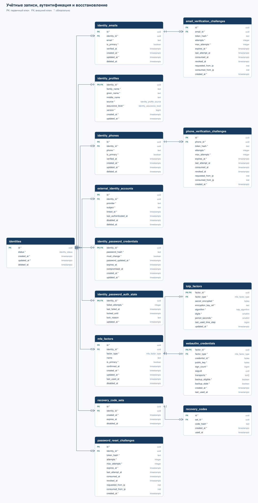
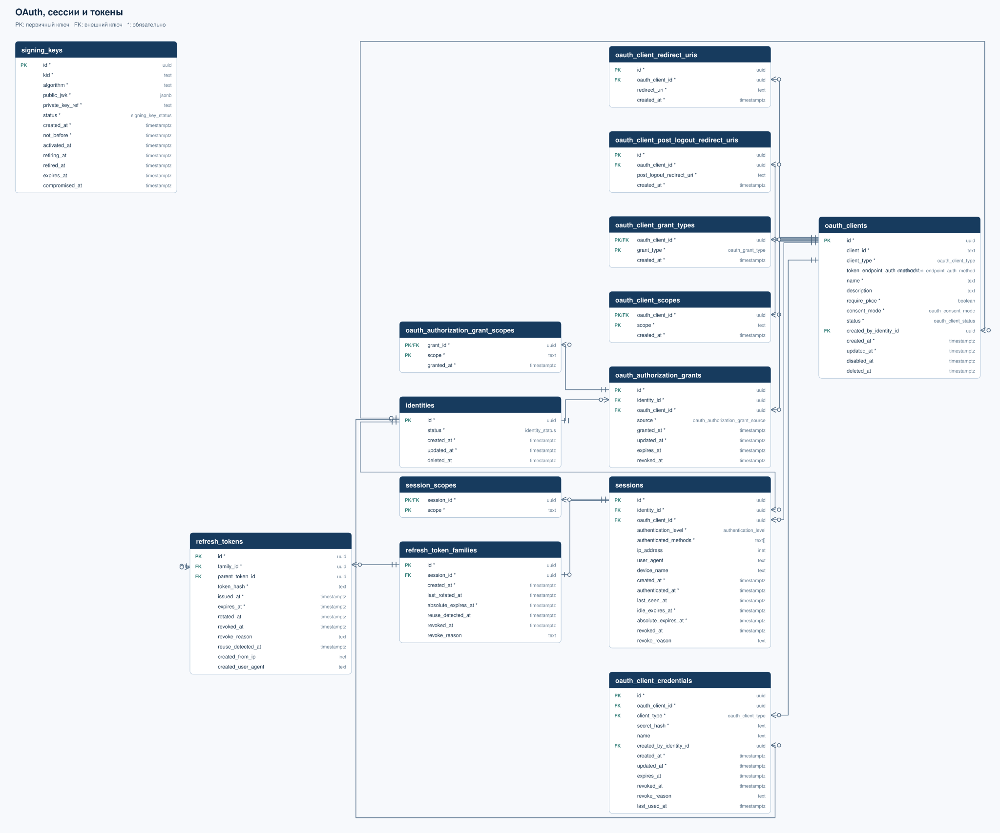
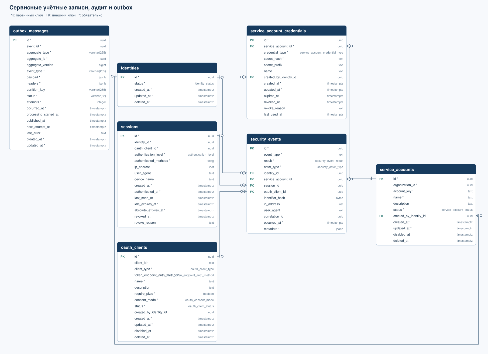

# База данных сервиса Identity

База данных Identity хранит учётные записи пользователей, профили и контактные данные, сведения для аутентификации и восстановления доступа. В её состав также входят данные OAuth-клиентов, разрешений, сессий, токенов, сервисных учётных записей и событий безопасности. Для наглядности модель разделена на области, связанные с учётными записями, авторизацией и служебными операциями.

## ER-диаграмма

Модель Identity разделена на три связанные области; общие таблицы могут повторяться там, где они участвуют в связях.

### Учётные записи, аутентификация и восстановление

Рисунок - Учётные записи, аутентификация и восстановление

[Открыть SVG: Учётные записи, аутентификация и восстановление](erd-identity_accounts.svg)

### OAuth, сессии и токены

Рисунок - OAuth, сессии и токены

[Открыть SVG: OAuth, сессии и токены](erd-identity_oauth.svg)

### Сервисные учётные записи, аудит и outbox

Рисунок - Сервисные учётные записи, аудит и outbox

[Открыть SVG: Сервисные учётные записи, аудит и outbox](erd-identity_operations.svg)

## Сущности

Таблица - Сущности сервиса Identity

| Таблица | Псевдоним | Описание | Особенности |
|---|---|---|---|
| identities | Учётная запись | Идентичность пользователя и её состояние. | PK: id |
| identity_profiles | Профиль учётной записи | Основные персональные данные учётной записи. | PK: identity_id |
| identity_emails | Электронный адрес | Адрес учётной записи и состояние подтверждения. | PK: id |
| identity_phones | Номер телефона | Телефон учётной записи и состояние подтверждения. | PK: id |
| external_identity_accounts | Внешняя учётная запись | Связь идентичности с субъектом внешнего провайдера. | PK: id |
| identity_password_credentials | Парольные данные | Хеш пароля и параметры его использования. | PK: identity_id |
| identity_password_auth_state | Состояние парольной защиты | Счётчики неудачных попыток и блокировка входа. | PK: identity_id |
| mfa_factors | Фактор аутентификации | Общие сведения и состояние дополнительного фактора. | PK: id |
| totp_factors | Фактор TOTP | Параметры и секрет фактора одноразовых кодов. | PK: factor_id |
| webauthn_credentials | Учётные данные WebAuthn | Параметры зарегистрированного аутентификатора. | PK: factor_id |
| recovery_code_sets | Набор кодов восстановления | Состояние набора резервных кодов. | PK: id |
| recovery_codes | Код восстановления | Хеш и состояние отдельного резервного кода. | PK: id |
| email_verification_challenges | Проверка электронной почты | Запрос подтверждения адреса электронной почты. | PK: id |
| phone_verification_challenges | Проверка телефона | Запрос подтверждения номера телефона. | PK: id |
| password_reset_challenges | Сброс пароля | Запрос на восстановление доступа по паролю. | PK: id |
| oauth_clients | OAuth-клиент | Конфигурация приложения, использующего OAuth. | PK: id |
| oauth_client_redirect_uris | Адрес перенаправления клиента | Разрешённый redirect URI OAuth-клиента. | PK: id |
| oauth_client_post_logout_redirect_uris | Адрес после выхода | Разрешённый адрес перехода после выхода из системы. | PK: id |
| oauth_client_grant_types | Тип выдачи OAuth | Разрешённый клиенту тип авторизационного grant. | PK: oauth_client_id, grant_type |
| oauth_client_scopes | Область доступа клиента | Область доступа, которую клиент может запрашивать. | PK: oauth_client_id, scope |
| oauth_client_credentials | Учётные данные OAuth-клиента | Секрет и состояние аутентификации клиента. | PK: id |
| oauth_authorization_grants | Согласие на доступ | Запомненное разрешение между пользователем и клиентом. | PK: id |
| oauth_authorization_grant_scopes | Область согласия | Область доступа, включённая в разрешение пользователя. | PK: grant_id, scope |
| sessions | Сессия | Состояние аутентифицированной сессии и сроки её действия. | PK: id |
| session_scopes | Область доступа сессии | Снимок области доступа, предоставленной сессии. | PK: session_id, scope |
| refresh_token_families | Семейство refresh-токенов | Объединение токенов для ротации и отзыва. | PK: id |
| refresh_tokens | Refresh-токен | Хеш токена и сведения о его ротации. | PK: id |
| signing_keys | Ключ подписи | Публичные параметры и ссылка на закрытый ключ подписи. | PK: id |
| service_accounts | Сервисная учётная запись | Идентичность вызывающего сервиса. | PK: id |
| service_account_credentials | Учётные данные сервиса | Секрет и состояние доступа сервисной учётной записи. | PK: id |
| security_events | Событие безопасности | Журнал события аутентификации или безопасности. | PK: id |
| outbox_messages | Исходящее событие | Сообщение transactional outbox для последующей публикации. | PK: id |

## Связи

Таблица - Связи сущностей сервиса Identity

| Родительская сущность и ключ | Дочерняя сущность и FK | Дочерних записей на одну родительскую | Родительских записей на одну дочернюю | Комментарий |
|---|---|---|---|---|
| identities (id) | identity_emails (identity_id) | 0..N | 1 | Безусловная уникальность FK не указана; ссылка обязательна. Удаление родителя: cascade. |
| identities (id) | identity_profiles (identity_id) | 0..1 | 1 | Не более одной дочерней записи; ссылка обязательна. Удаление родителя: cascade. |
| identities (id) | identity_phones (identity_id) | 0..N | 1 | Безусловная уникальность FK не указана; ссылка обязательна. Удаление родителя: cascade. |
| identities (id) | external_identity_accounts (identity_id) | 0..N | 1 | Безусловная уникальность FK не указана; ссылка обязательна. Удаление родителя: cascade. |
| identities (id) | identity_password_credentials (identity_id) | 0..1 | 1 | Не более одной дочерней записи; ссылка обязательна. Удаление родителя: cascade. |
| identities (id) | identity_password_auth_state (identity_id) | 0..1 | 1 | Не более одной дочерней записи; ссылка обязательна. Удаление родителя: cascade. |
| identities (id) | mfa_factors (identity_id) | 0..N | 1 | Безусловная уникальность FK не указана; ссылка обязательна. Удаление родителя: cascade. |
| mfa_factors (id, factor_type) | totp_factors (factor_id, factor_type) | 0..1 | 1 | Не более одной дочерней записи; ссылка обязательна. Удаление родителя: cascade. |
| mfa_factors (id, factor_type) | webauthn_credentials (factor_id, factor_type) | 0..1 | 1 | Не более одной дочерней записи; ссылка обязательна. Удаление родителя: cascade. |
| identities (id) | recovery_code_sets (identity_id) | 0..N | 1 | Безусловная уникальность FK не указана; ссылка обязательна. Удаление родителя: cascade. |
| recovery_code_sets (id) | recovery_codes (set_id) | 0..N | 1 | Безусловная уникальность FK не указана; ссылка обязательна. Удаление родителя: cascade. |
| identity_emails (id) | email_verification_challenges (email_id) | 0..N | 1 | Безусловная уникальность FK не указана; ссылка обязательна. Удаление родителя: cascade. |
| identity_phones (id) | phone_verification_challenges (phone_id) | 0..N | 1 | Безусловная уникальность FK не указана; ссылка обязательна. Удаление родителя: cascade. |
| identities (id) | password_reset_challenges (identity_id) | 0..N | 1 | Безусловная уникальность FK не указана; ссылка обязательна. Удаление родителя: cascade. |
| identities (id) | oauth_clients (created_by_identity_id) | 0..N | 0..1 | Безусловная уникальность FK не указана; ссылка может отсутствовать. Удаление родителя: set null. |
| oauth_clients (id) | oauth_client_redirect_uris (oauth_client_id) | 0..N | 1 | Безусловная уникальность FK не указана; ссылка обязательна. Удаление родителя: cascade. |
| oauth_clients (id) | oauth_client_post_logout_redirect_uris (oauth_client_id) | 0..N | 1 | Безусловная уникальность FK не указана; ссылка обязательна. Удаление родителя: cascade. |
| oauth_clients (id) | oauth_client_grant_types (oauth_client_id) | 0..N | 1 | Безусловная уникальность FK не указана; ссылка обязательна. Удаление родителя: cascade. |
| oauth_clients (id) | oauth_client_scopes (oauth_client_id) | 0..N | 1 | Безусловная уникальность FK не указана; ссылка обязательна. Удаление родителя: cascade. |
| oauth_clients (id, client_type) | oauth_client_credentials (oauth_client_id, client_type) | 0..N | 1 | Безусловная уникальность FK не указана; ссылка обязательна. Удаление родителя: cascade. |
| identities (id) | oauth_client_credentials (created_by_identity_id) | 0..N | 0..1 | Безусловная уникальность FK не указана; ссылка может отсутствовать. Удаление родителя: set null. |
| identities (id) | oauth_authorization_grants (identity_id) | 0..N | 1 | Безусловная уникальность FK не указана; ссылка обязательна. Удаление родителя: cascade. |
| oauth_clients (id) | oauth_authorization_grants (oauth_client_id) | 0..N | 1 | Безусловная уникальность FK не указана; ссылка обязательна. Удаление родителя: cascade. |
| oauth_authorization_grants (id) | oauth_authorization_grant_scopes (grant_id) | 0..N | 1 | Безусловная уникальность FK не указана; ссылка обязательна. Удаление родителя: cascade. |
| identities (id) | sessions (identity_id) | 0..N | 1 | Безусловная уникальность FK не указана; ссылка обязательна. Удаление родителя: cascade. |
| oauth_clients (id) | sessions (oauth_client_id) | 0..N | 1 | Безусловная уникальность FK не указана; ссылка обязательна. Удаление родителя: restrict. |
| sessions (id) | session_scopes (session_id) | 0..N | 1 | Безусловная уникальность FK не указана; ссылка обязательна. Удаление родителя: cascade. |
| sessions (id) | refresh_token_families (session_id) | 0..1 | 1 | Не более одной дочерней записи; ссылка обязательна. Удаление родителя: cascade. |
| refresh_token_families (id) | refresh_tokens (family_id) | 0..N | 1 | Безусловная уникальность FK не указана; ссылка обязательна. Удаление родителя: cascade. |
| refresh_tokens (id, family_id) | refresh_tokens (parent_token_id, family_id) | 0..N | 0..1 | Безусловная уникальность FK не указана; ссылка может отсутствовать. Удаление родителя: не задано. |
| identities (id) | service_accounts (created_by_identity_id) | 0..N | 0..1 | Безусловная уникальность FK не указана; ссылка может отсутствовать. Удаление родителя: set null. |
| service_accounts (id) | service_account_credentials (service_account_id) | 0..N | 1 | Безусловная уникальность FK не указана; ссылка обязательна. Удаление родителя: cascade. |
| identities (id) | service_account_credentials (created_by_identity_id) | 0..N | 0..1 | Безусловная уникальность FK не указана; ссылка может отсутствовать. Удаление родителя: set null. |
| identities (id) | security_events (identity_id) | 0..N | 0..1 | Безусловная уникальность FK не указана; ссылка может отсутствовать. Удаление родителя: set null. |
| service_accounts (id) | security_events (service_account_id) | 0..N | 0..1 | Безусловная уникальность FK не указана; ссылка может отсутствовать. Удаление родителя: set null. |
| sessions (id) | security_events (session_id) | 0..N | 0..1 | Безусловная уникальность FK не указана; ссылка может отсутствовать. Удаление родителя: set null. |
| oauth_clients (id) | security_events (oauth_client_id) | 0..N | 0..1 | Безусловная уникальность FK не указана; ссылка может отсутствовать. Удаление родителя: set null. |

## Атрибуты

Таблица - Атрибуты сущностей сервиса Identity

<table><thead><tr><th>Сущность</th><th>Поле</th><th>Тип</th><th>Описание</th></tr></thead><tbody>
<tr><td class="attribute-name" rowspan="5">identities</td><td class="attribute-name">id</td><td class="attribute-type">uuid</td><td class="attribute-description">Обязательно; PK; Идентификатор записи.</td></tr>
<tr><td class="attribute-name">status</td><td class="attribute-type">public.identity_status</td><td class="attribute-description">Обязательно; По умолчанию: pending; Состояние записи; допустимые переходы описаны в проекте сервиса.</td></tr>
<tr><td class="attribute-name">created_at</td><td class="attribute-type">timestamptz</td><td class="attribute-description">Обязательно; Время создания.</td></tr>
<tr><td class="attribute-name">updated_at</td><td class="attribute-type">timestamptz</td><td class="attribute-description">Обязательно; Время последнего изменения.</td></tr>
<tr><td class="attribute-name">deleted_at</td><td class="attribute-type">timestamptz</td><td class="attribute-description">Необязательно / не указано; Время удаления.</td></tr>
<tr><td class="attribute-name" rowspan="9">identity_profiles</td><td class="attribute-name">identity_id</td><td class="attribute-type">uuid</td><td class="attribute-description">Обязательно; PK, FK; Идентификатор учётной записи Identity.</td></tr>
<tr><td class="attribute-name">family_name</td><td class="attribute-type">text</td><td class="attribute-description">Обязательно; Фамилия.</td></tr>
<tr><td class="attribute-name">given_name</td><td class="attribute-type">text</td><td class="attribute-description">Обязательно; Имя.</td></tr>
<tr><td class="attribute-name">middle_name</td><td class="attribute-type">text</td><td class="attribute-description">Необязательно / не указано; Отчество или второе имя.</td></tr>
<tr><td class="attribute-name">source</td><td class="attribute-type">public.identity_profile_source</td><td class="attribute-description">Обязательно; По умолчанию: self_declared; Источник данных.</td></tr>
<tr><td class="attribute-name">assurance_level</td><td class="attribute-type">public.identity_assurance_level</td><td class="attribute-description">Обязательно; По умолчанию: self_declared; Уровень подтверждения данных.</td></tr>
<tr><td class="attribute-name">version</td><td class="attribute-type">bigint</td><td class="attribute-description">Обязательно; По умолчанию: 1; Версия для контроля конкурентных изменений.</td></tr>
<tr><td class="attribute-name">created_at</td><td class="attribute-type">timestamptz</td><td class="attribute-description">Обязательно; Время создания.</td></tr>
<tr><td class="attribute-name">updated_at</td><td class="attribute-type">timestamptz</td><td class="attribute-description">Обязательно; Время последнего изменения.</td></tr>
<tr><td class="attribute-name" rowspan="8">identity_emails</td><td class="attribute-name">id</td><td class="attribute-type">uuid</td><td class="attribute-description">Обязательно; PK; Идентификатор записи.</td></tr>
<tr><td class="attribute-name">identity_id</td><td class="attribute-type">uuid</td><td class="attribute-description">Обязательно; FK; Идентификатор учётной записи Identity.</td></tr>
<tr><td class="attribute-name">email</td><td class="attribute-type">text</td><td class="attribute-description">Обязательно; UNIQUE; Адрес электронной почты.</td></tr>
<tr><td class="attribute-name">is_primary</td><td class="attribute-type">boolean</td><td class="attribute-description">Обязательно; По умолчанию: false; Признак основного значения.</td></tr>
<tr><td class="attribute-name">verified_at</td><td class="attribute-type">timestamptz</td><td class="attribute-description">Необязательно / не указано; Время подтверждения.</td></tr>
<tr><td class="attribute-name">created_at</td><td class="attribute-type">timestamptz</td><td class="attribute-description">Обязательно; Время создания.</td></tr>
<tr><td class="attribute-name">updated_at</td><td class="attribute-type">timestamptz</td><td class="attribute-description">Обязательно; Время последнего изменения.</td></tr>
<tr><td class="attribute-name">deleted_at</td><td class="attribute-type">timestamptz</td><td class="attribute-description">Необязательно / не указано; Время удаления.</td></tr>
<tr><td class="attribute-name" rowspan="8">identity_phones</td><td class="attribute-name">id</td><td class="attribute-type">uuid</td><td class="attribute-description">Обязательно; PK; Идентификатор записи.</td></tr>
<tr><td class="attribute-name">identity_id</td><td class="attribute-type">uuid</td><td class="attribute-description">Обязательно; FK; Идентификатор учётной записи Identity.</td></tr>
<tr><td class="attribute-name">phone</td><td class="attribute-type">text</td><td class="attribute-description">Обязательно; UNIQUE; Номер телефона.</td></tr>
<tr><td class="attribute-name">is_primary</td><td class="attribute-type">boolean</td><td class="attribute-description">Обязательно; По умолчанию: false; Признак основного значения.</td></tr>
<tr><td class="attribute-name">verified_at</td><td class="attribute-type">timestamptz</td><td class="attribute-description">Необязательно / не указано; Время подтверждения.</td></tr>
<tr><td class="attribute-name">created_at</td><td class="attribute-type">timestamptz</td><td class="attribute-description">Обязательно; Время создания.</td></tr>
<tr><td class="attribute-name">updated_at</td><td class="attribute-type">timestamptz</td><td class="attribute-description">Обязательно; Время последнего изменения.</td></tr>
<tr><td class="attribute-name">deleted_at</td><td class="attribute-type">timestamptz</td><td class="attribute-description">Необязательно / не указано; Время удаления.</td></tr>
<tr><td class="attribute-name" rowspan="8">external_identity_accounts</td><td class="attribute-name">id</td><td class="attribute-type">uuid</td><td class="attribute-description">Обязательно; PK; Идентификатор записи.</td></tr>
<tr><td class="attribute-name">identity_id</td><td class="attribute-type">uuid</td><td class="attribute-description">Обязательно; FK; Идентификатор учётной записи Identity.</td></tr>
<tr><td class="attribute-name">provider</td><td class="attribute-type">text</td><td class="attribute-description">Обязательно; Идентификатор провайдера.</td></tr>
<tr><td class="attribute-name">subject</td><td class="attribute-type">text</td><td class="attribute-description">Обязательно; Идентификатор субъекта.</td></tr>
<tr><td class="attribute-name">linked_at</td><td class="attribute-type">timestamptz</td><td class="attribute-description">Обязательно; Время соответствующего действия или состояния.</td></tr>
<tr><td class="attribute-name">last_authenticated_at</td><td class="attribute-type">timestamptz</td><td class="attribute-description">Необязательно / не указано; Время соответствующего действия или состояния.</td></tr>
<tr><td class="attribute-name">disabled_at</td><td class="attribute-type">timestamptz</td><td class="attribute-description">Необязательно / не указано; Время соответствующего действия или состояния.</td></tr>
<tr><td class="attribute-name">deleted_at</td><td class="attribute-type">timestamptz</td><td class="attribute-description">Необязательно / не указано; Время удаления.</td></tr>
<tr><td class="attribute-name" rowspan="8">identity_password_credentials</td><td class="attribute-name">identity_id</td><td class="attribute-type">uuid</td><td class="attribute-description">Обязательно; PK, FK; Идентификатор учётной записи Identity.</td></tr>
<tr><td class="attribute-name">password_hash</td><td class="attribute-type">text</td><td class="attribute-description">Обязательно; Хеш пароля.</td></tr>
<tr><td class="attribute-name">must_change</td><td class="attribute-type">boolean</td><td class="attribute-description">Обязательно; По умолчанию: false; Признак обязательной смены.</td></tr>
<tr><td class="attribute-name">password_updated_at</td><td class="attribute-type">timestamptz</td><td class="attribute-description">Обязательно; Время соответствующего действия или состояния.</td></tr>
<tr><td class="attribute-name">expires_at</td><td class="attribute-type">timestamptz</td><td class="attribute-description">Необязательно / не указано; Время истечения.</td></tr>
<tr><td class="attribute-name">compromised_at</td><td class="attribute-type">timestamptz</td><td class="attribute-description">Необязательно / не указано; Время соответствующего действия или состояния.</td></tr>
<tr><td class="attribute-name">created_at</td><td class="attribute-type">timestamptz</td><td class="attribute-description">Обязательно; Время создания.</td></tr>
<tr><td class="attribute-name">updated_at</td><td class="attribute-type">timestamptz</td><td class="attribute-description">Обязательно; Время последнего изменения.</td></tr>
<tr><td class="attribute-name" rowspan="6">identity_password_auth_state</td><td class="attribute-name">identity_id</td><td class="attribute-type">uuid</td><td class="attribute-description">Обязательно; PK, FK; Идентификатор учётной записи Identity.</td></tr>
<tr><td class="attribute-name">failed_attempts</td><td class="attribute-type">integer</td><td class="attribute-description">Обязательно; По умолчанию: 0; Число неудачных попыток.</td></tr>
<tr><td class="attribute-name">last_failed_at</td><td class="attribute-type">timestamptz</td><td class="attribute-description">Необязательно / не указано; Время соответствующего действия или состояния.</td></tr>
<tr><td class="attribute-name">locked_until</td><td class="attribute-type">timestamptz</td><td class="attribute-description">Необязательно / не указано; Время окончания блокировки.</td></tr>
<tr><td class="attribute-name">lock_reason</td><td class="attribute-type">text</td><td class="attribute-description">Необязательно / не указано; Причина блокировки.</td></tr>
<tr><td class="attribute-name">updated_at</td><td class="attribute-type">timestamptz</td><td class="attribute-description">Обязательно; Время последнего изменения.</td></tr>
<tr><td class="attribute-name" rowspan="10">mfa_factors</td><td class="attribute-name">id</td><td class="attribute-type">uuid</td><td class="attribute-description">Обязательно; PK; Идентификатор записи.</td></tr>
<tr><td class="attribute-name">identity_id</td><td class="attribute-type">uuid</td><td class="attribute-description">Обязательно; FK; Идентификатор учётной записи Identity.</td></tr>
<tr><td class="attribute-name">factor_type</td><td class="attribute-type">public.mfa_factor_type</td><td class="attribute-description">Обязательно; Тип фактора аутентификации.</td></tr>
<tr><td class="attribute-name">name</td><td class="attribute-type">text</td><td class="attribute-description">Необязательно / не указано; Название или имя.</td></tr>
<tr><td class="attribute-name">is_primary</td><td class="attribute-type">boolean</td><td class="attribute-description">Обязательно; По умолчанию: false; Признак основного значения.</td></tr>
<tr><td class="attribute-name">confirmed_at</td><td class="attribute-type">timestamptz</td><td class="attribute-description">Необязательно / не указано; Время соответствующего действия или состояния.</td></tr>
<tr><td class="attribute-name">created_at</td><td class="attribute-type">timestamptz</td><td class="attribute-description">Обязательно; Время создания.</td></tr>
<tr><td class="attribute-name">updated_at</td><td class="attribute-type">timestamptz</td><td class="attribute-description">Обязательно; Время последнего изменения.</td></tr>
<tr><td class="attribute-name">last_used_at</td><td class="attribute-type">timestamptz</td><td class="attribute-description">Необязательно / не указано; Время последнего использования.</td></tr>
<tr><td class="attribute-name">disabled_at</td><td class="attribute-type">timestamptz</td><td class="attribute-description">Необязательно / не указано; Время соответствующего действия или состояния.</td></tr>
<tr><td class="attribute-name" rowspan="9">totp_factors</td><td class="attribute-name">factor_id</td><td class="attribute-type">uuid</td><td class="attribute-description">Обязательно; PK, FK; Идентификатор связанного объекта; владелец и назначение определяются контекстом сервиса.</td></tr>
<tr><td class="attribute-name">factor_type</td><td class="attribute-type">public.mfa_factor_type</td><td class="attribute-description">Обязательно; FK; По умолчанию: totp; Тип фактора аутентификации.</td></tr>
<tr><td class="attribute-name">secret_encrypted</td><td class="attribute-type">bytea</td><td class="attribute-description">Обязательно; Зашифрованный секрет.</td></tr>
<tr><td class="attribute-name">encryption_key_ref</td><td class="attribute-type">text</td><td class="attribute-description">Обязательно; Ссылка на ключ шифрования.</td></tr>
<tr><td class="attribute-name">algorithm</td><td class="attribute-type">public.totp_algorithm</td><td class="attribute-description">Обязательно; По умолчанию: sha1; Идентификатор алгоритма.</td></tr>
<tr><td class="attribute-name">digits</td><td class="attribute-type">smallint</td><td class="attribute-description">Обязательно; По умолчанию: 6; Количество цифр одноразового кода.</td></tr>
<tr><td class="attribute-name">period_seconds</td><td class="attribute-type">smallint</td><td class="attribute-description">Обязательно; По умолчанию: 30; Продолжительность периода в секундах.</td></tr>
<tr><td class="attribute-name">last_used_time_step</td><td class="attribute-type">bigint</td><td class="attribute-description">Необязательно / не указано; Последний использованный временной шаг.</td></tr>
<tr><td class="attribute-name">updated_at</td><td class="attribute-type">timestamptz</td><td class="attribute-description">Обязательно; Время последнего изменения.</td></tr>
<tr><td class="attribute-name" rowspan="11">webauthn_credentials</td><td class="attribute-name">factor_id</td><td class="attribute-type">uuid</td><td class="attribute-description">Обязательно; PK, FK; Идентификатор связанного объекта; владелец и назначение определяются контекстом сервиса.</td></tr>
<tr><td class="attribute-name">factor_type</td><td class="attribute-type">public.mfa_factor_type</td><td class="attribute-description">Обязательно; FK; По умолчанию: webauthn; Тип фактора аутентификации.</td></tr>
<tr><td class="attribute-name">credential_id</td><td class="attribute-type">bytea</td><td class="attribute-description">Обязательно; UNIQUE; Идентификатор связанного объекта; владелец и назначение определяются контекстом сервиса.</td></tr>
<tr><td class="attribute-name">public_key</td><td class="attribute-type">bytea</td><td class="attribute-description">Обязательно; Открытый ключ.</td></tr>
<tr><td class="attribute-name">sign_count</td><td class="attribute-type">bigint</td><td class="attribute-description">Обязательно; По умолчанию: 0; Счётчик подписей.</td></tr>
<tr><td class="attribute-name">aaguid</td><td class="attribute-type">uuid</td><td class="attribute-description">Необязательно / не указано; Идентификатор типа аутентификатора AAGUID.</td></tr>
<tr><td class="attribute-name">transports</td><td class="attribute-type">text[]</td><td class="attribute-description">Обязательно; По умолчанию: {}; Способы взаимодействия с аутентификатором.</td></tr>
<tr><td class="attribute-name">backup_eligible</td><td class="attribute-type">boolean</td><td class="attribute-description">Обязательно; По умолчанию: false; Признак возможности резервирования.</td></tr>
<tr><td class="attribute-name">backup_state</td><td class="attribute-type">boolean</td><td class="attribute-description">Обязательно; По умолчанию: false; Признак состояния резервирования.</td></tr>
<tr><td class="attribute-name">created_at</td><td class="attribute-type">timestamptz</td><td class="attribute-description">Обязательно; Время создания.</td></tr>
<tr><td class="attribute-name">last_used_at</td><td class="attribute-type">timestamptz</td><td class="attribute-description">Необязательно / не указано; Время последнего использования.</td></tr>
<tr><td class="attribute-name" rowspan="5">recovery_code_sets</td><td class="attribute-name">id</td><td class="attribute-type">uuid</td><td class="attribute-description">Обязательно; PK; Идентификатор записи.</td></tr>
<tr><td class="attribute-name">identity_id</td><td class="attribute-type">uuid</td><td class="attribute-description">Обязательно; FK; Идентификатор учётной записи Identity.</td></tr>
<tr><td class="attribute-name">created_at</td><td class="attribute-type">timestamptz</td><td class="attribute-description">Обязательно; Время создания.</td></tr>
<tr><td class="attribute-name">expires_at</td><td class="attribute-type">timestamptz</td><td class="attribute-description">Необязательно / не указано; Время истечения.</td></tr>
<tr><td class="attribute-name">disabled_at</td><td class="attribute-type">timestamptz</td><td class="attribute-description">Необязательно / не указано; Время соответствующего действия или состояния.</td></tr>
<tr><td class="attribute-name" rowspan="5">recovery_codes</td><td class="attribute-name">id</td><td class="attribute-type">uuid</td><td class="attribute-description">Обязательно; PK; Идентификатор записи.</td></tr>
<tr><td class="attribute-name">set_id</td><td class="attribute-type">uuid</td><td class="attribute-description">Обязательно; FK; Идентификатор связанного объекта; владелец и назначение определяются контекстом сервиса.</td></tr>
<tr><td class="attribute-name">code_hash</td><td class="attribute-type">text</td><td class="attribute-description">Обязательно; Хеш кода.</td></tr>
<tr><td class="attribute-name">created_at</td><td class="attribute-type">timestamptz</td><td class="attribute-description">Обязательно; Время создания.</td></tr>
<tr><td class="attribute-name">used_at</td><td class="attribute-type">timestamptz</td><td class="attribute-description">Необязательно / не указано; Время соответствующего действия или состояния.</td></tr>
<tr><td class="attribute-name" rowspan="12">email_verification_challenges</td><td class="attribute-name">id</td><td class="attribute-type">uuid</td><td class="attribute-description">Обязательно; PK; Идентификатор записи.</td></tr>
<tr><td class="attribute-name">email_id</td><td class="attribute-type">uuid</td><td class="attribute-description">Обязательно; FK; Идентификатор связанного объекта; владелец и назначение определяются контекстом сервиса.</td></tr>
<tr><td class="attribute-name">token_hash</td><td class="attribute-type">text</td><td class="attribute-description">Обязательно; UNIQUE; Хеш токена.</td></tr>
<tr><td class="attribute-name">attempts</td><td class="attribute-type">integer</td><td class="attribute-description">Обязательно; По умолчанию: 0; Количество попыток.</td></tr>
<tr><td class="attribute-name">max_attempts</td><td class="attribute-type">integer</td><td class="attribute-description">Обязательно; Максимально допустимое число попыток.</td></tr>
<tr><td class="attribute-name">expires_at</td><td class="attribute-type">timestamptz</td><td class="attribute-description">Обязательно; Время истечения.</td></tr>
<tr><td class="attribute-name">last_attempt_at</td><td class="attribute-type">timestamptz</td><td class="attribute-description">Необязательно / не указано; Время соответствующего действия или состояния.</td></tr>
<tr><td class="attribute-name">consumed_at</td><td class="attribute-type">timestamptz</td><td class="attribute-description">Необязательно / не указано; Время соответствующего действия или состояния.</td></tr>
<tr><td class="attribute-name">revoked_at</td><td class="attribute-type">timestamptz</td><td class="attribute-description">Необязательно / не указано; Время соответствующего действия или состояния.</td></tr>
<tr><td class="attribute-name">requested_from_ip</td><td class="attribute-type">inet</td><td class="attribute-description">Необязательно / не указано; IP-адрес источника запроса.</td></tr>
<tr><td class="attribute-name">consumed_from_ip</td><td class="attribute-type">inet</td><td class="attribute-description">Необязательно / не указано; IP-адрес источника использования.</td></tr>
<tr><td class="attribute-name">created_at</td><td class="attribute-type">timestamptz</td><td class="attribute-description">Обязательно; Время создания.</td></tr>
<tr><td class="attribute-name" rowspan="12">phone_verification_challenges</td><td class="attribute-name">id</td><td class="attribute-type">uuid</td><td class="attribute-description">Обязательно; PK; Идентификатор записи.</td></tr>
<tr><td class="attribute-name">phone_id</td><td class="attribute-type">uuid</td><td class="attribute-description">Обязательно; FK; Идентификатор связанного объекта; владелец и назначение определяются контекстом сервиса.</td></tr>
<tr><td class="attribute-name">token_hash</td><td class="attribute-type">text</td><td class="attribute-description">Обязательно; UNIQUE; Хеш токена.</td></tr>
<tr><td class="attribute-name">attempts</td><td class="attribute-type">integer</td><td class="attribute-description">Обязательно; По умолчанию: 0; Количество попыток.</td></tr>
<tr><td class="attribute-name">max_attempts</td><td class="attribute-type">integer</td><td class="attribute-description">Обязательно; Максимально допустимое число попыток.</td></tr>
<tr><td class="attribute-name">expires_at</td><td class="attribute-type">timestamptz</td><td class="attribute-description">Обязательно; Время истечения.</td></tr>
<tr><td class="attribute-name">last_attempt_at</td><td class="attribute-type">timestamptz</td><td class="attribute-description">Необязательно / не указано; Время соответствующего действия или состояния.</td></tr>
<tr><td class="attribute-name">consumed_at</td><td class="attribute-type">timestamptz</td><td class="attribute-description">Необязательно / не указано; Время соответствующего действия или состояния.</td></tr>
<tr><td class="attribute-name">revoked_at</td><td class="attribute-type">timestamptz</td><td class="attribute-description">Необязательно / не указано; Время соответствующего действия или состояния.</td></tr>
<tr><td class="attribute-name">requested_from_ip</td><td class="attribute-type">inet</td><td class="attribute-description">Необязательно / не указано; IP-адрес источника запроса.</td></tr>
<tr><td class="attribute-name">consumed_from_ip</td><td class="attribute-type">inet</td><td class="attribute-description">Необязательно / не указано; IP-адрес источника использования.</td></tr>
<tr><td class="attribute-name">created_at</td><td class="attribute-type">timestamptz</td><td class="attribute-description">Обязательно; Время создания.</td></tr>
<tr><td class="attribute-name" rowspan="12">password_reset_challenges</td><td class="attribute-name">id</td><td class="attribute-type">uuid</td><td class="attribute-description">Обязательно; PK; Идентификатор записи.</td></tr>
<tr><td class="attribute-name">identity_id</td><td class="attribute-type">uuid</td><td class="attribute-description">Обязательно; FK; Идентификатор учётной записи Identity.</td></tr>
<tr><td class="attribute-name">token_hash</td><td class="attribute-type">text</td><td class="attribute-description">Обязательно; UNIQUE; Хеш токена.</td></tr>
<tr><td class="attribute-name">attempts</td><td class="attribute-type">integer</td><td class="attribute-description">Обязательно; По умолчанию: 0; Количество попыток.</td></tr>
<tr><td class="attribute-name">max_attempts</td><td class="attribute-type">integer</td><td class="attribute-description">Обязательно; Максимально допустимое число попыток.</td></tr>
<tr><td class="attribute-name">expires_at</td><td class="attribute-type">timestamptz</td><td class="attribute-description">Обязательно; Время истечения.</td></tr>
<tr><td class="attribute-name">last_attempt_at</td><td class="attribute-type">timestamptz</td><td class="attribute-description">Необязательно / не указано; Время соответствующего действия или состояния.</td></tr>
<tr><td class="attribute-name">consumed_at</td><td class="attribute-type">timestamptz</td><td class="attribute-description">Необязательно / не указано; Время соответствующего действия или состояния.</td></tr>
<tr><td class="attribute-name">revoked_at</td><td class="attribute-type">timestamptz</td><td class="attribute-description">Необязательно / не указано; Время соответствующего действия или состояния.</td></tr>
<tr><td class="attribute-name">requested_from_ip</td><td class="attribute-type">inet</td><td class="attribute-description">Необязательно / не указано; IP-адрес источника запроса.</td></tr>
<tr><td class="attribute-name">consumed_from_ip</td><td class="attribute-type">inet</td><td class="attribute-description">Необязательно / не указано; IP-адрес источника использования.</td></tr>
<tr><td class="attribute-name">created_at</td><td class="attribute-type">timestamptz</td><td class="attribute-description">Обязательно; Время создания.</td></tr>
<tr><td class="attribute-name" rowspan="14">oauth_clients</td><td class="attribute-name">id</td><td class="attribute-type">uuid</td><td class="attribute-description">Обязательно; PK; Идентификатор записи.</td></tr>
<tr><td class="attribute-name">client_id</td><td class="attribute-type">text</td><td class="attribute-description">Обязательно; UNIQUE; Идентификатор OAuth-клиента.</td></tr>
<tr><td class="attribute-name">client_type</td><td class="attribute-type">public.oauth_client_type</td><td class="attribute-description">Обязательно; Тип клиента.</td></tr>
<tr><td class="attribute-name">token_endpoint_auth_method</td><td class="attribute-type">public.oauth_token_endpoint_auth_method</td><td class="attribute-description">Обязательно; Способ аутентификации клиента на token endpoint.</td></tr>
<tr><td class="attribute-name">name</td><td class="attribute-type">text</td><td class="attribute-description">Обязательно; Название или имя.</td></tr>
<tr><td class="attribute-name">description</td><td class="attribute-type">text</td><td class="attribute-description">Необязательно / не указано; Описание.</td></tr>
<tr><td class="attribute-name">require_pkce</td><td class="attribute-type">boolean</td><td class="attribute-description">Обязательно; По умолчанию: true; Признак обязательной проверки PKCE.</td></tr>
<tr><td class="attribute-name">consent_mode</td><td class="attribute-type">public.oauth_consent_mode</td><td class="attribute-description">Обязательно; По умолчанию: remember; Режим согласия.</td></tr>
<tr><td class="attribute-name">status</td><td class="attribute-type">public.oauth_client_status</td><td class="attribute-description">Обязательно; По умолчанию: active; Состояние записи; допустимые переходы описаны в проекте сервиса.</td></tr>
<tr><td class="attribute-name">created_by_identity_id</td><td class="attribute-type">uuid</td><td class="attribute-description">Необязательно / не указано; FK; Идентификатор связанного объекта; владелец и назначение определяются контекстом сервиса.</td></tr>
<tr><td class="attribute-name">created_at</td><td class="attribute-type">timestamptz</td><td class="attribute-description">Обязательно; Время создания.</td></tr>
<tr><td class="attribute-name">updated_at</td><td class="attribute-type">timestamptz</td><td class="attribute-description">Обязательно; Время последнего изменения.</td></tr>
<tr><td class="attribute-name">disabled_at</td><td class="attribute-type">timestamptz</td><td class="attribute-description">Необязательно / не указано; Время соответствующего действия или состояния.</td></tr>
<tr><td class="attribute-name">deleted_at</td><td class="attribute-type">timestamptz</td><td class="attribute-description">Необязательно / не указано; Время удаления.</td></tr>
<tr><td class="attribute-name" rowspan="4">oauth_client_redirect_uris</td><td class="attribute-name">id</td><td class="attribute-type">uuid</td><td class="attribute-description">Обязательно; PK; Идентификатор записи.</td></tr>
<tr><td class="attribute-name">oauth_client_id</td><td class="attribute-type">uuid</td><td class="attribute-description">Обязательно; FK; Идентификатор связанного объекта; владелец и назначение определяются контекстом сервиса.</td></tr>
<tr><td class="attribute-name">redirect_uri</td><td class="attribute-type">text</td><td class="attribute-description">Обязательно; Разрешённый адрес перенаправления.</td></tr>
<tr><td class="attribute-name">created_at</td><td class="attribute-type">timestamptz</td><td class="attribute-description">Обязательно; Время создания.</td></tr>
<tr><td class="attribute-name" rowspan="4">oauth_client_post_logout_redirect_uris</td><td class="attribute-name">id</td><td class="attribute-type">uuid</td><td class="attribute-description">Обязательно; PK; Идентификатор записи.</td></tr>
<tr><td class="attribute-name">oauth_client_id</td><td class="attribute-type">uuid</td><td class="attribute-description">Обязательно; FK; Идентификатор связанного объекта; владелец и назначение определяются контекстом сервиса.</td></tr>
<tr><td class="attribute-name">post_logout_redirect_uri</td><td class="attribute-type">text</td><td class="attribute-description">Обязательно; Адрес перенаправления после выхода.</td></tr>
<tr><td class="attribute-name">created_at</td><td class="attribute-type">timestamptz</td><td class="attribute-description">Обязательно; Время создания.</td></tr>
<tr><td class="attribute-name" rowspan="3">oauth_client_grant_types</td><td class="attribute-name">oauth_client_id</td><td class="attribute-type">uuid</td><td class="attribute-description">Обязательно; PK, FK; Идентификатор связанного объекта; владелец и назначение определяются контекстом сервиса.</td></tr>
<tr><td class="attribute-name">grant_type</td><td class="attribute-type">public.oauth_grant_type</td><td class="attribute-description">Обязательно; PK; Тип разрешённого OAuth grant.</td></tr>
<tr><td class="attribute-name">created_at</td><td class="attribute-type">timestamptz</td><td class="attribute-description">Обязательно; Время создания.</td></tr>
<tr><td class="attribute-name" rowspan="3">oauth_client_scopes</td><td class="attribute-name">oauth_client_id</td><td class="attribute-type">uuid</td><td class="attribute-description">Обязательно; PK, FK; Идентификатор связанного объекта; владелец и назначение определяются контекстом сервиса.</td></tr>
<tr><td class="attribute-name">scope</td><td class="attribute-type">text</td><td class="attribute-description">Обязательно; PK; Область доступа.</td></tr>
<tr><td class="attribute-name">created_at</td><td class="attribute-type">timestamptz</td><td class="attribute-description">Обязательно; Время создания.</td></tr>
<tr><td class="attribute-name" rowspan="12">oauth_client_credentials</td><td class="attribute-name">id</td><td class="attribute-type">uuid</td><td class="attribute-description">Обязательно; PK; Идентификатор записи.</td></tr>
<tr><td class="attribute-name">oauth_client_id</td><td class="attribute-type">uuid</td><td class="attribute-description">Обязательно; FK; Идентификатор связанного объекта; владелец и назначение определяются контекстом сервиса.</td></tr>
<tr><td class="attribute-name">client_type</td><td class="attribute-type">public.oauth_client_type</td><td class="attribute-description">Обязательно; FK; По умолчанию: confidential; Тип клиента.</td></tr>
<tr><td class="attribute-name">secret_hash</td><td class="attribute-type">text</td><td class="attribute-description">Обязательно; Хеш секрета.</td></tr>
<tr><td class="attribute-name">name</td><td class="attribute-type">text</td><td class="attribute-description">Необязательно / не указано; Название или имя.</td></tr>
<tr><td class="attribute-name">created_by_identity_id</td><td class="attribute-type">uuid</td><td class="attribute-description">Необязательно / не указано; FK; Идентификатор связанного объекта; владелец и назначение определяются контекстом сервиса.</td></tr>
<tr><td class="attribute-name">created_at</td><td class="attribute-type">timestamptz</td><td class="attribute-description">Обязательно; Время создания.</td></tr>
<tr><td class="attribute-name">updated_at</td><td class="attribute-type">timestamptz</td><td class="attribute-description">Обязательно; Время последнего изменения.</td></tr>
<tr><td class="attribute-name">expires_at</td><td class="attribute-type">timestamptz</td><td class="attribute-description">Необязательно / не указано; Время истечения.</td></tr>
<tr><td class="attribute-name">revoked_at</td><td class="attribute-type">timestamptz</td><td class="attribute-description">Необязательно / не указано; Время соответствующего действия или состояния.</td></tr>
<tr><td class="attribute-name">revoke_reason</td><td class="attribute-type">text</td><td class="attribute-description">Необязательно / не указано; Причина отзыва.</td></tr>
<tr><td class="attribute-name">last_used_at</td><td class="attribute-type">timestamptz</td><td class="attribute-description">Необязательно / не указано; Время последнего использования.</td></tr>
<tr><td class="attribute-name" rowspan="8">oauth_authorization_grants</td><td class="attribute-name">id</td><td class="attribute-type">uuid</td><td class="attribute-description">Обязательно; PK; Идентификатор записи.</td></tr>
<tr><td class="attribute-name">identity_id</td><td class="attribute-type">uuid</td><td class="attribute-description">Обязательно; FK; Идентификатор учётной записи Identity.</td></tr>
<tr><td class="attribute-name">oauth_client_id</td><td class="attribute-type">uuid</td><td class="attribute-description">Обязательно; FK; Идентификатор связанного объекта; владелец и назначение определяются контекстом сервиса.</td></tr>
<tr><td class="attribute-name">source</td><td class="attribute-type">public.oauth_authorization_grant_source</td><td class="attribute-description">Обязательно; Источник данных.</td></tr>
<tr><td class="attribute-name">granted_at</td><td class="attribute-type">timestamptz</td><td class="attribute-description">Обязательно; Время соответствующего действия или состояния.</td></tr>
<tr><td class="attribute-name">updated_at</td><td class="attribute-type">timestamptz</td><td class="attribute-description">Обязательно; Время последнего изменения.</td></tr>
<tr><td class="attribute-name">expires_at</td><td class="attribute-type">timestamptz</td><td class="attribute-description">Необязательно / не указано; Время истечения.</td></tr>
<tr><td class="attribute-name">revoked_at</td><td class="attribute-type">timestamptz</td><td class="attribute-description">Необязательно / не указано; Время соответствующего действия или состояния.</td></tr>
<tr><td class="attribute-name" rowspan="3">oauth_authorization_grant_scopes</td><td class="attribute-name">grant_id</td><td class="attribute-type">uuid</td><td class="attribute-description">Обязательно; PK, FK; Идентификатор связанного объекта; владелец и назначение определяются контекстом сервиса.</td></tr>
<tr><td class="attribute-name">scope</td><td class="attribute-type">text</td><td class="attribute-description">Обязательно; PK; Область доступа.</td></tr>
<tr><td class="attribute-name">granted_at</td><td class="attribute-type">timestamptz</td><td class="attribute-description">Обязательно; Время соответствующего действия или состояния.</td></tr>
<tr><td class="attribute-name" rowspan="15">sessions</td><td class="attribute-name">id</td><td class="attribute-type">uuid</td><td class="attribute-description">Обязательно; PK; Идентификатор записи.</td></tr>
<tr><td class="attribute-name">identity_id</td><td class="attribute-type">uuid</td><td class="attribute-description">Обязательно; FK; Идентификатор учётной записи Identity.</td></tr>
<tr><td class="attribute-name">oauth_client_id</td><td class="attribute-type">uuid</td><td class="attribute-description">Обязательно; FK; Идентификатор связанного объекта; владелец и назначение определяются контекстом сервиса.</td></tr>
<tr><td class="attribute-name">authentication_level</td><td class="attribute-type">public.authentication_level</td><td class="attribute-description">Обязательно; Уровень аутентификации.</td></tr>
<tr><td class="attribute-name">authenticated_methods</td><td class="attribute-type">text[]</td><td class="attribute-description">Обязательно; Способы аутентификации: пароль, TOTP, WebAuthn или код восстановления.</td></tr>
<tr><td class="attribute-name">ip_address</td><td class="attribute-type">inet</td><td class="attribute-description">Необязательно / не указано; IP-адрес.</td></tr>
<tr><td class="attribute-name">user_agent</td><td class="attribute-type">text</td><td class="attribute-description">Необязательно / не указано; Идентификатор клиентского программного обеспечения.</td></tr>
<tr><td class="attribute-name">device_name</td><td class="attribute-type">text</td><td class="attribute-description">Необязательно / не указано; Название устройства.</td></tr>
<tr><td class="attribute-name">created_at</td><td class="attribute-type">timestamptz</td><td class="attribute-description">Обязательно; Время создания.</td></tr>
<tr><td class="attribute-name">authenticated_at</td><td class="attribute-type">timestamptz</td><td class="attribute-description">Обязательно; Время соответствующего действия или состояния.</td></tr>
<tr><td class="attribute-name">last_seen_at</td><td class="attribute-type">timestamptz</td><td class="attribute-description">Необязательно / не указано; Время соответствующего действия или состояния.</td></tr>
<tr><td class="attribute-name">idle_expires_at</td><td class="attribute-type">timestamptz</td><td class="attribute-description">Обязательно; Время соответствующего действия или состояния.</td></tr>
<tr><td class="attribute-name">absolute_expires_at</td><td class="attribute-type">timestamptz</td><td class="attribute-description">Обязательно; Время соответствующего действия или состояния.</td></tr>
<tr><td class="attribute-name">revoked_at</td><td class="attribute-type">timestamptz</td><td class="attribute-description">Необязательно / не указано; Время соответствующего действия или состояния.</td></tr>
<tr><td class="attribute-name">revoke_reason</td><td class="attribute-type">text</td><td class="attribute-description">Необязательно / не указано; Причина отзыва.</td></tr>
<tr><td class="attribute-name" rowspan="2">session_scopes</td><td class="attribute-name">session_id</td><td class="attribute-type">uuid</td><td class="attribute-description">Обязательно; PK, FK; Идентификатор связанного объекта; владелец и назначение определяются контекстом сервиса.</td></tr>
<tr><td class="attribute-name">scope</td><td class="attribute-type">text</td><td class="attribute-description">Обязательно; PK; Область доступа.</td></tr>
<tr><td class="attribute-name" rowspan="8">refresh_token_families</td><td class="attribute-name">id</td><td class="attribute-type">uuid</td><td class="attribute-description">Обязательно; PK; Идентификатор записи.</td></tr>
<tr><td class="attribute-name">session_id</td><td class="attribute-type">uuid</td><td class="attribute-description">Обязательно; FK, UNIQUE; Идентификатор связанного объекта; владелец и назначение определяются контекстом сервиса.</td></tr>
<tr><td class="attribute-name">created_at</td><td class="attribute-type">timestamptz</td><td class="attribute-description">Обязательно; Время создания.</td></tr>
<tr><td class="attribute-name">last_rotated_at</td><td class="attribute-type">timestamptz</td><td class="attribute-description">Необязательно / не указано; Время соответствующего действия или состояния.</td></tr>
<tr><td class="attribute-name">absolute_expires_at</td><td class="attribute-type">timestamptz</td><td class="attribute-description">Обязательно; Время соответствующего действия или состояния.</td></tr>
<tr><td class="attribute-name">reuse_detected_at</td><td class="attribute-type">timestamptz</td><td class="attribute-description">Необязательно / не указано; Время соответствующего действия или состояния.</td></tr>
<tr><td class="attribute-name">revoked_at</td><td class="attribute-type">timestamptz</td><td class="attribute-description">Необязательно / не указано; Время соответствующего действия или состояния.</td></tr>
<tr><td class="attribute-name">revoke_reason</td><td class="attribute-type">text</td><td class="attribute-description">Необязательно / не указано; Причина отзыва.</td></tr>
<tr><td class="attribute-name" rowspan="12">refresh_tokens</td><td class="attribute-name">id</td><td class="attribute-type">uuid</td><td class="attribute-description">Обязательно; PK; Идентификатор записи.</td></tr>
<tr><td class="attribute-name">family_id</td><td class="attribute-type">uuid</td><td class="attribute-description">Обязательно; FK; Идентификатор связанного объекта; владелец и назначение определяются контекстом сервиса.</td></tr>
<tr><td class="attribute-name">parent_token_id</td><td class="attribute-type">uuid</td><td class="attribute-description">Необязательно / не указано; FK; Идентификатор связанного объекта; владелец и назначение определяются контекстом сервиса.</td></tr>
<tr><td class="attribute-name">token_hash</td><td class="attribute-type">text</td><td class="attribute-description">Обязательно; UNIQUE; Хеш токена.</td></tr>
<tr><td class="attribute-name">issued_at</td><td class="attribute-type">timestamptz</td><td class="attribute-description">Обязательно; Время соответствующего действия или состояния.</td></tr>
<tr><td class="attribute-name">expires_at</td><td class="attribute-type">timestamptz</td><td class="attribute-description">Обязательно; Время истечения.</td></tr>
<tr><td class="attribute-name">rotated_at</td><td class="attribute-type">timestamptz</td><td class="attribute-description">Необязательно / не указано; Время соответствующего действия или состояния.</td></tr>
<tr><td class="attribute-name">revoked_at</td><td class="attribute-type">timestamptz</td><td class="attribute-description">Необязательно / не указано; Время соответствующего действия или состояния.</td></tr>
<tr><td class="attribute-name">revoke_reason</td><td class="attribute-type">text</td><td class="attribute-description">Необязательно / не указано; Причина отзыва.</td></tr>
<tr><td class="attribute-name">reuse_detected_at</td><td class="attribute-type">timestamptz</td><td class="attribute-description">Необязательно / не указано; Время соответствующего действия или состояния.</td></tr>
<tr><td class="attribute-name">created_from_ip</td><td class="attribute-type">inet</td><td class="attribute-description">Необязательно / не указано; IP-адрес источника создания.</td></tr>
<tr><td class="attribute-name">created_user_agent</td><td class="attribute-type">text</td><td class="attribute-description">Необязательно / не указано; Клиентское ПО источника создания.</td></tr>
<tr><td class="attribute-name" rowspan="13">signing_keys</td><td class="attribute-name">id</td><td class="attribute-type">uuid</td><td class="attribute-description">Обязательно; PK; Идентификатор записи.</td></tr>
<tr><td class="attribute-name">kid</td><td class="attribute-type">text</td><td class="attribute-description">Обязательно; UNIQUE; Идентификатор ключа подписи.</td></tr>
<tr><td class="attribute-name">algorithm</td><td class="attribute-type">text</td><td class="attribute-description">Обязательно; Идентификатор алгоритма.</td></tr>
<tr><td class="attribute-name">public_jwk</td><td class="attribute-type">jsonb</td><td class="attribute-description">Обязательно; Публичные параметры ключа в формате JWK.</td></tr>
<tr><td class="attribute-name">private_key_ref</td><td class="attribute-type">text</td><td class="attribute-description">Обязательно; Ссылка на приватный ключ.</td></tr>
<tr><td class="attribute-name">status</td><td class="attribute-type">public.signing_key_status</td><td class="attribute-description">Обязательно; По умолчанию: pending; Состояние записи; допустимые переходы описаны в проекте сервиса.</td></tr>
<tr><td class="attribute-name">created_at</td><td class="attribute-type">timestamptz</td><td class="attribute-description">Обязательно; Время создания.</td></tr>
<tr><td class="attribute-name">not_before</td><td class="attribute-type">timestamptz</td><td class="attribute-description">Обязательно; Самое раннее допустимое время.</td></tr>
<tr><td class="attribute-name">activated_at</td><td class="attribute-type">timestamptz</td><td class="attribute-description">Необязательно / не указано; Время соответствующего действия или состояния.</td></tr>
<tr><td class="attribute-name">retiring_at</td><td class="attribute-type">timestamptz</td><td class="attribute-description">Необязательно / не указано; Время соответствующего действия или состояния.</td></tr>
<tr><td class="attribute-name">retired_at</td><td class="attribute-type">timestamptz</td><td class="attribute-description">Необязательно / не указано; Время соответствующего действия или состояния.</td></tr>
<tr><td class="attribute-name">expires_at</td><td class="attribute-type">timestamptz</td><td class="attribute-description">Необязательно / не указано; Время истечения.</td></tr>
<tr><td class="attribute-name">compromised_at</td><td class="attribute-type">timestamptz</td><td class="attribute-description">Необязательно / не указано; Время соответствующего действия или состояния.</td></tr>
<tr><td class="attribute-name" rowspan="11">service_accounts</td><td class="attribute-name">id</td><td class="attribute-type">uuid</td><td class="attribute-description">Обязательно; PK; Идентификатор записи.</td></tr>
<tr><td class="attribute-name">organization_id</td><td class="attribute-type">uuid</td><td class="attribute-description">Обязательно; Owned by Organization Service</td></tr>
<tr><td class="attribute-name">account_key</td><td class="attribute-type">text</td><td class="attribute-description">Обязательно; Ключ сервисной учётной записи.</td></tr>
<tr><td class="attribute-name">name</td><td class="attribute-type">text</td><td class="attribute-description">Обязательно; Название или имя.</td></tr>
<tr><td class="attribute-name">description</td><td class="attribute-type">text</td><td class="attribute-description">Необязательно / не указано; Описание.</td></tr>
<tr><td class="attribute-name">status</td><td class="attribute-type">public.service_account_status</td><td class="attribute-description">Обязательно; По умолчанию: active; Состояние записи; допустимые переходы описаны в проекте сервиса.</td></tr>
<tr><td class="attribute-name">created_by_identity_id</td><td class="attribute-type">uuid</td><td class="attribute-description">Необязательно / не указано; FK; Идентификатор связанного объекта; владелец и назначение определяются контекстом сервиса.</td></tr>
<tr><td class="attribute-name">created_at</td><td class="attribute-type">timestamptz</td><td class="attribute-description">Обязательно; Время создания.</td></tr>
<tr><td class="attribute-name">updated_at</td><td class="attribute-type">timestamptz</td><td class="attribute-description">Обязательно; Время последнего изменения.</td></tr>
<tr><td class="attribute-name">disabled_at</td><td class="attribute-type">timestamptz</td><td class="attribute-description">Необязательно / не указано; Время соответствующего действия или состояния.</td></tr>
<tr><td class="attribute-name">deleted_at</td><td class="attribute-type">timestamptz</td><td class="attribute-description">Необязательно / не указано; Время удаления.</td></tr>
<tr><td class="attribute-name" rowspan="13">service_account_credentials</td><td class="attribute-name">id</td><td class="attribute-type">uuid</td><td class="attribute-description">Обязательно; PK; Идентификатор записи.</td></tr>
<tr><td class="attribute-name">service_account_id</td><td class="attribute-type">uuid</td><td class="attribute-description">Обязательно; FK; Идентификатор связанного объекта; владелец и назначение определяются контекстом сервиса.</td></tr>
<tr><td class="attribute-name">credential_type</td><td class="attribute-type">public.service_account_credential_type</td><td class="attribute-description">Обязательно; По умолчанию: shared_secret; Тип учётных данных.</td></tr>
<tr><td class="attribute-name">secret_hash</td><td class="attribute-type">text</td><td class="attribute-description">Обязательно; Хеш секрета.</td></tr>
<tr><td class="attribute-name">secret_prefix</td><td class="attribute-type">text</td><td class="attribute-description">Необязательно / не указано; Префикс секрета для идентификации.</td></tr>
<tr><td class="attribute-name">name</td><td class="attribute-type">text</td><td class="attribute-description">Необязательно / не указано; Название или имя.</td></tr>
<tr><td class="attribute-name">created_by_identity_id</td><td class="attribute-type">uuid</td><td class="attribute-description">Необязательно / не указано; FK; Идентификатор связанного объекта; владелец и назначение определяются контекстом сервиса.</td></tr>
<tr><td class="attribute-name">created_at</td><td class="attribute-type">timestamptz</td><td class="attribute-description">Обязательно; Время создания.</td></tr>
<tr><td class="attribute-name">updated_at</td><td class="attribute-type">timestamptz</td><td class="attribute-description">Обязательно; Время последнего изменения.</td></tr>
<tr><td class="attribute-name">expires_at</td><td class="attribute-type">timestamptz</td><td class="attribute-description">Необязательно / не указано; Время истечения.</td></tr>
<tr><td class="attribute-name">revoked_at</td><td class="attribute-type">timestamptz</td><td class="attribute-description">Необязательно / не указано; Время соответствующего действия или состояния.</td></tr>
<tr><td class="attribute-name">revoke_reason</td><td class="attribute-type">text</td><td class="attribute-description">Необязательно / не указано; Причина отзыва.</td></tr>
<tr><td class="attribute-name">last_used_at</td><td class="attribute-type">timestamptz</td><td class="attribute-description">Необязательно / не указано; Время последнего использования.</td></tr>
<tr><td class="attribute-name" rowspan="14">security_events</td><td class="attribute-name">id</td><td class="attribute-type">uuid</td><td class="attribute-description">Обязательно; PK; Идентификатор записи.</td></tr>
<tr><td class="attribute-name">event_type</td><td class="attribute-type">text</td><td class="attribute-description">Обязательно; Тип события.</td></tr>
<tr><td class="attribute-name">result</td><td class="attribute-type">public.security_event_result</td><td class="attribute-description">Обязательно; Результат операции.</td></tr>
<tr><td class="attribute-name">actor_type</td><td class="attribute-type">public.security_actor_type</td><td class="attribute-description">Обязательно; Тип инициатора.</td></tr>
<tr><td class="attribute-name">identity_id</td><td class="attribute-type">uuid</td><td class="attribute-description">Необязательно / не указано; FK; Идентификатор учётной записи Identity.</td></tr>
<tr><td class="attribute-name">service_account_id</td><td class="attribute-type">uuid</td><td class="attribute-description">Необязательно / не указано; FK; Идентификатор связанного объекта; владелец и назначение определяются контекстом сервиса.</td></tr>
<tr><td class="attribute-name">session_id</td><td class="attribute-type">uuid</td><td class="attribute-description">Необязательно / не указано; FK; Идентификатор связанного объекта; владелец и назначение определяются контекстом сервиса.</td></tr>
<tr><td class="attribute-name">oauth_client_id</td><td class="attribute-type">uuid</td><td class="attribute-description">Необязательно / не указано; FK; Идентификатор связанного объекта; владелец и назначение определяются контекстом сервиса.</td></tr>
<tr><td class="attribute-name">identifier_hash</td><td class="attribute-type">bytea</td><td class="attribute-description">Необязательно / не указано; Хеш идентификатора.</td></tr>
<tr><td class="attribute-name">ip_address</td><td class="attribute-type">inet</td><td class="attribute-description">Необязательно / не указано; IP-адрес.</td></tr>
<tr><td class="attribute-name">user_agent</td><td class="attribute-type">text</td><td class="attribute-description">Необязательно / не указано; Идентификатор клиентского программного обеспечения.</td></tr>
<tr><td class="attribute-name">correlation_id</td><td class="attribute-type">uuid</td><td class="attribute-description">Необязательно / не указано; Идентификатор связанного объекта; владелец и назначение определяются контекстом сервиса.</td></tr>
<tr><td class="attribute-name">occurred_at</td><td class="attribute-type">timestamptz</td><td class="attribute-description">Обязательно; Время события.</td></tr>
<tr><td class="attribute-name">metadata</td><td class="attribute-type">jsonb</td><td class="attribute-description">Обязательно; По умолчанию: {}; Дополнительные технические метаданные.</td></tr>
<tr><td class="attribute-name" rowspan="18">outbox_messages</td><td class="attribute-name">id</td><td class="attribute-type">uuid</td><td class="attribute-description">Обязательно; PK; Идентификатор записи.</td></tr>
<tr><td class="attribute-name">event_id</td><td class="attribute-type">uuid</td><td class="attribute-description">Обязательно; UNIQUE; Идентификатор события.</td></tr>
<tr><td class="attribute-name">aggregate_type</td><td class="attribute-type">varchar(255)</td><td class="attribute-description">Обязательно; Тип агрегата — источника события.</td></tr>
<tr><td class="attribute-name">aggregate_id</td><td class="attribute-type">uuid</td><td class="attribute-description">Обязательно; Идентификатор связанного объекта; владелец и назначение определяются контекстом сервиса.</td></tr>
<tr><td class="attribute-name">aggregate_version</td><td class="attribute-type">bigint</td><td class="attribute-description">Необязательно / не указано; Версия агрегата — источника события.</td></tr>
<tr><td class="attribute-name">event_type</td><td class="attribute-type">varchar(255)</td><td class="attribute-description">Обязательно; Тип события.</td></tr>
<tr><td class="attribute-name">payload</td><td class="attribute-type">jsonb</td><td class="attribute-description">Обязательно; Содержимое события или операции.</td></tr>
<tr><td class="attribute-name">headers</td><td class="attribute-type">jsonb</td><td class="attribute-description">Обязательно; По умолчанию: '{}'::jsonb; Заголовки события.</td></tr>
<tr><td class="attribute-name">partition_key</td><td class="attribute-type">varchar(255)</td><td class="attribute-description">Необязательно / не указано; Ключ распределения события.</td></tr>
<tr><td class="attribute-name">status</td><td class="attribute-type">varchar(32)</td><td class="attribute-description">Обязательно; По умолчанию: PENDING; Состояние записи; допустимые переходы описаны в проекте сервиса.</td></tr>
<tr><td class="attribute-name">attempts</td><td class="attribute-type">integer</td><td class="attribute-description">Обязательно; По умолчанию: 0; Количество попыток.</td></tr>
<tr><td class="attribute-name">occurred_at</td><td class="attribute-type">timestamptz</td><td class="attribute-description">Обязательно; Время события.</td></tr>
<tr><td class="attribute-name">processing_started_at</td><td class="attribute-type">timestamptz</td><td class="attribute-description">Необязательно / не указано; Время соответствующего действия или состояния.</td></tr>
<tr><td class="attribute-name">published_at</td><td class="attribute-type">timestamptz</td><td class="attribute-description">Необязательно / не указано; Время публикации.</td></tr>
<tr><td class="attribute-name">next_attempt_at</td><td class="attribute-type">timestamptz</td><td class="attribute-description">Необязательно / не указано; Время следующей попытки.</td></tr>
<tr><td class="attribute-name">last_error</td><td class="attribute-type">text</td><td class="attribute-description">Необязательно / не указано; Последняя зафиксированная ошибка.</td></tr>
<tr><td class="attribute-name">created_at</td><td class="attribute-type">timestamptz</td><td class="attribute-description">Обязательно; По умолчанию: now(); Время создания.</td></tr>
<tr><td class="attribute-name">updated_at</td><td class="attribute-type">timestamptz</td><td class="attribute-description">Обязательно; По умолчанию: now(); Время последнего изменения.</td></tr>
</tbody></table>

## Перечисления

Допустимые значения перечислимых типов. Переходы между состояниями задаются правилами сервиса.

Таблица - Перечисления сервиса Identity

| Тип | Допустимые значения |
|---|---|
| identity_status | pending, active, disabled, deleted |
| identity_profile_source | self_declared, provisioned, verified |
| identity_assurance_level | self_declared, organization_asserted, identity_verified |
| mfa_factor_type | totp, webauthn |
| totp_algorithm | sha1, sha256, sha512 |
| authentication_level | single_factor, multi_factor |
| oauth_client_type | public, confidential |
| oauth_consent_mode | required, remember, trusted |
| oauth_authorization_grant_source | user_consent, trusted_client_policy |
| oauth_token_endpoint_auth_method | none, client_secret_basic |
| oauth_grant_type | authorization_code, refresh_token |
| oauth_client_status | active, disabled, deleted |
| signing_key_status | pending, active, retiring, retired, compromised |
| service_account_status | active, disabled, deleted |
| service_account_credential_type | shared_secret |
| security_event_result | success, failure, blocked |
| security_actor_type | anonymous, identity, service_account, administrator, system |

## Ограничения данных

- Профиль связан с одной учётной записью; для одной учётной записи допускается не более одного профиля.
- Версия профиля положительна, время последнего изменения не предшествует времени создания.
- Идентификатор и название OAuth-клиента не могут быть пустыми. Публичный клиент использует PKCE.
- Открытые параметры ключа подписи не должны содержать закрытую часть ключа.

