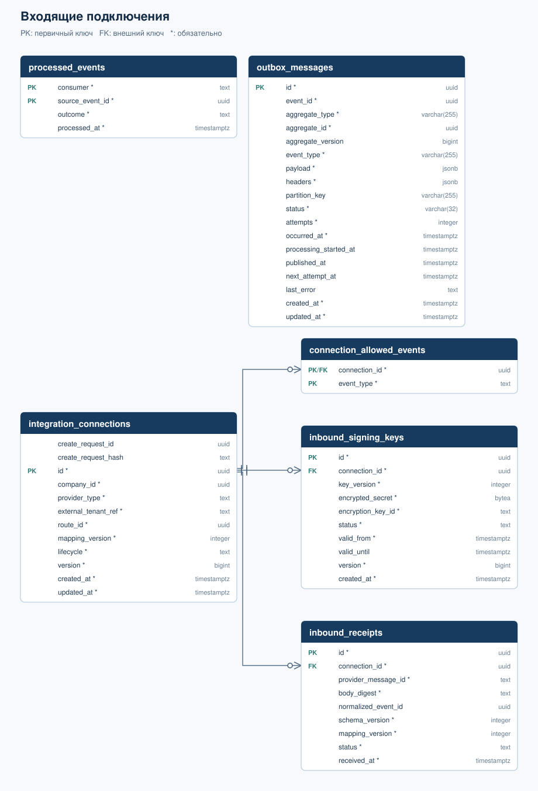
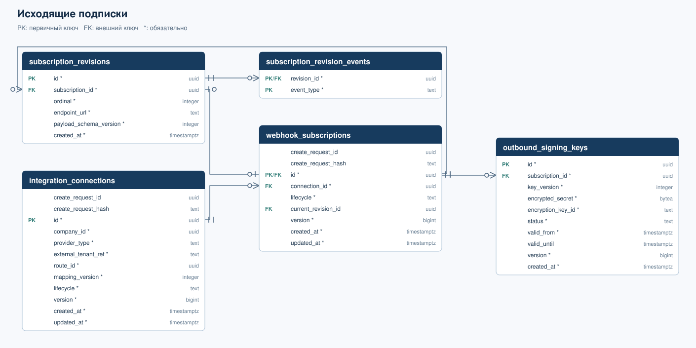
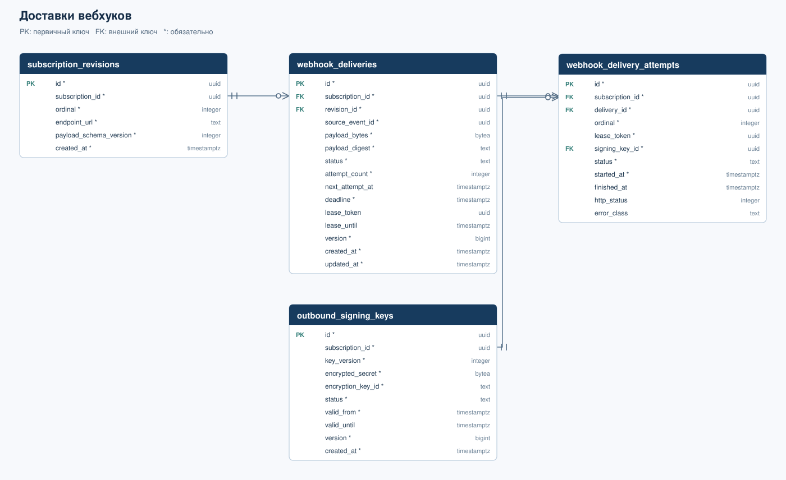

# База данных сервиса Integration

Источник: проектная [DBML-схема](../schema.dbml). Смысл сценариев и незакрытые решения — в [описании сервиса](../../../services/integration/index.md).

## ER-диаграмма

Таблицы показаны со всеми полями из DBML. PK — первичный ключ, FK — внешний ключ, звёздочка — обязательное поле. Связи обозначены нотацией «воронья лапка»: круг — необязательная связь, черта — один, лапка — многие. Линии подходят к строкам полей; для составного FK линия подходит к первому полю, а все поля перечислены ниже. Кратность выведена из FK, NOT NULL и уникальных ключей DBML; дополнительные SQL-ограничения смотрите в миграциях или проекте ограничений. Внешние идентификаторы других сервисов не соединены межбазовыми FK.

Схема разделена на части; общие таблицы повторяются там, где нужны для связей.

### Входящие подключения

[Открыть SVG: Входящие подключения](erd-connections.svg)

### Исходящие подписки

[Открыть SVG: Исходящие подписки](erd-subscriptions.svg)

### Доставки вебхуков

[Открыть SVG: Доставки вебхуков](erd-deliveries.svg)

## Перечень связей

| № | Родительская таблица и поля | Дочерняя таблица и FK | Удаление родителя |
|---|---|---|---|
| 1 | integration_connections (id) | connection_allowed_events (connection_id) | не указано |
| 2 | integration_connections (id) | inbound_signing_keys (connection_id) | не указано |
| 3 | integration_connections (id) | webhook_subscriptions (connection_id) | не указано |
| 4 | webhook_subscriptions (id) | subscription_revisions (subscription_id) | не указано |
| 5 | subscription_revisions (subscription_id, id) | webhook_subscriptions (id, current_revision_id) | не указано |
| 6 | subscription_revisions (id) | subscription_revision_events (revision_id) | не указано |
| 7 | webhook_subscriptions (id) | outbound_signing_keys (subscription_id) | не указано |
| 8 | integration_connections (id) | inbound_receipts (connection_id) | не указано |
| 9 | subscription_revisions (subscription_id, id) | webhook_deliveries (subscription_id, revision_id) | не указано |
| 10 | webhook_deliveries (subscription_id, id) | webhook_delivery_attempts (subscription_id, delivery_id) | не указано |
| 11 | outbound_signing_keys (subscription_id, id) | webhook_delivery_attempts (subscription_id, signing_key_id) | не указано |

## Таблицы и поля

Обязательность приведена по DBML: «да» означает `NOT NULL` или PK; «нет / не указано» не гарантирует отсутствие дополнительных SQL-ограничений. UNIQUE отдельно отмечен только для отдельного поля; составные ключи и индексы перечислены под таблицей. Пустое пояснение в исходной модели не дополняется вымышленными правилами.

### integration_connections

| Поле | Тип | Обязательно | Ключ / уникальность | По умолчанию | Пояснение |
|---|---|---|---|---|---|
| create_request_id | uuid | нет / не указано | UNIQUE | — | UUID операции создания; уникален в пределах этой таблицы |
| create_request_hash | text | нет / не указано | — | — | Хеш канонического запроса создания |
| id | uuid | да | PK | — | Идентификатор записи. |
| company_id | uuid | да | — | — | Внешний Company ID |
| provider_type | text | да | — | — | Тип внешнего провайдера. |
| external_tenant_ref | text | да | — | — | Идентификатор tenant у внешнего провайдера. |
| route_id | uuid | да | UNIQUE | — | Идентификатор связанного объекта; владелец и назначение определяются контекстом сервиса. |
| mapping_version | integer | да | — | — | Версия преобразования внешнего контракта. |
| lifecycle | text | да | — | — | Состояние жизненного цикла. |
| version | bigint | да | — | 1 | Версия для контроля конкурентных изменений. |
| created_at | timestamptz | да | — | — | Время создания. |
| updated_at | timestamptz | да | — | — | Время последнего изменения. |

Составные ключи и индексы DBML: `INDEX (company_id, lifecycle)`.

### connection_allowed_events

| Поле | Тип | Обязательно | Ключ / уникальность | По умолчанию | Пояснение |
|---|---|---|---|---|---|
| connection_id | uuid | да | PK, FK | — | Идентификатор связанного объекта; владелец и назначение определяются контекстом сервиса. |
| event_type | text | да | PK | — | Тип события. |

Составные ключи и индексы DBML: `PK (connection_id, event_type)`.

### inbound_signing_keys

| Поле | Тип | Обязательно | Ключ / уникальность | По умолчанию | Пояснение |
|---|---|---|---|---|---|
| id | uuid | да | PK | — | Идентификатор записи. |
| connection_id | uuid | да | FK | — | Идентификатор связанного объекта; владелец и назначение определяются контекстом сервиса. |
| key_version | integer | да | — | — | Версия ключа. |
| encrypted_secret | bytea | да | — | — | Зашифрованное секретное значение. |
| encryption_key_id | text | да | — | — | Идентификатор ключа шифрования. |
| status | text | да | — | — | Состояние записи; допустимые переходы описаны в проекте сервиса. |
| valid_from | timestamptz | да | — | — | Время начала действия. |
| valid_until | timestamptz | нет / не указано | — | — | Крайний срок действия. |
| version | bigint | да | — | 1 | Версия для контроля конкурентных изменений. |
| created_at | timestamptz | да | — | — | Время создания. |

Составные ключи и индексы DBML: `UNIQUE (connection_id, key_version)`.

### webhook_subscriptions

| Поле | Тип | Обязательно | Ключ / уникальность | По умолчанию | Пояснение |
|---|---|---|---|---|---|
| create_request_id | uuid | нет / не указано | UNIQUE | — | UUID операции создания; уникален в пределах этой таблицы |
| create_request_hash | text | нет / не указано | — | — | Хеш канонического запроса создания |
| id | uuid | да | PK, FK | — | Идентификатор записи. |
| connection_id | uuid | да | FK | — | Идентификатор связанного объекта; владелец и назначение определяются контекстом сервиса. |
| lifecycle | text | да | — | — | Состояние жизненного цикла. |
| current_revision_id | uuid | нет / не указано | FK | — | Текущая редакция этой подписки |
| version | bigint | да | — | 1 | Версия для контроля конкурентных изменений. |
| created_at | timestamptz | да | — | — | Время создания. |
| updated_at | timestamptz | да | — | — | Время последнего изменения. |

### subscription_revisions

| Поле | Тип | Обязательно | Ключ / уникальность | По умолчанию | Пояснение |
|---|---|---|---|---|---|
| id | uuid | да | PK | — | Идентификатор записи. |
| subscription_id | uuid | да | FK | — | Идентификатор связанного объекта; владелец и назначение определяются контекстом сервиса. |
| ordinal | integer | да | — | — | Порядковый номер внутри родительского контекста. |
| endpoint_url | text | да | — | — | Проверяется на каждом соединении; без secrets в URL |
| payload_schema_version | integer | да | — | — | Версия схемы содержимого. |
| created_at | timestamptz | да | — | — | Время создания. |

Составные ключи и индексы DBML: `UNIQUE (subscription_id, ordinal)`; `UNIQUE (subscription_id, id)`.

### subscription_revision_events

| Поле | Тип | Обязательно | Ключ / уникальность | По умолчанию | Пояснение |
|---|---|---|---|---|---|
| revision_id | uuid | да | PK, FK | — | Идентификатор связанного объекта; владелец и назначение определяются контекстом сервиса. |
| event_type | text | да | PK | — | Тип события. |

Составные ключи и индексы DBML: `PK (revision_id, event_type)`.

### outbound_signing_keys

| Поле | Тип | Обязательно | Ключ / уникальность | По умолчанию | Пояснение |
|---|---|---|---|---|---|
| id | uuid | да | PK | — | Идентификатор записи. |
| subscription_id | uuid | да | FK | — | Идентификатор связанного объекта; владелец и назначение определяются контекстом сервиса. |
| key_version | integer | да | — | — | Версия ключа. |
| encrypted_secret | bytea | да | — | — | Зашифрованное секретное значение. |
| encryption_key_id | text | да | — | — | Идентификатор ключа шифрования. |
| status | text | да | — | — | Состояние записи; допустимые переходы описаны в проекте сервиса. |
| valid_from | timestamptz | да | — | — | Время начала действия. |
| valid_until | timestamptz | нет / не указано | — | — | Крайний срок действия. |
| version | bigint | да | — | 1 | Версия для контроля конкурентных изменений. |
| created_at | timestamptz | да | — | — | Время создания. |

Составные ключи и индексы DBML: `UNIQUE (subscription_id, key_version)`; `UNIQUE (subscription_id, id)`.

### inbound_receipts

| Поле | Тип | Обязательно | Ключ / уникальность | По умолчанию | Пояснение |
|---|---|---|---|---|---|
| id | uuid | да | PK | — | Идентификатор записи. |
| connection_id | uuid | да | FK | — | Идентификатор связанного объекта; владелец и назначение определяются контекстом сервиса. |
| provider_message_id | text | да | — | — | Идентификатор связанного объекта; владелец и назначение определяются контекстом сервиса. |
| body_digest | text | да | — | — | Контрольный digest исходного тела. |
| normalized_event_id | uuid | нет / не указано | UNIQUE | — | Идентификатор связанного объекта; владелец и назначение определяются контекстом сервиса. |
| schema_version | integer | да | — | — | Версия схемы контракта. |
| mapping_version | integer | да | — | — | Версия преобразования внешнего контракта. |
| status | text | да | — | — | Состояние записи; допустимые переходы описаны в проекте сервиса. |
| received_at | timestamptz | да | — | — | Время приёма. |

Составные ключи и индексы DBML: `UNIQUE (connection_id, provider_message_id)`.

### processed_events

| Поле | Тип | Обязательно | Ключ / уникальность | По умолчанию | Пояснение |
|---|---|---|---|---|---|
| consumer | text | да | PK | — | Идентификатор потребителя события. |
| source_event_id | uuid | да | PK | — | Идентификатор связанного объекта; владелец и назначение определяются контекстом сервиса. |
| outcome | text | да | — | — | Результат обработки. |
| processed_at | timestamptz | да | — | — | Время соответствующего действия или состояния. |

Составные ключи и индексы DBML: `PK (consumer, source_event_id)`.

### webhook_deliveries

| Поле | Тип | Обязательно | Ключ / уникальность | По умолчанию | Пояснение |
|---|---|---|---|---|---|
| id | uuid | да | PK | — | Идентификатор записи. |
| subscription_id | uuid | да | FK | — | Идентификатор связанного объекта; владелец и назначение определяются контекстом сервиса. |
| revision_id | uuid | да | FK | — | Идентификатор связанного объекта; владелец и назначение определяются контекстом сервиса. |
| source_event_id | uuid | да | — | — | Идентификатор связанного объекта; владелец и назначение определяются контекстом сервиса. |
| payload_bytes | bytea | да | — | — | Неизменяемый подписываемый payload |
| payload_digest | text | да | — | — | Контрольный digest payload. |
| status | text | да | — | — | Состояние записи; допустимые переходы описаны в проекте сервиса. |
| attempt_count | integer | да | — | 0 | Число попыток. |
| next_attempt_at | timestamptz | нет / не указано | — | — | Время следующей попытки. |
| deadline | timestamptz | да | — | — | Крайний срок. |
| lease_token | uuid | нет / не указано | — | — | Токен захвата работы. |
| lease_until | timestamptz | нет / не указано | — | — | Окончание срока захвата. |
| version | bigint | да | — | 1 | Версия для контроля конкурентных изменений. |
| created_at | timestamptz | да | — | — | Время создания. |
| updated_at | timestamptz | да | — | — | Время последнего изменения. |

Составные ключи и индексы DBML: `UNIQUE (subscription_id, source_event_id)`; `UNIQUE (subscription_id, id)`; `INDEX (status, next_attempt_at)`.

### webhook_delivery_attempts

| Поле | Тип | Обязательно | Ключ / уникальность | По умолчанию | Пояснение |
|---|---|---|---|---|---|
| id | uuid | да | PK | — | Идентификатор записи. |
| subscription_id | uuid | да | FK | — | Идентификатор связанного объекта; владелец и назначение определяются контекстом сервиса. |
| delivery_id | uuid | да | FK | — | Идентификатор связанного объекта; владелец и назначение определяются контекстом сервиса. |
| ordinal | integer | да | — | — | Порядковый номер внутри родительского контекста. |
| lease_token | uuid | да | — | — | Токен захвата работы. |
| signing_key_id | uuid | да | FK | — | Идентификатор связанного объекта; владелец и назначение определяются контекстом сервиса. |
| status | text | да | — | — | Состояние записи; допустимые переходы описаны в проекте сервиса. |
| started_at | timestamptz | да | — | — | Время начала. |
| finished_at | timestamptz | нет / не указано | — | — | Время завершения. |
| http_status | integer | нет / не указано | — | — | HTTP-код ответа. |
| error_class | text | нет / не указано | — | — | Классификация ошибки. |

Составные ключи и индексы DBML: `UNIQUE (delivery_id, ordinal)`.

### outbox_messages

| Поле | Тип | Обязательно | Ключ / уникальность | По умолчанию | Пояснение |
|---|---|---|---|---|---|
| id | uuid | да | PK | — | Идентификатор записи. |
| event_id | uuid | да | UNIQUE | — | Идентификатор события. |
| aggregate_type | varchar(255) | да | — | — | Тип агрегата — источника события. |
| aggregate_id | uuid | да | — | — | Идентификатор связанного объекта; владелец и назначение определяются контекстом сервиса. |
| aggregate_version | bigint | нет / не указано | — | — | Версия агрегата — источника события. |
| event_type | varchar(255) | да | — | — | Тип события. |
| payload | jsonb | да | — | — | Содержимое события или операции. |
| headers | jsonb | да | — | {} | Заголовки события. |
| partition_key | varchar(255) | нет / не указано | — | — | Ключ распределения события. |
| status | varchar(32) | да | — | PENDING | Состояние записи; допустимые переходы описаны в проекте сервиса. |
| attempts | integer | да | — | 0 | Количество попыток. |
| occurred_at | timestamptz | да | — | — | Время события. |
| processing_started_at | timestamptz | нет / не указано | — | — | Время соответствующего действия или состояния. |
| published_at | timestamptz | нет / не указано | — | — | Время публикации. |
| next_attempt_at | timestamptz | нет / не указано | — | — | Время следующей попытки. |
| last_error | text | нет / не указано | — | — | Последняя зафиксированная ошибка. |
| created_at | timestamptz | да | — | — | Время создания. |
| updated_at | timestamptz | да | — | — | Время последнего изменения. |

Составные ключи и индексы DBML: `INDEX (aggregate_type, aggregate_id, aggregate_version)`.

