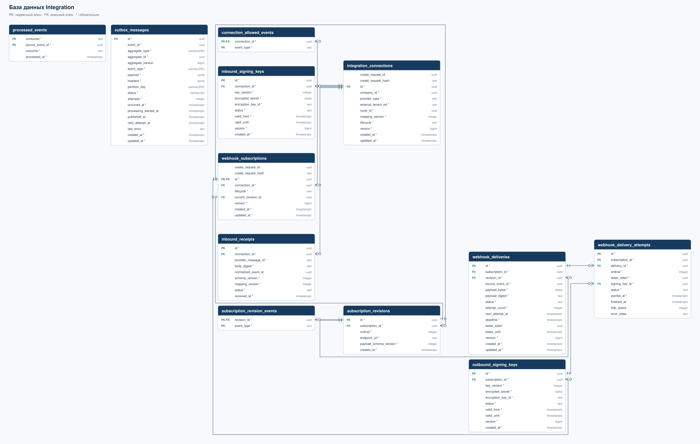

# База данных сервиса Integration

База данных Integration хранит подключения внешних систем, параметры подписок и сведения для проверки подлинности обмена. Она также содержит записи о входящих событиях, исходящих доставках и попытках отправки, обеспечивая учёт и повторную обработку взаимодействий.

## ER-диаграмма

Рисунок - Модель данных сервиса Integration

[Открыть SVG полностью](erd.svg)

## Сущности

Таблица - Сущности сервиса Integration

| Таблица | Псевдоним | Описание | Особенности |
|---|---|---|---|
| integration_connections | Интеграционное подключение | Подключение компании к внешнему провайдеру. | PK: id |
| inbound_signing_keys | Ключ входящей подписи | Версия секрета проверки входящих webhook. | PK: id |
| webhook_subscriptions | Подписка на webhook | Внешнее назначение событий и его состояние. | PK: id |
| subscription_revisions | Редакция подписки | Снимок адреса и типов событий исходящего webhook. | PK: id |
| outbound_signing_keys | Ключ исходящей подписи | Версия секрета подписи исходящих webhook. | PK: id |
| inbound_receipts | Принятый webhook | Сведения о приёме и результате обработки входящего сообщения. | PK: id |
| processed_events | Обработанное событие | Запись о результате обработки входящего события потребителем. | PK: consumer, source_event_id |
| webhook_deliveries | Доставка webhook | Зафиксированные payload и состояние доставки события. | PK: id |
| webhook_delivery_attempts | Попытка доставки webhook | Результат попытки доставки и использованный ключ. | PK: id |
| outbox_messages | Исходящее событие | Сообщение transactional outbox для последующей публикации. | PK: id |

## Связи

Таблица - Связи сущностей сервиса Integration

| Родительская сущность и ключ | Дочерняя сущность и FK | Дочерних записей на одну родительскую | Родительских записей на одну дочернюю | Комментарий |
|---|---|---|---|---|
| integration_connections (id) | inbound_signing_keys (connection_id) | 0..N | 1 | Безусловная уникальность FK не указана; ссылка обязательна. Удаление родителя: не задано. |
| integration_connections (id) | webhook_subscriptions (connection_id) | 0..N | 1 | Безусловная уникальность FK не указана; ссылка обязательна. Удаление родителя: не задано. |
| webhook_subscriptions (id) | subscription_revisions (subscription_id) | 0..N | 1 | Безусловная уникальность FK не указана; ссылка обязательна. Удаление родителя: не задано. |
| subscription_revisions (subscription_id, id) | webhook_subscriptions (id, current_revision_id) | 0..1 | 0..1 | Не более одной дочерней записи; ссылка может отсутствовать. Удаление родителя: не задано. |
| webhook_subscriptions (id) | outbound_signing_keys (subscription_id) | 0..N | 1 | Безусловная уникальность FK не указана; ссылка обязательна. Удаление родителя: не задано. |
| integration_connections (id) | inbound_receipts (connection_id) | 0..N | 1 | Безусловная уникальность FK не указана; ссылка обязательна. Удаление родителя: не задано. |
| subscription_revisions (subscription_id, id) | webhook_deliveries (subscription_id, revision_id) | 0..N | 1 | Безусловная уникальность FK не указана; ссылка обязательна. Удаление родителя: не задано. |
| webhook_deliveries (subscription_id, id) | webhook_delivery_attempts (subscription_id, delivery_id) | 0..N | 1 | Безусловная уникальность FK не указана; ссылка обязательна. Удаление родителя: не задано. |
| outbound_signing_keys (subscription_id, id) | webhook_delivery_attempts (subscription_id, signing_key_id) | 0..N | 1 | Безусловная уникальность FK не указана; ссылка обязательна. Удаление родителя: не задано. |

## Атрибуты

Таблица - Атрибуты сущностей сервиса Integration

<table><thead><tr><th>Сущность</th><th>Поле</th><th>Тип</th><th>Описание</th></tr></thead><tbody>
<tr><td class="attribute-name" rowspan="13">integration_connections</td><td class="attribute-name">create_request_id</td><td class="attribute-type">uuid</td><td class="attribute-description">Необязательно / не указано; UNIQUE; UUID операции создания; уникален в пределах этой таблицы</td></tr>
<tr><td class="attribute-name">create_request_hash</td><td class="attribute-type">text</td><td class="attribute-description">Необязательно / не указано; Хеш канонического запроса создания</td></tr>
<tr><td class="attribute-name">id</td><td class="attribute-type">uuid</td><td class="attribute-description">Обязательно; PK; Идентификатор записи.</td></tr>
<tr><td class="attribute-name">company_id</td><td class="attribute-type">uuid</td><td class="attribute-description">Обязательно; Внешний Company ID</td></tr>
<tr><td class="attribute-name">provider_type</td><td class="attribute-type">text</td><td class="attribute-description">Обязательно; Тип внешнего провайдера.</td></tr>
<tr><td class="attribute-name">external_tenant_ref</td><td class="attribute-type">text</td><td class="attribute-description">Обязательно; Идентификатор tenant у внешнего провайдера.</td></tr>
<tr><td class="attribute-name">allowed_events</td><td class="attribute-type">text[]</td><td class="attribute-description">Обязательно; По умолчанию: {}; Разрешённые типы входящих событий</td></tr>
<tr><td class="attribute-name">route_id</td><td class="attribute-type">uuid</td><td class="attribute-description">Обязательно; UNIQUE; Идентификатор связанного объекта; владелец и назначение определяются контекстом сервиса.</td></tr>
<tr><td class="attribute-name">mapping_version</td><td class="attribute-type">integer</td><td class="attribute-description">Обязательно; Версия преобразования внешнего контракта.</td></tr>
<tr><td class="attribute-name">lifecycle</td><td class="attribute-type">text</td><td class="attribute-description">Обязательно; Состояние жизненного цикла.</td></tr>
<tr><td class="attribute-name">version</td><td class="attribute-type">bigint</td><td class="attribute-description">Обязательно; По умолчанию: 1; Версия для контроля конкурентных изменений.</td></tr>
<tr><td class="attribute-name">created_at</td><td class="attribute-type">timestamptz</td><td class="attribute-description">Обязательно; Время создания.</td></tr>
<tr><td class="attribute-name">updated_at</td><td class="attribute-type">timestamptz</td><td class="attribute-description">Обязательно; Время последнего изменения.</td></tr>
<tr><td class="attribute-name" rowspan="10">inbound_signing_keys</td><td class="attribute-name">id</td><td class="attribute-type">uuid</td><td class="attribute-description">Обязательно; PK; Идентификатор записи.</td></tr>
<tr><td class="attribute-name">connection_id</td><td class="attribute-type">uuid</td><td class="attribute-description">Обязательно; FK; Идентификатор связанного объекта; владелец и назначение определяются контекстом сервиса.</td></tr>
<tr><td class="attribute-name">key_version</td><td class="attribute-type">integer</td><td class="attribute-description">Обязательно; Версия ключа.</td></tr>
<tr><td class="attribute-name">encrypted_secret</td><td class="attribute-type">bytea</td><td class="attribute-description">Обязательно; Зашифрованное секретное значение.</td></tr>
<tr><td class="attribute-name">encryption_key_id</td><td class="attribute-type">text</td><td class="attribute-description">Обязательно; Идентификатор ключа шифрования.</td></tr>
<tr><td class="attribute-name">status</td><td class="attribute-type">text</td><td class="attribute-description">Обязательно; Состояние записи; допустимые переходы описаны в проекте сервиса.</td></tr>
<tr><td class="attribute-name">valid_from</td><td class="attribute-type">timestamptz</td><td class="attribute-description">Обязательно; Время начала действия.</td></tr>
<tr><td class="attribute-name">valid_until</td><td class="attribute-type">timestamptz</td><td class="attribute-description">Необязательно / не указано; Крайний срок действия.</td></tr>
<tr><td class="attribute-name">version</td><td class="attribute-type">bigint</td><td class="attribute-description">Обязательно; По умолчанию: 1; Версия для контроля конкурентных изменений.</td></tr>
<tr><td class="attribute-name">created_at</td><td class="attribute-type">timestamptz</td><td class="attribute-description">Обязательно; Время создания.</td></tr>
<tr><td class="attribute-name" rowspan="9">webhook_subscriptions</td><td class="attribute-name">create_request_id</td><td class="attribute-type">uuid</td><td class="attribute-description">Необязательно / не указано; UNIQUE; UUID операции создания; уникален в пределах этой таблицы</td></tr>
<tr><td class="attribute-name">create_request_hash</td><td class="attribute-type">text</td><td class="attribute-description">Необязательно / не указано; Хеш канонического запроса создания</td></tr>
<tr><td class="attribute-name">id</td><td class="attribute-type">uuid</td><td class="attribute-description">Обязательно; PK, FK; Идентификатор записи.</td></tr>
<tr><td class="attribute-name">connection_id</td><td class="attribute-type">uuid</td><td class="attribute-description">Обязательно; FK; Идентификатор связанного объекта; владелец и назначение определяются контекстом сервиса.</td></tr>
<tr><td class="attribute-name">lifecycle</td><td class="attribute-type">text</td><td class="attribute-description">Обязательно; Состояние жизненного цикла.</td></tr>
<tr><td class="attribute-name">current_revision_id</td><td class="attribute-type">uuid</td><td class="attribute-description">Необязательно / не указано; FK; Текущая редакция этой подписки</td></tr>
<tr><td class="attribute-name">version</td><td class="attribute-type">bigint</td><td class="attribute-description">Обязательно; По умолчанию: 1; Версия для контроля конкурентных изменений.</td></tr>
<tr><td class="attribute-name">created_at</td><td class="attribute-type">timestamptz</td><td class="attribute-description">Обязательно; Время создания.</td></tr>
<tr><td class="attribute-name">updated_at</td><td class="attribute-type">timestamptz</td><td class="attribute-description">Обязательно; Время последнего изменения.</td></tr>
<tr><td class="attribute-name" rowspan="7">subscription_revisions</td><td class="attribute-name">id</td><td class="attribute-type">uuid</td><td class="attribute-description">Обязательно; PK; Идентификатор записи.</td></tr>
<tr><td class="attribute-name">subscription_id</td><td class="attribute-type">uuid</td><td class="attribute-description">Обязательно; FK; Идентификатор связанного объекта; владелец и назначение определяются контекстом сервиса.</td></tr>
<tr><td class="attribute-name">ordinal</td><td class="attribute-type">integer</td><td class="attribute-description">Обязательно; Порядковый номер внутри родительского контекста.</td></tr>
<tr><td class="attribute-name">endpoint_url</td><td class="attribute-type">text</td><td class="attribute-description">Обязательно; Проверяется на каждом соединении; без secrets в URL</td></tr>
<tr><td class="attribute-name">payload_schema_version</td><td class="attribute-type">integer</td><td class="attribute-description">Обязательно; Версия схемы содержимого.</td></tr>
<tr><td class="attribute-name">event_types</td><td class="attribute-type">text[]</td><td class="attribute-description">Обязательно; По умолчанию: {}; Типы исходящих событий редакции подписки</td></tr>
<tr><td class="attribute-name">created_at</td><td class="attribute-type">timestamptz</td><td class="attribute-description">Обязательно; Время создания.</td></tr>
<tr><td class="attribute-name" rowspan="10">outbound_signing_keys</td><td class="attribute-name">id</td><td class="attribute-type">uuid</td><td class="attribute-description">Обязательно; PK; Идентификатор записи.</td></tr>
<tr><td class="attribute-name">subscription_id</td><td class="attribute-type">uuid</td><td class="attribute-description">Обязательно; FK; Идентификатор связанного объекта; владелец и назначение определяются контекстом сервиса.</td></tr>
<tr><td class="attribute-name">key_version</td><td class="attribute-type">integer</td><td class="attribute-description">Обязательно; Версия ключа.</td></tr>
<tr><td class="attribute-name">encrypted_secret</td><td class="attribute-type">bytea</td><td class="attribute-description">Обязательно; Зашифрованное секретное значение.</td></tr>
<tr><td class="attribute-name">encryption_key_id</td><td class="attribute-type">text</td><td class="attribute-description">Обязательно; Идентификатор ключа шифрования.</td></tr>
<tr><td class="attribute-name">status</td><td class="attribute-type">text</td><td class="attribute-description">Обязательно; Состояние записи; допустимые переходы описаны в проекте сервиса.</td></tr>
<tr><td class="attribute-name">valid_from</td><td class="attribute-type">timestamptz</td><td class="attribute-description">Обязательно; Время начала действия.</td></tr>
<tr><td class="attribute-name">valid_until</td><td class="attribute-type">timestamptz</td><td class="attribute-description">Необязательно / не указано; Крайний срок действия.</td></tr>
<tr><td class="attribute-name">version</td><td class="attribute-type">bigint</td><td class="attribute-description">Обязательно; По умолчанию: 1; Версия для контроля конкурентных изменений.</td></tr>
<tr><td class="attribute-name">created_at</td><td class="attribute-type">timestamptz</td><td class="attribute-description">Обязательно; Время создания.</td></tr>
<tr><td class="attribute-name" rowspan="9">inbound_receipts</td><td class="attribute-name">id</td><td class="attribute-type">uuid</td><td class="attribute-description">Обязательно; PK; Идентификатор записи.</td></tr>
<tr><td class="attribute-name">connection_id</td><td class="attribute-type">uuid</td><td class="attribute-description">Обязательно; FK; Идентификатор связанного объекта; владелец и назначение определяются контекстом сервиса.</td></tr>
<tr><td class="attribute-name">provider_message_id</td><td class="attribute-type">text</td><td class="attribute-description">Обязательно; Идентификатор связанного объекта; владелец и назначение определяются контекстом сервиса.</td></tr>
<tr><td class="attribute-name">body_digest</td><td class="attribute-type">text</td><td class="attribute-description">Обязательно; Контрольный digest исходного тела.</td></tr>
<tr><td class="attribute-name">normalized_event_id</td><td class="attribute-type">uuid</td><td class="attribute-description">Необязательно / не указано; UNIQUE; Идентификатор связанного объекта; владелец и назначение определяются контекстом сервиса.</td></tr>
<tr><td class="attribute-name">schema_version</td><td class="attribute-type">integer</td><td class="attribute-description">Обязательно; Версия схемы контракта.</td></tr>
<tr><td class="attribute-name">mapping_version</td><td class="attribute-type">integer</td><td class="attribute-description">Обязательно; Версия преобразования внешнего контракта.</td></tr>
<tr><td class="attribute-name">status</td><td class="attribute-type">text</td><td class="attribute-description">Обязательно; Состояние записи; допустимые переходы описаны в проекте сервиса.</td></tr>
<tr><td class="attribute-name">received_at</td><td class="attribute-type">timestamptz</td><td class="attribute-description">Обязательно; Время приёма.</td></tr>
<tr><td class="attribute-name" rowspan="4">processed_events</td><td class="attribute-name">consumer</td><td class="attribute-type">text</td><td class="attribute-description">Обязательно; PK; Идентификатор потребителя события.</td></tr>
<tr><td class="attribute-name">source_event_id</td><td class="attribute-type">uuid</td><td class="attribute-description">Обязательно; PK; Идентификатор связанного объекта; владелец и назначение определяются контекстом сервиса.</td></tr>
<tr><td class="attribute-name">outcome</td><td class="attribute-type">text</td><td class="attribute-description">Обязательно; Результат обработки.</td></tr>
<tr><td class="attribute-name">processed_at</td><td class="attribute-type">timestamptz</td><td class="attribute-description">Обязательно; Время соответствующего действия или состояния.</td></tr>
<tr><td class="attribute-name" rowspan="15">webhook_deliveries</td><td class="attribute-name">id</td><td class="attribute-type">uuid</td><td class="attribute-description">Обязательно; PK; Идентификатор записи.</td></tr>
<tr><td class="attribute-name">subscription_id</td><td class="attribute-type">uuid</td><td class="attribute-description">Обязательно; FK; Идентификатор связанного объекта; владелец и назначение определяются контекстом сервиса.</td></tr>
<tr><td class="attribute-name">revision_id</td><td class="attribute-type">uuid</td><td class="attribute-description">Обязательно; FK; Идентификатор связанного объекта; владелец и назначение определяются контекстом сервиса.</td></tr>
<tr><td class="attribute-name">source_event_id</td><td class="attribute-type">uuid</td><td class="attribute-description">Обязательно; Идентификатор связанного объекта; владелец и назначение определяются контекстом сервиса.</td></tr>
<tr><td class="attribute-name">payload_bytes</td><td class="attribute-type">bytea</td><td class="attribute-description">Обязательно; Неизменяемый подписываемый payload</td></tr>
<tr><td class="attribute-name">payload_digest</td><td class="attribute-type">text</td><td class="attribute-description">Обязательно; Контрольный digest payload.</td></tr>
<tr><td class="attribute-name">status</td><td class="attribute-type">text</td><td class="attribute-description">Обязательно; Состояние записи; допустимые переходы описаны в проекте сервиса.</td></tr>
<tr><td class="attribute-name">attempt_count</td><td class="attribute-type">integer</td><td class="attribute-description">Обязательно; По умолчанию: 0; Число попыток.</td></tr>
<tr><td class="attribute-name">next_attempt_at</td><td class="attribute-type">timestamptz</td><td class="attribute-description">Необязательно / не указано; Время следующей попытки.</td></tr>
<tr><td class="attribute-name">deadline</td><td class="attribute-type">timestamptz</td><td class="attribute-description">Обязательно; Крайний срок.</td></tr>
<tr><td class="attribute-name">lease_token</td><td class="attribute-type">uuid</td><td class="attribute-description">Необязательно / не указано; Токен захвата работы.</td></tr>
<tr><td class="attribute-name">lease_until</td><td class="attribute-type">timestamptz</td><td class="attribute-description">Необязательно / не указано; Окончание срока захвата.</td></tr>
<tr><td class="attribute-name">version</td><td class="attribute-type">bigint</td><td class="attribute-description">Обязательно; По умолчанию: 1; Версия для контроля конкурентных изменений.</td></tr>
<tr><td class="attribute-name">created_at</td><td class="attribute-type">timestamptz</td><td class="attribute-description">Обязательно; Время создания.</td></tr>
<tr><td class="attribute-name">updated_at</td><td class="attribute-type">timestamptz</td><td class="attribute-description">Обязательно; Время последнего изменения.</td></tr>
<tr><td class="attribute-name" rowspan="11">webhook_delivery_attempts</td><td class="attribute-name">id</td><td class="attribute-type">uuid</td><td class="attribute-description">Обязательно; PK; Идентификатор записи.</td></tr>
<tr><td class="attribute-name">subscription_id</td><td class="attribute-type">uuid</td><td class="attribute-description">Обязательно; FK; Идентификатор связанного объекта; владелец и назначение определяются контекстом сервиса.</td></tr>
<tr><td class="attribute-name">delivery_id</td><td class="attribute-type">uuid</td><td class="attribute-description">Обязательно; FK; Идентификатор связанного объекта; владелец и назначение определяются контекстом сервиса.</td></tr>
<tr><td class="attribute-name">ordinal</td><td class="attribute-type">integer</td><td class="attribute-description">Обязательно; Порядковый номер внутри родительского контекста.</td></tr>
<tr><td class="attribute-name">lease_token</td><td class="attribute-type">uuid</td><td class="attribute-description">Обязательно; Токен захвата работы.</td></tr>
<tr><td class="attribute-name">signing_key_id</td><td class="attribute-type">uuid</td><td class="attribute-description">Обязательно; FK; Идентификатор связанного объекта; владелец и назначение определяются контекстом сервиса.</td></tr>
<tr><td class="attribute-name">status</td><td class="attribute-type">text</td><td class="attribute-description">Обязательно; Состояние записи; допустимые переходы описаны в проекте сервиса.</td></tr>
<tr><td class="attribute-name">started_at</td><td class="attribute-type">timestamptz</td><td class="attribute-description">Обязательно; Время начала.</td></tr>
<tr><td class="attribute-name">finished_at</td><td class="attribute-type">timestamptz</td><td class="attribute-description">Необязательно / не указано; Время завершения.</td></tr>
<tr><td class="attribute-name">http_status</td><td class="attribute-type">integer</td><td class="attribute-description">Необязательно / не указано; HTTP-код ответа.</td></tr>
<tr><td class="attribute-name">error_class</td><td class="attribute-type">text</td><td class="attribute-description">Необязательно / не указано; Классификация ошибки.</td></tr>
<tr><td class="attribute-name" rowspan="18">outbox_messages</td><td class="attribute-name">id</td><td class="attribute-type">uuid</td><td class="attribute-description">Обязательно; PK; Идентификатор записи.</td></tr>
<tr><td class="attribute-name">event_id</td><td class="attribute-type">uuid</td><td class="attribute-description">Обязательно; UNIQUE; Идентификатор события.</td></tr>
<tr><td class="attribute-name">aggregate_type</td><td class="attribute-type">varchar(255)</td><td class="attribute-description">Обязательно; Тип агрегата — источника события.</td></tr>
<tr><td class="attribute-name">aggregate_id</td><td class="attribute-type">uuid</td><td class="attribute-description">Обязательно; Идентификатор связанного объекта; владелец и назначение определяются контекстом сервиса.</td></tr>
<tr><td class="attribute-name">aggregate_version</td><td class="attribute-type">bigint</td><td class="attribute-description">Необязательно / не указано; Версия агрегата — источника события.</td></tr>
<tr><td class="attribute-name">event_type</td><td class="attribute-type">varchar(255)</td><td class="attribute-description">Обязательно; Тип события.</td></tr>
<tr><td class="attribute-name">payload</td><td class="attribute-type">jsonb</td><td class="attribute-description">Обязательно; Содержимое события или операции.</td></tr>
<tr><td class="attribute-name">headers</td><td class="attribute-type">jsonb</td><td class="attribute-description">Обязательно; По умолчанию: {}; Заголовки события.</td></tr>
<tr><td class="attribute-name">partition_key</td><td class="attribute-type">varchar(255)</td><td class="attribute-description">Необязательно / не указано; Ключ распределения события.</td></tr>
<tr><td class="attribute-name">status</td><td class="attribute-type">varchar(32)</td><td class="attribute-description">Обязательно; По умолчанию: PENDING; Состояние записи; допустимые переходы описаны в проекте сервиса.</td></tr>
<tr><td class="attribute-name">attempts</td><td class="attribute-type">integer</td><td class="attribute-description">Обязательно; По умолчанию: 0; Количество попыток.</td></tr>
<tr><td class="attribute-name">occurred_at</td><td class="attribute-type">timestamptz</td><td class="attribute-description">Обязательно; Время события.</td></tr>
<tr><td class="attribute-name">processing_started_at</td><td class="attribute-type">timestamptz</td><td class="attribute-description">Необязательно / не указано; Время соответствующего действия или состояния.</td></tr>
<tr><td class="attribute-name">published_at</td><td class="attribute-type">timestamptz</td><td class="attribute-description">Необязательно / не указано; Время публикации.</td></tr>
<tr><td class="attribute-name">next_attempt_at</td><td class="attribute-type">timestamptz</td><td class="attribute-description">Необязательно / не указано; Время следующей попытки.</td></tr>
<tr><td class="attribute-name">last_error</td><td class="attribute-type">text</td><td class="attribute-description">Необязательно / не указано; Последняя зафиксированная ошибка.</td></tr>
<tr><td class="attribute-name">created_at</td><td class="attribute-type">timestamptz</td><td class="attribute-description">Обязательно; Время создания.</td></tr>
<tr><td class="attribute-name">updated_at</td><td class="attribute-type">timestamptz</td><td class="attribute-description">Обязательно; Время последнего изменения.</td></tr>
</tbody></table>

## Ограничения данных

- Версии подключения, схемы, подписки и ключей положительны. Срок окончания действия ключа, если задан, следует за началом.
- Для принятого входящего события обязателен идентификатор нормализованного события.
- Срок доставки webhook заканчивается после создания; для выполняющейся доставки обязательны данные временного захвата. HTTP-статус попытки, если указан, находится в диапазоне от 100 до 599.

- Исходящая доставка webhook использует редакцию своей подписки; для попытки нельзя использовать ключ другой подписки.

