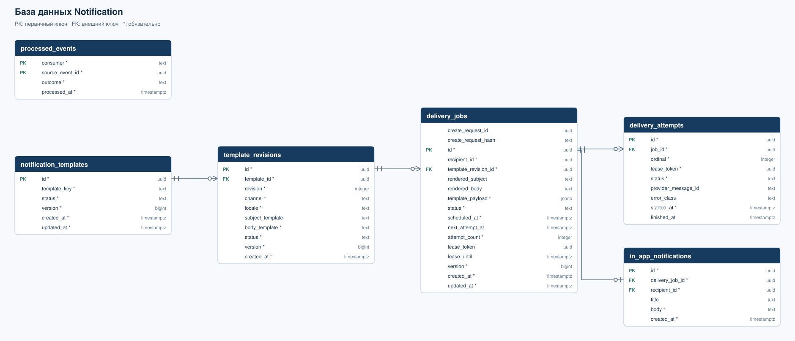

# База данных сервиса Notification

Источник: проектная [DBML-схема](../schema.dbml). Смысл сценариев и незакрытые решения — в [описании сервиса](../../../services/notification/index.md).

## ER-диаграмма

Таблицы показаны со всеми полями из DBML. PK — первичный ключ, FK — внешний ключ, звёздочка — обязательное поле. Связи обозначены нотацией «воронья лапка»: круг — необязательная связь, черта — один, лапка — многие. Линии подходят к строкам полей; для составного FK линия подходит к первому полю, а все поля перечислены ниже. Кратность выведена из FK, NOT NULL и уникальных ключей DBML; дополнительные SQL-ограничения смотрите в миграциях или проекте ограничений. Внешние идентификаторы других сервисов не соединены межбазовыми FK.

[Открыть SVG полностью](erd.svg)

## Перечень связей

| № | Родительская таблица и поля | Дочерняя таблица и FK | Удаление родителя |
|---|---|---|---|
| 1 | notification_templates (id) | template_revisions (template_id) | не указано |
| 2 | template_revisions (id) | delivery_jobs (template_revision_id) | не указано |
| 3 | delivery_jobs (id) | delivery_attempts (job_id) | не указано |
| 4 | delivery_jobs (id, recipient_id) | in_app_notifications (delivery_job_id, recipient_id) | не указано |

## Таблицы и поля

Обязательность приведена по DBML: «да» означает `NOT NULL` или PK; «нет / не указано» не гарантирует отсутствие дополнительных SQL-ограничений. UNIQUE отдельно отмечен только для отдельного поля; составные ключи и индексы перечислены под таблицей. Пустое пояснение в исходной модели не дополняется вымышленными правилами.

### notification_templates

| Поле | Тип | Обязательно | Ключ / уникальность | По умолчанию | Пояснение |
|---|---|---|---|---|---|
| id | uuid | да | PK | — | Идентификатор записи. |
| template_key | text | да | UNIQUE | — | Стабильный ключ шаблона. |
| status | text | да | — | — | Состояние записи; допустимые переходы описаны в проекте сервиса. |
| version | bigint | да | — | 1 | Версия для контроля конкурентных изменений. |
| created_at | timestamptz | да | — | — | Время создания. |
| updated_at | timestamptz | да | — | — | Время последнего изменения. |

### template_revisions

| Поле | Тип | Обязательно | Ключ / уникальность | По умолчанию | Пояснение |
|---|---|---|---|---|---|
| id | uuid | да | PK | — | Идентификатор записи. |
| template_id | uuid | да | FK | — | Идентификатор связанного объекта; владелец и назначение определяются контекстом сервиса. |
| revision | integer | да | — | — | Номер редакции. |
| channel | text | да | — | — | Канал доставки. |
| locale | text | да | — | — | Локаль представления. |
| subject_template | text | нет / не указано | — | — | Шаблон темы. |
| body_template | text | да | — | — | Шаблон текста. |
| status | text | да | — | — | Опубликованная редакция неизменяема |
| version | bigint | да | — | 1 | Версия для контроля конкурентных изменений. |
| created_at | timestamptz | да | — | — | Время создания. |

Составные ключи и индексы DBML: `UNIQUE (template_id, channel, locale, revision)`.

### delivery_jobs

Одна задача одному получателю и одному каналу; канал определяется неизменяемой редакцией.

| Поле | Тип | Обязательно | Ключ / уникальность | По умолчанию | Пояснение |
|---|---|---|---|---|---|
| create_request_id | uuid | нет / не указано | UNIQUE | — | UUID операции создания; уникален в пределах этой таблицы |
| create_request_hash | text | нет / не указано | — | — | Хеш канонического запроса создания |
| id | uuid | да | PK | — | Идентификатор записи. |
| recipient_id | uuid | да | — | — | Внешний Identity ID |
| template_revision_id | uuid | да | FK | — | Идентификатор связанного объекта; владелец и назначение определяются контекстом сервиса. |
| rendered_subject | text | нет / не указано | — | — | Фиксируется перед первой отправкой; содержит чувствительные данные |
| rendered_body | text | нет / не указано | — | — | Фиксируется перед первой отправкой; повтор использует тот же снимок |
| template_payload | jsonb | да | — | — | Данные рендеринга; минимум персональных данных |
| status | text | да | — | — | Состояние записи; допустимые переходы описаны в проекте сервиса. |
| scheduled_at | timestamptz | да | — | — | Время соответствующего действия или состояния. |
| next_attempt_at | timestamptz | нет / не указано | — | — | Время следующей попытки. |
| attempt_count | integer | да | — | 0 | Число попыток. |
| lease_token | uuid | нет / не указано | — | — | Токен захвата работы. |
| lease_until | timestamptz | нет / не указано | — | — | Окончание срока захвата. |
| version | bigint | да | — | 1 | Версия для контроля конкурентных изменений. |
| created_at | timestamptz | да | — | — | Время создания. |
| updated_at | timestamptz | да | — | — | Время последнего изменения. |

Составные ключи и индексы DBML: `UNIQUE (id, recipient_id)`; `INDEX (status, next_attempt_at)`; `INDEX (status, scheduled_at)`.

### delivery_attempts

| Поле | Тип | Обязательно | Ключ / уникальность | По умолчанию | Пояснение |
|---|---|---|---|---|---|
| id | uuid | да | PK | — | Идентификатор записи. |
| job_id | uuid | да | FK | — | Идентификатор связанного объекта; владелец и назначение определяются контекстом сервиса. |
| ordinal | integer | да | — | — | Порядковый номер внутри родительского контекста. |
| lease_token | uuid | да | — | — | Токен захвата работы. |
| status | text | да | — | — | Состояние записи; допустимые переходы описаны в проекте сервиса. |
| provider_message_id | text | нет / не указано | — | — | Идентификатор связанного объекта; владелец и назначение определяются контекстом сервиса. |
| error_class | text | нет / не указано | — | — | Классификация ошибки. |
| started_at | timestamptz | да | — | — | Время начала. |
| finished_at | timestamptz | нет / не указано | — | — | Время завершения. |

Составные ключи и индексы DBML: `UNIQUE (job_id, ordinal)`.

### in_app_notifications

Снимок показанного сообщения; получатель согласован с job составным FK.

| Поле | Тип | Обязательно | Ключ / уникальность | По умолчанию | Пояснение |
|---|---|---|---|---|---|
| id | uuid | да | PK | — | Идентификатор записи. |
| delivery_job_id | uuid | да | FK, UNIQUE | — | Идентификатор связанного объекта; владелец и назначение определяются контекстом сервиса. |
| recipient_id | uuid | да | FK | — | Внешний Identity ID |
| title | text | нет / не указано | — | — | Название. |
| body | text | да | — | — | Текст содержимого. |
| created_at | timestamptz | да | — | — | Время создания. |

Составные ключи и индексы DBML: `INDEX (recipient_id, created_at, id)`.

### processed_events

Сохраняется атомарно с полным набором задач для одного входного события.

| Поле | Тип | Обязательно | Ключ / уникальность | По умолчанию | Пояснение |
|---|---|---|---|---|---|
| consumer | text | да | PK | — | Идентификатор потребителя события. |
| source_event_id | uuid | да | PK | — | Идентификатор связанного объекта; владелец и назначение определяются контекстом сервиса. |
| outcome | text | да | — | — | Результат обработки. |
| processed_at | timestamptz | да | — | — | Время соответствующего действия или состояния. |

Составные ключи и индексы DBML: `PK (consumer, source_event_id)`.

