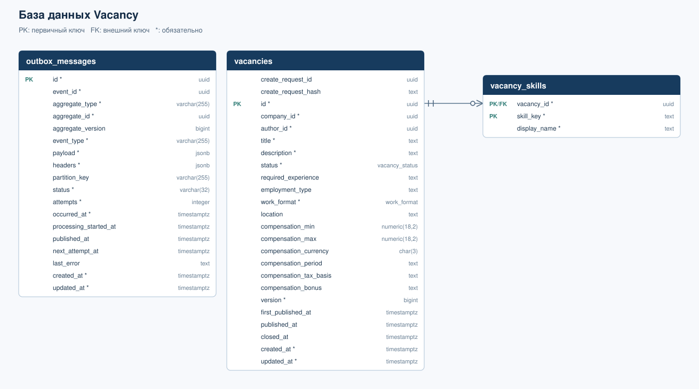

# База данных сервиса Vacancy

База данных Vacancy предназначена для хранения вакансий компаний, условий работы, требований к кандидатам и связанных навыков. В модели отражаются состояние вакансии, публикация и закрытие, а также сведения, необходимые для поиска и просмотра предложений.

## ER-диаграмма

Рисунок - Модель данных сервиса Vacancy

[Открыть SVG полностью](erd.svg)

## Сущности

Таблица - Сущности сервиса Vacancy

| Таблица | Псевдоним | Описание | Особенности |
|---|---|---|---|
| vacancies | Вакансия | Содержание вакансии, условия и состояние публикации. | PK: id |
| vacancy_skills | Навык вакансии | Ключ и отображаемое название требуемого навыка. | PK: vacancy_id, skill_key |
| outbox_messages | Исходящее событие | Сообщение transactional outbox для последующей публикации. | PK: id |

## Связи

Таблица - Связи сущностей сервиса Vacancy

| Родительская сущность и ключ | Дочерняя сущность и FK | Дочерних записей на одну родительскую | Родительских записей на одну дочернюю | Комментарий |
|---|---|---|---|---|
| vacancies (id) | vacancy_skills (vacancy_id) | 0..N | 1 | Безусловная уникальность FK не указана; ссылка обязательна. Удаление родителя: не задано. |

## Атрибуты

Таблица - Атрибуты сущностей сервиса Vacancy

<table><thead><tr><th>Сущность</th><th>Поле</th><th>Тип</th><th>Описание</th></tr></thead><tbody>
<tr><td class="attribute-name" rowspan="24">vacancies</td><td class="attribute-name">create_request_id</td><td class="attribute-type">uuid</td><td class="attribute-description">Необязательно / не указано; UNIQUE; UUID операции создания; уникален в пределах этой таблицы</td></tr>
<tr><td class="attribute-name">create_request_hash</td><td class="attribute-type">text</td><td class="attribute-description">Необязательно / не указано; Хеш канонического запроса создания</td></tr>
<tr><td class="attribute-name">id</td><td class="attribute-type">uuid</td><td class="attribute-description">Обязательно; PK; Идентификатор записи.</td></tr>
<tr><td class="attribute-name">company_id</td><td class="attribute-type">uuid</td><td class="attribute-description">Обязательно; Внешний ID Company Service, не FK</td></tr>
<tr><td class="attribute-name">author_id</td><td class="attribute-type">uuid</td><td class="attribute-description">Обязательно; Внешний ID Identity, устанавливается из доверенного контекста</td></tr>
<tr><td class="attribute-name">title</td><td class="attribute-type">text</td><td class="attribute-description">Обязательно; Название.</td></tr>
<tr><td class="attribute-name">description</td><td class="attribute-type">text</td><td class="attribute-description">Обязательно; Описание.</td></tr>
<tr><td class="attribute-name">status</td><td class="attribute-type">vacancy_status</td><td class="attribute-description">Обязательно; По умолчанию: DRAFT; Состояние записи; допустимые переходы описаны в проекте сервиса.</td></tr>
<tr><td class="attribute-name">required_experience</td><td class="attribute-type">text</td><td class="attribute-description">Необязательно / не указано; Требуемый опыт.</td></tr>
<tr><td class="attribute-name">employment_type</td><td class="attribute-type">text</td><td class="attribute-description">Необязательно / не указано; Тип занятости.</td></tr>
<tr><td class="attribute-name">work_format</td><td class="attribute-type">work_format</td><td class="attribute-description">Обязательно; Формат работы.</td></tr>
<tr><td class="attribute-name">location</td><td class="attribute-type">text</td><td class="attribute-description">Необязательно / не указано; Местоположение.</td></tr>
<tr><td class="attribute-name">compensation_min</td><td class="attribute-type">numeric(18,2)</td><td class="attribute-description">Необязательно / не указано; Нижняя граница компенсации.</td></tr>
<tr><td class="attribute-name">compensation_max</td><td class="attribute-type">numeric(18,2)</td><td class="attribute-description">Необязательно / не указано; Верхняя граница компенсации.</td></tr>
<tr><td class="attribute-name">compensation_currency</td><td class="attribute-type">char(3)</td><td class="attribute-description">Необязательно / не указано; Валюта компенсации.</td></tr>
<tr><td class="attribute-name">compensation_period</td><td class="attribute-type">text</td><td class="attribute-description">Необязательно / не указано; Период компенсации.</td></tr>
<tr><td class="attribute-name">compensation_tax_basis</td><td class="attribute-type">text</td><td class="attribute-description">Необязательно / не указано; GROSS или NET, если указано</td></tr>
<tr><td class="attribute-name">compensation_bonus</td><td class="attribute-type">text</td><td class="attribute-description">Необязательно / не указано; Описание бонусной части компенсации.</td></tr>
<tr><td class="attribute-name">version</td><td class="attribute-type">bigint</td><td class="attribute-description">Обязательно; По умолчанию: 1; Версия для контроля конкурентных изменений.</td></tr>
<tr><td class="attribute-name">first_published_at</td><td class="attribute-type">timestamptz</td><td class="attribute-description">Необязательно / не указано; Время соответствующего действия или состояния.</td></tr>
<tr><td class="attribute-name">published_at</td><td class="attribute-type">timestamptz</td><td class="attribute-description">Необязательно / не указано; Время последней публикации или восстановления</td></tr>
<tr><td class="attribute-name">closed_at</td><td class="attribute-type">timestamptz</td><td class="attribute-description">Необязательно / не указано; Время соответствующего действия или состояния.</td></tr>
<tr><td class="attribute-name">created_at</td><td class="attribute-type">timestamptz</td><td class="attribute-description">Обязательно; Время создания.</td></tr>
<tr><td class="attribute-name">updated_at</td><td class="attribute-type">timestamptz</td><td class="attribute-description">Обязательно; Время последнего изменения.</td></tr>
<tr><td class="attribute-name" rowspan="3">vacancy_skills</td><td class="attribute-name">vacancy_id</td><td class="attribute-type">uuid</td><td class="attribute-description">Обязательно; PK, FK; Идентификатор связанного объекта; владелец и назначение определяются контекстом сервиса.</td></tr>
<tr><td class="attribute-name">skill_key</td><td class="attribute-type">text</td><td class="attribute-description">Обязательно; PK; Нормализованный ключ навыка.</td></tr>
<tr><td class="attribute-name">display_name</td><td class="attribute-type">text</td><td class="attribute-description">Обязательно; Имя для отображения.</td></tr>
<tr><td class="attribute-name" rowspan="18">outbox_messages</td><td class="attribute-name">id</td><td class="attribute-type">uuid</td><td class="attribute-description">Обязательно; PK; Идентификатор записи.</td></tr>
<tr><td class="attribute-name">event_id</td><td class="attribute-type">uuid</td><td class="attribute-description">Обязательно; UNIQUE; Идентификатор события.</td></tr>
<tr><td class="attribute-name">aggregate_type</td><td class="attribute-type">varchar(255)</td><td class="attribute-description">Обязательно; Тип агрегата — источника события.</td></tr>
<tr><td class="attribute-name">aggregate_id</td><td class="attribute-type">uuid</td><td class="attribute-description">Обязательно; Идентификатор связанного объекта; владелец и назначение определяются контекстом сервиса.</td></tr>
<tr><td class="attribute-name">aggregate_version</td><td class="attribute-type">bigint</td><td class="attribute-description">Необязательно / не указано; Версия агрегата — источника события.</td></tr>
<tr><td class="attribute-name">event_type</td><td class="attribute-type">varchar(255)</td><td class="attribute-description">Обязательно; Тип события.</td></tr>
<tr><td class="attribute-name">payload</td><td class="attribute-type">jsonb</td><td class="attribute-description">Обязательно; Содержимое события или операции.</td></tr>
<tr><td class="attribute-name">headers</td><td class="attribute-type">jsonb</td><td class="attribute-description">Обязательно; По умолчанию: {}; Заголовки события.</td></tr>
<tr><td class="attribute-name">partition_key</td><td class="attribute-type">varchar(255)</td><td class="attribute-description">Необязательно / не указано; Ключ распределения события.</td></tr>
<tr><td class="attribute-name">status</td><td class="attribute-type">varchar(32)</td><td class="attribute-description">Обязательно; По умолчанию: PENDING; Состояние записи; допустимые переходы описаны в проекте сервиса.</td></tr>
<tr><td class="attribute-name">attempts</td><td class="attribute-type">integer</td><td class="attribute-description">Обязательно; По умолчанию: 0; Количество попыток.</td></tr>
<tr><td class="attribute-name">occurred_at</td><td class="attribute-type">timestamptz</td><td class="attribute-description">Обязательно; Время события.</td></tr>
<tr><td class="attribute-name">processing_started_at</td><td class="attribute-type">timestamptz</td><td class="attribute-description">Необязательно / не указано; Время соответствующего действия или состояния.</td></tr>
<tr><td class="attribute-name">published_at</td><td class="attribute-type">timestamptz</td><td class="attribute-description">Необязательно / не указано; Время публикации.</td></tr>
<tr><td class="attribute-name">next_attempt_at</td><td class="attribute-type">timestamptz</td><td class="attribute-description">Необязательно / не указано; Время следующей попытки.</td></tr>
<tr><td class="attribute-name">last_error</td><td class="attribute-type">text</td><td class="attribute-description">Необязательно / не указано; Последняя зафиксированная ошибка.</td></tr>
<tr><td class="attribute-name">created_at</td><td class="attribute-type">timestamptz</td><td class="attribute-description">Обязательно; Время создания.</td></tr>
<tr><td class="attribute-name">updated_at</td><td class="attribute-type">timestamptz</td><td class="attribute-description">Обязательно; Время последнего изменения.</td></tr>
</tbody></table>

## Перечисления

Допустимые значения перечислимых типов. Переходы между состояниями задаются правилами сервиса.

Таблица - Перечисления сервиса Vacancy

| Тип | Допустимые значения |
|---|---|
| vacancy_status | DRAFT, PUBLISHED, ARCHIVED, CLOSED |
| work_format | OFFICE, REMOTE, HYBRID |

## Ограничения данных

- Название вакансии и наименования навыков не могут быть пустыми.
- Диапазон компенсации неотрицателен и упорядочен; при указании суммы обязательны валюта и период. Признак налогообложения принимает значения GROSS или NET.
- Для опубликованной вакансии фиксируются даты первой и последней публикации. Для закрытой вакансии указывается время закрытия.

- Вакансия принадлежит компании; её публикация допускается после проверки полномочий и правил публикации, включая наличие навыка.

