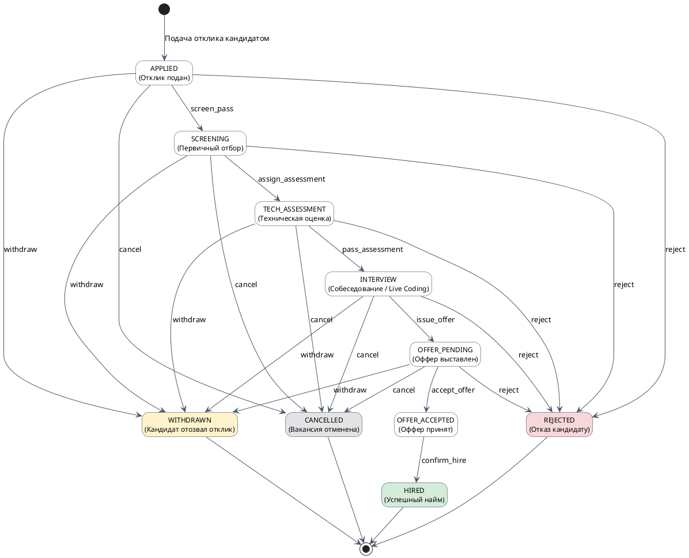
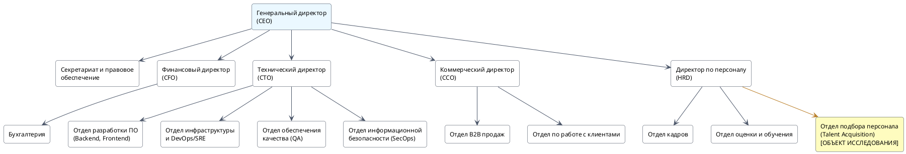
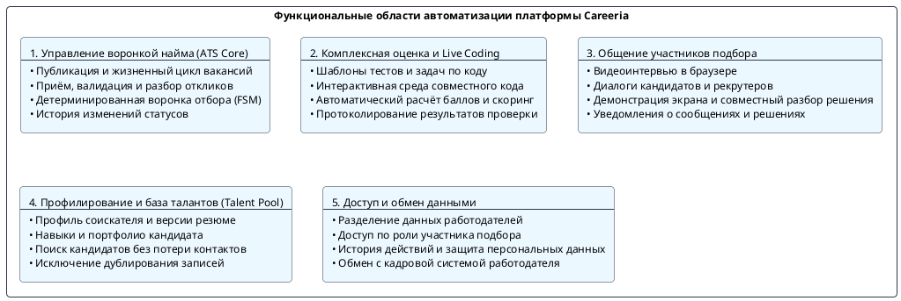

# 1.1. Идентификация и декомпозиция

Раздел посвящён системному анализу предметной области платформы Careeria, структуре предприятия, функциональной декомпозиции программного продукта, анализу актуальных проблем найма и обоснованию целесообразности разработки.

---

## 1. Описание предметной области автоматизации

### 1.1. Сведения о предприятии и бизнес-контексте

В рамках проекта рассматривается предприятие-разработчик и поставщик цифровой облачной платформы подбора персонала Careeria - ООО «Карерия Технологии» (Careeria Technologies LLC), а также типовое предприятие-клиент (корпоративный работодатель), внедряющее платформу для комплексной цифровизации рекрутингового цикла.

| Параметр | Характеристика предприятия |
|---|---|
| Полное наименование | Общество с ограниченной ответственностью «Карерия Технологии» |
| Организационно-правовая форма | Общество с ограниченной ответственностью (ООО), субъект ИТ-отрасли (аккредитованная ИТ-организация) |
| Форма собственности | Частная |
| Направления предпринимательской деятельности | 1. Разработка, внедрение и сопровождение заказного и тиражируемого программного обеспечения для управления человеческими ресурсами (HR-Tech, Talent Acquisition); 2. Предоставление многопользовательской B2B SaaS-платформы автоматизации найма, оценки соискателей и проведения видеособеседований; 3. Консалтинг по оптимизации воронок найма и заказная интеграция с корпоративными HR-системами заказчиков (HRIS, ATS, ERP, СЭД). |
| Номенклатура выпускаемой продукции и виды услуг | Продукция (программные комплексы): • Цифровая рекрутинговая платформа полного цикла Careeria; • Модуль управления вакансиями и воронкой отбора (ATS Core & Hiring Pipeline); • Модуль онлайн-тестирования и оценки компетенций (Assessment Engine); • Интерактивная среда технического интервью и совместного написания кода (Live Coding Room); • Сервер защищённых аудио- и видеоконференций (WebRTC Media Server); • Шлюз корпоративных интеграций и вебхуков (HR-Integration Gateway).  Виды услуг: • Предоставление доступа к облачному сервису по модели подписки (SaaS); • Техническая поддержка, сопровождение инфраструктуры и гарантия SLA (99.9%); • Заказная доработка и интеграция с внутренними ERP/HR-контурами клиентов; • Обучение специалистов по подбору персонала и нанимающих менеджеров. |
| Преобладающий тип производства | • В части разработки ПО: непрерывное серийное производство наукоёмкой нематериальной продукции на базе гибких методологий (Agile/Scrum, CI/CD, GitOps); • В части эксплуатации платформы: непрерывное круглосуточное предоставление высоконагруженных облачных сервисов (24/7 High-Availability Cloud Service). |
| Перспективы развития предприятия | 1. Экспансия на рынок Enterprise-клиентов и замещение ушедших зарубежных систем управления талантами (Greenhouse, Lever, Workday); 2. Внедрение интеллектуальных алгоритмов машинного обучения (AI Matching & Smart Screening) для семантического анализа резюме и ранжирования откликов; 3. Развитие распределённой защищённой среды компиляции и исполнения кода для модуля Live Coding в изолированных песочницах (sandboxes); 4. Расширение экосистемы готовых коннекторов к популярным отечественным кадровым системам (1С:ЗУП, E-Staff, Huntflow); 5. Сертификация контура безопасности на соответствие требованиям законодательства о защите персональных данных (152-ФЗ, уровни защищённости УЗ-1 / УЗ-2). |

---

### 1.2. Концептуальная модель предметной области

Предметная область охватывает полный жизненный цикл взаимодействия ключевых категорий участников: соискателей (кандидатов), представителей нанимающих организаций (работодателей) и внешних учётных кадровых систем.

#### 1.2.1. Естественно-языковое описание процесса

1. Инициация потребности: работодатель формирует потребность в сотруднике. В системе создаётся карточка вакансии, определяются требования, навыки, вилка компенсации и настраивается регламент отбора (этапы воронки). Вакансия публикуется в открытом доступе.
2. Формирование профиля и отклик: кандидат регистрируется на платформе, заполняет профиль, указывает опыт, образование, навыки и загружает версии резюме. При нахождении релевантной позиции кандидат отправляет отклик (Application).
3. Первичный отбор (Screening): рекрутер компании рассматривает входящий отклик, оценивает соответствие резюме формальным критериям и принимает решение о допуске к следующему этапу либо отклонении кандидата с фиксацией причины отказа.
4. Комплексная оценка компетенций: кандидату назначаются стандартизированные тесты, практические кейсы или сессии Live Coding. Результаты выполнения автоматически протоколируются и становятся доступны нанимающему менеджеру.
5. Собеседование (Interview): координатор планирует встречу. Участники подключаются к встроенной видеокомнате WebRTC, где могут вести диалог, демонстрировать экран и совместно работать над программным кодом в едином окне без сторонних приложений.
6. Принятие решения и оффер: на основе оценок и истории прохождения этапов формируется решение о найме. Кандидату выставляется оффер. При принятии оффера отклик переходит в финальный статус найма (HIRED), а данные синхронизируются с корпоративной HR-системой работодателя.

#### 1.2.2. Таблица ключевых сущностей предметной области

| Сущность | Назначение в предметной области | Сервис-владелец |
|---|---|---|
| Candidate Profile | Цифровой профиль соискателя: контактные данные, опыт работы, образование, навыки, языки и карьерные предпочтения | [Candidate Service](../02-business-services/01-candidate-company.md) |
| Resume | Метаданные и физические файлы версий резюме кандидата в объектном хранилище | [Candidate Service](../02-business-services/01-candidate-company.md), [File Service](../03-platform-services/03-files-notifications-integrations.md) |
| Company | Профиль организации-работодателя, реквизиты, настройки бренда и корпоративные политики | [Company Service](../02-business-services/01-candidate-company.md) |
| Company Member | Связь пользователя с компанией и назначение роли (OWNER, ADMIN, RECRUITER, HIRING_MANAGER) | [Company Service](../02-business-services/01-candidate-company.md) |
| Vacancy | Описание вакантной должности, квалификационные требования, график, условия и вилка заработной платы | [Vacancy Service](../02-business-services/02-vacancy-hiring.md) |
| Application | Экземпляр отклика конкретного кандидата на определённую вакансию компании, центральный агрегат воронки | [Hiring Service](../02-business-services/02-vacancy-hiring.md) |
| Hiring Pipeline & Stage | Конфигурация этапов отбора для конкретной вакансии (скрининг, интервью, оценка, оффер) | [Hiring Service](../02-business-services/02-vacancy-hiring.md) |
| ApplicationTransition | Неизменяемая запись журнала аудита о переводе кандидата между этапами с указанием автора, причины и времени | [Hiring Service](../02-business-services/02-vacancy-hiring.md) |
| Assessment & Task | Шаблоны тестов, алгоритмические задания, сессии совместного программирования и критерии проверки | [Assessment Service](../02-business-services/03-assessment-communication.md) |
| Interview & Room | Назначенная сессия собеседования, участники, WebRTC-комната медиапотоков и текстовый чат встречи | [Hiring Service](../02-business-services/02-vacancy-hiring.md), [LiveKit / Centrifugo](../03-platform-services/02-edge-realtime-media.md) |
| Offer / Rejection | Итоговые решения по кандидату: параметры предложения о работе либо структурированная причина отказа | [Hiring Service](../02-business-services/02-vacancy-hiring.md) |

#### 1.2.3. Формально-математическое и графовое описание воронки найма

Этапы отклика и допустимые переходы между ними описаны конечным автоматом (State Machine):

M = ⟨S, Σ, δ, s₀, F⟩

где:

- S - конечное множество состояний отклика (Application States):
  S = { APPLIED, SCREENING, INTERVIEW, ASSESSMENT, OFFER, HIRED, REJECTED, WITHDRAWN, CANCELLED };
- s₀ - начальное состояние, инициируемое подачей заявки кандидатом:
  s₀ = APPLIED;
- F - подмножество терминальных состояний процесса найма:
  F = { HIRED, REJECTED, WITHDRAWN, CANCELLED } ⊂ S;
- Σ - алфавит входных управляющих событий:
  Σ = { screen_pass, invite_interview, assign_assessment, pass_assessment, issue_offer, accept_offer, reject, withdraw, cancel };
- δ(S, Σ) - функция допустимых переходов между состояниями воронки.

Для каждого текущего состояния и действия правила определяют допустимое следующее состояние. Недопустимый переход отклоняется; разрешённое изменение статуса фиксируется в истории отклика с указанием времени, автора и причины. Так можно восстановить путь кандидата и рассчитать длительность этапов.

---

## 2. Описание организационной структуры предприятия

### 2.1. Тип организационной структуры

Для компании-разработчика цифровой платформы Careeria (а также для технологичных предприятий-заказчиков) характерна линейно-функциональная организационная структура с элементами матричного управления:

- Линейные связи обеспечивают вертикаль подчинения от Генерального директора к руководителям департаментов и далее к исполнителям, что гарантирует персональную ответственность и дисциплину выполнения распоряжений.
- Функциональные подразделения (ИТ, HR, финансы, маркетинг, безопасность) вырабатывают регламенты, стандарты и оказывают экспертную поддержку.
- Матричные элементы реализуются на уровне кросс-функциональных продуктовых команд, где инженеры, дизайнеры и аналитики временно группируются для решения задач конкретных доменных сервисов.

### 2.2. Схема организационной структуры предприятия

### 2.3. Место подразделения (объекта исследования) в деятельности предприятия

Подразделением, выступающим непосредственным объектом исследования и ключевым внутренним пользователем платформы, является Отдел подбора персонала (Talent Acquisition Department), входящий в состав Департамента управления персоналом (HRD).

Роль подразделения в производственно-хозяйственной деятельности:

1. Кадровое обеспечение ключевых бизнес-процессов: отдел подбора отвечает за своевременное закрытие вакансий во всех функциональных дирекциях компании (ИТ, продажи, финансы, логистика), минимизируя простои производства и задержки выпуска продукции.
2. Кросс-функциональное взаимодействие: отдел выступает центральным коммуникационным узлом между рынком внешних кандидатов и внутренними нанимающими менеджерами (руководителями отделов разработки, тимлидами, коммерческими директорами).
3. Управление экономикой найма: контроль и оптимизация ключевых метрик, таких как стоимость привлечения сотрудника (Cost-per-Hire), длительность закрытия позиции (Time-to-Hire) и показатель текучести на испытательном сроке.
4. Формирование репутации бренда работодателя: обеспечение прозрачного и технологичного процесса взаимодействия с соискателями (Candidate Experience).

### 2.4. Объект и предмет исследования

- Объект исследования: автоматизированная информационная система управления процессами подбора, оценки и найма персонала (рекрутинговая платформа Careeria).
- Предмет исследования: архитектурные методы, модели данных, алгоритмы и сквозные бизнес-процессы автоматизации воронки кандидатов, проведения интерактивных технических испытаний (Live Coding) и защищённых WebRTC-коммуникаций в едином программном контуре.

---

## 3. Локализация разработки ПО

Программный комплекс Careeria декомпозируется на пять базовых функциональных областей автоматизации и четыре регламентных локальных представления (автоматизированных рабочих места) в рамках единого клиентского приложения, строго соответствующих ролям пользователей на диаграммах системного контекста.

### 3.1. Основные области автоматизации

1. **Управление воронкой найма и откликами (ATS Core & Hiring Pipeline)**:

* Автоматизация создания, редактирования, публикации, приостановки и архивации вакансий;

* Регистрация откликов соискателей и централизованная фильтрация входящего потока;

* Перевод кандидатов по гибко настраиваемым этапам отбора в строгом соответствии с конечным автоматом;

* Фиксация автора, времени и причины каждого изменения статуса для анализа воронки.

2. **Комплексная оценка кандидатов и среда Live Coding (Assessment Engine)**:

* Конструирование тестовых опросников и практических алгоритмических заданий;

* Предоставление защищённой сессии совместного написания кода (Live Coding) с двусторонней синхронизацией редактора;

* Автоматическая фиксация ответов, валидация результатов и расчёт итогового скоринга кандидата.

3. **Синхронные и асинхронные коммуникации (Realtime & WebRTC Media)**:

* Организация видеоконференций высокого разрешения внутри веб-приложения без установки стороннего ПО (Zoom, MS Teams);

* Индивидуальные и групповые текстовые диалоги «Кандидат ↔ Рекрутер ↔ Нанимающий менеджер»;

* Отображение новых сообщений и уведомлений участникам подбора.

4. **Профилирование и управление базой талантов (Candidate & Talent Pool)**:

* Ведение профиля соискателя: стаж, места работы, образование, подтверждённые стек-навыки, сертификаты;

* Загрузка и хранение нескольких версий резюме в форматах PDF/DOCX;

* Быстрый поиск по базе кандидатов без потери контактов при ротации рекрутеров.

5. **Корпоративный контур, ролевой доступ и интеграции (Multi-tenancy & Enterprise Security)**:

* Полная изоляция данных между компаниями-работодателями;

* Предоставление доступа к сведениям о кандидатах в соответствии с ролью участника подбора;

* Обмен событиями найма с внешними корпоративными HR-системами работодателей через криптографически подписанные HTTPS Webhooks.

---

### 3.2. Локальные представления ПО по группам потребителей

Для каждой группы пользователей предусмотрено своё рабочее представление. Таблица описывает их задачи без распределения этих задач по внутренним компонентам системы.

| Группа пользователей | Рабочее представление | Основные задачи | Результат для участника |
| --- | --- | --- | --- |
| **Кандидат** | Личный кабинет | Заполнить профиль и резюме, найти вакансию, отправить отклик, следить за его статусом, выполнить задание, пройти интервью и общаться с рекрутером. | Видеть ход рассмотрения и получать ответ по своему отклику. |
| **Рекрутер** | Рабочее место подбора | Опубликовать вакансию, разобрать отклики, передать кандидатов руководителю, согласовать время интервью, назначить задание и сообщить решение. | Работать с откликом и перепиской без повторного ввода сведений в таблицу. |
| **Нанимающий руководитель** | Кабинет интервьюера | Согласовать требования к роли, изучить кандидатов, провести интервью и практическую оценку, заполнить чек-лист и согласовать оффер. | Принимать решение по резюме, результатам задания и сохранённым оценкам. |
| **Администратор компании** | Панель управления работодателем | Заполнить профиль компании, пригласить участников подбора, назначить роли и настроить доступ к сведениям. | Управлять участниками и границами доступа компании. |

#### Взаимодействие с внешними системами (System_Ext)

При оформлении финалиста сведения о принятом оффере и данные кандидата передаются в кадровую систему работодателя. Подтверждение оформления возвращается в процесс подбора и позволяет закрыть отклик как завершённый найм. Способ технического обмена здесь не определяет действия пользователей.

---

## 4. Основные проблемы области автоматизации

### 4.1. Системный анализ проблем в предметной области

В описанном процессе найма возникают следующие проблемы:

1. **Фрагментация инструментария («зоопарк систем»)**:
Вакансии публикуют на нескольких job-бордах, резюме собирают по почте, с кандидатами переписываются в Telegram и WhatsApp. Списки ведут в Excel или Google Sheets, видеозвонки проводят в Zoom или Google Meet, а задачи по программированию дают в Google Docs, CoderPad или LeetCode. Данные остаются в разных сервисах, поэтому команде приходится восстанавливать историю кандидата вручную.

2. **Затягивание закрытия вакансии (высокий time-to-fill)**:
Когда рекрутер и нанимающий менеджер передают сведения друг другу вручную, кандидат может ждать решения неделями. За это время он может принять предложение другой компании.

3. **«Чёрная дыра» откликов и ухудшение Candidate Experience**:
Кандидат не видит статус отклика и не получает ответа от работодателя.

4. **Трудоёмкость и недостоверность рекрутинговой аналитики**:
По оценке проекта, рекрутеры тратят до 30–40% рабочего времени на сведение таблиц. Пока отчёт готовят, данные успевают устареть; трудно понять, на каком этапе отсеивается больше всего кандидатов.

5. **Субъективность и неструктурированность технической оценки**:
Единых критериев оценки может не быть. Кандидат пишет код на виртуальной доске без подсветки и запуска, а комментарии интервьюера остаются в личных заметках и не попадают в итоговое решение.

6. **Риски информационной безопасности и нарушение 152-ФЗ**:
Пересылка резюме через личные мессенджеры и хранение файлов на компьютерах сотрудников создают риск нарушения требований к обработке персональных данных.

---

### 4.2. Практические сценарии (User Stories)

#### Сценарий 1: Потеря ключевого кандидата из-за отсутствия единого контура трекинга

- Понедельник: рекрутер получил отклик сильного Senior Go-разработчика в Telegram. Скопировал файл резюме и переслал техлиду в Slack: «Посмотри, пожалуйста, кандидата».
- Вторник - Среда: у техлида внеплановый релиз и инциденты на проде. Сообщение рекрутера опустилось вниз по ленте чата и затерялось. Никакой задачи в единой системе заведено не было.
- Четверг: рекрутер вспомнил о кандидате и написал повторный запрос. Техлид открыл файл: «Отличный специалист, давай срочно звать на техническое интервью!».
- Пятница: рекрутер вернулся к разработчику с предложением интервью. Ответ кандидата: «Спасибо, но вчера я уже прошёл все раунды в другой компании и сегодня подписал оффер. Они провели весь цикл за 3 дня в едином личном кабинете».
- Итог: компания упустила редкого специалиста, сорвала сроки проекта, а бюджет на привлечение был потрачен впустую.

#### Сценарий 2: Недостоверная аналитика и рутинный сбор отчётности для руководства

Руководитель HR-департамента перед совещанием с советом директоров запрашивает отчёт: какова конверсия по этапам воронки за текущий квартал, среднее время нахождения кандидата на этапе технического скрининга и реальные причины отказов по позиции Senior Data Engineer.

При отсутствии платформы Careeria рекрутерам приходится:

- Открывать три разные таблицы Excel, заведённые разными сотрудниками;
- Вручную поднимать переписки в почте и корпоративных мессенджерах;
- Сверять даты первого контакта и итоговых решений.

В этом сценарии отчёт готовят два рабочих дня. В нём остаются дубликаты кандидатов и расхождения в цифрах, поэтому по нему трудно найти задержки в процессе.

#### Сценарий 3: Срыв технического интервью из-за несвязанных инструментов

Интервьюер запланировал видеозвонок в стороннем сервисе, а задачи разместил в онлайн-документе. Кандидат не смог подключиться из-за VPN и настроек безопасности видеосервиса. Встречу перенесли в мессенджер, но документ не поддерживал подсветку синтаксиса и запуск тестов. Эксперт, рабочий час которого стоит несколько тысяч рублей, потратил время на настройку инструментов и не получил всех данных для оценки кандидата.

---

## 5. Актуальность разработки ПО

Обоснование проекта построено вокруг потребностей работодателей, возможностей существующих инструментов и места Careeria на рынке.

| Потребности (Needs) | Возможности (Opportunities) | Рыночная ниша (Niche) |
| --- | --- | --- |
| Рекрутеру нужны единая карточка отклика, история переходов и данные о времени ожидания на каждом этапе. Цель проекта — сократить срок от открытия вакансии до принятия оффера. | При работе с таблицами, почтой и отдельными сервисами видеосвязи сведения об отклике приходится переносить между системами. Результаты технической оценки и переписку затем собирают вручную. | Careeria связывает воронку откликов, практическую оценку и видеособеседование с одной карточкой кандидата. |

### 5.1. Потребности рынка и бизнеса (Needs)

1. **Сокращение time-to-fill и Cost-per-Hire**: Долгое согласование этапов найма увеличивает срок закрытия вакансии. Для ИТ-ролей и других дефицитных специальностей задержка может отложить работу команды; её стоимость зависит от конкретной позиции.

2. **Ликвидация «слепых зон» воронки найма**: Руководству предприятия необходим объективный сквозной инструмент контроля воронки с фиксацией точного времени нахождения каждого кандидата на каждом этапе и автоматическим выявлением узких мест.

3. **Повышение качества отбора**: Необходимость проведения объективных технических проверок в единой стандартизированной среде (Live Coding) с сохранением протокола выполнения заданий для исключения субъективизма нанимающих менеджеров.

4. **Соответствие требованиям регуляторов**: Обеспечение обработки и хранения персональных данных российских соискателей в защищённом отечественном облачном контуре (152-ФЗ).

### 5.2. Ограничения существующих средств автоматизации (Current Limitations)

1. **Недостатки традиционных систем автоматизации**:

* Электронные таблицы (Excel/Google Sheets) не поддерживают версионность, права доступа, уведомления и быстро превращаются в неактуализированное «кладбище данных»;

* Обычные системы класса ATS (Huntflow, E-Staff) решают только задачу хранения карточек кандидатов и переписки, но полностью изолированы от этапа технической оценки, тестирования и видеособеседований, требуя оплаты и ручной связки нескольких сторонних сервисов.

2. **Технологический разрыв из-за ухода зарубежных вендоров**:

* Ведущие международные платформы полного цикла (Greenhouse, Lever, Workday, HackerRank, Codility) прекратили работу на территории Российской Федерации либо заблокировали оплату корпоративных лицензий;

* Компаниям, которые ведут отклики в ATS, а оценку и собеседования — в отдельных сервисах, нужен способ связать эти этапы. Careeria объединяет ATS, ассессмент и видеосвязь в одной платформе.

### 5.3. Рыночная ниша платформы Careeria (Niche)

Платформа Careeria занимает уникальную нишу интегрированной рекрутинговой экосистемы полного цикла:

Careeria объединяет в одной платформе функции, которые в описанном процессе выполняют разные сервисы:

1. **Единый цифровой контур**: Объединение классической ATS (вакансии, отклики, этапы воронки), специализированного модуля онлайн-оценки (тесты, кейсы, интерактивный Live Coding) и встроенных защищённых WebRTC-видеоконференций без необходимости переключения между вкладками и сервисами.

2. **Детерминированная машина состояний (State Machine)**: Правила допускают только предусмотренные переходы между этапами отбора. История статусов сохраняет автора, время и причину изменения, чтобы участники могли восстановить ход рассмотрения отклика и рассчитать конверсию воронки.

3. **Безопасность и масштабируемость**: Данные разных работодателей должны быть разделены, доступ к сведениям кандидата зависит от роли пользователя, а производительность проверяется при росте числа вакансий, откликов и одновременных интервью.

4. **Бесшовная интеграция**: Открытый API и подписанные вебхуки используются для обмена данными с ЗУП, внутренними ERP и СЭД.

---

## Связанные разделы

* [1.2. Формулировка задач](02-formulation-of-tasks.md) — назначение системы, цель разработки ПО, характеристики ввода/вывода, надёжность и безопасность.
* [1.3. SWOT-анализ среды](03-swot-analysis.md) — анализ сильных и слабых сторон, возможностей и угроз, матрица TOWS.
* [1.4. SMART-анализ целей](04-smart-analysis.md) — исследование данных, преимущества и недостатки цели, формулировка по SMART.
* [1.5. Анализ аналогов ПО](05-analogs-analysis.md) — качественный и количественный сравнительный анализ по модели FURPS+.

* [2.3. Разработка концептуальной модели ПО "как должно быть"](../02-business-services/03-to-be.md) — изменения в работе участников найма.

* [Системный контекст C4 L1](../../architecture/c4-plant-uml/plantuml/context/system-context.md) — диаграмма системного контекста Careeria.
