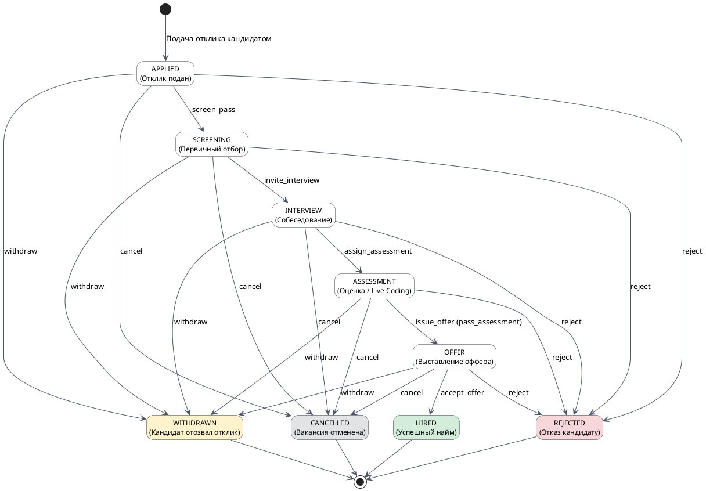
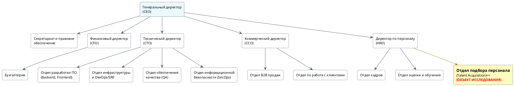
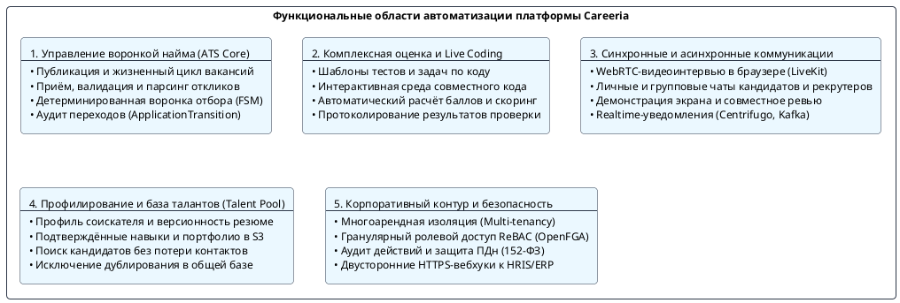

# 1.1. Идентификация и декомпозиция

Раздел посвящён системному анализу предметной области платформы **Careeria**, структуре предприятия, функциональной декомпозиции программного продукта, анализу актуальных проблем найма и обоснованию целесообразности разработки.

---

## 1. Описание предметной области автоматизации

### 1.1. Сведения о предприятии и бизнес-контексте

В рамках проекта рассматривается предприятие-разработчик и поставщик цифровой облачной платформы подбора персонала **Careeria** — **ООО «Карерия Технологии» (Careeria Technologies LLC)**, а также типовое предприятие-клиент (корпоративный работодатель), внедряющее платформу для комплексной цифровизации рекрутингового цикла.

| Параметр | Характеристика предприятия |
|---|---|
| **Полное наименование** | Общество с ограниченной ответственностью «Карерия Технологии» |
| **Организационно-правовая форма** | Общество с ограниченной ответственностью (ООО), субъект ИТ-отрасли (аккредитованная ИТ-организация) |
| **Форма собственности** | Частная |
| **Направления предпринимательской деятельности** | 1. Разработка, внедрение и сопровождение заказного и тиражируемого программного обеспечения для управления человеческими ресурсами (HR-Tech, Talent Acquisition); 2. Предоставление многопользовательской B2B SaaS-платформы автоматизации найма, оценки соискателей и проведения видеособеседований; 3. Консалтинг по оптимизации воронок найма и заказная интеграция с корпоративными HR-системами заказчиков (HRIS, ATS, ERP, СЭД). |
| **Номенклатура выпускаемой продукции и виды услуг** | **Продукция (программные комплексы):** • Цифровая рекрутинговая платформа полного цикла **Careeria**; • Модуль управления вакансиями и воронкой отбора (ATS Core & Hiring Pipeline); • Модуль онлайн-тестирования и оценки компетенций (Assessment Engine); • Интерактивная среда технического интервью и совместного написания кода (Live Coding Room); • Сервер защищённых аудио- и видеоконференций (WebRTC Media Server); • Шлюз корпоративных интеграций и вебхуков (HR-Integration Gateway).  **Виды услуг:** • Предоставление доступа к облачному сервису по модели подписки (SaaS); • Техническая поддержка, сопровождение инфраструктуры и гарантия SLA (99.9%); • Заказная доработка и интеграция с внутренними ERP/HR-контурами клиентов; • Обучение специалистов по подбору персонала и нанимающих менеджеров. |
| **Преобладающий тип производства** | • В части разработки ПО: непрерывное серийное производство наукоёмкой нематериальной продукции на базе гибких методологий (Agile/Scrum, CI/CD, GitOps); • В части эксплуатации платформы: непрерывное круглосуточное предоставление высоконагруженных облачных сервисов (24/7 High-Availability Cloud Service). |
| **Перспективы развития предприятия** | 1. Экспансия на рынок Enterprise-клиентов и замещение ушедших зарубежных систем управления талантами (Greenhouse, Lever, Workday); 2. Внедрение интеллектуальных алгоритмов машинного обучения (AI Matching & Smart Screening) для семантического анализа резюме и ранжирования откликов; 3. Развитие распределённой защищённой среды компиляции и исполнения кода для модуля Live Coding в изолированных песочницах (sandboxes); 4. Расширение экосистемы готовых коннекторов к популярным отечественным кадровым системам (1С:ЗУП, E-Staff, Huntflow); 5. Сертификация контура безопасности на соответствие требованиям законодательства о защите персональных данных (152-ФЗ, уровни защищённости УЗ-1 / УЗ-2). |

---

### 1.2. Концептуальная модель предметной области

Предметная область охватывает полный жизненный цикл взаимодействия ключевых категорий участников: **соискателей (кандидатов)**, представителей **нанимающих организаций (работодателей)** и **внешних учетных кадровых систем**.

#### 1.2.1. Естественно-языковое описание процесса

1. **Инициация потребности**: Работодатель формирует потребность в сотруднике. В системе создаётся карточка вакансии, определяются требования, навыки, вилка компенсации и настраивается регламент отбора (этапы воронки). Вакансия публикуется в открытом доступе.
2. **Формирование профиля и отклик**: Кандидат регистрируется на платформе, заполняет профиль, указывает опыт, образование, навыки и загружает версии резюме. При нахождении релевантной позиции кандидат отправляет отклик (`Application`).
3. **Первичный отбор (Screening)**: Рекрутер компании рассматривает входящий отклик, оценивает соответствие резюме формальным критериям и принимает решение о допуске к следующему этапу либо отклонении кандидата с фиксацией причины отказа.
4. **Комплексная оценка компетенций**: Кандидату назначаются стандартизированные тесты, практические кейсы или сессии Live Coding. Результаты выполнения автоматически протоколируются и становятся доступны нанимающему менеджеру.
5. **Собеседование (Interview)**: Координатор планирует встречу. Участники подключаются к встроенной видеокомнате WebRTC, где могут вести диалог, демонстрировать экран и совместно работать над программным кодом в едином окне без сторонних приложений.
6. **Принятие решения и оффер**: На основе оценок и истории прохождения этапов формируется решение о найме. Кандидату выставляется оффер. При принятии оффера отклик переходит в финальный статус найма (`HIRED`), а данные синхронизируются с корпоративной HR-системой работодателя.

#### 1.2.2. Таблица ключевых сущностей предметной области

| Сущность | Назначение в предметной области | Сервис-владелец |
|---|---|---|
| **Candidate Profile** | Цифровой профиль соискателя: контактные данные, опыт работы, образование, навыки, языки и карьерные предпочтения | [Candidate Service](../02-business-services/01-candidate-company.md) |
| **Resume** | Метаданные и физические файлы версий резюме кандидата в объектном хранилище | [Candidate Service](../02-business-services/01-candidate-company.md), [File Service](../03-platform-services/03-files-notifications-integrations.md) |
| **Company** | Профиль организации-работодателя, реквизиты, настройки бренда и корпоративные политики | [Company Service](../02-business-services/01-candidate-company.md) |
| **Company Member** | Связь пользователя с компанией и назначение роли (`OWNER`, `ADMIN`, `RECRUITER`, `HIRING_MANAGER`) | [Company Service](../02-business-services/01-candidate-company.md) |
| **Vacancy** | Описание вакантной должности, квалификационные требования, график, условия и вилка заработной платы | [Vacancy Service](../02-business-services/02-vacancy-hiring.md) |
| **Application** | Экземпляр отклика конкретного кандидата на определённую вакансию компании, центральный агрегат воронки | [Hiring Service](../02-business-services/02-vacancy-hiring.md) |
| **Hiring Pipeline & Stage** | Конфигурация этапов отбора для конкретной вакансии (скрининг, интервью, оценка, оффер) | [Hiring Service](../02-business-services/02-vacancy-hiring.md) |
| **ApplicationTransition** | Неизменяемая запись журнала аудита о переводе кандидата между этапами с указанием автора, причины и времени | [Hiring Service](../02-business-services/02-vacancy-hiring.md) |
| **Assessment & Task** | Шаблоны тестов, алгоритмические задания, сессии совместного программирования и критерии проверки | [Assessment Service](../02-business-services/03-assessment-communication.md) |
| **Interview & Room** | Назначенная сессия собеседования, участники, WebRTC-комната медиапотоков и текстовый чат встречи | [Hiring Service](../02-business-services/02-vacancy-hiring.md), [LiveKit / Centrifugo](../03-platform-services/02-edge-realtime-media.md) |
| **Offer / Rejection** | Итоговые решения по кандидату: параметры предложения о работе либо структурированная причина отказа | [Hiring Service](../02-business-services/02-vacancy-hiring.md) |

#### 1.2.3. Формально-математическое и графовое описание воронки найма

Жизненный цикл отклика соискателя строго формализуется как детерминированный конечный автомат (State Machine):

> ***M* = ⟨*S*, *Σ*, *δ*, *s*₀, *F*⟩**
>
> где:
>
> - ***S*** — конечное множество состояний отклика (Application States):  
>   *S* = { `APPLIED`, `SCREENING`, `INTERVIEW`, `ASSESSMENT`, `OFFER`, `HIRED`, `REJECTED`, `WITHDRAWN`, `CANCELLED` };
> - ***s*₀** — начальное состояние, инициируемое подачей заявки кандидатом:  
>   *s*₀ = `APPLIED`;
> - ***F*** — подмножество терминальных состояний процесса найма:  
>   *F* = { `HIRED`, `REJECTED`, `WITHDRAWN`, `CANCELLED` } ⊂ *S*;
> - ***Σ*** — алфавит входных управляющих событий:  
>   *Σ* = { `screen_pass`, `invite_interview`, `assign_assessment`, `pass_assessment`, `issue_offer`, `accept_offer`, `reject`, `withdraw`, `cancel` };
> - ***δ*: *S* × *Σ* → *S*** — функция допустимых переходов между состояниями воронки.

Каждый вызов функции переходов *δ*(*s*, *σ*) валидируется в [Hiring Service](../02-business-services/02-vacancy-hiring.md) и порождает неизменяемую запись в таблице `ApplicationTransition`, формируя математически строгий направленный граф аудита пути кандидата.

---

## 2. Описание организационной структуры предприятия

### 2.1. Тип организационной структуры

Для компании-разработчика цифровой платформы Careeria (а также для технологичных предприятий-заказчиков) характерна **линейно-функциональная организационная структура с элементами матричного управления**.

* **Линейные связи** обеспечивают вертикаль подчинения от Генерального директора к руководителям департаментов и далее к исполнителям, что гарантирует персональную ответственность и дисциплину выполнения распоряжений.

* **Функциональные подразделения** (ИТ, HR, финансы, маркетинг, безопасность) вырабатывают регламенты, стандарты и оказывают экспертную поддержку.

* **Матричные элементы** реализуются на уровне кросс-функциональных продуктовых команд, где инженеры, дизайнеры и аналитики временно группируются для решения задач конкретных доменных сервисов.

### 2.2. Схема организационной структуры предприятия

### 2.3. Место подразделения (объекта исследования) в деятельности предприятия

Подразделением — непосредственным объектом исследования и ключевым внутренним пользователем платформы является **Отдел подбора персонала (Talent Acquisition Department)**, входящий в состав Департамента управления персоналом (HRD).

**Роль подразделения в производственно-хозяйственной деятельности:**

1. **Кадровое обеспечение ключевых бизнес-процессов**: Отдел подбора отвечает за своевременное закрытие вакансий во всех функциональных дирекциях компании (ИТ, продажи, финансы, логистика), минимизируя простои производства и задержки выпуска продукции.

2. **Кросс-функциональное взаимодействие**: Отдел выступает центральным коммуникационным узлом между рынком внешних кандидатов и внутренними нанимающими менеджерами (руководителями отделов разработки, тимлидами, коммерческими директорами).

3. **Управление экономикой найма**: Контроль и оптимизация ключевых метрик: стоимость привлечения сотрудника (*Cost-per-Hire*), длительность закрытия позиции (*Time-to-Hire*) и показатель текучести на испытательном сроке.

4. **Формирование репутации бренда работодателя**: Обеспечение прозрачного и технологичного процесса взаимодействия с соискателями (*Candidate Experience*).

### 2.4. Объект и предмет исследования

* **Объект исследования**: автоматизированная информационная система управления процессами подбора, оценки и найма персонала (рекрутинговая платформа Careeria).

* **Предмет исследования**: архитектурные методы, модели данных, алгоритмы и сквозные бизнес-процессы автоматизации воронки кандидатов, проведения интерактивных технических испытаний (Live Coding) и защищённых WebRTC-коммуникаций в едином программном контуре.

---

## 3. Локализация разработки ПО

Программный комплекс **Careeria** декомпозируется на пять базовых функциональных областей автоматизации и четыре регламентных локальных представления (автоматизированных рабочих места) в рамках единого клиентского приложения, строго соответствующих ролям пользователей на диаграммах системного контекста C4 (L1) и контейнеров (L2).

### 3.1. Основные области автоматизации

1. **Управление воронкой найма и откликами (ATS Core & Hiring Pipeline)**:

* Автоматизация создания, редактирования, публикации, приостановки и архивации вакансий;

* Регистрация откликов соискателей и централизованная фильтрация входящего потока;

* Перевод кандидатов по гибко настраиваемым этапам отбора в строгом соответствии с конечным автоматом;

* Автоматическое протоколирование всех транзакций в `ApplicationTransition` для сквозной аналитики воронки.

2. **Комплексная оценка кандидатов и среда Live Coding (Assessment Engine)**:

* Конструирование тестовых опросников и практических алгоритмических заданий;

* Предоставление защищённой сессии совместного написания кода (Live Coding) с двусторонней синхронизацией редактора;

* Автоматическая фиксация ответов, валидация результатов и расчёт итогового скоринга кандидата.

3. **Синхронные и асинхронные коммуникации (Realtime & WebRTC Media)**:

* Организация видеоконференций высокого разрешения внутри веб-приложения без установки стороннего ПО (Zoom, MS Teams);

* Индивидуальные и групповые текстовые диалоги «Кандидат ↔ Рекрутер ↔ Нанимающий менеджер»;

* Realtime-доставка статусов прочтения, печати сообщений и системных уведомлений через Centrifugo и WebSocket.

4. **Профилирование и управление базой талантов (Candidate & Talent Pool)**:

* Ведение профиля соискателя: стаж, места работы, образование, подтверждённые стек-навыки, сертификаты;

* Загрузка и хранение нескольких версий резюме в форматах PDF/DOCX через безопасные presigned URL (MinIO/S3);

* Быстрый поиск по базе кандидатов без потери контактов при ротации рекрутеров.

5. **Корпоративный контур, ролевой доступ и интеграции (Multi-tenancy & Enterprise Security)**:

* Полная изоляция данных между компаниями-работодателями;

* Гранулярный ролевой контроль ReBAC на базе [OpenFGA](../../security/index.md);

* Обмен событиями найма с внешними корпоративными HR-системами работодателей через криптографически подписанные HTTPS Webhooks.

---

### 3.2. Локальные представления ПО по группам потребителей

В соответствии с диаграммами системного контекста C4 (L1) и контейнеров (L2), утверждёнными в архитектурной документации платформы Careeria, в системе выделены **четыре регламентные группы пользователей (Person)**, взаимодействующие с единым контейнером клиентского интерфейса **Web Application** (Next.js, React, TypeScript), а также **внешние системы (External System)**, сопрягаемые через специализированные шлюзы.

| Группа потребителей (роль в модели C4) | Локальное представление в составе Web Application | Соответствующие целевые контейнеры бэкенда | Основные решаемые задачи | Ключевая ценность |
| --- | --- | --- | --- | --- |
| **Кандидат (Candidate)** | **Личный кабинет соискателя** *(Candidate Portal)* | `Candidate Service`, `Vacancy Service`, `Hiring Service`, `Assessment Service`, `Communication Service`, `File Service`, `LiveKit`, `Centrifugo` | • Создание и ведение цифрового профиля, управление версиями резюме; • Поиск опубликованных вакансий и подача откликов (`Application`); • Прозрачный онлайн-трекинг этапа рассмотрения кандидатуры по воронке; • Прохождение тестирования и подключение к сессиям Live Coding; • Участие в онлайн-интервью через WebRTC и чат с рекрутером. | Высокий Candidate Experience, отсутствие неопределённости («чёрной дыры»), единая точка коммуникации без сторонних программ. |
| **Рекрутер (Recruiter)** | **Рабочее место рекрутера** *(ATS Dashboard, Kanban-доска)* | `Vacancy Service`, `Hiring Service`, `Candidate Service`, `Assessment Service`, `Communication Service`, `Notification Service`, `OpenFGA` | • Создание, редактирование и публикация вакансий организации; • Приём, скрининг и централизованный разбор откликов соискателей; • Управление перемещением кандидатов по этапам воронки (FSM); • Планирование встреч, генерация ссылок на интервью, координация слотов; • Назначение оценочных заданий и мониторинг их выполнения; • Ведение диалогов с кандидатами и нанимающими менеджерами. | Ликвидация рутины, сокращение времени реакции на отклик до минут, исключение потери перспективных кандидатов. |
| **Нанимающий руководитель (Hiring Manager)** | **Кабинет эксперта-интервьюера** *(Hiring Workspace & Live Coding)* | `Hiring Service`, `Assessment Service`, `Vacancy Service`, `Communication Service`, `LiveKit`, `OpenFGA` | • Согласование квалификационных профилей кандидатов по своим вакансиям; • Проведение технических видеоинтервью во встроенной WebRTC-комнате; • Проведение сессий Live Coding с совместным просмотром и запуском кода; • Заполнение стандартизированного оценочного листа (*Scorecard*); • Принятие решения по кандидату и согласование оффера (*Job Offer*). | Исключение хаотичной переписки в мессенджерах, объективная стандартизированная оценка компетенций в едином окне. |
| **Администратор компании (Company Admin)** | **Панель администрирования компании** *(Company Admin Console)* | `Company Service`, `Identity Service`, `Integration Service`, `OpenFGA` | • Управление профилем работодателя, филиальной структурой и реквизитами; • Приглашение сотрудников компании и назначение корпоративных ролей (`ADMIN`, `RECRUITER`, `HIRING_MANAGER`); • Настройка политик доступа ReBAC в движке OpenFGA; • Конфигурация интеграционных вебхуков и API-ключей для обмена данными с корпоративной кадровой системой работодателя. | Безопасность и многоарендная изоляция данных компании, централизованный контроль прав доступа и синхронизация с кадровым контуром. |

#### Взаимодействие с внешними системами (System_Ext)

Помимо пользователей-людей, на диаграммах C4 формализованы три внешние программные системы:

1. **Employer HR System (1С:ЗУП, Workday, BambooHR)**: автоматизированный обмен данными по воронке кандидатов. События передаются через криптографически подписанные вебхуки в `Integration Service` через единый `API Gateway`.
2. **Identity Provider (Keycloak)**: обеспечение единой точки входа и федеративной аутентификации пользователей по протоколам OAuth 2.0 / OpenID Connect через `Identity Service`.
3. **Notification Providers (SendGrid, FCM, Twilio)**: внешняя доставка системных и триггерных уведомлений соискателям и сотрудникам (Email, Push, SMS), координируемая контейнером `Notification Service`.

*Примечание: Технические задачи мониторинга доступности микросервисов, сбора телеметрии и аудита безопасности (Prometheus, Grafana, OpenTelemetry, Jaeger) относятся к слою платформенной DevOps/SRE-эксплуатации инфраструктуры и выполняются системными инженерами вне пользовательского клиентского интерфейса Careeria.*

---

## 4. Основные проблемы области автоматизации

### 4.1. Системный анализ проблем в предметной области

Традиционные процессы найма на предприятиях страдают от ряда системных проблем:

1. **Фрагментация инструментария («зоопарк систем»)**:
Компании вынуждены использовать множество разрозненных сервисов: публикация вакансий на нескольких job-бордах, сбор резюме в почте, переписка с кандидатами в Telegram/WhatsApp, ведение списков в электронных таблицах Excel/Google Sheets, видеосозвоны в Zoom/Google Meet, а задачи по программированию — в Google Docs или внешних сервисах (CoderPad, LeetCode). Отсутствие интеграции приводит к регулярным потерям контекста.

2. **Затягивание сроков найма (высокий Time-to-Hire)**:
Из-за задержек при передаче информации между рекрутером и нанимающим менеджером кандидат ожидает решения неделями. Сильные специалисты за это время получают встречные офферы от конкурентов с быстрым циклом отбора.

3. **«Чёрная дыра» откликов и ухудшение Candidate Experience**:
Кандидаты не получают обратной связи о статусе рассмотрения своего резюме, что наносит прямой ущерб HR-бренду работодателя.

4. **Трудоёмкость и недостоверность рекрутинговой аналитики**:
Сбор метрик по воронке требует от рекрутеров до 30–40% рабочего времени на ручное сведение таблиц. Такие отчёты субъективны, быстро устаревают и не позволяют оперативно локализовать этап, на котором отсеивается наибольшее число соискателей.

5. **Субъективность и неструктурированность технической оценки**:
Оценка профессиональных навыков часто проводится без единых стандартов: код пишется на виртуальной доске без подсветки и компиляции, а комментарии интервьюера остаются в личных блокнотах и теряются при принятии итогового решения.

6. **Риски информационной безопасности и нарушение 152-ФЗ**:
Пересылка резюме, содержащих персональные данные, по личным мессенджерам и их хранение на персональных компьютерах сотрудников прямо нарушает законодательство РФ о защите персональных данных.

---

### 4.2. Практические сценарии (User Stories)

#### Сценарий 1: Потеря ключевого кандидата из-за отсутствия единого контура трекинга

* **Понедельник**: Рекрутер получил отклик сильного Senior Go-разработчика в Telegram. Скопировал файл резюме и переслал техлиду в Slack: *"Посмотри, пожалуйста, кандидата"*.

* **Вторник – Среда**: У техлида внеплановый релиз и инциденты на проде. Сообщение рекрутера опустилось вниз по ленте чата и затерялось. Никакой задачи в единой системе заведено не было.

* **Четверг**: Рекрутер вспомнил о кандидате и написал повторный запрос. Техлид открыл файл: *"Отличный специалист, давай срочно звать на техническое интервью!"*.

* **Пятница**: Рекрутер вернулся к разработчику с предложением интервью. Ответ кандидата: "Спасибо, но вчера я уже прошёл все раунды в другой компании и сегодня подписал оффер. Они провели весь цикл за 3 дня в едином личном кабинете".

* **Итог**: Компания упустила редкого специалиста, сорвала сроки проекта, а бюджет на привлечение был потрачен впустую.

#### Сценарий 2: Недостоверная аналитика и рутинный сбор отчётности для руководства

Руководитель HR-департамента перед совещанием с советом директоров запрашивает отчёт: какова конверсия по этапам воронки за текущий квартал, среднее время нахождения кандидата на этапе технического скрининга и реальные причины отказов по позиции Senior Data Engineer.

При отсутствии платформы Careeria рекрутерам приходится:

* Открывать три разные таблицы Excel, заведённые разными сотрудниками;

* Вручную поднимать переписки в почте и корпоративных мессенджерах;

* Сверять даты первого контакта и итоговых решений.

На эту задачу уходит два рабочих дня. Итоговый отчёт содержит неточности, дубликаты кандидатов и расхождения в цифрах, не отражая реальных узких мест процесса.

#### Сценарий 3: Срыв технического интервью из-за несвязанных инструментов

Интервьюер запланировал техническое собеседование в стороннем сервисе видеосвязи, а задачи на алгоритмы разместил в онлайн-документе. В момент начала встречи кандидат не смог подключиться из-за проблем с VPN и политикой безопасности сервиса видеосвязи. При переносе встречи в альтернативный мессенджер выяснилось, что онлайн-документ не поддерживает подсветку синтаксиса выбранного языка и запуск тестов. Время эксперта компании стоимостью несколько тысяч рублей в час потрачено неэффективно, а оценка кандидата оказалась неполной и субъективной.

---

## 5. Актуальность разработки ПО

Актуальность создания рекрутинговой платформы **Careeria** обосновывается через системную триаду: **ПОТРЕБНОСТИ — ВОЗМОЖНОСТИ — НИША**.

| Потребности (Needs) | Возможности (Opportunities) | Рыночная ниша (Niche) |
| --- | --- | --- |
| Для повышения качества и скорости подбора персонала компаниям жизненно необходимо иметь сквозной цифровой процесс, детерминированную воронку отбора, низкий Time-to-Hire и непрерывную аналитику по этапам в реальном времени. | Существующие средства автоматизации (изолированные ATS, таблицы, почта) не актуализируют данные вовремя, не поддерживают встроенную среду Live Coding и видеосвязи, требуя ручной агрегации разрозненных сведений. Зарубежные аналоги ушли с рынка РФ. | Разработка и запуск платформы Careeria устраняет технологический разрыв между классической ATS, модулем оценки/Live Coding и защищёнными WebRTC-видеоинтервью в едином контуре. |

### 5.1. Потребности рынка и бизнеса (Needs)

1. **Сокращение Time-to-Hire и Cost-per-Hire**: В условиях дефицита квалифицированных специалистов (особенно в сфере IT и высокотехнологичных отраслях) выигрывают компании с минимальным временем от первого отклика до выставления оффера. Каждый день простоя критической вакансии приносит прямые финансовые убытки.

2. **Ликвидация «слепых зон» воронки найма**: Руководству предприятия необходим объективный сквозной инструмент контроля воронки с фиксацией точного времени нахождения каждого кандидата на каждом этапе и автоматическим выявлением узких мест.

3. **Повышение качества отбора**: Необходимость проведения объективных технических проверок в единой стандартизированной среде (Live Coding) с сохранением протокола выполнения заданий для исключения субъективизма нанимающих менеджеров.

4. **Соответствие требованиям регуляторов**: Обеспечение обработки и хранения персональных данных российских соискателей в защищённом отечественном облачном контуре (152-ФЗ).

### 5.2. Ограничения существующих возможностей (Opportunities)

1. **Недостатки традиционных систем автоматизации**:

* Электронные таблицы (Excel/Google Sheets) не поддерживают версионность, права доступа, уведомления и быстро превращаются в неактуализированное «кладбище данных»;

* Обычные системы класса ATS (Huntflow, E-Staff) решают только задачу хранения карточек кандидатов и переписки, но полностью изолированы от этапа технической оценки, тестирования и видеособеседований, требуя оплаты и ручной связки нескольких сторонних сервисов.

2. **Технологический разрыв из-за ухода зарубежных вендоров**:

* Ведущие международные платформы полного цикла (Greenhouse, Lever, Workday, HackerRank, Codility) прекратили работу на территории Российской Федерации либо заблокировали оплату корпоративных лицензий;

* Возникла критическая потребность в зрелом отечественном комплексном решении, объединяющем ATS, ассессмент и встроенную видеосвязь на современном технологическом стеке.

### 5.3. Рыночная ниша платформы Careeria (Niche)

Платформа **Careeria** занимает уникальную нишу **интегрированной рекрутинговой экосистемы полного цикла**:

1. **Единый цифровой контур**: Объединение классической ATS (вакансии, отклики, этапы воронки), специализированного модуля онлайн-оценки (тесты, кейсы, интерактивный Live Coding) и встроенных защищённых WebRTC-видеоконференций без необходимости переключения между вкладками и сервисами.

2. **Детерминированная машина состояний (State Machine)**: Строго контролируемый переход между этапами отбора с неизменяемым логированием (`ApplicationTransition`), гарантирующий чистоту данных и мгновенное построение сквозной воронки конверсии.

3. **Безопасность и масштабируемость**: Микросервисная архитектура на базе Go, PostgreSQL, Apache Kafka и OpenFGA обеспечивает горизонтальное масштабирование под нагрузки Enterprise-уровня и соответствие высоким корпоративным стандартам безопасности.

4. **Бесшовная интеграция**: Наличие открытого API и криптографически подписанных вебхуков позволяет платформе встраиваться в существующий IT-ландшафт предприятия (1С:ЗУП, внутренние ERP и СЭД).

---

## Связанные разделы

* [1.2. Формулировка задач](02-formulation-of-tasks.md) — назначение системы, цель разработки ПО, характеристики ввода/вывода, надёжность и безопасность.
* [1.3. SWOT-анализ](03-swot-analysis.md) — анализ сильных и слабых сторон, возможностей и угроз, матрица TOWS.
* [1.4. SMART-анализ целей разработки](04-smart-analysis.md) — исследование данных, преимущества и недостатки цели, формулировка по SMART.
* [1.5. Анализ аналогов ПО](05-analogs-analysis.md) — качественный и количественный сравнительный анализ по модели FURPS+.

* [2.2. Вакансии и процесс найма](../02-business-services/02-vacancy-hiring.md) — реализация Vacancy Service и Hiring Service.

* [Системный контекст C4 L1](../../architecture/c4-plant-uml/plantuml/context/system-context.md) — диаграмма системного контекста Careeria.
