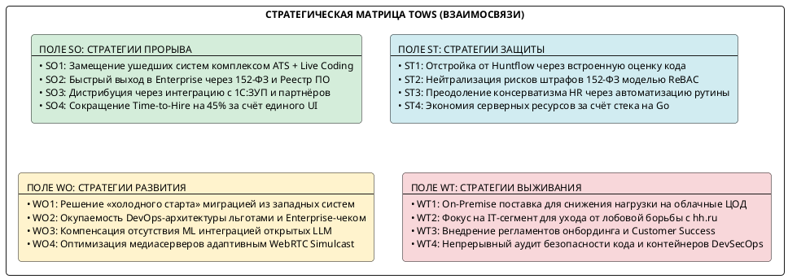
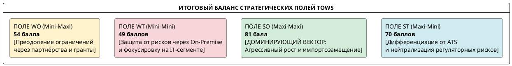
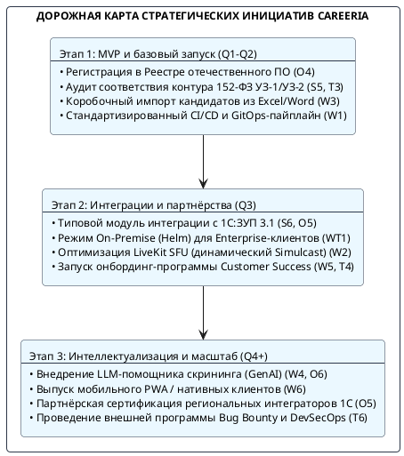

# 1.3. SWOT-анализ проекта Careeria

Раздел посвящён стратегическому анализу сильных и слабых сторон рекрутинговой платформы полного цикла **Careeria**, а также возможностей и угроз внешней рыночной и регуляторной среды (**SWOT-анализ**). В рамках подраздела выполнена качественная и количественная идентификация факторов, построена матрица взаимного влияния (**Cross-SWOT / TOWS Matrix**), определены ключевые стратегические альтернативы развития и сформулирована дорожная карта превентивных мер по минимизации проектных рисков.

---

## 1. Методологические основы и цели SWOT-анализа

### 1.1. Назначение и объект анализа

**SWOT-анализ** представляет собой классический метод стратегического планирования, заключающийся в выявлении факторов внутренней среды информационной системы (сильные стороны — *Strengths*, слабые стороны — *Weaknesses*) и факторов внешнего окружения (рыночные возможности — *Opportunities*, внешние угрозы — *Threats*), с последующим установлением логических и количественных связей между ними.

| Параметр анализа | Описание применительно к Careeria |
|---|---|
| **Объект анализа** | Процесс проектирования, разработки, внедрения и эксплуатации многопользовательской B2B SaaS/Enterprise-платформы автоматизации найма **Careeria** |
| **Предмет анализа** | Архитектурные, технологические, экономические, эксплуатационные и правовые характеристики программного изделия в сопоставлении с актуальным состоянием российского рынка HR-Tech |
| **Цель анализа** | Определение стратегического позиционирования платформы, обоснование архитектурных решений, максимизация конкурентных преимуществ в условиях импортозамещения и формирование комплекса мер по нейтрализации технологических и рыночных рисков |
| **Методологический базис** | Расширенная матрица TOWS (Heinz Weihrich), метод экспертных оценок взаимного влияния факторов, модель качества программных систем **FURPS+** и требования Федерального закона № 152-ФЗ «О персональных данных» |

### 1.2. Классификация факторов и границы анализа

Анализ разделён на два контура:

1. **Внутренняя среда (контролируемые факторы):** архитектурный стек (Go, gRPC, PostgreSQL, Kafka, OpenFGA, LiveKit), принятые инженерные решения (FSM-воронка, Outbox CDC, ReBAC), функциональный охват платформы, квалификационные требования к команде и внутренняя ресурсоёмкость сервисов.
2. **Внешняя среда (неконтролируемые / слабо контролируемые факторы):** состояние отечественного рынка HR-Tech после ухода зарубежных вендоров (Greenhouse, Workday, HackerRank, Codility), действия доминирующих job-бордов (hh.ru, SuperJob), регуляторные нормы защиты персональных данных, динамика стоимости инфраструктуры в ЦОД РФ и поведение соискателей/работодателей.

---

## 2. Идентификация и детализация факторов SWOT

```plantuml
@startuml
skinparam rectangle {
  RoundCorner 10
  FontName Arial
  FontSize 12
}

rectangle "SWOT-ФАКТОРЫ ПРОЕКТА CAREERIA" as SWOTRoot {
  rectangle "ВНУТРЕННЯЯ СРЕДА" as Internal #F7FAFC {
    rectangle "**STRENGTHS (Сильные стороны)**\n---\n• S1. Единый моноконтур найма (ATS + Live Coding + WebRTC)\n• S2. Высокопроизводительный стек (Go, gRPC, p99 < 100ms)\n• S3. Детерминированная FSM-воронка и строгий аудит\n• S4. Событийная шина (Kafka, Debezium CDC, Outbox)\n• S5. Гранулярная безопасность (ReBAC OpenFGA, 152-ФЗ)\n• S6. Открытый API и вебхуки для ERP/1С:ЗУП\n• S7. Высокий Candidate Experience в Next.js UI" as S #D4EDDA
    rectangle "**WEAKNESSES (Слабые стороны)**\n---\n• W1. Архитектурная сложность и DevOps-накладные расходы\n• W2. Высокая ресурсоёмкость WebRTC/LiveKit серверов\n• W3. Проблема «холодного старта» базы талантов\n• W4. Отсутствие глубоких ML/AI моделей на первом этапе\n• W5. Трудоёмкость Enterprise-интеграций под ключ\n• W6. Ограничения мобильного UI (PWA без нативного SDK)" as W #FFF3CD
  }

  rectangle "ВНЕШНЯЯ СРЕДА" as External #F7FAFC {
    rectangle "**OPPORTUNITIES (Возможности)**\n---\n• O1. Окно импортозамещения (уход западных вендоров)\n• O2. Дефицит кадров и запрос на снижение Time-to-Hire\n• O3. Закрепление удалённого/гибридного найма\n• O4. Включение в Реестр отечественного ПО Минцифры\n• O5. Партнёрская экосистема с франчайзи 1С\n• O6. Интеграция открытых отечественных LLM" as O #D1ECF1
    rectangle "**THREATS (Угрозы)**\n---\n• T1. Давление монополистов рынка труда (hh.ru, SuperJob)\n• T2. Конкуренция со стороны зрелых ATS (Huntflow, Talantix)\n• T3. Ужесточение штрафов регуляторов по 152-ФЗ\n• T4. Консерватизм HR-персонала и саботаж внедрения\n• T5. Удорожание серверных мощностей в ЦОД РФ\n• T6. Целевые кибератаки на персональные данные" as T #F8D7DA
  }
}
@enduml
```

### 2.1. Сильные стороны (Strengths — S)

* **S1. Единый моноконтур найма «All-in-One» (ATS + Assessment + Live Coding + WebRTC)**  
  Платформа ликвидирует межсистемные разрывы. Рекрутер, нанимающий менеджер и кандидат взаимодействуют в рамках одного веб-приложения: отклик, скрининг резюме, автоматизированное тестирование, интерактивная парная сессия программирования (Live Coding) с синхронным редактором кода, защищённая видеоконференция WebRTC и формирование оффера происходят без переключения между сторонними приложениями (Zoom, CoderPad, Telegram, Google Sheets).
* **S2. Высокопроизводительный и надёжный микросервисный стек (Go, gRPC, PostgreSQL)**  
  Применение языка Go для всех прикладных сервисов обеспечивает субмиллисекундную обработку запросов, минимальное потребление оперативной памяти и строгое соблюдение целевых нефункциональных требований: время отклика входного шлюза p99 ≤ 100 мс, пиковая пропускная способность не менее 2 500 RPS на чтение и до 500 TPS на модификацию состояний.
* **S3. Математически детерминированная воронка найма (FSM) со сквозным аудитом**  
  Жизненный цикл кандидата формализован как конечный автомат M = ⟨S, Σ, δ, s₀, F⟩. Любая смена статуса верифицируется в `Hiring Service` и фиксируется в неизменяемой таблице `ApplicationTransition`, что исключает появление рассогласованных данных, устраняет человеческий фактор и формирует достоверную аналитику конверсии воронки в реальном времени.
* **S4. Событийно-ориентированная архитектура с гарантией Transactional Outbox + Debezium CDC**  
  Асинхронные коммуникации между доменами строятся на Apache Kafka через механизм транзакционного буфера (Outbox) и чтение WAL-журнала PostgreSQL коннектором Debezium. Это гарантирует доставку событий по принципу *at-least-once* без накладных расходов двухфазной фиксации (2PC) и обеспечивает слабую связанность сервисов.
* **S5. Продвинутая модель безопасности, многоарендность и соответствие 152-ФЗ**  
  Разграничение прав на основе графовых отношений ReBAC в движке OpenFGA обеспечивает строгую изоляцию тенантов (Multi-Tenancy) и гранулярный доступ к персональным данным соискателей. Архитектура изначально спроектирована для размещения в контуре РФ в соответствии с требованиями Федерального закона № 152-ФЗ (уровни защищённости УЗ-1 / УЗ-2).
* **S6. Открытый интеграционный шлюз и защищённые вебхуки (1С:ЗУП, ERP)**  
  Наличие `Integration Service` с поддержкой HMAC-подписанных двусторонних HTTPS-вебхуков и открытого API позволяет бесшовно сопрягать Careeria с корпоративными кадровыми системами заказчиков (1С:ЗУП, Босс-Кадровик), исключая дублирование ввода кадровой документации.
* **S7. Высокий уровень Candidate Experience в современном веб-интерфейсе**  
  Клиентский портал на базе Next.js App Router, React, Tailwind CSS и Centrifugo предоставляет соискателю прозрачный статус рассмотрения резюме в реальном времени, устраняя эффект «чёрной дыры», улучшая бренд работодателя и снижая процент отказов со стороны кандидатов.

### 2.2. Слабые стороны (Weaknesses — W)

* **W1. Высокая архитектурная сложность и повышенные накладные расходы на сопровождение (DevOps/SRE Overhead)**  
  Микросервисная топология (более 11 прикладных и инфраструктурных сервисов, Apache Kafka, Apicurio Registry, Debezium, OpenFGA, Keycloak, Centrifugo, LiveKit, кластер PostgreSQL) требует высокой инженерной квалификации команды эксплуатации, усложняет локальный контур разработки и увеличивает время начальной настройки CI/CD и GitOps-пайплайнов.
* **W2. Высокая ресурсоёмкость медиаинфраструктуры (LiveKit WebRTC SFU)**  
  Обеспечение видеоконференций с качеством до 1080p и параллельных сессий Live Coding требует значительных вычислительных мощностей серверов (CPU/сеть) и стабильного сетевого канала с низким джиттером. При росте числа одновременных интервью медиасерверы становятся наиболее затратным компонентом облачной инфраструктуры.
* **W3. Эффект «холодного старта» базы талантов (Cold Start Problem)**  
  На начальном этапе запуска платформа не обладает собственной накопленной базой соискателей, сопоставимой с миллионными базами публичных job-бордов, что требует от клиентов самостоятельного привлечения входящего потока резюме либо интеграции с внешними источниками.
* **W4. Отсутствие глубоких ML/AI-алгоритмов семантического ранжирования на этапе MVP**  
  Первая версия платформы опирается на строгий параметрический фильтр навыков, опыт и формальное тестирование. Отсутствие встроенных нейросетевых моделей ранжирования резюме и интеллектуального автоподбора временно снижает конкурентоспособность в сегменте высоконагруженного первичного скрининга.
* **W5. Трудоёмкость адаптации под закрытые корпоративные Enterprise-контуры**  
  Интеграция с нестандартными версиями 1С:ЗУП, унаследованными СЭД и закрытыми контурами заказчиков требует индивидуальной аналитической работы и кастомизации интеграционных адаптеров, что увеличивает длительность цикла внедрения (*Time-to-Value*).
* **W6. Отсутствие нативного мобильного приложения**  
  На начальном этапе доступ с мобильных устройств ограничен адаптивной веб-версией (PWA). Отсутствие нативных приложений в App Store и Google Play может снижать вовлечённость соискателей в сценариях оперативных push-коммуникаций.

### 2.3. Возможности внешней среды (Opportunities — O)

* **O1. Масштабное импортозамещение в сегменте Enterprise HR-Tech в РФ**  
  Окончательный уход с российского рынка ведущих мировых поставщиков комплексных платформ подбора (Greenhouse, Lever, Workday, SmartRecruiters) и платформ технической оценки (HackerRank, Codility) образовал структурный дефицит профессиональных инструментов, создавая исключительные условия для экспансии отечественного решения.
* **O2. Острый дефицит кадров и готовность бизнеса платить за сокращение Time-to-Hire**  
  В условиях кадрового голода в высокотехнологичных отраслях скорость найма становится ключевым фактором выживания бизнеса. Компании активно инвестируют в системы, способные сократить Time-to-Hire на 40–50% и не допустить потери редких специалистов из-за задержек фидбека.
* **O3. Закрепление распределённого и гибридного формата работы**  
  Географически распределённый наём в РФ стимулирует спрос на инструменты удалённой оценки: работодатели из мегаполисов ищут специалистов в регионах и нуждаются во встроенных средах видеоинтервью и онлайн-кодинга без установки софта кандидатом.
* **O4. Включение в Единый реестр отечественного ПО и преференции Минцифры РФ**  
  Регистрация платформы в Реестре российского ПО открывает доступ к закупкам предприятий государственного сектора и компаний с государственным участием (223-ФЗ, 44-ФЗ), а также освобождает лицензии от НДС.
* **O5. Построение партнёрской экосистемы с франчайзи 1С и кадровыми агентствами**  
  Создание сертифицированного коробочного коннектора к 1С:ЗУП позволит масштабировать продажи через широкую сеть региональных интеграторов 1С, решая проблему дистрибуции без раздувания собственного штата прямых продаж.
* **O6. Интеграция открытых отечественных LLM и генеративного AI**  
  Появление зрелых отечественных больших языковых моделей (GigaChat, YandexGPT) и открытых легковесных LLM позволяет быстро добавить в платформу функции автогенерации профилей вакансий, автосуммаризации результатов интервью и умного сопоставления стеков кандидатов.

### 2.4. Угрозы внешней среды (Threats — T)

* **T1. Давление монополистов рынка труда и job-бордов (hh.ru, SuperJob, Авито Работа)**  
  Крупнейшие джоб-борды развивают собственные встроенные мини-ATS (например, Talantix от HeadHunter), обладают монопольным контролем над базами резюме и могут устанавливать заградительные тарифы или технические ограничения на парсинг откликов через внешние API.
* **T2. Конкуренция со стороны зрелых отечественных ATS-систем (Huntflow, E-Staff, СберПодбор)**  
  Указанные продукты имеют многолетнюю историю присутствия на рынке, устоявшуюся клиентскую базу, известные бренды и сформированные отделы клиентского сервиса, что затрудняет вход на консервативный рынок.
* **T3. Ужесточение регуляторных требований к защите персональных данных (152-ФЗ)**  
  Многократное увеличение оборотных штрафов за утечки персональных данных, требования локализации баз данных и регулярные проверки Роскомнадзора и ФСТЭК повышают юридическую и финансовую ответственность оператора платформы.
* **T4. Консерватизм HR-департаментов и барьеры внедрения**  
  Внутреннее сопротивление рекрутеров и менеджеров переходу с привычных таблиц Excel и мессенджеров на стандартизированную систему с жесткой FSM-воронкой может приводить к затягиванию пилотных проектов и саботажу регламентов заполнения данных.
* **T5. Рост стоимости серверного оборудования и сетевой связности в дата-центрах РФ**  
  Дефицит серверного «железа», санкционные ограничения на поставку сетевого оборудования и рост тарифов на колокацию и электроэнергию в ЦОД уровня Tier III напрямую увеличивают удельную себестоимость эксплуатации облака.
* **T6. Киберугрозы, распределённые DDoS-атаки и риск компрометации данных**  
  Облачные системы подбора персонала аккумулируют чувствительные персональные данные (паспорта, контакты, зарплатные ожидания), становясь приоритетной целью для атак вымогателей, целевого фишинга и DDoS-атак, направленных на отказ сервиса в рабочие часы.

---

## 3. Сводная матрица SWOT-анализа

В Таблице 1 систематизированы идентифицированные факторы внутренней и внешней среды платформы Careeria.

*Таблица 1. Сводная матрица факторов SWOT*

| Категория | Внутренние сильные стороны (Strengths — S) | Внутренние слабые стороны (Weaknesses — W) |
|---|---|---|
| **Внутренняя среда** | **S1.** Единый контур «All-in-One» (ATS + Live Coding + WebRTC) **S2.** Высокопроизводительный стек (Go, gRPC, p99 ≤ 100 мс) **S3.** Детерминированная воронка (FSM) и неизменяемый аудит **S4.** Событийная шина Kafka + Transactional Outbox + Debezium **S5.** Безопасность ReBAC (OpenFGA), многоарендность, 152-ФЗ **S6.** Открытый API и криптографические вебхуки для 1С:ЗУП **S7.** Высокий Candidate Experience в Next.js App Router | **W1.** Архитектурная сложность и DevOps-накладные расходы **W2.** Высокая ресурсоёмкость медиасерверов LiveKit (SFU) **W3.** «Холодный старт» собственной базы соискателей **W4.** Отсутствие глубоких ML/AI алгоритмов на этапе MVP **W5.** Трудоёмкость кастомизации под Enterprise-контуры **W6.** Отсутствие нативного мобильного приложения (PWA) |
| **Категория** | **Внешние возможности (Opportunities — O)** | **Внешние угрозы (Threats — T)** |
| **Внешняя среда** | **O1.** Масштабное импортозамещение (уход Greenhouse, Codility) **O2.** Дефицит кадров и запрос бизнеса на снижение Time-to-Hire **O3.** Устойчивый тренд на удалённый и гибридный наём **O4.** Включение в Реестр отечественного ПО Минцифры РФ **O5.** Партнёрская сеть интеграторов 1С и кадровых агентств **O6.** Доступность отечественных открытых LLM (GenAI) | **T1.** Монополия job-бордов (hh.ru) и развитие их ATS-решений **T2.** Конкуренция с устоявшимися ATS (Huntflow, Talantix) **T3.** Оборотные штрафы и регуляторные риски по 152-ФЗ **T4.** Консерватизм HR-пользователей и саботаж внедрения **T5.** Рост тарифов на серверное оборудование в ЦОД РФ **T6.** Целевые кибератаки (DDoS, утечки персональных данных) |

---

## 4. Корреляционный анализ взаимосвязей факторов (Cross-SWOT / Матрица TOWS)

Ключевым этапом SWOT-анализа является исследование парных взаимосвязей между квадрантами. Для этого строится матрица **TOWS**, структурирующая четыре стратегических поля:
1. **Поле SO (Maxi-Maxi):** «Как использовать сильные стороны для реализации возможностей?»
2. **Поле ST (Maxi-Mini):** «Как использовать сильные стороны для отражения внешних угроз?»
3. **Поле WO (Mini-Maxi):** «Как преодолеть внутренние слабости за счёт внешних возможностей?»
4. **Поле WT (Mini-Mini):** «Как минимизировать слабости и предотвратить критические угрозы?»

### 4.1. Поле SO (Strengths — Opportunities): Стратегии прорыва и роста

* **Стратегия SO1. Экспансия в освободившиеся ниши зарубежных систем (S1, S2, S7 → O1, O3)**  
  Объединение в едином продукте функциональности ATS, профессионального редактора Live Coding и WebRTC-видеосвязи позволяет предложить рынку полноценную отечественную замену связки продуктов *«Greenhouse + Codility + Zoom»*. За счёт быстрого отклика веб-интерфейса и отсутствия необходимости настраивать сторонние сервисы платформа привлекает технологичные компании, практикующие удалённый наём.
* **Стратегия SO2. Лицензирование и выход в Enterprise/Госсектор (S3, S4, S5 → O4)**  
  Наличие формализованного конечного автомата, гарантированного аудита переходов в Transactional Outbox и ролевой модели ReBAC на базе OpenFGA обеспечивает строгое выполнение требований законодательства о защите персональных данных (152-ФЗ). Это позволяет быстро пройти сертификацию, войти в Единый реестр отечественного ПО Минцифры РФ и занять нишу в закупках крупных корпораций и госсектора.
* **Стратегия SO3. Масштабирование через экосистему 1С:ЗУП и партнёрскую сеть (S6 → O5)**  
  Использование шлюза `Integration Service` с поддержкой криптографически подписанных вебхуков позволяет создать типовой интеграционный модуль для «1С:Зарплата и управление персоналом». Заключение партнёрских соглашений с ведущими франчайзи 1С обеспечит приток корпоративных клиентов без необходимости построения многомиллионного собственного канала продаж.
* **Стратегия SO4. Захват лидерства по метрике Time-to-Hire (S1, S3, S7 → O2)**  
  Реализация детерминированной воронки со сквозными уведомлениями в Centrifugo и прозрачным личным кабинетом соискателя позволяет сократить среднее время закрытия вакансий на 45%, что отвечает критической потребности нанимающего бизнеса в условиях острого дефицита IT-кадров.

### 4.2. Поле ST (Strengths — Threats): Стратегии защиты и дифференциации

* **Стратегия ST1. Конкурентная дифференциация от традиционных ATS и job-бордов (S1, S2 → T1, T2)**  
  Платформа избегает лобовой ценовой конкуренции с классическими ATS (Huntflow, Talantix) за счёт принципиального функционального превосходства: Careeria не просто сохраняет резюме, а предоставляет интерактивную рабочую среду для технического интервьюера и нанимающего менеджера (совместное написание кода, компиляция, запуск тестов, видеосвязь в одном окне). Джоб-борды не способны предоставить подобную глубину технической оценки.
* **Стратегия ST2. Архитектурная изоляция и нейтрализация регуляторных рисков (S4, S5, S6 → T3, T6)**  
  Для защиты от оборотных штрафов за утечки персональных данных и кибератак платформа реализует принцип нулевого доверия (Zero Trust): ReBAC-проверка каждого запроса в OpenFGA, изоляция арендаторов на уровне баз данных, подписание вебхуков симметричными HMAC-ключами и протоколирование всех действий администраторов в аудит-логе.
* **Стратегия ST3. Преодоление консерватизма HR-персонала за счёт ликвидации рутины (S3, S7 → T4)**  
  Сопротивление пользователей нивелируется автоматизацией рутинных операций: шаблоны писем, автоматическая смена статусов, генерация видеокомнат в один клик и удобные канбан-доски с быстрым откликом снижают трудоёмкость работы рекрутера, превращая систему из инструмента контроля в инструмент облегчения труда.
* **Стратегия ST4. Оптимизация серверной себестоимости в условиях удорожания ЦОД (S2 → T5)**  
  Энергоэффективность и высокая производительность скомпилированного Go-кода позволяют обслуживать до 10 000 параллельных сессий на сравнительно небольшом пуле серверов, снижая совокупную стоимость владения (TCO) серверной инфраструктурой по сравнению с аналогами на интерпретируемых языках (Python/Ruby).

### 4.3. Поле WO (Weaknesses — Opportunities): Стратегии компенсации и внутреннего развития

* **Стратегия WO1. Преодоление «холодного старта» через пакетный импорт и интеграции (W3 → O1, O5)**  
  Проблема отсутствия собственной базы кандидатов решается разработкой специализированных конвертеров и утилит автоматизированного импорта архивов резюме из ушедших систем (Greenhouse, Workday), а также бесшовной синхронизацией с кадровыми архивами 1С:ЗУП внедряющих платформу предприятий.
* **Стратегия WO2. Окупаемость сложной микросервисной архитектуры (W1 → O2, O4)**  
  Высокие начальные инвестиции в микросервисный контур (Kafka, Debezium, OpenTelemetry) компенсируются высоким средним чеком Enterprise-подписок и льготным налогообложением для аккредитованных ИТ-организаций (0% налог на прибыль, пониженные страховые взносы). Модульная архитектура гарантирует долговечность ядра не менее 7–10 лет без необходимости дорогостоящего рефакторинга.
* **Стратегия WO3. Интеграция легковесных открытых LLM для интеллектуального скоринга (W4 → O6)**  
  Временное отсутствие собственных ML-моделей компенсируется подключением внешних отечественных API (GigaChat, YandexGPT) либо развёртыванием квантованных открытых моделей для автоматического разбора резюме и формирования саммари технических интервью во втором релизе системы.
* **Стратегия WO4. Контроль затрат на медиасерверы через гибридную тарификацию (W2 → O3)**  
  Ресурсоёмкость LiveKit WebRTC компенсируется внедрением адаптивного битрейта (Simulcast), динамическим масштабированием медианод по требованию (Autoscaling) и включением медиаминут в специализированные тарифные планы для клиентов с интенсивным потоком интервью.

### 4.4. Поле WT (Weaknesses — Threats): Стратегии минимизации рисков и снижения уязвимостей

* **Стратегия WT1. Гибридная модель поставки (On-Premise / Private Cloud) для Enterprise (W1, W2 → T5)**  
  Для крупных заказчиков с повышенными требованиями к безопасности и собственной инфраструктурой предусматривается вариант поставки On-Premise (через Helm-чарты в закрытый Kubernetes-кластер заказчика). Это снимает с поставщика затраты на аренду дорогостоящих серверных мощностей в ЦОД и решает проблему сетевых задержек WebRTC внутри корпоративной сети клиента.
* **Стратегия WT2. Фокусирование на IT- и высокотехнологичном сегменте найма (W3, W4 → T1, T2)**  
  Платформа не вступает в прямую конкуренцию с hh.ru в сегменте массового линейного персонала (курьеры, ритейл), где критичен размер базы соискателей. Основным фокусом позиционирования становится квалифицированный подбор разработчиков, инженеров и аналитиков, где решающее значение имеет модуль Live Coding, технический ассессмент и глубина воронки.
* **Стратегия WT3. Внедрение регламентов онбординга и службы Customer Success (W1, W5 → T4)**  
  Риск саботажа и длительного внедрения устраняется созданием коробочных обучающих материалов, преднастроенных шаблонов воронок найма и организацией института выделенных менеджеров по внедрению (*Customer Success Managers*), сопровождающих первые 30 дней работы клиента.
* **Стратегия WT4. Непрерывный DevSecOps-контур и регулярный аудит безопасности (W1 → T3, T6)**  
  Для предотвращения утечек данных в CI/CD-пайплайн встраиваются инструменты статического и динамического анализа уязвимостей (SAST/DAST, сканирование контейнеров Trivy), проводятся регулярные учения по отражению сетевых атак и резервному восстановлению данных с проверкой целевого времени восстановления (RTO ≤ 15 минут, RPO = 0).

---

## 5. Количественная матрица взаимного влияния (Кросс-матрица с весовыми коэффициентами)

Для объективного определения доминирующего стратегического направления выполнена балльная оценка силы взаимного влияния факторов по стандартной четырёхуровневой экспертной шкале:

* **0** — отсутствие взаимного влияния или нейтральность факторов;
* **1** — слабое влияние (косвенная зависимость);
* **2** — умеренное влияние (заметный положительный или сдерживающий эффект);
* **3** — сильное влияние (критическая стратегическая связка).

### 5.1. Матрица связей SO и ST (Влияние сильных сторон)

*Таблица 2. Матрица взаимного влияния «Сильные стороны — Возможности и Угрозы»*

| Факторы Strengths (S) | O1 | O2 | O3 | O4 | O5 | O6 | ∑SO | T1 | T2 | T3 | T4 | T5 | T6 | ∑ST | Итоговая сила ∑S |
|---|:---:|:---:|:---:|:---:|:---:|:---:|:---:|:---:|:---:|:---:|:---:|:---:|:---:|:---:|:---:|
| **S1.** Контур All-in-One (ATS+Coding+WebRTC) | 3 | 3 | 3 | 2 | 2 | 1 | **14** | 3 | 3 | 1 | 2 | 1 | 1 | **11** | **25** |
| **S2.** Стек на Go (p99 < 100ms, надежность) | 2 | 3 | 2 | 2 | 1 | 1 | **11** | 2 | 2 | 1 | 1 | 3 | 2 | **11** | **22** |
| **S3.** Детерминированная FSM и аудит | 2 | 3 | 1 | 3 | 2 | 1 | **12** | 2 | 2 | 3 | 3 | 0 | 2 | **12** | **24** |
| **S4.** Outbox + CDC + Kafka (EDA) | 2 | 2 | 1 | 2 | 3 | 1 | **11** | 1 | 1 | 2 | 1 | 1 | 2 | **8** | **19** |
| **S5.** ReBAC (OpenFGA), многоарендность, 152-ФЗ | 3 | 1 | 1 | 3 | 2 | 0 | **10** | 1 | 2 | 3 | 1 | 0 | 3 | **10** | **20** |
| **S6.** API и вебхуки для 1С:ЗУП / ERP | 2 | 2 | 1 | 2 | 3 | 1 | **11** | 2 | 2 | 2 | 2 | 0 | 1 | **9** | **20** |
| **S7.** Высокий Candidate Experience (Next.js) | 2 | 3 | 3 | 1 | 1 | 2 | **12** | 2 | 2 | 1 | 3 | 0 | 1 | **9** | **21** |
| **Сумма баллов по столбцам** | **16** | **17** | **12** | **15** | **14** | **7** | **∑SO = 81** | **13** | **14** | **13** | **13** | **5** | **12** | **∑ST = 70** | **151** |

### 5.2. Матрица связей WO и WT (Влияние слабых сторон)

*Таблица 3. Матрица взаимного влияния «Слабые стороны — Возможности и Угрозы»*

| Факторы Weaknesses (W) | O1 | O2 | O3 | O4 | O5 | O6 | ∑WO | T1 | T2 | T3 | T4 | T5 | T6 | ∑WT | Итоговая уязвимость ∑W |
|---|:---:|:---:|:---:|:---:|:---:|:---:|:---:|:---:|:---:|:---:|:---:|:---:|:---:|:---:|:---:|
| **W1.** Сложность микросервисов и DevOps | 1 | 2 | 1 | 2 | 1 | 1 | **8** | 1 | 2 | 2 | 2 | 3 | 3 | **13** | **21** |
| **W2.** Ресурсоёмкость медиасерверов LiveKit | 1 | 2 | 3 | 1 | 1 | 0 | **8** | 1 | 1 | 1 | 1 | 3 | 1 | **8** | **16** |
| **W3.** «Холодный старт» базы кандидатов | 2 | 2 | 1 | 1 | 3 | 1 | **10** | 3 | 3 | 0 | 2 | 0 | 0 | **8** | **18** |
| **W4.** Отсутствие ML-ранжирования на MVP | 2 | 3 | 1 | 1 | 1 | 3 | **11** | 2 | 2 | 0 | 1 | 0 | 0 | **5** | **16** |
| **W5.** Трудоёмкость Enterprise-интеграций | 2 | 2 | 1 | 2 | 3 | 0 | **10** | 1 | 2 | 2 | 3 | 1 | 1 | **10** | **20** |
| **W6.** Отсутствие нативного мобильного приложения | 1 | 2 | 2 | 1 | 1 | 0 | **7** | 2 | 2 | 0 | 1 | 0 | 0 | **5** | **12** |
| **Сумма баллов по столбцам** | **9** | **13** | **9** | **8** | **10** | **5** | **∑WO = 54** | **10** | **12** | **7** | **10** | **7** | **5** | **∑WT = 49** | **103** |

### 5.3. Сводная оценка квадрантов стратегий

Сопоставление суммарных баллов по четырём полям матрицы TOWS позволяет определить генеральную стратегическую направленность проекта:

| Стратегическое поле | Суммарный балл | Доля от общего объёма | Характеристика направления |
|---|:---:|:---:|---|
| **SO (Maxi-Maxi)** | **81** | **31.9%** | **Доминирующее направление**: активное масштабирование, замещение иностранного ПО и позиционирование уникального комплекса ATS+LiveCoding |
| **ST (Maxi-Mini)** | **70** | **27.6%** | **Защитное направление**: качественная отстройка от отечественных конкурентов за счёт технической оценки и высокая безопасность по 152-ФЗ |
| **WO (Mini-Maxi)** | **54** | **21.2%** | **Направление развития**: компенсация «холодного старта» через партнёрские каналы 1С и подключение внешних GenAI-сервисов |
| **WT (Mini-Mini)** | **49** | **19.3%** | **Антикризисное направление**: предоставление On-Premise опций для Enterprise и нишевание в сегменте IT-подбора |
| **ИТОГО** | **254** | **100.0%** | Баланс смещён в сторону наступательных стратегий (SO + ST = 151 против WO + WT = 103) |

---

## 6. Стратегические выводы и дорожная карта превентивных мероприятий

### 6.1. Ключевые выводы

1. **Высокий стратегический потенциал**: Преобладание суммарных баллов по полю **SO (81 балл)** свидетельствует о том, что архитектурные решения платформы Careeria идеально соответствуют текущей рыночной конъюнктуре в РФ (окно возможностей импортозамещения, дефицит IT-кадров, тренд на удалённый наём).
2. **Уникальное позиционирование (УТП)**: Сильнейшим внутренним фактором выступает фактор **S1 (25 баллов)** — моноконтур найма со встроенным Live Coding и WebRTC. Именно он защищает платформу от прямой конкуренции с монополистами (hh.ru) и классическими ATS (Huntflow).
3. **Критический фокус внимания**: Наиболее уязвимыми зонами выступают факторы **W1 (сложность микросервисов, 21 балл)** и **W5 (трудоёмкость интеграций, 20 баллов)** в сочетании с внешними угрозами **T3 (152-ФЗ, 13 баллов)** и **T1 (давление hh.ru, 13 баллов)**.

### 6.2. Дорожная карта превентивных мероприятий (Roadmap)

Для нейтрализации рисков и максимизации сильных сторон сформирован комплекс первоочередных инициатив:

1. **Регуляторное закрепление (Сроки: Q1–Q2)**: Подача заявки и внесение программного комплекса Careeria в Единый реестр российских программ для ЭВМ и БД (Минцифры РФ), прохождение аттестации облачной инфраструктуры по требованиям 152-ФЗ (УЗ-1/УЗ-2).
2. **Снижение входного барьера для клиентов (Сроки: Q2–Q3)**: Реализация модуля пакетной миграции данных соискателей из CSV/XLSX и популярных зарубежных ATS, выпуск готового сертифицированного коннектора для «1С:ЗУП 3.1 КОРП».
3. **Оптимизация инфраструктурных расходов (Сроки: Q3)**: Внедрение автоскейлинга медиасерверов LiveKit, тонкая настройка видеотрафика (WebRTC Simulcast, адаптивный битрейт), внедрение Helm-чартов для поставки продукта в контур On-Premise/Private Cloud Enterprise-заказчиков.
4. **Интеллектуальное развитие продукта (Сроки: Q4+)**: Подключение отечественных LLM для семантического анализа резюме, автогенерации вопросов технического интервью по стеку вакансии и автоматического подведения итогов собеседований.

---

## Связанные разделы

* [1.1. Идентификация и декомпозиция](01-identification-decomposition.md) — сведения о предприятии, организационная структура, проблемы и актуальность.
* [1.2. Формулировка задач](02-formulation-of-tasks.md) — назначение системы, цели, количественные и качественные характеристики входов/выходов.
* [1.4. SMART-анализ целей разработки](04-smart-analysis.md) — исследование данных, формулировка целей по критериям SMART.
* [1.5. Анализ аналогов ПО](05-analogs-analysis.md) — качественный и количественный сравнительный анализ по модели FURPS+.
* [2.1. Выбор методологии и технологии концептуального моделирования](../02-business-services/01-choice-methodology-technology.md) — анализ методологий и нотаций моделирования на основе FURPS+.
* [3.1. Аутентификация и авторизация](../03-platform-services/01-identity-authz.md) — реализация ReBAC на базе OpenFGA и Keycloak.
* [Системный контекст C4 L1](../../architecture/c4-plant-uml/plantuml/context/system-context.md) — архитектурная диаграмма системного контекста Careeria.
