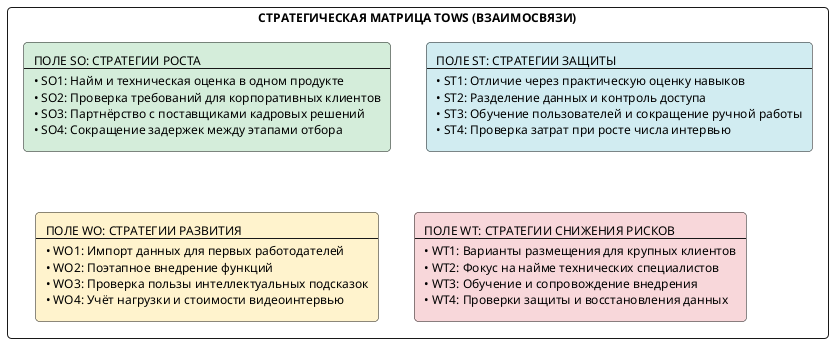
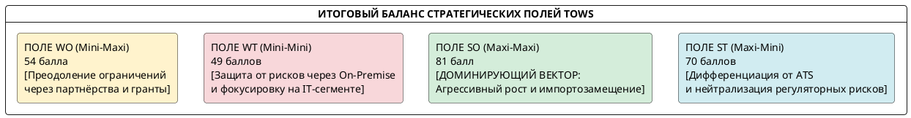
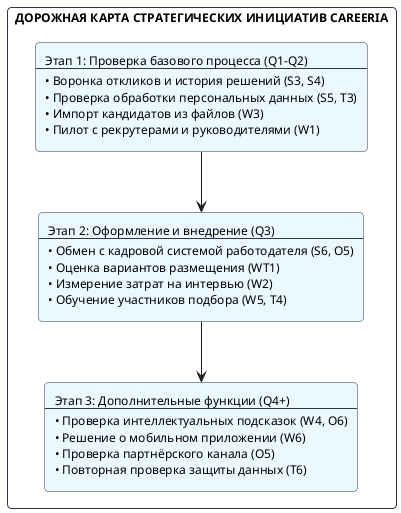

# 1.3. SWOT-анализ среды

В SWOT-анализе сильные и слабые стороны Careeria сопоставлены с рыночными возможностями и угрозами. Матрица TOWS связывает эти факторы с вариантами развития проекта и мерами по снижению рисков.

Careeria находится на этапе планирования. Поэтому сильные стороны ниже описывают целевые свойства продукта, а слабые — ограничения и затраты на их реализацию. Оценки в матрицах отражают предварительное суждение о значимости факторов, которое нужно проверить после пилота.

---

## 1. Методологические основы и цели SWOT-анализа

### 1.1. Назначение и объект анализа

**SWOT-анализ** разделяет факторы на внутренние (сильные и слабые стороны проекта) и внешние (возможности и угрозы рынка). Затем между ними устанавливаются связи для матрицы TOWS.

| Параметр анализа | Описание применительно к Careeria |
|---|---|
| **Объект анализа** | Планируемая платформа автоматизации найма **Careeria** и условия её внедрения у работодателей |
| **Предмет анализа** | Функции продукта, ограничения его первой версии, потребности участников найма и внешние рыночные риски |
| **Цель анализа** | Определить преимущества и слабые места проекта, возможности рынка и меры по снижению рисков внедрения |
| **Методологический базис** | Расширенная матрица TOWS (Heinz Weihrich), метод экспертных оценок взаимного влияния факторов, модель качества программных систем **FURPS+** и требования Федерального закона № 152-ФЗ «О персональных данных» |

### 1.2. Классификация факторов и границы анализа

Анализ разделён на два контура:

1. **Внутренняя среда (контролируемые факторы):** запланированные функции платформы, правила работы с откликами, требования к скорости и сохранности данных, объём разработки и ограничения первой версии.
2. **Внешняя среда (неконтролируемые / слабо контролируемые факторы):** состояние отечественного рынка HR-Tech после ухода зарубежных вендоров (Greenhouse, Workday, HackerRank, Codility), действия доминирующих job-бордов (hh.ru, SuperJob), регуляторные нормы защиты персональных данных, динамика стоимости инфраструктуры в ЦОД РФ и поведение соискателей/работодателей.

---

## 2. Идентификация и детализация факторов SWOT

```plantuml
@startuml
skinparam rectangle {
  RoundCorner 10
  FontName Arial
  FontSize 12
}

rectangle "SWOT-ФАКТОРЫ ПРОЕКТА CAREERIA" as SWOTRoot {
  rectangle "ВНУТРЕННЯЯ СРЕДА" as Internal #F7FAFC {
    rectangle "**STRENGTHS (Сильные стороны)**\n---\n• S1. Найм, оценка и интервью в одном процессе\n• S2. Целевой стек: Go, PostgreSQL, gRPC, Kafka\n• S3. Детерминированные переходы и история решений\n• S4. Сохранение отклика и результатов между этапами\n• S5. Доступ по ролям и защита данных\n• S6. Передача данных для кадрового оформления\n• S7. Понятный статус отклика для кандидата" as S #D4EDDA
    rectangle "**WEAKNESSES (Слабые стороны)**\n---\n• W1. Большой объём функций первой версии\n• W2. Затраты на видеоинтервью и работу с кодом\n• W3. «Холодный старт» базы талантов\n• W4. Нет семантического подбора в первой версии\n• W5. Трудоёмкость подключения кадровых систем\n• W6. Нет нативного мобильного приложения" as W #FFF3CD
  }

  rectangle "ВНЕШНЯЯ СРЕДА" as External #F7FAFC {
    rectangle "**OPPORTUNITIES (Возможности)**\n---\n• O1. Окно импортозамещения (уход западных вендоров)\n• O2. Дефицит кадров и запрос на сокращение срока закрытия вакансии\n• O3. Закрепление удалённого/гибридного найма\n• O4. Включение в Реестр отечественного ПО Минцифры\n• O5. Партнёрская экосистема с франчайзи 1С\n• O6. Интеграция открытых отечественных LLM" as O #D1ECF1
    rectangle "**THREATS (Угрозы)**\n---\n• T1. Давление монополистов рынка труда (hh.ru, SuperJob)\n• T2. Конкуренция со стороны зрелых ATS (Huntflow, Talantix)\n• T3. Ужесточение штрафов регуляторов по 152-ФЗ\n• T4. Консерватизм HR-персонала и саботаж внедрения\n• T5. Удорожание серверных мощностей в ЦОД РФ\n• T6. Целевые кибератаки на персональные данные" as T #F8D7DA
  }
}
@enduml
```

### 2.1. Сильные стороны (Strengths — S)

* **S1. Найм, оценка и интервью в одном процессе**
  Рекрутер, руководитель и кандидат работают с одним откликом: рассматривают резюме, проводят практическую оценку и интервью, согласуют решение и оффер. Им не нужно переносить результаты между таблицей, перепиской и площадкой для задания.
* **S2. Целевой технологический стек**
  Для прикладной логики выбран Go, для хранения рабочих данных — PostgreSQL; для обмена данными предусмотрены gRPC и Kafka. Такой выбор задаёт основу для роста нагрузки и проверки требований к скорости работы. Сами показатели производительности зависят от реализации и должны быть подтверждены испытаниями.
* **S3. Детерминированные переходы и история решений**
  Этапы отклика описаны конечным автоматом M = ⟨S, Σ, δ, s₀, F⟩. Для каждого состояния и действия задан допустимый следующий этап. Изменение статуса должно сохранять автора, время и причину, чтобы участники могли восстановить ход отбора.
* **S4. Сохранение результатов между этапами**
  Резюме, переписка, согласованное интервью и оценка остаются связаны с откликом. Рекрутер и руководитель получают предыдущие результаты вместе с кандидатом на следующем этапе, поэтому повторно собирать сведения не требуется.
* **S5. Доступ по ролям и защита данных**
  Участник подбора получает доступ только к сведениям, необходимым для его роли. Данные разных работодателей разделяются; порядок обработки персональных данных должен соответствовать применимым требованиям 152-ФЗ.
* **S6. Передача данных для кадрового оформления**
  После принятия оффера сведения финалиста передаются в кадровую систему работодателя. Подтверждение оформления возвращается в историю отклика, что позволяет различать принятие предложения и завершённый найм.
* **S7. Понятный статус отклика для кандидата**
  Кандидат видит этап рассмотрения и получает сообщения о дальнейших действиях в личном кабинете. Ему не нужно отдельно выяснять у рекрутера, дошло ли резюме до руководителя.

### 2.2. Слабые стороны (Weaknesses — W)

* **W1. Высокая архитектурная сложность и повышенные накладные расходы на сопровождение (DevOps/SRE Overhead)**  
  Микросервисная топология (более 11 прикладных и инфраструктурных сервисов, Apache Kafka, Apicurio Registry, Debezium, OpenFGA, Keycloak, Centrifugo, LiveKit, кластер PostgreSQL) требует высокой инженерной квалификации команды эксплуатации, усложняет локальный контур разработки и увеличивает время начальной настройки CI/CD и GitOps-пайплайнов.
* **W2. Высокая ресурсоёмкость медиаинфраструктуры (LiveKit WebRTC SFU)**  
  Обеспечение видеоконференций с качеством до 1080p и параллельных сессий Live Coding требует значительных вычислительных мощностей серверов (CPU/сеть) и стабильного сетевого канала с низким джиттером. При росте числа одновременных интервью медиасерверы становятся наиболее затратным компонентом облачной инфраструктуры.
* **W3. Эффект «холодного старта» базы талантов (Cold Start Problem)**  
  На старте у Careeria нет базы резюме, сопоставимой с базами крупных job-бордов. Клиентам нужно привлекать кандидатов самостоятельно или подключать внешние источники откликов.
* **W4. Отсутствие глубоких ML/AI-алгоритмов семантического ранжирования на этапе MVP**  
  В первой версии кандидатов отбирают по навыкам, опыту и результатам тестов. Семантического ранжирования резюме и автоматического подбора пока нет; при большом потоке откликов это ограничивает возможности первичного отбора.
* **W5. Трудоёмкость адаптации под закрытые корпоративные Enterprise-контуры**  
  Для нестандартных версий 1С:ЗУП, старых СЭД и закрытых контуров заказчиков потребуются отдельный анализ и настройка адаптеров. Это увеличивает срок внедрения.
* **W6. Отсутствие нативного мобильного приложения**  
  На старте мобильный доступ предоставляется через адаптивную веб-версию (PWA). Нативных приложений для iOS и Android нет; это ограничивает сценарии push-уведомлений.

### 2.3. Возможности внешней среды (Opportunities — O)

* **O1. Масштабное импортозамещение в сегменте Enterprise HR-Tech в РФ**  
  Ограниченная доступность Greenhouse, Lever, Workday, SmartRecruiters, HackerRank и Codility для российских клиентов оставляет спрос на местные инструменты подбора и технической оценки.
* **O2. Острый дефицит кадров и запрос на сокращение срока закрытия вакансии**
  Компаниям, которые нанимают ИТ-специалистов, важно сокращать паузы между этапами отбора и быстрее отвечать кандидатам. Цель Careeria по показателю time-to-fill — сократить срок от открытия вакансии до принятия оффера с 39 до 26 дней (на 33,3%).
* **O3. Закрепление распределённого и гибридного формата работы**  
  При найме специалистов из других регионов работодателю нужны удалённые собеседования и проверка кода. Встроенные видеоинтервью и редактор позволяют кандидату участвовать без установки отдельного приложения.
* **O4. Включение в Единый реестр отечественного ПО и преференции Минцифры РФ**  
  Регистрация платформы в Реестре российского ПО открывает доступ к закупкам предприятий государственного сектора и компаний с государственным участием (223-ФЗ, 44-ФЗ), а также освобождает лицензии от НДС.
* **O5. Построение партнёрской экосистемы с франчайзи 1С и кадровыми агентствами**  
  Готовый коннектор к 1С:ЗУП можно предложить региональным интеграторам 1С. Это создаст партнёрский канал продаж без расширения собственной команды прямых продаж.
* **O6. Интеграция открытых отечественных LLM и генеративного AI**  
  GigaChat, YandexGPT и открытые LLM можно рассмотреть для подготовки черновиков вакансий, кратких итогов интервью и сопоставления навыков кандидата с требованиями. Эти функции потребуют отдельной проверки качества.

### 2.4. Угрозы внешней среды (Threats — T)

* **T1. Давление монополистов рынка труда и job-бордов (hh.ru, SuperJob, Авито Работа)**  
  Крупнейшие джоб-борды развивают собственные встроенные мини-ATS (например, Talantix от HeadHunter), обладают монопольным контролем над базами резюме и могут устанавливать заградительные тарифы или технические ограничения на парсинг откликов через внешние API.
* **T2. Конкуренция со стороны зрелых отечественных ATS-систем (Huntflow, E-Staff, СберПодбор)**  
  Указанные продукты имеют многолетнюю историю присутствия на рынке, устоявшуюся клиентскую базу, известные бренды и сформированные отделы клиентского сервиса, что затрудняет вход на консервативный рынок.
* **T3. Ужесточение регуляторных требований к защите персональных данных (152-ФЗ)**  
  Многократное увеличение оборотных штрафов за утечки персональных данных, требования локализации баз данных и регулярные проверки Роскомнадзора и ФСТЭК повышают юридическую и финансовую ответственность оператора платформы.
* **T4. Консерватизм HR-департаментов и барьеры внедрения**  
  Внутреннее сопротивление рекрутеров и менеджеров переходу с привычных таблиц Excel и мессенджеров на стандартизированную систему с жесткой FSM-воронкой может приводить к затягиванию пилотных проектов и саботажу регламентов заполнения данных.
* **T5. Рост стоимости серверного оборудования и сетевой связности в дата-центрах РФ**  
  Дефицит серверного «железа», санкционные ограничения на поставку сетевого оборудования и рост тарифов на колокацию и электроэнергию в ЦОД уровня Tier III напрямую увеличивают удельную себестоимость эксплуатации облака.
* **T6. Киберугрозы, распределённые DDoS-атаки и риск компрометации данных**  
  Облачные системы подбора персонала аккумулируют чувствительные персональные данные (паспорта, контакты, зарплатные ожидания), становясь приоритетной целью для атак вымогателей, целевого фишинга и DDoS-атак, направленных на отказ сервиса в рабочие часы.

---

## 3. Сводная матрица SWOT-анализа

В таблице 1 систематизированы идентифицированные факторы внутренней и внешней среды платформы Careeria.

Таблица 1. Сводная матрица факторов SWOT

| Категория | Внутренние сильные стороны (Strengths: S) | Внутренние слабые стороны (Weaknesses: W) |
|---|---|---|
| **Внутренняя среда** | **S1.** Найм, оценка и интервью в одном процессе **S2.** Целевой стек: Go, PostgreSQL, gRPC, Kafka **S3.** Детерминированные переходы и история решений **S4.** Сохранение результатов между этапами **S5.** Доступ по ролям и защита персональных данных **S6.** Передача данных для кадрового оформления **S7.** Понятный статус отклика для кандидата | **W1.** Большой объём функций первой версии **W2.** Затраты на видеоинтервью и работу с кодом **W3.** «Холодный старт» базы соискателей **W4.** Нет семантического подбора в первой версии **W5.** Трудоёмкость подключения кадровых систем **W6.** Нет нативного мобильного приложения |
| **Категория** | **Внешние возможности (Opportunities — O)** | **Внешние угрозы (Threats — T)** |
| **Внешняя среда** | **O1.** Масштабное импортозамещение (уход Greenhouse, Codility) **O2.** Дефицит кадров и запрос бизнеса на сокращение срока закрытия вакансии **O3.** Устойчивый тренд на удалённый и гибридный наём **O4.** Включение в Реестр отечественного ПО Минцифры РФ **O5.** Партнёрская сеть интеграторов 1С и кадровых агентств **O6.** Доступность отечественных открытых LLM (GenAI) | **T1.** Монополия job-бордов (hh.ru) и развитие их ATS-решений **T2.** Конкуренция с устоявшимися ATS (Huntflow, Talantix) **T3.** Оборотные штрафы и регуляторные риски по 152-ФЗ **T4.** Консерватизм HR-пользователей и саботаж внедрения **T5.** Рост тарифов на серверное оборудование в ЦОД РФ **T6.** Целевые кибератаки (DDoS, утечки персональных данных) |

---

## 4. Корреляционный анализ взаимосвязей факторов (Cross-SWOT / Матрица TOWS)

Матрица **TOWS** сопоставляет внутренние и внешние факторы в четырёх полях:
1. **Поле SO (Maxi-Maxi):** «Как использовать сильные стороны для реализации возможностей?»
2. **Поле ST (Maxi-Mini):** «Как использовать сильные стороны для отражения внешних угроз?»
3. **Поле WO (Mini-Maxi):** «Как преодолеть внутренние слабости за счёт внешних возможностей?»
4. **Поле WT (Mini-Mini):** «Как минимизировать слабости и предотвратить критические угрозы?»

### 4.1. Поле SO (Strengths — Opportunities): Стратегии прорыва и роста

* **Стратегия SO1. Выход в нишу удалённого найма (S1, S2, S7 → O1, O3)**
  Careeria планирует объединить работу с откликами, практическую оценку и видеоинтервью. Работодателю с удалённым наймом будет проще провести кандидата через эти этапы без переноса сведений между несколькими продуктами.
* **Стратегия SO2. Выход к корпоративным заказчикам (S3, S4, S5 → O4)**
  Для корпоративного работодателя важны история решений, разграничение доступа и сохранность данных при передаче между этапами. Перед выходом в регулируемые закупки проекту потребуется отдельно проверить применимые требования к обработке персональных данных и условия включения в реестр отечественного ПО.
* **Стратегия SO3. Партнёрство с поставщиками кадровых решений (S6 → O5)**
  Планируемый обмен сведениями о финалисте и подтверждением оформления может быть полезен работодателям, уже ведущим кадровый учёт в 1С:ЗУП. Формат подключения и партнёрский канал нужно проверить с первыми заказчиками.
* **Стратегия SO4. Сокращение срока закрытия вакансии (S1, S3, S7 → O2)**
  Воронка с правилами переходов, своевременными уведомлениями и кабинетом кандидата должна сократить ожидание между этапами. Расчётная цель проекта — уменьшить средний срок от открытия вакансии до принятия оффера на 33,3%.

### 4.2. Поле ST (Strengths — Threats): Стратегии защиты и дифференциации

* **Стратегия ST1. Практическая оценка как отличие от традиционных ATS (S1, S2 → T1, T2)**
  Careeria отличается от Huntflow и Talantix рабочим местом для технического интервью: совместное написание кода, компиляция, запуск тестов и видеосвязь доступны в одном окне. Этот сценарий выбран как основа позиционирования продукта.
* **Стратегия ST2. Разделение данных и контроль доступа (S4, S5, S6 → T3, T6)**
  Пользователи должны видеть данные только своей организации и в пределах назначенной роли. Журнал действий помогает разбирать спорные случаи доступа и изменения сведений. Эти требования снижают риск несанкционированного просмотра персональных данных.
* **Стратегия ST3. Преодоление консерватизма HR-персонала за счёт ликвидации рутины (S3, S7 → T4)**  
  Чтобы рекрутерам было проще перейти на новую систему, предусмотрены шаблоны писем, автоматическая смена статусов, создание видеокомнат и канбан-доска. Эти функции сокращают ручные действия при ведении отклика.
* **Стратегия ST4. Проверка стоимости работы при росте нагрузки (S2 → T5)**
  Выбор Go для прикладной логики позволяет планировать работу при большой нагрузке, но не гарантирует низкую стоимость эксплуатации сам по себе. Испытания должны показать, сколько одновременных откликов и интервью система выдерживает при приемлемом времени ответа. По этим данным можно рассчитать стоимость работы у крупных работодателей.

### 4.3. Поле WO (Weaknesses — Opportunities): Стратегии компенсации и внутреннего развития

* **Стратегия WO1. Преодоление «холодного старта» через пакетный импорт и интеграции (W3 → O1, O5)**  
  Для переноса данных клиентов планируются конвертеры архивов резюме из Greenhouse и Workday и синхронизация с кадровыми архивами 1С:ЗУП. Это поможет начать работу без собственной базы кандидатов.
* **Стратегия WO2. Поэтапное внедрение функций (W1 → O2, O4)**
  В первую очередь нужно проверить с работодателями воронку откликов, интервью и оценку кандидатов. Дополнительные сценарии следует планировать после проверки базового процесса на пилоте. Такой порядок уменьшает риск задержать запуск из-за большого объёма функций.
* **Стратегия WO3. Проверка интеллектуальных подсказок (W4 → O6)**
  После пилота можно проверить, помогают ли автоматические черновики вакансий и краткие итоги интервью рекрутеру и руководителю. Решение о включении этих функций зависит от качества результатов и времени, которое они экономят пользователям.
* **Стратегия WO4. Контроль затрат на видеоинтервью (W2 → O3)**
  При пилоте нужно измерить длительность и число одновременных встреч, качество связи и стоимость их проведения. Эти данные помогут определить условия использования для работодателей с большим потоком интервью.

### 4.4. Поле WT (Weaknesses — Threats): Стратегии минимизации рисков и снижения уязвимостей

* **Стратегия WT1. Варианты размещения для крупных клиентов (W1, W2 → T5)**
  Если работодателю требуется работа в собственном контуре, условия размещения и стоимость нужно оценить до договора. Это особенно важно для компаний с большим числом параллельных интервью.
* **Стратегия WT2. Фокусирование на IT- и высокотехнологичном сегменте найма (W3, W4 → T1, T2)**  
  Careeria ориентируется на подбор разработчиков, инженеров и аналитиков. Для этих ролей важны Live Coding и техническая оценка; в массовом найме, где решает размер базы кандидатов, проект не планирует конкурировать с hh.ru.
* **Стратегия WT3. Внедрение регламентов онбординга и службы Customer Success (W1, W5 → T4)**  
  Для первых 30 дней работы клиента предусмотрены обучающие материалы, готовые шаблоны воронок и помощь менеджера по внедрению (*Customer Success Manager*). Это должно снизить нагрузку при переходе на новую систему.
* **Стратегия WT4. Проверки защиты и восстановления данных (W1 → T3, T6)**
  До пилота нужно проверить разграничение доступа, порядок хранения персональных данных и восстановление после сбоя. Затем проверки повторяют при изменении функций, связанных с откликами и кадровым обменом.

---

## 5. Количественная матрица взаимного влияния (Кросс-матрица с весовыми коэффициентами)

Связи между факторами оценены по четырёхуровневой экспертной шкале:

- 0: отсутствие взаимного влияния или нейтральность факторов;
- 1: слабое влияние (косвенная зависимость);
- 2: умеренное влияние (заметный положительный или сдерживающий эффект);
- 3: сильное влияние (критическая стратегическая связка).

### 5.1. Матрица связей SO и ST (Влияние сильных сторон)

Таблица 2. Матрица взаимного влияния «Сильные стороны - Возможности и Угрозы»

| Факторы Strengths (S) | O1 | O2 | O3 | O4 | O5 | O6 | ∑SO | T1 | T2 | T3 | T4 | T5 | T6 | ∑ST | Итоговая сила ∑S |
|---|:---:|:---:|:---:|:---:|:---:|:---:|:---:|:---:|:---:|:---:|:---:|:---:|:---:|:---:|:---:|
| **S1.** Найм и оценка в одном процессе | 3 | 3 | 3 | 2 | 2 | 1 | **14** | 3 | 3 | 1 | 2 | 1 | 1 | **11** | **25** |
| **S2.** Целевой стек Go, PostgreSQL, gRPC, Kafka | 2 | 3 | 2 | 2 | 1 | 1 | **11** | 2 | 2 | 1 | 1 | 3 | 2 | **11** | **22** |
| **S3.** Детерминированная FSM и аудит | 2 | 3 | 1 | 3 | 2 | 1 | **12** | 2 | 2 | 3 | 3 | 0 | 2 | **12** | **24** |
| **S4.** Результаты связаны с откликом | 2 | 2 | 1 | 2 | 3 | 1 | **11** | 1 | 1 | 2 | 1 | 1 | 2 | **8** | **19** |
| **S5.** Доступ по ролям и защита данных | 3 | 1 | 1 | 3 | 2 | 0 | **10** | 1 | 2 | 3 | 1 | 0 | 3 | **10** | **20** |
| **S6.** Передача данных для оформления | 2 | 2 | 1 | 2 | 3 | 1 | **11** | 2 | 2 | 2 | 2 | 0 | 1 | **9** | **20** |
| **S7.** Статус отклика виден кандидату | 2 | 3 | 3 | 1 | 1 | 2 | **12** | 2 | 2 | 1 | 3 | 0 | 1 | **9** | **21** |
| **Сумма баллов по столбцам** | **16** | **17** | **12** | **15** | **14** | **7** | **∑SO = 81** | **13** | **14** | **13** | **13** | **5** | **12** | **∑ST = 70** | **151** |

### 5.2. Матрица связей WO и WT (Влияние слабых сторон)

Таблица 3. Матрица взаимного влияния «Слабые стороны - Возможности и Угрозы»

| Факторы Weaknesses (W) | O1 | O2 | O3 | O4 | O5 | O6 | ∑WO | T1 | T2 | T3 | T4 | T5 | T6 | ∑WT | Итоговая уязвимость ∑W |
|---|:---:|:---:|:---:|:---:|:---:|:---:|:---:|:---:|:---:|:---:|:---:|:---:|:---:|:---:|:---:|
| **W1.** Большой объём функций первой версии | 1 | 2 | 1 | 2 | 1 | 1 | **8** | 1 | 2 | 2 | 2 | 3 | 3 | **13** | **21** |
| **W2.** Затраты на видеоинтервью и код | 1 | 2 | 3 | 1 | 1 | 0 | **8** | 1 | 1 | 1 | 1 | 3 | 1 | **8** | **16** |
| **W3.** «Холодный старт» базы кандидатов | 2 | 2 | 1 | 1 | 3 | 1 | **10** | 3 | 3 | 0 | 2 | 0 | 0 | **8** | **18** |
| **W4.** Отсутствие ML-ранжирования на MVP | 2 | 3 | 1 | 1 | 1 | 3 | **11** | 2 | 2 | 0 | 1 | 0 | 0 | **5** | **16** |
| **W5.** Подключение кадровых систем | 2 | 2 | 1 | 2 | 3 | 0 | **10** | 1 | 2 | 2 | 3 | 1 | 1 | **10** | **20** |
| **W6.** Отсутствие нативного мобильного приложения | 1 | 2 | 2 | 1 | 1 | 0 | **7** | 2 | 2 | 0 | 1 | 0 | 0 | **5** | **12** |
| **Сумма баллов по столбцам** | **9** | **13** | **9** | **8** | **10** | **5** | **∑WO = 54** | **10** | **12** | **7** | **10** | **7** | **5** | **∑WT = 49** | **103** |

### 5.3. Сводная оценка квадрантов стратегий

Суммы баллов по четырём полям матрицы TOWS приведены ниже:

| Стратегическое поле | Суммарный балл | Доля от общего объёма | Характеристика направления |
|---|:---:|:---:|---|
| **SO (Maxi-Maxi)** | **81** | **31.9%** | **Доминирующее направление**: активное масштабирование, замещение иностранного ПО и позиционирование уникального комплекса ATS+LiveCoding |
| **ST (Maxi-Mini)** | **70** | **27.6%** | **Защитное направление**: качественная отстройка от отечественных конкурентов за счёт технической оценки и высокая безопасность по 152-ФЗ |
| **WO (Mini-Maxi)** | **54** | **21.2%** | **Направление развития**: импорт сведений для первых клиентов, партнёрские каналы и проверка дополнительных функций |
| **WT (Mini-Mini)** | **49** | **19.3%** | **Антикризисное направление**: предоставление On-Premise опций для Enterprise и нишевание в сегменте IT-подбора |
| **ИТОГО** | **254** | **100.0%** | Баланс смещён в сторону наступательных стратегий (SO + ST = 151 против WO + WT = 103) |

---

## 6. Стратегические выводы и дорожная карта превентивных мероприятий

### 6.1. Ключевые выводы

1. **Высокий стратегический потенциал**: По принятой экспертной шкале поле **SO получило 81 балл** — больше остальных полей. Наиболее заметные возможности в этой оценке связаны с импортозамещением, подбором ИТ-специалистов и удалённым наймом.
2. **Позиционирование продукта**: Наибольшую оценку среди внутренних факторов получил **S1 (25 баллов)** — работа с откликом, техническая оценка и интервью в одном процессе. Это планируемое отличие Careeria от job-бордов и классических ATS.
3. **Основные ограничения**: По принятой шкале высокие оценки получили **W1 (объём функций первой версии, 21 балл)** и **W5 (подключение кадровых систем, 20 баллов)**. При планировании пилота их нужно рассматривать вместе с угрозами **T3 (требования к персональным данным, 13 баллов)** и **T1 (конкуренция job-бордов, 13 баллов)**.

### 6.2. Дорожная карта превентивных мероприятий (Roadmap)

Ниже перечислены инициативы по этапам разработки:

1. **Проверка базового процесса (Q1–Q2)**: Реализовать ведение отклика и историю решений, проверить правила переходов, импорт сведений и работу рекрутера с руководителем на пилотных вакансиях.
2. **Кадровое оформление и внедрение (Q2–Q3)**: Проверить передачу сведений финалиста в кадровую систему работодателя, подтверждение оформления, обучение участников и применимые требования к обработке персональных данных.
3. **Оценка нагрузки и затрат (Q3)**: Измерить время ответа при росте числа откликов, число одновременных интервью, качество связи и стоимость работы. По результатам определить условия для крупных работодателей.
4. **Дополнительные функции (Q4+)**: Проверить пользу интеллектуальных подсказок, спрос на мобильное приложение и возможность расширения партнёрского канала.

---

## Связанные разделы

* [1.1. Идентификация и декомпозиция](01-identification-decomposition.md) — сведения о предприятии, организационная структура, проблемы и актуальность.
* [1.2. Формулировка задач](02-formulation-of-tasks.md) — назначение системы, цели, количественные и качественные характеристики входов/выходов.
* [1.4. SMART-анализ целей разработки](04-smart-analysis.md) — исследование данных, формулировка целей по критериям SMART.
* [1.5. Анализ аналогов ПО](05-analogs-analysis.md) — качественный и количественный сравнительный анализ по модели FURPS+.
* [2.1. Выбор методологии и технологии концептуального моделирования](../02-business-services/01-choice-methodology-technology.md) — анализ методологий и нотаций моделирования на основе FURPS+.
* [Системный контекст C4 L1](../../architecture/c4-plant-uml/plantuml/context/system-context.md) — архитектурная диаграмма системного контекста Careeria.
