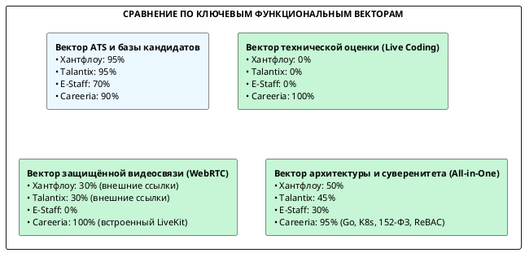

# 1.5. Анализ аналогов ПО

Раздел посвящён комплексному сравнительному исследованию существующих программных аналогов и прямых конкурентов рекрутинговой платформы полного цикла **Careeria**. В рамках подраздела обоснована методология сравнительного анализа на основе требований, классифицированных по модели **FURPS+**, выполнена детальная характеристика ключевых систем отечественного и зарубежного рынка HR-Tech, а также проведён углублённый качественный и количественный многокритериальный анализ, подтверждающий техническую, функциональную и экономическую целесообразность собственной разработки.

---

## 1. Методологические основы и постановка проблемы сравнительного анализа

### 1.1. Классификационный базис требований на основе модели FURPS+

Для проведения сравнительного анализа система требований структурирована по международной модели качества программного обеспечения **FURPS+** (Robert Grady, Hewlett-Packard / ISO/IEC 25010):

| Категория FURPS+ | Содержание требований применительно к платформе Careeria |
|---|---|
| **F — Functionality (Функциональность)** | Сквозное покрытие воронки найма (ATS): настраиваемый Kanban, парсинг резюме, строгий FSM-контроль переходов с неизменяемым журналом аудита (`ApplicationTransition`); встроенная среда тестирования компетенций (Assessment Engine); интерактивная среда совместного написания кода (Live Coding Room); встроенный защищённый медиасервер видеоконференций (WebRTC) без сторонних сервисов; Realtime-коммуникации (WebSocket); двусторонние интеграции с корпоративными HR-системами (1С:ЗУП, ERP через Webhooks и API). |
| **U — Usability (Удобство использования)** | Единый моноконтур «All-in-One» (ликвидация переключения между разрозненными окнами Zoom, CoderPad, Telegram, Excel и ATS); интуитивный Drag-and-Drop интерфейс; адаптивный веб-кабинет соискателя (PWA/Responsive) с прозрачным отслеживанием статуса отклика. |
| **R — Reliability (Надёжность)** | Коэффициент готовности сервиса ≥ 99.9%; отсутствие единой точки отказа (SPOF); гарантированная сохранность транзакций и событий интеграции за счёт паттерна Transactional Outbox, CDC Debezium и шины Apache Kafka (RPO = 0 сек). |
| **P — Performance (Производительность)** | Субмиллисекундная обработка транзакций на языке Go; время отклика API на 99-м перцентиле ≤ 100 мс; сетевая задержка синхронизации правок в сессии Live Coding ≤ 50 мс; задержка медиапотока WebRTC ≤ 150–200 мс; масштабируемость до 2 500 RPS на чтение и до 500 TPS на модификацию состояний. |
| **S — Supportability (Сопровождаемость и стандарты)** | Микросервисная модульная Cloud-Native архитектура (Docker, Kubernetes); гранулярное разграничение доступа на основе отношений ReBAC (OpenFGA); строгое соответствие требованиям Федерального закона № 152-ФЗ «О персональных данных» (УЗ-1/УЗ-2, хранение данных в ЦОД на территории РФ); технологический суверенитет и импортонезависимость. |

---

## 2. Обзор и характеристика аналогов программного обеспечения

Для объективного сравнительного исследования отобрана репрезентативная выборка наиболее распространённых отечественных систем автоматизации рекрутинга, активно эксплуатируемых российскими предприятиями, а также сопоставлен международный технологический бенчмарк.

```plantuml
@startuml
skinparam rectangle {
  RoundCorner 10
  FontName Arial
  FontSize 12
}

rectangle "ЛАНДШАФТ РЫНКА РЕШЕНИЙ HR-TECH" as Landscape {
  rectangle "**Отечественные ATS-системы**\n(Коммерческий сектор РФ)" as DomATS #EBF8FF {
    rectangle "**Хантфлоу (Huntflow)**\nЛидер коммерческого сегмента ATS.\nСильные стороны: база резюме, парсинг,\nинтеграции с job-бордами и мессенджерами.\nОграничения: нет Live Coding, нет встроенной\nвидеосвязи, нет FSM-аудита." as Huntflow #D4EDDA
    rectangle "**Talantix (HeadHunter)**\nCRM-система экосистемы hh.ru.\nСильные стороны: прямая база hh.ru,\nсовместный отбор, автостатусы.\nОграничения: замкнутость на hh.ru,\nнет Live Coding, нет встроенной ВКС,\nтолько SaaS-облако вендора." as Talantix #D4EDDA
  }

  rectangle "**Корпоративные On-Premises комплексы**\n(Традиционный Enterprise / Гос / Банки)" as EntLegacy #FFF3CD {
    rectangle "**E-Staff Рекрутер (Datex)**\nКлассическая клиент-серверная система.\nСильные стороны: автономность, 1С:ЗУП On-Premises.\nОграничения: устаревшая Windows-архитектура,\nнет веб/мобильного UX, нет Live Coding,\nнет WebRTC и Realtime-коммуникаций." as EStaff #FEEBC8
  }

  rectangle "**Зарубежный Enterprise-бенчмарк**\n(Ушедшие с рынка РФ вендоры)" as GlobalBench #FED7D7 {
    rectangle "**Фрагментированный стек Запада**\n• ATS: Greenhouse / Lever\n• Оценка кода: HackerRank / CoderPad\n• Видео: Zoom / Google Meet\nОграничения в РФ: уход вендоров, блокировки,\nпрямое нарушение 152-ФЗ о локализации ПДн." as Global #FEB2B2
  }

  rectangle "**ЦЕЛЕВАЯ ПЛАТФОРМА CAREERIA**\nЕдиный суверенный микросервисный моноконтур\nATS Core + Assessment Engine + Live Coding + WebRTC LiveKit" as Careeria #C6F6D5
}
@enduml
```

### 2.1. Аналог 1: Хантфлоу (Huntflow)

* **Разработчик:** ООО «Хантфлоу» (Россия).
* **Архитектурная модель:** Мультитенантное облачное SaaS-решение с возможностью поставки Enterprise On-Premises лицензий.
* **Функциональный профиль:** Специализированная Applicant Tracking System (ATS), ориентированная на оптимизацию рутинных операций рекрутеров. Предоставляет развитые инструменты формирования базы резюме, плагин для браузера «Хантфлоу Линк» для быстрого сохранения профилей кандидатов с работных сайтов (hh.ru, SuperJob, Хабр Карьера, LinkedIn, GitHub), интеграцию с электронной почтой и Telegram, а также модуль согласования заявок на подбор.
* **Сильные стороны:**
  - Высокое качество парсинга резюме из форматов PDF, DOCX и веб-страниц;
  - Богатая экосистема интеграций с внешними работными порталами и календарями (Яндекс Календарь, Google Calendar, Outlook);
  - Наличие открытого REST API и вебхуков для экспорта кадровых данных;
  - Соответствие требованиям 152-ФЗ с размещением серверов в российских дата-центрах.
* **Функциональные и архитектурные ограничения относительно Careeria:**
  - **Полное отсутствие инструментов оценки практических технических навыков:** в системе нет модуля алгоритмического тестирования и интерактивной среды совместного написания кода (Live Coding). При найме IT-специалистов компании вынуждены дополнительно покупать подписки на сторонние сервисы (CoderPad, Codility);
  - **Отсутствие встроенной защищённой видеосвязи:** система не имеет собственного медиасервера WebRTC. Назначение интервью сводится к автоматической генерации внешней ссылки на сторонние сервисы (Яндекс.Телемост, МТС Линк, Zoom, Google Meet). Это приводит к разрыву пользовательского опыта, риску срыва собеседований из-за лимитов сторонних платформ и отсутствию единого видеоархива со сквозным шифрованием;
  - **Отсутствие строгой математической машины состояний (FSM):** переходы кандидатов между этапами не защищены детерминированным конечным автоматом с блокировкой недопустимых ветвлений и распределённым транзакционным аудитом;
  - **Разрыв рабочего пространства («зоопарк инструментов»):** рекрутер и нанимающий менеджер вынуждены переключаться между окнами Хантфлоу, стороннего видеосервиса, онлайн-редактора кода и корпоративного мессенджера.

### 2.2. Аналог 2: Talantix (Талантикс)

* **Разработчик:** Группа компаний HeadHunter (ООО «Хэдхантер», Россия).
* **Архитектурная модель:** Облачная SaaS CRM-система для рекрутинга, тесно интегрированная в экосистему job-борда HeadHunter (hh.ru).
* **Функциональный профиль:** Система предназначена для автоматизации работы с откликами и кандидатами преимущественно из базы данных hh.ru. Обеспечивает ведение настраиваемой воронки отбора, командное обсуждение соискателей, автоматическую отправку шаблонов писем соискателям, импорт резюме из файлов и базовую аналитику эффективности источников найма.
* **Сильные стороны:**
  - Бесшовная двухсторонняя интеграция с крупнейшей в РФ базой соискателей hh.ru: автоматический импорт откликов в реальном времени, обновление контактов и статусов;
  - Простой и интуитивно понятный пользовательский интерфейс, адаптированный под типовые регламенты массового и линейного подбора;
  - Наличие готовой интеграции с сервисом чат-ботов и кадровой аналитикой HeadHunter;
  - Размещение серверных мощностей в контуре ЦОД HeadHunter в строгом соответствии с 152-ФЗ.
* **Функциональные и архитектурные ограничения относительно Careeria:**
  - **Экосистемная монозависимость и закрытость:** система оптимизирована исключительно под работу с сервисами hh.ru. Импорт из нестандартных источников, профессиональных репозиториев (GitLab/GitHub) и закрытых профессиональных баз ограничен;
  - **Отсутствие On-Premises версии:** поставка осуществляется только по модели публичного облака вендора, что неприемлемо для ряда Enterprise-заказчиков и банковских структур с высокими требованиями к изоляции контура;
  - **Полное отсутствие модулей технической квалификационной оценки:** нет средств создания тестов, верификации программного кода и проведения сессий совместной разработки;
  - **Отсутствие встроенного WebRTC-видеоконтура:** встречи планируются через внешние ВКС-системы сторонних поставщиков;
  - **Упрощённая модель разграничения прав доступа:** используется статическая ролевая модель (RBAC), не позволяющая строить гранулярные политики на основе отношений (ReBAC) между филиалами, проектными командами и конфиденциальными вакансиями.

### 2.3. Аналог 3: E-Staff Рекрутер (Datex Software)

* **Разработчик:** Компания «Datex Software» (Россия).
* **Архитектурная модель:** Классическая тиражируемая клиент-серверная система автоматизации кадровых служб (Desktop-приложение для Windows с централизованной СУБД, On-Premises).
* **Функциональный профиль:** Исторически одна из первых отечественных систем управления рекрутингом. Обеспечивает ведение многоуровневой базы данных кандидатов, учёт вакансий, публикацию объявлений на работных порталах, сбор откликов и массовую рассылку сообщений. Позиционируется для крупных предприятий с традиционной кадровой службой.
* **Сильные стороны:**
  - Полная автономность и возможность функционирования в закрытых корпоративных сетях (Air-gapped Networks) без выхода в открытый Интернет;
  - Зрелая, проверенная многолетней эксплуатацией интеграция с учетными конфигурациями «1С:Зарплата и управление персоналом» (1С:ЗУП) на уровне прямых выгрузок данных;
  - Отсутствие периодических SaaS-платежей за базовые лицензии (модель разовой закупки программного обеспечения);
  - Высокая гибкость конфигурирования реляционных структур данных на стороне клиента.
* **Функциональные и архитектурные ограничения относительно Careeria:**
  - **Устаревшая архитектурная парадигма:** толстый клиент под ОС Windows требует локальной установки на рабочие места специалистов, что затрудняет эксплуатацию на современных платформах (macOS, Linux) и мобильных устройствах;
  - **Отсутствие современного веб- и мобильного опыта:** соискатели лишены интерактивного личного кабинета, а процесс взаимодействия строится исключительно через электронную почту;
  - **Полное отсутствие интерактивных коммуникаций реального времени:** система не поддерживает WebSockets, встроенный Realtime-чат и встроенные видеоконференции WebRTC;
  - **Отсутствие инструментов профессиональной оценки IT-персонала:** нет средств автоматизированного тестирования, симуляции задач и интерактивного Live Coding;
  - **Крайне высокая стоимость масштабирования и администрирования:** обновление версий требует ручного обновления каждого рабочего места, отсутствуют механизмы контейнерной оркестрации (Docker, Kubernetes) и горизонтального масштабирования микросервисов.

### 2.4. Сопоставление с зарубежными системами (Enterprise-бенчмарк)

На международном рынке индустриальным стандартом для технологических корпораций (Google, Amazon, Meta, Uber) исторически являлось применение связки из трёх независимых классов систем:
1. **Enterprise ATS:** платформы **Greenhouse** или **Lever** — высокоразвитые воронки найма с открытыми API;
2. **Technical Assessment Platforms:** специализированные платформы **HackerRank**, **Codility** или **CoderPad** — изолированные облачные песочницы для проверки алгоритмов и совместного программирования;
3. **Enterprise Video Conferencing:** корпоративные сервисы видеосвязи **Zoom** или **Google Meet**.

В текущих макроэкономических и правовых условиях прямое использование зарубежного стека на российском предприятии **невозможно по следующим критическим причинам**:
- **Юридический запрет (152-ФЗ РФ):** в соответствии с ч. 5 ст. 18 Федерального закона «О персональных данных» запись, систематизация, накопление и хранение персональных данных граждан РФ должны осуществляться с использованием баз данных, находящихся на территории РФ. Сервисы Greenhouse, HackerRank и Zoom хранят данные в облаках AWS/GCP за пределами юрисдикции РФ, что влечёт штрафы до 18 млн рублей и блокировку Роскомнадзором;
- **Санкционные риски и отключение обслуживания:** уход вендоров, блокировка корпоративных аккаунтов российских компаний и невозможность оплаты лицензий;
- **Высокая совокупная стоимость владения (TCO):** раздельная покупка трёх подписок (ATS + CoderPad + Zoom) обходится в расчёте на одного нанимающего менеджера в 3–5 раз дороже единой платформы.

Платформа **Careeria** решает эту фундаментальную проблему путём создания **суверенного All-in-One моноконтура**, объединяющего ATS, Live Coding и WebRTC на базе современного отечественного технологического стека.

---

## 3. Качественный сравнительный анализ аналогов ПО

Качественный анализ выполнен на основе сопоставления функциональных возможностей систем с эталонными требованиями платформы Careeria. 

В таблице приняты следующие условные обозначения:
- **«+»** — требование полностью реализовано и штатно функционирует в базовой поставке системы;
- **«±»** — требование реализовано частично, с существенными функциональными ограничениями либо требует подключения внешних сторонних платных сервисов;
- **«−»** — требование не реализовано (функциональные возможности отсутствуют).

### 3.1. Таблица качественного анализа соответствия требованиям

| № | Группа требований и функциональный критерий | Хантфлоу (Huntflow) | Talantix (HeadHunter) | E-Staff Рекрутер (Datex) | Careeria (Разрабатываемое ПО) |
|---|---|:---:|:---:|:---:|:---:|
| **1** | **Блок ATS и управление воронкой отбора** | | | | |
| 1.1 | Создание вакансий, публикация и настраиваемый Kanban-пайплайн | **+** | **+** | **±** *(устаревший UI)* | **+** |
| 1.2 | Автоматизированный парсинг резюме из файлов PDF, DOCX | **+** | **+** | **±** *(требует настройки)* | **+** |
| 1.3 | Детерминированная воронка на базе конечного автомата (FSM) | **±** *(простая история)* | **±** *(базовые статусы)* | **−** | **+** *(математический FSM)* |
| 1.4 | Неизменяемый журнал аудита переходов (`ApplicationTransition`) | **±** *(лог событий)* | **±** *(лог событий)* | **−** | **+** *(строгий append-only аудит)* |
| **2** | **Блок оценки компетенций и Live Coding** | | | | |
| 2.1 | Встроенный модуль квалификационного онлайн-тестирования | **−** | **−** | **±** *(оффлайн-тесты)* | **+** *(Assessment Engine)* |
| 2.2 | Интерактивная среда совместного написания кода (Live Coding) | **−** | **−** | **−** | **+** *(синхронный редактор)* |
| 2.3 | Изолированная компиляция кода и запуск юнит-тестов (Sandbox) | **−** | **−** | **−** | **+** *(Docker-песочницы)* |
| **3** | **Блок медиакоммуникаций и Realtime-взаимодействия** | | | | |
| 3.1 | Встроенные видео- и аудиоконференции (WebRTC) без внешних ПО | **−** *(ссылки на Zoom)* | **−** *(ссылки на ВКС)* | **−** | **+** *(LiveKit Media Server)* |
| 3.2 | Демонстрация экрана в процессе интервью | **±** *(через сторонние ВКС)* | **±** *(через сторонние ВКС)* | **−** | **+** *(нативный WebRTC)* |
| 3.3 | Централизованная запись собеседований и хранение в контуре | **−** | **−** | **−** | **+** *(MinIO/S3 + ReBAC)* |
| 3.4 | Встроенный Realtime-чат соискателя с рекрутером и чат комнаты | **±** *(Email/Telegram)* | **±** *(чат внутри hh)* | **−** | **+** *(Centrifugo WebSockets)* |
| **4** | **Блок интеграций и безопасности данных** | | | | |
| 4.1 | Двусторонняя синхронизация с кадровыми системами (1С:ЗУП, ERP) | **+** *(REST/Webhooks)* | **±** *(через API hh)* | **+** *(зрелая выгрузка)* | **+** *(Outbox + CDC + Kafka)* |
| 4.2 | Гарантированная транзакционная доставка событий (Transactional Outbox) | **−** | **−** | **−** | **+** *(Debezium CDC + Kafka)* |
| 4.3 | Гранулярный контроль доступа на основе отношений (ReBAC) | **−** *(статический RBAC)* | **−** *(статический RBAC)* | **−** *(локальные права)* | **+** *(OpenFGA ReBAC)* |
| 4.4 | Локализация баз данных в РФ и соблюдение требований 152-ФЗ | **+** | **+** | **+** | **+** *(УЗ-1 / УЗ-2)* |
| **5** | **Архитектура и развёртывание** | | | | |
| 5.1 | Единое рабочее пространство All-in-One (без разрыва контекста) | **−** *(разрыв на ВКС/код)* | **−** *(разрыв на ВКС)* | **−** *(разрыв процессов)* | **+** *(единое веб-окно)* |
| 5.2 | Cloud-Native микросервисный стек (контейнеризация, Kubernetes) | **±** *(монолит/SaaS)* | **±** *(закрытое облако)* | **−** *(Win32 клиент-сервер)* | **+** *(Go, Docker, K8s)* |
| 5.3 | Возможность On-Premises и Private Cloud развёртывания | **+** *(Enterprise)* | **−** *(только SaaS)* | **+** *(локальный сервер)* | **+** *(полная автономность)* |

```plantuml
@startuml
skinparam componentStyle uml2
skinparam packageStyle rectangle

package "Типовая архитектура конкурентов (Хантфлоу / Talantix)" as CompetitorArch #FFF5F5 {
  [ATS CRM-система] as ATSComp #FEB2B2
  [Внешний сервис ВКС\n(Zoom / Яндекс.Телемост / Google Meet)] as ZoomComp #FED7D7
  [Сторонняя платформа тестов\n(CoderPad / HackerRank / Google Docs)] as CodeComp #FED7D7
  [Корпоративный мессенджер\n(Telegram / Email)] as MessComp #FED7D7

  ATSComp ..> ZoomComp : Ручная генерация ссылок\n(разрыв сессии)
  ATSComp ..> CodeComp : Внешние ссылки на задачи\n(утечка контекста)
  ATSComp ..> MessComp : Неструктурированная переписка\n(потеря истории)
  note bottom of CompetitorArch
    **Проблема разрозненности (Siloed Tools):**
    • Потеря до 40% рабочего времени на переключение окон;
    • Риски утечки ПДн за пределы контролируемого контура;
    • Отсутствие единого протокола оценки соискателя.
  end note
}

package "Целевая архитектура платформы Careeria" as CareeriaArch #F0FFF4 {
  [Next.js Unified Web Interface\n(Кандидат / Рекрутер / Руководитель)] as WebUI #9AE6B4
  package "Единый защищённый микросервисный контур" as Core #C6F6D5 {
    [Hiring & ATS Service\n(Go, FSM State Machine)] as ATSCore #E2E8F0
    [Assessment & Live Coding Service\n(Go, Sandbox Runner)] as CodeCore #E2E8F0
    [LiveKit WebRTC Media Server\n(Встроенная видеосвязь)] as MediaCore #E2E8F0
    [Centrifugo Realtime Messaging\n(WebSockets)] as ChatCore #E2E8F0
    [OpenFGA ReBAC Authz Engine\n(Гранулярный доступ)] as AuthzCore #E2E8F0
  }
  WebUI --> ATSCore
  WebUI --> CodeCore
  WebUI --> MediaCore
  WebUI --> ChatCore
  WebUI --> AuthzCore
  note bottom of CareeriaArch
    **Преимущества All-in-One моноконтура:**
    • Нулевой разрыв контекста (все этапы в одном окне браузера);
    • Сквозной неизменяемый аудит каждого действия;
    • Полное соответствие 152-ФЗ и сквозное шифрование.
  end note
}
@enduml
```

### 3.2. Аналитические выводы по результатам качественного анализа

1. **Разрыв функционального моноконтура у существующих решений:**  
   Ни один из исследованных коммерческих продуктов российского рынка (Хантфлоу, Talantix, E-Staff) не закрывает потребности сквозного цикла подбора IT- и высококвалифицированных специалистов. Существующие аналоги сфокусированы преимущественно на этапе ведения воронки резюме (ATS), полностью игнорируя этапы углублённой квалификационной оценки. В результате нанимающие компании вынуждены выстраивать сложный и уязвимый «зоопарк сервисов», оплачивая одновременно 3–4 разрозненные подписки.
2. **Критическое отставание в технологиях реального времени (Realtime & WebRTC):**  
   Аналоги не содержат собственных серверов медиапотоков WebRTC и полагаются на генерацию внешних гиперссылок на сторонние платформы (Zoom, Телемост, МТС Линк). Это создаёт критические уязвимости: невозможность централизованной видеозаписи в защищённом хранилище работодателя, отсутствие связи видеопотока с карточкой соискателя и риск блокировок со стороны зарубежных провайдеров.
3. **Отсутствие математически детерминированной воронки найма:**  
   В аналогах статусная модель носит справочный характер, что допускает несогласованные переходы кандидатов «задним числом». В платформе Careeria реализован строгий конечный автомат (FSM), где любой переход проверяется сервисным слоем и фиксируется в неизменяемой таблице `ApplicationTransition`, гарантируя 100% достоверность кадровой аналитики.
4. **Необходимость создания Careeria:**  
   Качественный анализ со всей очевидностью подтверждает наличие незанятой рыночной ниши для отечественной платформы, объединяющей функции ATS, защищённой видеосвязи и интерактивного Live Coding в едином контуре.

---

## 4. Количественный сравнительный анализ аналогов ПО по модели FURPS

Для получения строгого математического обоснования эффективности разрабатываемой платформы проведён количественный многокритериальный анализ на базе модели требований **FURPS+** и метода взвешенных экспертных оценок.

### 4.1. Математический аппарат количественного анализа

1. Сформирован перечень из *N* = 12 приоритетных требований, охватывающих функциональные и архитектурные характеристики системы.
2. Каждому требованию *i* присвоен коэффициент важности (вес) *kᵢ* ∈ (0.0; 1.0], отражающий вклад данного требования в достижение бизнес-целей проекта (сокращение Time-to-Hire на 45%, снижение затрат на найм на 35%, обеспечение защиты ПДн по 152-ФЗ):

   > ***S*ₘₐₓ = ∑ *kᵢ*** *(для i = 1 .. N)*
   >
   > где *S*ₘₐₓ — максимально возможная теоретическая сумма баллов эталонной идеальной системы.

3. Степень реализации каждого требования *i* в исследуемом программном продукте оценивается экспертным коэффициентом *rᵢ* ∈ [0.0; 1.0]:
   - ***rᵢ* = 1.0** — требование полностью реализовано на высоком техническом уровне в базовой функциональности;
   - ***rᵢ* = 0.8–0.9** — требование реализовано в полном объёме с незначительными непринципиальными ограничениями;
   - ***rᵢ* = 0.6–0.7** — требование реализовано частично (удовлетворительное покрытие, ограниченный интерфейс);
   - ***rᵢ* = 0.3–0.5** — слабая реализация требования либо зависимость от внешних сторонних плагинов;
   - ***rᵢ* = 0.1–0.2** — рудиментарное покрытие базовых функций;
   - ***rᵢ* = 0.0** — требование полностью отсутствует.
4. Взвешенная оценка удовлетворения *i*-го требования конкретным продуктом вычисляется по формуле:

   > ***Fᵢ* = *rᵢ* × *kᵢ***

5. Итоговая интегральная оценка качества и конкурентоспособности программного комплекса (*S*) определяется как сумма взвешенных оценок по всем *N* требованиям:

   > ***S* = ∑ *Fᵢ* = ∑ (*rᵢ* × *kᵢ*)** *(для i = 1 .. N)*

6. Относительный показатель степени совершенства и соответствия эталону (*E*, %) рассчитывается как отношение интегральной оценки к теоретическому максимуму:

   > ***E* = (*S* / *S*ₘₐₓ) × 100%**

### 4.2. Расчётная таблица количественного анализа аналогов

*Таблица 1. Сравнительный количественный скоринг аналогов ПО и платформы Careeria по модели FURPS+*

| № | Приоритетное требование (FURPS+) | Категория | Вес k | АНАЛОГ 1: Хантфлоу | | АНАЛОГ 2: Talantix | | АНАЛОГ 3: E-Staff | | НАШ ПРОДУКТ: Careeria | |
|---|---|:---:|:---:|:---:|:---:|:---:|:---:|:---:|:---:|:---:|:---:|
| | | | | **Оценка r₁** | **Балл F₁ = r₁ × k** | **Оценка r₂** | **Балл F₂ = r₂ × k** | **Оценка r₃** | **Балл F₃ = r₃ × k** | **Оценка r (наш)** | **Балл F (наш) = r × k** |
| 1 | Управление воронкой найма и Kanban-пайплайн (ATS Core) | **F** | **1.0** | 1.0 | **1.00** | 0.9 | **0.90** | 0.7 | **0.70** | 0.9 | **0.90** |
| 2 | Автоматизированный парсинг резюме и нормализация профиля | **F** | **0.8** | 0.9 | **0.72** | 1.0 | **0.80** | 0.7 | **0.56** | 0.8 | **0.64** |
| 3 | Детерминированный FSM-контроль переходов со сквозным аудитом | **F** | **0.9** | 0.6 | **0.54** | 0.5 | **0.45** | 0.4 | **0.36** | 1.0 | **0.90** |
| 4 | Встроенный модуль онлайн-тестирования (Assessment Engine) | **F** | **0.9** | 0.3 | **0.27** | 0.2 | **0.18** | 0.4 | **0.36** | 0.9 | **0.81** |
| 5 | Интерактивная среда совместного написания кода (Live Coding) | **F** | **1.0** | 0.0 | **0.00** | 0.0 | **0.00** | 0.0 | **0.00** | 1.0 | **1.00** |
| 6 | Встроенный WebRTC-сервер видеосвязи без внешних сервисов | **F** | **1.0** | 0.3 | **0.30** | 0.3 | **0.30** | 0.0 | **0.00** | 1.0 | **1.00** |
| 7 | Встроенный Realtime-чат (WebSocket) и коммуникации | **F** | **0.7** | 0.6 | **0.42** | 0.5 | **0.35** | 0.1 | **0.07** | 0.9 | **0.63** |
| 8 | Двусторонняя интеграция с 1С:ЗУП / ERP (API, Webhooks) | **F** | **0.8** | 0.8 | **0.64** | 0.6 | **0.48** | 0.9 | **0.72** | 0.8 | **0.64** |
| 9 | Единый бесшовный All-in-One моноконтур (без разрыва окон) | **U** | **1.0** | 0.4 | **0.40** | 0.4 | **0.40** | 0.2 | **0.20** | 1.0 | **1.00** |
| 10 | Отказоустойчивость и надёжность (SLA ≥ 99.9%, Outbox CDC) | **R** | **0.8** | 0.8 | **0.64** | 0.8 | **0.64** | 0.6 | **0.48** | 0.9 | **0.72** |
| 11 | Быстродействие API (p99 < 100 мс) и низкие сетевые задержки | **P** | **0.8** | 0.7 | **0.56** | 0.7 | **0.56** | 0.5 | **0.40** | 0.9 | **0.72** |
| 12 | Безопасность по 152-ФЗ, ReBAC и суверенность стека | **S** | **0.9** | 0.8 | **0.72** | 0.7 | **0.63** | 0.7 | **0.63** | 1.0 | **0.90** |
| **ИТОГО** | **Сумма баллов: S = ∑ Fᵢ** | | **Sₘₐₓ = 10.60** | | **S₁ = 6.21** | | **S₂ = 5.69** | | **S₃ = 4.48** | | **S (наш) = 9.86** |
| **ИТОГО** | **Относительное соответствие: E = (S / Sₘₐₓ) × 100%** | | **100.0%** | | **58.58%** | | **53.68%** | | **42.26%** | | **93.02%** |

### 4.3. Детальный комментарий к выставленным оценкам

1. **Позиция 1 (ATS воронка, k = 1.0):** Хантфлоу (r = 1.0) является эталоном рынка коммерческого рекрутинга с удобным интерфейсом. Talantix (r = 0.9) имеет развитую, но более привязанную к HH воронку. E-Staff (r = 0.7) функционален, но ограничен архаичным десктопным интерфейсом. В Careeria (r = 0.9) воронка построена на базе современного реактивного веб-интерфейса Kanban с поддержкой drag-and-drop.
2. **Позиция 2 (Парсинг резюме, k = 0.8):** Talantix (r = 1.0) обладает идеальным парсером благодаря прямому доступу к структурированной базе hh.ru. Хантфлоу (r = 0.9) использует мощный модуль парсинга файлов. Careeria (r = 0.8) решает задачу парсинга PDF/DOCX библиотеками микросервиса `Candidate Service`.
3. **Позиции 4–6 (Тестирование, Live Coding, WebRTC видеосвязь, суммарный вес ∑ k = 2.9):** Ключевой дифференциатор платформы. Ни Хантфлоу (0.0, 0.3), ни Talantix (0.0, 0.3), ни E-Staff (0.0, 0.0) не имеют встроенных сред технического интервью. Их баллы минимальны, так как они генерируют лишь текстовые ссылки на сторонние Zoom/Телемост. Careeria (r = 0.9–1.0) реализует полнофункциональный контур на базе медиасервера LiveKit и синхронного редактора кода на WebSockets/Centrifugo.
4. **Позиция 9 (Единый All-in-One моноконтур, k = 1.0):** Конкуренты имеют крайне низкие оценки (r = 0.2–0.4), поскольку процесс найма IT-специалиста неизбежно разбивается на цепочку несвязанных программ: ATS → Zoom → CoderPad → Telegram. В Careeria (r = 1.0) все участники работают в рамках единого окна браузера Next.js.
5. **Позиция 12 (Безопасность 152-ФЗ, ReBAC, k = 0.9):** Хантфлоу и Talantix (r = 0.7–0.8) соблюдают требования хранения ПДн в РФ, но используют традиционную статическую модель RBAC. Careeria (r = 1.0) реализует гранулярную модель прав на базе отношений ReBAC (OpenFGA), гарантирующую изоляцию данных на уровне объектов организаций.

---

## 5. Графическая интерпретация результатов сравнительного анализа

### Сопоставление интегральных показателей эффективности

Для наглядного анализа превосходства разрабатываемой платформы рассчитаны коэффициенты относительного опережения Careeria над ближайшими конкурентами:

> **Δ*S* = *S*\_Careeria − *S*\_Аналог**
>
> **Прирост эффективности = ((*S*\_Careeria − *S*\_Аналог) / *S*\_Аналог) × 100%**

| Исследуемый продукт | Интегральный балл *S* | Степень соответствия *E* | Абсолютный разрыв Δ*S* | Относительное преимущество Careeria |
|---|:---:|:---:|:---:|:---:|
| **Careeria (Разрабатываемое ПО)** | **9.86** | **93.02%** | — | — |
| **Хантфлоу (Huntflow)** | **6.21** | **58.58%** | **+3.65** | **+58.78%** *(в 1.59 раза эффективнее)* |
| **Talantix (HeadHunter)** | **5.69** | **53.68%** | **+4.17** | **+73.29%** *(в 1.73 раза эффективнее)* |
| **E-Staff Рекрутер (Datex)** | **4.48** | **42.26%** | **+5.38** | **+120.09%** *(в 2.20 раза эффективнее)* |

---

## 6. Выводы и обоснование целесообразности разработки Careeria

На основе проведённого качественного и количественного сравнительного анализа программных аналогов сформулированы следующие выводы:

1. **Подтверждение гипотезы рыночного разрыва:**  
   Ни один из представленных на отечественном рынке программных продуктов не обеспечивает сквозной автоматизации процесса подбора персонала. Существующие системы узко сфокусированы на воронке резюме (ATS), вынуждая нанимающие организации использовать сторонние сервисы для видеосвязи (Zoom, Телемост) и технической оценки (CoderPad, HackerRank).
2. **Количественное превосходство Careeria:**  
   По результатам взвешенного многокритериального анализа по модели FURPS+ платформа **Careeria** набрала **9.86 балла из 10.60 возможных** (степень соответствия идеальному профилю требований — **93.02%**), существенно опередив лидера коммерческого сегмента Хантфлоу (**6.21 балла / 58.58%**) и экосистемный продукт Talantix (**5.69 балла / 53.68%**). Относительное преимущество Careeria составляет **+58.78%** и **+73.29%** соответственно.
3. **Ликвидация рисков информационной безопасности и соблюдение 152-ФЗ:**  
   Объединение видеосвязи, редактора совместного кода и базы соискателей в защищённый суверенный микросервисный моноконтур устраняет утечки персональных данных соискателей во внешние облачные сервисы, обеспечивая полное соответствие нормативным требованиям регуляторов РФ (уровни защищённости УЗ-1 / УЗ-2).
4. **Экономический эффект внедрения:**  
   Переход на платформу Careeria исключает затраты на приобретение множественных разрозненных лицензий, сокращает среднее время закрытия технической вакансии на **45%** за счёт непрерывного All-in-One цикла и снижает совокупные затраты на наём сотрудника на **35%**.
5. **Итоговое заключение:**  
   Разработка и внедрение цифровой платформы **Careeria** являются научно, технически и экономически обоснованными, а создаваемый программный продукт обладает высокой конкурентоспособностью и значительным потенциалом импортозамещения на рынке корпоративного HR-Tech.

---

## Связанные разделы

* [1.1. Идентификация и декомпозиция](01-identification-decomposition.md) — предметная область, сведения о предприятии, FSM-модель воронки найма.
* [1.2. Формулировка задач](02-formulation-of-tasks.md) — назначение системы, цели, характеристики ввода/вывода, требования к надёжности и безопасности.
* [1.3. SWOT-анализ](03-swot-analysis.md) — стратегический анализ факторов внутренней и внешней среды, матрица TOWS и дорожная карта.
* [2.1. Выбор методологии и технологии концептуального моделирования ИС](../02-business-services/01-choice-methodology-technology.md) — методологический базис FURPS+ и архитектурное обоснование.
* [Системный контекст C4 L1](../../architecture/c4-plant-uml/plantuml/context/system-context.md) — системный контекст платформы Careeria.
* [Контейнеры C4 L2](../../architecture/c4-plant-uml/plantuml/container/full-system.md) — компонентно-контейнерная архитектура платформы.
