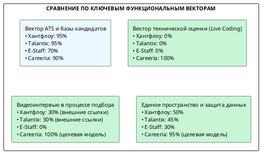

# 1.5. Анализ аналогов ПО

В разделе Careeria сравнивается с российскими и зарубежными системами для найма. Критерии сгруппированы по модели FURPS+; далее приведены описание аналогов, функциональное сравнение и расчёт оценок.

---

## 1. Методологические основы и постановка проблемы сравнительного анализа

### 1.1. Классификационный базис требований на основе модели FURPS+

Требования для сравнения сгруппированы по FURPS+ (Robert Grady, Hewlett-Packard / ISO/IEC 25010):

| Категория FURPS+ | Содержание требований применительно к платформе Careeria |
|---|---|
| F - Functionality (Функциональность) | Сквозное покрытие воронки найма: вакансии, отклики, настраиваемые этапы и детерминированные правила переходов с историей решений; проверка навыков и совместная работа с кодом; видеособеседование и переписка в одном рабочем пространстве; обмен данными с кадровой системой работодателя. |
| U - Usability (Удобство использования) | Единый моноконтур «All-in-One» (ликвидация переключения между разрозненными окнами Zoom, CoderPad, Telegram, Excel и ATS); интуитивный Drag-and-Drop интерфейс; адаптивный веб-кабинет соискателя (PWA/Responsive) с прозрачным отслеживанием статуса отклика. |
| R - Reliability (Надёжность) | Целевая доступность системы не ниже 99,9%; сохранение откликов, оценок и решений при сбоях; возможность восстановить работу без потери подтверждённых действий пользователя. |
| P - Performance (Производительность) | Проверяемое время ответа при просмотре воронки и изменении статуса; своевременное отображение правок при совместной работе с кодом и приемлемое качество видеосвязи при одновременных интервью. |
| S - Supportability (Сопровождаемость и стандарты) | Разделение данных работодателей, доступ по ролям, учёт требований Федерального закона № 152-ФЗ «О персональных данных» и возможность расширять сценарии подбора без нарушения уже согласованных правил. |

---

## 2. Обзор и характеристика аналогов программного обеспечения

Для сравнения выбраны российские системы автоматизации найма и зарубежные продукты, представляющие три отдельных класса инструментов: ATS, техническую оценку и видеосвязь.

```plantuml
@startuml
skinparam rectangle {
  RoundCorner 10
  FontName Arial
  FontSize 12
}

rectangle "ЛАНДШАФТ РЫНКА РЕШЕНИЙ HR-TECH" as Landscape {
  rectangle "Отечественные ATS-системы\n(Коммерческий сектор РФ)" as DomATS #EBF8FF {
    rectangle "Хантфлоу (Huntflow)\nЛидер коммерческого сегмента ATS.\nСильные стороны: база резюме, парсинг,\nинтеграции с job-бордами и мессенджерами.\nОграничения: нет Live Coding, нет встроенной\nвидеосвязи, нет FSM-аудита." as Huntflow #D4EDDA
    rectangle "Talantix (HeadHunter)\nCRM-система экосистемы hh.ru.\nСильные стороны: прямая база hh.ru,\nсовместный отбор, автостатусы.\nОграничения: замкнутость на hh.ru,\nнет Live Coding, нет встроенной ВКС,\nтолько SaaS-облако вендора." as Talantix #D4EDDA
  }

  rectangle "Корпоративные On-Premises комплексы\n(Традиционный Enterprise / Гос / Банки)" as EntLegacy #FFF3CD {
    rectangle "E-Staff Рекрутер (Datex)\nКлассическая клиент-серверная система.\nСильные стороны: автономность, 1С:ЗУП On-Premises.\nОграничения: устаревшая Windows-архитектура,\nнет веб/мобильного UX, нет Live Coding,\nнет WebRTC и Realtime-коммуникаций." as EStaff #FEEBC8
  }

  rectangle "Зарубежный Enterprise-бенчмарк\n(Ушедшие с рынка РФ вендоры)" as GlobalBench #FED7D7 {
    rectangle "Фрагментированный стек Запада\n• ATS: Greenhouse / Lever\n• Оценка кода: HackerRank / CoderPad\n• Видео: Zoom / Google Meet\nОграничения в РФ: уход вендоров, блокировки,\nпрямое нарушение 152-ФЗ о локализации ПДн." as Global #FEB2B2
  }

  rectangle "ЦЕЛЕВАЯ ПЛАТФОРМА CAREERIA\nВакансии и отклики, практическая оценка,\nвидеоинтервью и переписка в одном процессе" as Careeria #C6F6D5
}
@enduml
```

### 2.1. Аналог 1: Хантфлоу (Huntflow)

- Разработчик: ООО «Хантфлоу» (Россия).
- Архитектурная модель: мультитенантное облачное SaaS-решение с возможностью поставки Enterprise On-Premises лицензий.
- Функциональный профиль: специализированная Applicant Tracking System (ATS), ориентированная на оптимизацию рутинных операций рекрутеров. Предоставляет развитые инструменты формирования базы резюме, плагин для браузера «Хантфлоу Линк» для быстрого сохранения профилей кандидатов с работных сайтов (hh.ru, SuperJob, Хабр Карьера, LinkedIn, GitHub), интеграцию с электронной почтой и Telegram, а также модуль согласования заявок на подбор.
- Сильные стороны:
    - Высокое качество парсинга резюме из форматов PDF, DOCX и веб-страниц;
    - Богатая экосистема интеграций с внешними работными порталами и календарями (Яндекс Календарь, Google Calendar, Outlook);
    - Наличие открытого REST API и вебхуков для экспорта кадровых данных;
    - Соответствие требованиям 152-ФЗ с размещением серверов в российских дата-центрах.
- Функциональные и архитектурные ограничения относительно Careeria:
    - Полное отсутствие инструментов оценки практических технических навыков: в системе нет модуля алгоритмического тестирования и интерактивной среды совместного написания кода (Live Coding). При найме IT-специалистов компании вынуждены дополнительно покупать подписки на сторонние сервисы (CoderPad, Codility);
    - Отсутствие встроенной видеосвязи: для интервью система формирует ссылку на отдельную площадку. Организатору приходится проверять доступность встречи и затем возвращать её результаты в карточку кандидата;
    - Отсутствие строгой математической машины состояний (FSM): переходы кандидатов между этапами не защищены детерминированным конечным автоматом с блокировкой недопустимых ветвлений и распределённым транзакционным аудитом;
    - Разрыв рабочего пространства («зоопарк инструментов»): рекрутер и нанимающий менеджер вынуждены переключаться между окнами Хантфлоу, стороннего видеосервиса, онлайн-редактора кода и корпоративного мессенджера.

### 2.2. Аналог 2: Talantix (Талантикс)

- Разработчик: группа компаний HeadHunter (ООО «Хэдхантер», Россия).
- Архитектурная модель: облачная SaaS CRM-система для рекрутинга, тесно интегрированная в экосистему job-борда HeadHunter (hh.ru).
- Функциональный профиль: система предназначена для автоматизации работы с откликами и кандидатами преимущественно из базы данных hh.ru. Обеспечивает ведение настраиваемой воронки отбора, командное обсуждение соискателей, автоматическую отправку шаблонов писем соискателям, импорт резюме из файлов и базовую аналитику эффективности источников найма.
- Сильные стороны:
    - Бесшовная двухсторонняя интеграция с крупнейшей в РФ базой соискателей hh.ru: автоматический импорт откликов в реальном времени, обновление контактов и статусов;
    - Простой и интуитивно понятный пользовательский интерфейс, адаптированный под типовые регламенты массового и линейного подбора;
    - Наличие готовой интеграции с сервисом чат-ботов и кадровой аналитикой HeadHunter;
    - Размещение серверных мощностей в контуре ЦОД HeadHunter в строгом соответствии с 152-ФЗ.
- Функциональные и архитектурные ограничения относительно Careeria:
    - Экосистемная монозависимость и закрытость: система оптимизирована исключительно под работу с сервисами hh.ru. Импорт из нестандартных источников, профессиональных репозиториев (GitLab/GitHub) и закрытых профессиональных баз ограничен;
    - Отсутствие On-Premises версии: поставка осуществляется только по модели публичного облака вендора, что неприемлемо для ряда Enterprise-заказчиков и банковских структур с высокими требованиями к изоляции контура;
    - Полное отсутствие модулей технической квалификационной оценки: нет средств создания тестов, верификации программного кода и проведения сессий совместной разработки;
    - Отсутствие встроенного видеоинтервью: встречи планируются через отдельные средства видеосвязи;
    - Упрощённая модель разграничения прав доступа: используется статическая ролевая модель (RBAC), не позволяющая строить гранулярные политики на основе отношений (ReBAC) между филиалами, проектными командами и конфиденциальными вакансиями.

### 2.3. Аналог 3: E-Staff Рекрутер (Datex Software)

- Разработчик: компания «Datex Software» (Россия).
- Архитектурная модель: классическая тиражируемая клиент-серверная система автоматизации кадровых служб (Desktop-приложение для Windows с централизованной СУБД, On-Premises).
- Функциональный профиль: исторически одна из первых отечественных систем управления рекрутингом. Обеспечивает ведение многоуровневой базы данных кандидатов, учёт вакансий, публикацию объявлений на работных порталах, сбор откликов и массовую рассылку сообщений. Позиционируется для крупных предприятий с традиционной кадровой службой.
- Сильные стороны:
    - Полная автономность и возможность функционирования в закрытых корпоративных сетях (Air-gapped Networks) без выхода в открытый Интернет;
    - Зрелая, проверенная многолетней эксплуатацией интеграция с учётными конфигурациями «1С:Зарплата и управление персоналом» (1С:ЗУП) на уровне прямых выгрузок данных;
    - Отсутствие периодических SaaS-платежей за базовые лицензии (модель разовой закупки программного обеспечения);
    - Высокая гибкость конфигурирования реляционных структур данных на стороне клиента.
- Функциональные и архитектурные ограничения относительно Careeria:
    - Устаревшая архитектурная парадигма: толстый клиент под ОС Windows требует локальной установки на рабочие места специалистов, что затрудняет эксплуатацию на современных платформах (macOS, Linux) и мобильных устройствах;
    - Отсутствие современного веб- и мобильного опыта: соискатели лишены интерактивного личного кабинета, а процесс взаимодействия строится исключительно через электронную почту;
    - Нет встроенных средств общения во время интервью: переписку и видеовстречу организуют вне системы;
    - Отсутствие инструментов профессиональной оценки IT-персонала: нет средств автоматизированного тестирования, симуляции задач и интерактивного Live Coding;
    - Сложное обновление рабочих мест: клиентскую программу требуется обслуживать на компьютерах пользователей.

### 2.4. Сопоставление с зарубежными системами (Enterprise-бенчмарк)

В сравнении зарубежный набор инструментов представлен тремя классами систем:

1. Enterprise ATS: платформы Greenhouse или Lever - высокоразвитые воронки найма с открытыми API;
2. Technical Assessment Platforms: специализированные платформы HackerRank, Codility или CoderPad - изолированные облачные песочницы для проверки алгоритмов и совместного программирования;
3. Enterprise Video Conferencing: корпоративные сервисы видеосвязи Zoom или Google Meet.

При выборе зарубежных сервисов для российского работодателя нужно проверить следующие ограничения:

- Юридический запрет (152-ФЗ РФ): [ч. 5 ст. 18 закона](https://mintrud.gov.ru/docs/laws/130) ограничивает использование баз данных за пределами РФ при сборе персональных данных граждан РФ. Применимость ограничения к каждому сервису зависит от того, какие данные он получает и где они обрабатываются;
- Санкционные риски и отключение обслуживания: уход вендоров, блокировка корпоративных аккаунтов российских компаний и невозможность оплаты лицензий;
- Высокая совокупная стоимость владения (TCO): по предварительной оценке проекта, три подписки (ATS + CoderPad + Zoom) в расчёте на одного нанимающего менеджера могут стоить в 3-5 раз дороже единой платформы. Оценку нужно проверить по тарифам и условиям использования.

Careeria планирует объединить работу с откликами, практическую оценку и видеоинтервью в одной платформе. Требования к размещению и защите данных проверяются отдельно.

---

## 3. Качественный сравнительный анализ аналогов ПО

В качественном сравнении функции систем сопоставляются с требованиями к Careeria.

В столбце Careeria знак «+» означает запланированную функцию, а не подтверждённую возможность готового продукта. Оценки аналогов и проектную оценку Careeria нужно уточнить при проверке продуктов и пилотном внедрении.

В таблице приняты следующие условные обозначения:

- «+»: требование полностью реализовано и штатно функционирует в базовой поставке системы;
- «±»: требование реализовано частично, с существенными функциональными ограничениями либо требует подключения внешних сторонних платных сервисов;
- «-»: требование не реализовано (функциональные возможности отсутствуют).

### 3.1. Таблица качественного анализа соответствия требованиям

| № | Группа требований и функциональный критерий | Хантфлоу (Huntflow) | Talantix (HeadHunter) | E-Staff Рекрутер (Datex) | Careeria (Разрабатываемое ПО) |
|---|---|:---:|:---:|:---:|:---:|
| 1 | Блок ATS и управление воронкой отбора | | | | |
| 1.1 | Создание вакансий, публикация и настраиваемый Kanban-пайплайн | + | + | ± (устаревший UI) | + |
| 1.2 | Автоматизированный парсинг резюме из файлов PDF, DOCX | + | + | ± (требует настройки) | + |
| 1.3 | Детерминированная воронка на базе конечного автомата (FSM) | ± (простая история) | ± (базовые статусы) | - | + (математический FSM) |
| 1.4 | История изменений статуса с автором, временем и причиной | ± (лог событий) | ± (лог событий) | - | + (целевое требование проекта) |
| 2 | Блок оценки компетенций и Live Coding | | | | |
| 2.1 | Встроенный модуль квалификационного онлайн-тестирования | - | - | ± (оффлайн-тесты) | + (Assessment Engine) |
| 2.2 | Интерактивная среда совместного написания кода (Live Coding) | - | - | - | + (синхронный редактор) |
| 2.3 | Запуск кода и проверочных тестов в практическом задании | - | - | - | + (целевая функция) |
| 3 | Блок медиакоммуникаций и Realtime-взаимодействия | | | | |
| 3.1 | Видео- и аудиоинтервью в рабочем пространстве подбора | - (ссылки на Zoom) | - (ссылки на ВКС) | - | + (целевая функция) |
| 3.2 | Демонстрация экрана в процессе интервью | ± (через сторонние ВКС) | ± (через сторонние ВКС) | - | + (целевая функция) |
| 3.3 | Хранение результатов собеседования рядом с откликом | - | - | - | + (целевая функция) |
| 3.4 | Переписка кандидата с рекрутером и участниками интервью | ± (Email/Telegram) | ± (чат внутри hh) | - | + (целевая функция) |
| 4 | Блок интеграций и безопасности данных | | | | |
| 4.1 | Передача данных финалиста в кадровую систему | + (обмен данными) | ± (через hh.ru) | + (выгрузка) | + (целевая функция) |
| 4.2 | Подтверждение кадрового оформления в истории отклика | - | - | - | + (целевая функция) |
| 4.3 | Доступ к сведениям кандидата по роли пользователя | - (общие роли) | - (общие роли) | - (локальные права) | + (целевое требование) |
| 4.4 | Локализация баз данных в РФ и соблюдение требований 152-ФЗ | + | + | + | + (УЗ-1 / УЗ-2) |
| 5 | Архитектура и развёртывание | | | | |
| 5.1 | Единое рабочее пространство All-in-One (без разрыва контекста) | - (разрыв на ВКС/код) | - (разрыв на ВКС) | - (разрыв процессов) | + (единое веб-окно) |
| 5.2 | Возможность расширять систему при росте числа работодателей | ± | ± | - | + (целевое требование) |
| 5.3 | Возможность On-Premises и Private Cloud развёртывания | + (Enterprise) | - (только SaaS) | + (локальный сервер) | + (полная автономность) |

```plantuml
@startuml
skinparam componentStyle uml2
skinparam packageStyle rectangle

package "Рабочий процесс с разными инструментами" as CompetitorArch #FFF5F5 {
  [ATS CRM-система] as ATSComp #FEB2B2
  [Внешний сервис ВКС\n(Zoom / Яндекс.Телемост / Google Meet)] as ZoomComp #FED7D7
  [Сторонняя платформа тестов\n(CoderPad / HackerRank / Google Docs)] as CodeComp #FED7D7
  [Корпоративный мессенджер\n(Telegram / Email)] as MessComp #FED7D7

  ATSComp ..> ZoomComp : Ручная генерация ссылок\n(разрыв сессии)
  ATSComp ..> CodeComp : Внешние ссылки на задачи\n(утечка контекста)
  ATSComp ..> MessComp : Неструктурированная переписка\n(потеря истории)
  note bottom of CompetitorArch
    Проблема разрозненности (Siloed Tools):
    • Потеря до 40% рабочего времени на переключение окон;
    • Риски утечки ПДн за пределы контролируемого контура;
    • Отсутствие единого протокола оценки соискателя.
  end note
}

package "Целевой процесс Careeria" as CareeriaArch #F0FFF4 {
  [Рабочее пространство\nкандидата, рекрутера и руководителя] as WebUI #9AE6B4
  package "Действия участников" as Core #C6F6D5 {
    [Вести отклик и его статусы] as ATSCore #E2E8F0
    [Проверять навыки и работать с кодом] as CodeCore #E2E8F0
    [Проводить видеоинтервью] as MediaCore #E2E8F0
    [Обсуждать следующие шаги] as ChatCore #E2E8F0
    [Открывать данные по роли] as AuthzCore #E2E8F0
  }
  WebUI --> ATSCore
  WebUI --> CodeCore
  WebUI --> MediaCore
  WebUI --> ChatCore
  WebUI --> AuthzCore
  note bottom of CareeriaArch
    Ожидаемый результат:
    • Участники видят результаты предыдущих этапов;
    • Изменения статуса сохраняют автора, время и причину;
    • Доступ к сведениям зависит от роли пользователя.
  end note
}
@enduml
```

### 3.2. Аналитические выводы по результатам качественного анализа

1. Разрыв функционального моноконтура у существующих решений: в рассмотренной выборке Хантфлоу, Talantix и E-Staff сосредоточены на ATS-функциях. Для технической оценки работодателю могут потребоваться отдельные сервисы; в описанном сценарии это добавляет 3-4 подписки.
2. Критическое отставание в технологиях реального времени (Realtime & WebRTC): в рассмотренных системах видеовстречи организуются через ссылки на Zoom, Телемост или МТС Линк. Запись встречи и её связь с карточкой кандидата зависят от возможностей внешнего сервиса и настроенной интеграции.
3. Отсутствие математически детерминированной воронки найма: в Careeria допустимые переходы между этапами должны задаваться конечным автоматом. Для каждого изменения статуса требуется сохранять автора, время и причину. Цель проекта: фиксировать 100% таких изменений для анализа воронки и истории решений.
4. Необходимость создания Careeria: сравнение показывает различие в наборе функций, так как Careeria объединяет ATS, видеосвязь и Live Coding в одном продукте.

---

## 4. Количественный сравнительный анализ аналогов ПО по модели FURPS

Количественное сравнение использует требования FURPS+ и веса, назначенные экспертным методом. Баллы Careeria показывают ожидаемое соответствие проекту при реализации всех описанных функций; они не подтверждают наличие этих функций или достигнутые показатели в работающем продукте.

### 4.1. Математический аппарат количественного анализа

1. Сформирован перечень из N = 12 приоритетных требований, охватывающих функциональные и архитектурные характеристики системы.
2. Каждому требованию i присвоен коэффициент важности (вес) kᵢ ∈ (0.0; 1.0], отражающий вклад данного требования в цели проекта: сокращение срока от открытия вакансии до принятия оффера на 33,3%, снижение трудозатрат на обработку вакансии не менее чем на 30 часов и защиту персональных данных. Максимально возможная теоретическая сумма баллов эталонной идеальной системы вычисляется по формуле:
    Sₘₐₓ = ∑ kᵢ (для i = 1..N)
3. Степень реализации каждого требования i в исследуемом программном продукте оценивается экспертным коэффициентом rᵢ ∈ [0.0; 1.0]:
    - rᵢ = 1.0: требование полностью реализовано на высоком техническом уровне в базовой функциональности;
    - rᵢ = 0.8-0.9: требование реализовано в полном объёме с незначительными непринципиальными ограничениями;
    - rᵢ = 0.6-0.7: требование реализовано частично (удовлетворительное покрытие, ограниченный интерфейс);
    - rᵢ = 0.3-0.5: слабая реализация требования либо зависимость от внешних сторонних плагинов;
    - rᵢ = 0.1-0.2: рудиментарное покрытие базовых функций;
    - rᵢ = 0.0: требование полностью отсутствует.
4. Взвешенная оценка удовлетворения i-го требования конкретным продуктом вычисляется по формуле:
    Fᵢ = rᵢ × kᵢ
5. Итоговая оценка соответствия выбранным требованиям (S) определяется как сумма взвешенных оценок по всем N требованиям:
    S = ∑ Fᵢ = ∑ (rᵢ × kᵢ) (для i = 1..N)
6. Доля от максимально возможного балла по выбранным требованиям (E, %) рассчитывается как отношение интегральной оценки к теоретическому максимуму:
    E = (S / Sₘₐₓ) × 100%

### 4.2. Расчётная таблица количественного анализа аналогов

Таблица 1. Экспертная оценка аналогов и прогнозная оценка Careeria по выбранным требованиям FURPS+

| № | Приоритетное требование (FURPS+) | Категория | Вес k | АНАЛОГ 1: Хантфлоу | | АНАЛОГ 2: Talantix | | АНАЛОГ 3: E-Staff | | ПРОЕКТНАЯ ОЦЕНКА: Careeria | |
|---|---|:---:|:---:|:---:|:---:|:---:|:---:|:---:|:---:|:---:|:---:|
| | | | | Оценка r₁ | Балл F₁ = r₁ × k | Оценка r₂ | Балл F₂ = r₂ × k | Оценка r₃ | Балл F₃ = r₃ × k | Оценка r (наш) | Балл F (наш) = r × k |
| 1 | Управление воронкой найма и Kanban-пайплайн (ATS Core) | F | 1.0 | 1.0 | 1.00 | 0.9 | 0.90 | 0.7 | 0.70 | 0.9 | 0.90 |
| 2 | Автоматизированный парсинг резюме и нормализация профиля | F | 0.8 | 0.9 | 0.72 | 1.0 | 0.80 | 0.7 | 0.56 | 0.8 | 0.64 |
| 3 | Детерминированный FSM-контроль переходов со сквозным аудитом | F | 0.9 | 0.6 | 0.54 | 0.5 | 0.45 | 0.4 | 0.36 | 1.0 | 0.90 |
| 4 | Встроенный модуль онлайн-тестирования (Assessment Engine) | F | 0.9 | 0.3 | 0.27 | 0.2 | 0.18 | 0.4 | 0.36 | 0.9 | 0.81 |
| 5 | Интерактивная среда совместного написания кода (Live Coding) | F | 1.0 | 0.0 | 0.00 | 0.0 | 0.00 | 0.0 | 0.00 | 1.0 | 1.00 |
| 6 | Видеоинтервью в рабочем пространстве подбора | F | 1.0 | 0.3 | 0.30 | 0.3 | 0.30 | 0.0 | 0.00 | 1.0 | 1.00 |
| 7 | Переписка кандидата и рекрутера в рамках отклика | F | 0.7 | 0.6 | 0.42 | 0.5 | 0.35 | 0.1 | 0.07 | 0.9 | 0.63 |
| 8 | Двусторонняя интеграция с 1С:ЗУП / ERP (API, Webhooks) | F | 0.8 | 0.8 | 0.64 | 0.6 | 0.48 | 0.9 | 0.72 | 0.8 | 0.64 |
| 9 | Единый бесшовный All-in-One моноконтур (без разрыва окон) | U | 1.0 | 0.4 | 0.40 | 0.4 | 0.40 | 0.2 | 0.20 | 1.0 | 1.00 |
| 10 | Доступность системы и сохранность данных при сбое | R | 0.8 | 0.8 | 0.64 | 0.8 | 0.64 | 0.6 | 0.48 | 0.9 | 0.72 |
| 11 | Быстродействие API (p99 < 100 мс) и низкие сетевые задержки | P | 0.8 | 0.7 | 0.56 | 0.7 | 0.56 | 0.5 | 0.40 | 0.9 | 0.72 |
| 12 | Разделение данных работодателей и доступ по ролям | S | 0.9 | 0.8 | 0.72 | 0.7 | 0.63 | 0.7 | 0.63 | 1.0 | 0.90 |
| ИТОГО | Сумма баллов: S = ∑ Fᵢ | | Sₘₐₓ = 10.60 | | S₁ = 6.21 | | S₂ = 5.69 | | S₃ = 4.48 | | S (наш) = 9.86 |
| ИТОГО | Относительное соответствие: E = (S / Sₘₐₓ) × 100% | | 100.0% | | 58.58% | | 53.68% | | 42.26% | | 93.02% |

### 4.3. Детальный комментарий к выставленным оценкам

1. Позиция 1 (ATS воронка, k = 1.0): Хантфлоу (r = 1.0) является эталоном рынка коммерческого рекрутинга с удобным интерфейсом. Talantix (r = 0.9) имеет развитую, но более привязанную к HH воронку. E-Staff (r = 0.7) функционален, но ограничен архаичным десктопным интерфейсом. В Careeria (r = 0.9) воронка построена на базе современного реактивного веб-интерфейса Kanban с поддержкой drag-and-drop.
2. Позиция 2 (Парсинг резюме, k = 0.8): Talantix получил максимальную оценку по выбранной шкале (r = 1.0) за прямой доступ к структурированной базе hh.ru. Хантфлоу (r = 0.9) использует разбор файлов. Для Careeria (r = 0.8) запланирована обработка резюме в PDF и DOCX.
3. Позиции 4-6 (Тестирование, работа с кодом и видеоинтервью, суммарный вес ∑ k = 2.9): в выбранном сценарии технического найма эти функции оцениваются вместе. Низкие оценки аналогов отражают необходимость подключать отдельные инструменты для практической проверки и видеосвязи. Оценка Careeria (r = 0.9-1.0) относится к целевой модели; её ещё нужно проверить на работающем продукте.
4. Позиция 9 (Единое рабочее пространство, k = 1.0): в сравниваемом сценарии участникам приходится переходить между системой учёта откликов, видеовстречей, заданием и перепиской. Для Careeria (r = 1.0) запланирована работа с этими результатами в рамках одного отклика.
5. Позиция 12 (Доступ и защита персональных данных, k = 0.9): при сравнении учитываются разделение данных работодателей, права участников и история действий с откликом. Оценка Careeria (r = 1.0) отражает целевое требование, соответствие которому предстоит проверить при разработке и внедрении.

---

## 5. Графическая интерпретация результатов сравнительного анализа

### Сопоставление интегральных показателей эффективности

Ниже рассчитана разница между оценкой Careeria и оценками ближайших аналогов:

ΔS = S_Careeria - S_Аналог

Относительный разрыв баллов = ((S_Careeria - S_Аналог) / S_Аналог) × 100%

| Исследуемый продукт | Интегральный балл S | Степень соответствия E | Абсолютный разрыв ΔS | Относительный разрыв баллов |
|---|:---:|:---:|:---:|:---:|
| Careeria (прогноз при реализации проекта) | 9.86 | 93.02% | - | - |
| Хантфлоу (Huntflow) | 6.21 | 58.58% | +3.65 | +58.78% |
| Talantix (HeadHunter) | 5.69 | 53.68% | +4.17 | +73.29% |
| E-Staff Рекрутер (Datex) | 4.48 | 42.26% | +5.38 | +120.09% |

---

## 6. Выводы и обоснование целесообразности разработки Careeria

Сравнение по выбранным критериям даёт следующие результаты:

1. Подтверждение гипотезы рыночного разрыва: в рассмотренной выборке российские ATS ведут воронку откликов, а для видеосвязи и технической оценки работодатели подключают Zoom, Телемост, CoderPad или HackerRank.
2. Прогнозная оценка Careeria: при реализации всех запланированных функций Careeria набирает по выбранной шкале 9.86 балла из 10.60 (93.02%), Хантфлоу - 6.21 балла (58.58%), Talantix - 5.69 балла (53.68%). Разница в экспертных баллах составляет +58.78% и +73.29% соответственно. Она не измеряет скорость найма или фактическую эффективность продуктов.
3. Снижение числа внешних получателей данных и проверка требований 152-ФЗ: размещение видеосвязи, редактора кода и данных кандидатов в одном контуре уменьшает число внешних сервисов, которым передаются данные. Соответствие требованиям 152-ФЗ и заявленным уровням защищённости УЗ-1 / УЗ-2 должно проверяться отдельно.
4. Экономический эффект внедрения: в расчёте проекта объединение инструментов может заменить несколько подписок. Цель по сроку закрытия вакансии: 33,3%. Снижение затрат на наём на 35% остаётся отдельной гипотезой: для её проверки при внедрении нужны исходные и итоговые затраты.
5. Итоговое заключение: Careeria предлагает в одном продукте функции, которые в рассмотренном сценарии распределены между ATS, сервисом видеосвязи и площадкой технической оценки.

---

## Связанные разделы

- [1.1. Идентификация и декомпозиция](01-identification-decomposition.md): предметная область, сведения о предприятии, FSM-модель воронки найма.
- [1.2. Формулировка задач](02-formulation-of-tasks.md): назначение системы, цели, характеристики ввода/вывода, требования к надёжности и безопасности.
- [1.3. SWOT-анализ среды](03-swot-analysis.md): стратегический анализ факторов внутренней и внешней среды, матрица TOWS и дорожная карта.
- [2.1. Выбор методологии и технологии концептуального моделирования ИС](../02-business-services/01-choice-methodology-technology.md): методологический базис FURPS+ и архитектурное обоснование.
- [Системный контекст C4 L1](../../architecture/c4-plant-uml/plantuml/context/system-context.md): системный контекст платформы Careeria.
- [Контейнеры C4 L2](../../architecture/c4-plant-uml/plantuml/container/full-system.md): компонентно-контейнерная архитектура платформы.