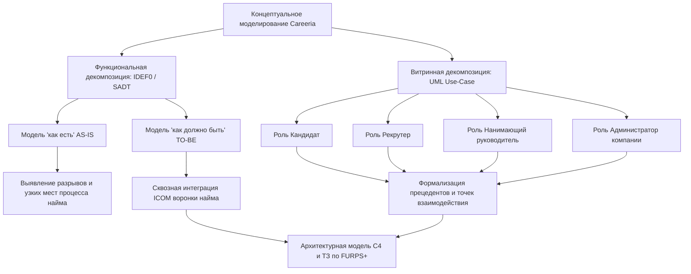

# 2.1. Выбор методологии и технологии концептуального моделирования ИС

Раздел посвящён анализу и обоснованию методологического аппарата и инструментальных технологий концептуального моделирования информационной системы для рекрутинговой платформы полного цикла **Careeria**.

В соответствии с требованиями к проекту концептуальное моделирование призвано сформировать устойчивый абстрактный базис предметной области, объединяющий интересы заказчиков, аналитиков, архитекторов и инженеров-разработчиков, а также заложить основу для последующей разработки архитектурной модели (C4), спецификации требований (**FURPS+**) и технического задания.

---

## 2.1.1. Сущность, цели и уровни концептуального моделирования

### Понятие и назначение концептуальной модели

**Концептуальная модель** — это формализованное абстрактное описание предметной области, фиксирующее состав её ключевых понятий (сущностей), логических взаимосвязей между ними, бизнес-правил и ограничений без привязки к деталям физической реализации (типам СУБД, форматам сетевой сериализации, языкам программирования или аппаратному окружению).

Простыми словами, концептуальная модель представляет собой единую семантическую карту: «*что существует в системе, какие бизнес-процессы в ней протекают и как её элементы связаны между собой*». Модель должна быть в равной степени понятна и прозрачна для всех участников жизненного цикла создания ПО:

- **Заказчик и бизнес-стейкхолдеры** проверяют, покрывает ли модель все целевые функции подбора персонала, оценки кандидатов и ведения переговоров.
- **Системные аналитики** используют модель для формализации сценариев использования, декомпозиции процессов на этапы воронки найма и формулирования функциональных требований.
- **Архитекторы и разработчики** опираются на концептуальные границы сущностей при выделении границ микросервисов (Bounded Contexts), проектировании схем реляционных баз данных и контрактов межсервисного взаимодействия.

### Разграничение уровней абстракции моделирования

В инженерии программных систем выделяют три последовательных уровня абстракции моделирования (Таблица 1).

*Таблица 1. Уровни абстракции моделирования информационной системы*

| Уровень моделирования | Цель и фокус внимания | Используемые артефакты в Careeria | Технологическая зависимость |
|---|---|---|---|
| **Концептуальный уровень** | Определение предметной области, бизнес-сущностей, акторов и их высокоуровневых отношений | IDEF0-диаграммы сквозных процессов найма; UML Use-Case сценарии взаимодействия ролей | Полная независимость от платформы, ОС, СУБД и языков |
| **Логический уровень** | Формализация структур данных, отношений, жизненных циклов и интерфейсов без привязки к конкретным продуктам | Модель ReBAC-отношений OpenFGA; конечные автоматы (UML Statechart) статусов отклика и вакансии; UML Activity диаграммы | Независимость от СУБД, но строгая привязка к логике архитектурных паттернов |
| **Физический уровень** | Описание физической реализации компонентов, схем хранения и сетевых контрактов | DDL-миграции PostgreSQL (Goose); Protobuf/gRPC спецификации; Kafka Avro схемы; Docker Compose манифесты | Полная привязка к выбранному стеку (Go, PostgreSQL, Kafka, Next.js) |

### Пять этапов построения концептуальной модели Careeria

Построение концептуальной модели платформы Careeria выполняется в пять последовательных шагов:

1. **Определение границ системы и идентификация стейкхолдеров.** Выделение внешних границ платформы и ключевых ролей пользователей: соискатели (Кандидаты), специалисты по подбору (Рекрутеры), руководители направлений (Нанимающие руководители), системные администраторы организаций (Администраторы компании), а также внешние интегрируемые системы (корпоративные HR-системы работодателей, провайдеры аутентификации, сервисы уведомлений).
2. **Идентификация доменных сущностей и их атрибутов.** Выделение устойчивых концептов предметной области: *Кандидат*, *Резюме*, *Компания*, *Вакансия*, *Отклик (Application)*, *Этап найма (Stage)*, *Интервью*, *Оценка (Assessment)*, *Оффер*, *Диалог*.
3. **Определение связей и кратностей.** Установление отношений между сущностями: принадлежность вакансий компании (1:N), подача кандидатом откликов на вакансии (1:N), прохождение откликом этапов настраиваемой воронки (1:N), проведение интервью по отклику (1:N) и формирование единой истории переходов.
4. **Формализация бизнес-правил и ограничений.** Определение инвариантов системы: невозможность перевода отклика на завершающие этапы без решения нанимающего руководителя; обязательность ReBAC-авторизации для просмотра персональных данных кандидата; изоляция данных между независимыми компаниями.
5. **Верификация и согласование модели.** Сопоставление концептуальной модели со спецификацией требований по модели **FURPS+** и архитектурными ограничениями **DIIP**.

---

## 2.1.2. Сравнительный анализ методологий концептуального моделирования

### Система критериев сравнения на основе модели FURPS+

Для объективного выбора методологий концептуального моделирования сформирована система критериев, согласованная с моделью требований **FURPS+** (Robert Grady, Hewlett-Packard, 1992) и группой ограничений **DIIP** (*Design, Implementation, Interface, Physical*):

1. **К1. Архитектурный охват и тип моделируемой архитектуры (согласовано с Design / D01, D02):** способность методологии выражать функциональные процессы, структуру программных подсистем и границы взаимодействия компонентов.
2. **К2. Поддержка функциональной декомпозиции (согласовано с Functionality):** возможность иерархического разбиения сложного бизнес-процесса от контекстного уровня (A-0) до элементарных процедур с фиксацией входов, выходов, управлений и механизмов.
3. **К3. Поддержка витринной (пользовательской) декомпозиции (согласовано с Usability / Design D01):** наглядность моделирования сценариев взаимодействия пользователей различных категорий с интерфейсами и сервисами системы.
4. **К4. Масштабируемость и выразительность для распределённых систем (согласовано с Supportability / Performance):** применимость методологии для описания микросервисных архитектур, асинхронных событийных шин и ReBAC-авторизации.
5. **К5. Зрелость стандартизации и инструментальной поддержки (согласовано с Supportability / Implementation):** наличие признанных мировых стандартов (ISO/IEC, OMG, IEEE), открытых спецификаций и программных средств моделирования.
6. **К6. Поддерживаемость и порог освоения (согласовано с Supportability / Usability):** трудоёмкость изучения нотации командой и доступность диаграмм для восприятия непрограммистами (заказчиками, HR-специалистами).

### Анализируемые методологии и нотации

В рамках исследования рассмотрены ключевые современные методологии концептуального и логического анализа:

- **SADT / IDEF0 (Integration Definition for Function Modeling):** классическая методология структурного анализа и функционального моделирования сложных систем, регламентированная стандартом IEEE 1320.1 и Р 50.1.028-2001. Построена на блочной декомпозиции с правилом ICOM (*Input, Control, Output, Mechanism*).
- **BPMN 2.0 (Business Process Model and Notation):** стандартизированная OMG нотация описания сквозных бизнес-процессов, ориентированная на исполнение процессов (BPMS-движки, оркестрация) и моделирование временных потоков событий (*Event-driven process flows*).
- **UML (Unified Modeling Language):** семейство стандартизированных объектно-ориентированных нотаций (OMG). Для концептуального моделирования ключевыми выступают диаграммы прецедентов (*Use Case*), деятельностей (*Activity*) и состояний (*State Machine*).
- **ERD (Entity-Relationship Diagram):** нотация концептуального моделирования сущностей и связей (модели Чена, Мартина, Баркера), ориентированная преимущественно на реляционные структуры данных.
- **C4 Model:** специализированная архитектурная нотация (Simon Brown), ориентированная на контекстное, контейнерное и компонентное описание распределённых программных систем.

### Матрица сравнительного анализа методологий

*Таблица 2. Сравнительный анализ методологий концептуального моделирования*

| Критерий оценки (FURPS+) | IDEF0 (SADT) | BPMN 2.0 | UML (Use-Case / Activity) | ERD (Chen / Crow's Foot) | C4 Model |
|---|---|---|---|---|---|
| **К1. Архитектурный охват** | Функциональная и процессная архитектура | Бизнес-архитектура, оркестрация процессов | Программная, системная и объектная архитектура | Информационная архитектура, структуры данных | Программная и системная микросервисная архитектура |
| **К2. Функциональная декомпозиция** | **Исключительная:** строгая иерархия блоков (A0, A1...), регламент ICOM | Средняя: дорожки (*swimlanes*), подпроцессы, развилки потоков управления | Умеренная: декомпозиция прецедентов (`<<include>>`, `<<extend>>`) | Отсутствует (моделируются только статические сущности) | Умеренная: декомпозиция уровней Context → Container → Component |
| **К3. Витринная декомпозиция (акторы)** | Ограниченная (акторы фигурируют только как механизмы/стрелки снизу) | Хорошая (акторы разделяются дорожками участников) | **Исключительная:** наглядная витрина ролей, границ системы и прецедентов | Отсутствует | Хорошая (акторы взаимодействуют с системами и контейнерами) |
| **К4. Масштабируемость** | Строго ограничена рамками функциональных потоков | Высокая в пределах бизнес-логики процессов | **Высокая:** покрывает любой масштаб системы от концепта до классов | Высокая для БД, низкая для динамических процессов | **Высокая:** идеальна для микросервисных платформ |
| **К5. Зрелость стандартизации** | Международные стандарты IEEE 1320.1, ГОСТ Р 50.1.028 | Стандарт OMG BPMN 2.0, стандарты ISO/IEC 19510 | Стандарты ISO/IEC 19505, OMG UML 2.5 | Отраслевые стандарты моделирования данных | Открытый отраслевой стандарт де-факто |
| **К6. Поддерживаемость и порог входа** | Требует знания семантики стрелок ICOM и правил балансировки | Требует знания обширной библиотеки графических пиктограмм | **Оптимальный:** Use-Case интуитивно понятен стейкхолдерам | Простой для реляционных структур, недостаточен для процессов | Минимальный благодаря лаконичной цветовой нотации |

### Анализ применимости методологий к платформе Careeria

1. **IDEF0 (SADT):** Обладает максимальной строгостью при анализе сквозного функционала платформы найма. Правила ICOM позволяют детально отобразить:
   - *Входы (I):* резюме кандидатов, требования вакансий, тестовые задания, видеопотоки;
   - *Управления (C):* трудовое законодательство, корпоративные регламенты найма, правила ReBAC, лимиты времени на собеседование;
   - *Выходы (O):* опубликованные вакансии, статусы откликов, протоколы оценок, офферы, отказы;
   - *Механизмы (M):* сервисы платформы, внешние провайдеры (Keycloak, LiveKit, Kafka) и персонал (рекрутеры, нанимающие менеджеры).  
   Методология идеально подходит для построения моделей «как есть» (выявление разрозненности процессов) и «как должно быть» (сквозная интеграция).
2. **UML (Use-Case):** Является признанным индустриальным стандартом для витринной декомпозиции. Диаграммы вариантов использования позволяют напрямую сопоставить 4 ключевые пользовательские роли Careeria (Кандидат, Рекрутер, Нанимающий руководитель, Администратор компании) с целевыми сервисами и экранами платформы, явно отобразив сценарии сквозной аутентификации, модерации, коммуникации и видеосвязи.
3. **BPMN 2.0:** Высокоэффективна для моделирования длительных бизнес-процессов с явными таймерами и развилками, однако перегружена узкоспециализированными пиктограммами и уступает UML в выразительности программных границ интерфейсов.
4. **ERD:** Необходима на стадии проектирования баз данных микросервисов, но недостаточна для концептуального описания поведения системы и взаимодействия пользователей.
5. **C4 Model:** Исключительно полезна для описания компонентной архитектуры системы, контейнеров и инфраструктурного взаимодействия (уже внедрена в проекте Careeria в каталоге [`docs/architecture/c4-plant-uml/`](../../architecture/c4-plant-uml/README.md)), выступая прямым продолжением концептуального моделирования.

---

## 2.1.3. Сравнительный анализ инструментальных средств (технологий моделирования)

### Критерии выбора инструментальных средств

Для выбора программных инструментов моделирования (CASE-средств) сформулированы критерии, ориентированные на командную разработку, независимость от коммерческих поставщиков и интеграцию с практиками **Docs-as-Code** (согласовано с требованиями **FURPS+** к сопровождаемости *Supportability* и ограничениями *Implementation* / *Design*):

1. **Стоимость владения и лицензионная чистота (TCO):** отсутствие дорогостоящих проприетарных лицензий, поддержка работы в студенческих и коммерческих командах без ограничений по триальным периодам.
2. **Командная работа и версионирование (VCS / Git):** хранение исходных диаграмм в текстовых форматах, позволяющее выполнять ветвление, слияние (*merge*), просмотр различий (*diff*) и рецензирование изменений (*pull request review*) без бинарных конфликтов.
3. **Парадигма создания диаграмм:** классическое визуальное рисование («мышью по холсту») против парадигмы *«Диаграмма как код» (Diagrams as Code)*.
4. **Кроссплатформенность и доступность:** работа на операционных системах Linux, macOS и Windows, а также возможность автономного запуска в изолированных Docker-контейнерах.
5. **Интеграция с контуром разработки и CI/CD:** автоматическая генерация векторных изображений (SVG/PNG), интеграция со статическими генераторами документации (MkDocs) и средами разработки (VS Code, GoLand).
6. **Автоматизация контроля качества:** возможность запуска линтеров синтаксиса диаграмм и автоматизированных тестов битых ссылок при коммитах.

### Анализируемые программные средства

В сравнительном анализе рассмотрены четыре характерных представителя инструментов моделирования:

- **Visual Paradigm:** тяжеловесный коммерческий визуальный CASE-пакет корпоративного уровня с поддержкой UML, BPMN, ERD и генерации исходного кода.
- **Enterprise Architect (Sparx Systems):** популярное в Enterprise-сегменте комплексное инструментальное средство моделирования с поддержкой широкого спектра нотаций и репозиториев моделей.
- **Draw.io (diagrams.net):** популярный визуальный веб- и десктоп-редактор схем общего назначения с открытым исходным кодом.
- **PlantUML (в стеке Docs-as-Code: MkDocs + Docker + Make):** специализированный инструмент декларативного описания диаграмм на предметно-ориентированном текстовом языке с компиляцией в SVG/PNG.

### Матрица сравнительного анализа CASE-инструментов

*Таблица 3. Сравнительный анализ инструментальных технологий моделирования*

| Критерий сравнения | Visual Paradigm | Enterprise Architect | Draw.io (diagrams.net) | PlantUML (Docs-as-Code) |
|---|---|---|---|---|
| **Стоимость и лицензия** | Коммерческая (высокая стоимость подписки на пользователя) | Коммерческая (проприетарная лицензия на рабочее место) | Бесплатная (Open Source / Web) | **Бесплатная** (Open Source, GPL/MIT) |
| **Версионирование в Git** | Затруднено (бинарные проекты `.vpp`, конфликты слияния) | Затруднено (бинарные `.eapx` или внешняя СУБД) | Ограниченно (XML-разметка, сложный семантический diff) | **Идеальное:** чистый plain text, построчный Git diff, бесконфликтные PR |
| **Основная парадигма** | Тяжеловесный GUI-редактор | Тяжеловесный GUI-редактор с репозиторием | Интерактивный визуальный векторный редактор | **Diagrams as Code:** декларативный исходный код диаграммы |
| **Кроссплатформенность** | Десктоп (Win, Mac, Linux) + урезанный Web | Ограниченная (нативно Windows, запуск под Wine) | Кроссплатформенный (Web, Win, Mac, Linux) | **Полная:** работает везде, где есть Java/Docker (Linux, macOS, Windows) |
| **Интеграция с CI/CD и документацией** | Через плагины экспорта и серверную часть | Через специализированные API и скрипты | Экспорт картинок вручную или CLI-рендеринг | **Бесшовная:** сборка внутри Makefile, прямой рендеринг в MkDocs через inline SVG |
| **Автоматизация тестирования** | Ручная проверка моделей | Встроенная валидация внутри пакета | Отсутствует | **Автоматическая:** проверка синтаксиса и связей (`make docs-test`, скрипт `check.py`) |

### Анализ результатов сравнения инструментов

- **Visual Paradigm** и **Enterprise Architect** предоставляют мощный арсенал моделирования, однако их проприетарная закрытая природа, высокая стоимость лицензий и сохранение моделей в бинарных базах данных категорически не соответствуют современным стандартам командной разработки в микросервисных проектах. В условиях распределённой команды совместная работа над бинарными файлами порождает постоянные конфликты версий.
- **Draw.io** удобен для быстрого прототипирования набросков интерфейсов и единичных блок-схем, однако сохранение XML-координат блоков приводит к сильному зашумлению истории Git при малейшем сдвиге элементов мышью. Кроме того, Draw.io не поддерживает переиспользование общих библиотек элементов и стилей.
- **PlantUML** объединяет преимущества декларативного кода и автоматизированного пайплайна:
  - Исходные файлы диаграмм (`.puml`) сохраняются в стандартном текстовом представлении в репозитории Git;
  - Изменение архитектурных концептов отслеживается через стандартный `git diff`;
  - Поддерживается модульность через директивы `!include` и `!includesub`, что позволяет повторно использовать описания сущностей, палитры стилей и общие компоненты;
  - Компиляция выполняется внутри изолированного Docker-контейнера без требования установки специфического ПО на рабочие станции разработчиков.

---

## 2.1.4. Обоснование выбора методологий и технологий для платформы Careeria

### Методологический базис: Синергия IDEF0 и UML Use-Case

Исходя из результатов сравнительного анализа и специфики предметной области Careeria (рекрутинговая платформа с жестким сочетанием бизнес-процессов ATS и коммуникационных сервисов реального времени), в проекте принимается **комбинированный дуальный подход**:

#### 1. Обоснование структурного анализа SADT в нотации IDEF0

1. **Полнота покрытия сквозного цикла подбора персонала.** Рекрутинг представляет собой сложный межфункциональный процесс, простирающийся от формирования заявки на вакансию до подписания оффера и оформления сотрудника. IDEF0 обеспечивает строгую функциональную декомпозицию этого процесса сверху вниз.
2. **Фиксация строгих ограничений и управлений (Control).** Правила ICOM позволяют наглядно отделить нормативные и регламентные ограничения (законодательство о персональных данных 152-ФЗ, правила конфиденциальности, политики компании, роли ReBAC) от прямых информационных входов (резюме, анкеты).
3. **Объективное сопоставление моделей «как есть» и «как должно быть».** В модели AS-IS методология IDEF0 наглядно обнажает критические разрывы традиционного найма: множественную ручную пересылку резюме по электронной почте, использование разрозненных мессенджеров для связи, потерю кандидатов и отсутствие централизованной аналитики. В модели TO-BE входы и выходы замыкаются в единый автоматизированный цифровой контур Careeria.

#### 2. Обоснование объектно-ориентированного анализа в нотации UML Use-Case

1. **Чёткая ролевая проекция системы.** В платформе Careeria строго специфицированы 4 пользовательские роли (Кандидат, Рекрутер, Нанимающий руководитель, Администратор компании). Диаграммы вариантов использования предоставляют наглядную «витрину» системы, демонстрирующую, какие целевые задачи решает каждая роль и через какие точки входа осуществляется доступ.
2. **Формализация интерфейсных взаимосвязей.** Нотация Use-Case позволяет с помощью отношений `<<include>>` (включение) и `<<extend>>` (расширение) структурировать функциональные сценарии (например, безусловное включение авторизации и ReBAC-проверки прав при открытии отклика; опциональное расширение интервью видеоконференцией или сессией Live Coding).
3. **Прямая трассируемость в функциональные требования и тесты.** Каждый вариант использования UML выступает прямым источником для формулирования требований раздела *Functionality* модели FURPS+ и составления приёмочных пользовательских сценариев (*User Stories / Acceptance Criteria*).

#### 3. Дополнительные логические нотации UML

Для моделирования динамических аспектов системы в рамках логического проектирования дополнительно используются:
- **UML State Machine (диаграммы состояний):** моделирование конечного автомата жизненного цикла вакансии (`DRAFT` → `PUBLISHED` → `PAUSED` → `CLOSED` → `ARCHIVED`) и статусов отклика кандидата (`APPLIED` → `SCREENING` → `INTERVIEW` → `OFFER` → `HIRED` / `REJECTED`);
- **UML Activity (диаграммы деятельностей):** моделирование параллельных процессов оценки компетенций (прохождение теста, решение практической задачи и совместный Live Coding).

### Обоснование инструментального стека (PlantUML и Docs-as-Code)

В качестве инструментальной технологии концептуального и архитектурного моделирования для платформы Careeria утверждён подход **Docs-as-Code** на базе **PlantUML**:

1. **Единый технологический контур с C4-моделью проекта.** Вся архитектура платформы Careeria уже описана на PlantUML (каталог [`docs/architecture/c4-plant-uml/plantuml/`](../../architecture/c4-plant-uml/README.md)). Использование PlantUML для концептуальных диаграмм исключает фрагментацию инструментария и обеспечивает сквозную стилевую преемственность.
2. **Хранение в Git и командное рецензирование.** Все диаграммы описываются декларативным кодом в файлах с расширением `.puml` и версионируются в едином репозитории. Архитектурные изменения проходят классический процесс рецензирования кода через Pull Requests.
3. **Автоматизированная валидация и сборка:**
   - Команда `make docs-test` выполняет строгую проверку синтаксиса диаграмм и валидирует целостность внутренних гиперссылок; порядок проверки описан в [руководстве по документации](../../contributing/index.md);
   - Команда `make architecture-validate` проверяет корректность всех подключений PlantUML;
   - Плагин `plantuml_markdown` генерирует встроенный интерактивный SVG, поддерживающий масштабирование и кликабельные ссылки на смежные сервисы системы.
4. **Изоляция в Docker.** Разработчикам не требуется настраивать Java, Graphviz или специализированные утилиты: окружение полностью упаковано в контейнере `docs/docker-compose.yml` и запускается локально командой `make docs`.

---

## 2.1.5. Взаимосвязь с требованиями к системе и последующими главами

Сформированные в данном подразделе критерии выбора методологий и инструментов концептуального моделирования напрямую увязаны с общей архитектурной концепцией проекта и служат методическим базисом для последующих глав:

- **Связь с моделью требований FURPS+ (Глава 3):** критерии сравнительного анализа нотаций и CASE-средств (К1–К6) согласованы с атрибутами качества модели **FURPS+** (*Supportability*, *Functionality*, *Usability*) и группой ограничений **DIIP** (*Design, Implementation, Interface, Physical*). При этом полная спецификация требований с их классификацией по категориям (F01–F20, U01–U20, R01–R20, P01–P20, S01–S20, D01–D20, Im01–Im20, In01–In20) и приоритизацией по методике MoSCoW приводится далее в Главе 3 «Техническое задание».
- **Связь с архитектурным проектом C4 (Глава 4):** применение нотации UML и инструментария PlantUML обеспечивает сквозную преемственность с многоуровневой архитектурной моделью **C4 Model** (каталог `architecture/c4-plant-uml/`), позволяя плавно перейти от концептуальной витрины прецедентов к контекстным (L1), контейнерным (L2) и компонентным (L3) представлениям платформы Careeria.

---

## Резюме и выводы

1. Концептуальное моделирование платформы Careeria разделено на два взаимодополняющих среза: **функциональную декомпозицию** сквозного рекрутингового процесса и **витринную декомпозицию** пользовательских сценариев.
2. В качестве методологии функциональной декомпозиции выбрана методология структурного анализа **SADT / IDEF0**, гарантирующая строгую иерархию процессов и учёт входных/выходных/управляющих потоков для моделей «как есть» и «как должно быть».
3. В качестве методологии витринной декомпозиции выбрана нотация **UML Use-Case** (с расширением диаграммами состояний и деятельностей), обеспечивающая наглядную привязку 4 ключевых ролей системы к прикладным функциям платформы.
4. В качестве технологического инструмента моделирования утверждён декларативный стек **PlantUML + MkDocs + Docker + Git** (парадигма *Docs-as-Code*), гарантирующий бесплатное использование, удобство совместной работы в Git, сквозную совместимость с архитектурой C4 проекта и автоматизированное тестирование.

---

## Куда перейти дальше

- [Глава 2. Бизнес-сервисы и доменная модель](index.md)
- [2.2. Функциональное моделирование процессов AS-IS и анализ текущего состояния](02-as-is.md)
- [2.3. Функциональное моделирование целевых процессов TO-BE на базе платформы Careeria](03-to-be.md)
- [Системный контекст архитектуры C4 (L1)](../../architecture/c4-plant-uml/plantuml/context/system-context.md)
- [Контейнерная архитектура полной системы C4 (L2)](../../architecture/c4-plant-uml/plantuml/container/full-system.md)

