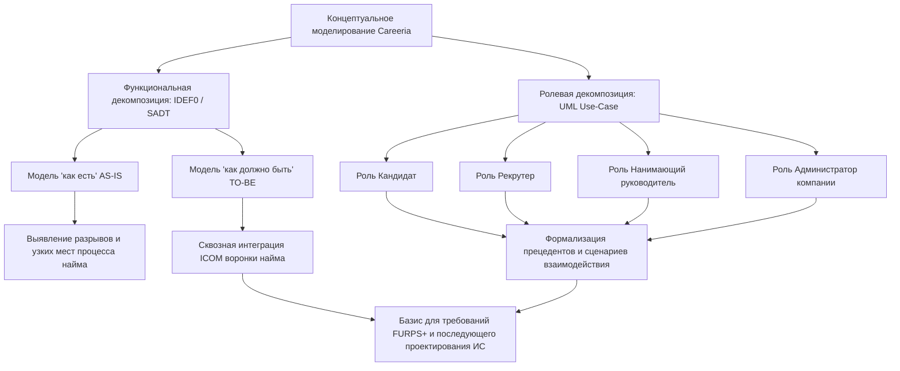

# 2.1. Выбор методологии и технологии концептуального моделирования ИС

В данном разделе проводится обоснование и сравнительный анализ методологий, нотаций и инструментальных средств концептуального моделирования предметной области и бизнес-процессов платформы подбора персонала Careeria. По результатам аналитического сопоставления сформирован комплекс методов для формализации текущего порядка организации найма («как есть») и проектируемого целевого процесса («как должно быть»).

Концептуальная модель выступает фундаментальным базисом формализации предметной области, объединяя интересы ключевых заинтересованных сторон проекта (заказчиков, системных аналитиков и будущих разработчиков), и служит основой для последующей спецификации требований (по модели FURPS+) и архитектурного проектирования информационной системы.

---

## 2.1.1. Сущность, цели и уровни концептуального моделирования

### Понятие и назначение концептуальной модели

**Концептуальная модель** представляет собой абстрактное формализованное описание предметной области, фиксирующее ключевые сущности, семантические связи между ними, а также фундаментальные бизнес-правила и ограничения. Модель строится на проблемно-ориентированном уровне и инвариантна относительно используемых СУБД, форматов передачи данных, языков программирования и целевой вычислительной инфраструктуры.

В рамках аналитического исследования концептуальная модель решает три основные задачи: идентификация базовых сущностей предметной области, определение протекающих процессов и установление регламентов их информационного взаимодействия. Практическая ценность модели распределяется между участниками проектной группы следующим образом:

- **Заказчик и бизнес-эксперты** валидируют полноту покрытия моделью предметных функций подбора персонала, предварительного отбора кандидатов, оценки их компетенций и проведения переговоров.
- **Системные аналитики** используют концептуальные спецификации для формализации пользовательских сценариев взаимодействия, декомпозиции сквозного процесса на этапы воронки отбора и формулирования непротиворечивых функциональных требований.
- **Проектировщики и разработчики** рассматривают концептуальную модель как исходный базис для последующего логического и физического проектирования структур данных, интерфейсов взаимодействия и программных компонентов.

### Разграничение уровней абстракции моделирования

В таблице 1 приведено разграничение концептуального, логического и физического уровней абстракции проектируемой информационной системы.

*Таблица 1. Уровни абстракции моделирования информационной системы*

| Уровень моделирования | Цель и фокус внимания | Используемые артефакты в Careeria | Технологическая зависимость |
|---|---|---|---|
| **Концептуальный уровень** | Определение предметной области, бизнес-сущностей, акторов и их высокоуровневых отношений | IDEF0-диаграммы сквозных процессов найма; UML Use-Case сценарии взаимодействия ролей | Полная независимость от платформы, ОС, СУБД и языков программирования |
| **Логический уровень** | Формализация структур данных, отношений, жизненных циклов и интерфейсов без привязки к конкретным продуктам | Спецификация ролевых моделей доступа; конечные автоматы жизненных циклов сущностей (вакансии, отклика); диаграммы деятельностей | Независимость от конкретной программно-аппаратной реализации |
| **Физический уровень** | Описание способов хранения данных и взаимодействия программных компонентов | Схемы реляционных/нереляционных баз данных, протоколы сетевого обмена и параметры развёртывания | Определяется на последующих этапах архитектурного проектирования |

### Пять этапов построения концептуальной модели Careeria

Построение концептуальной модели предметной области Careeria выполняется последовательно в рамках пяти этапов:

1. **Определение границ системы и участников.** Выделение внешних границ предметной области и ключевых ролей: соискатели (кандидаты), рекрутеры, нанимающие руководители и администраторы организаций-работодателей. На внешней границе фиксируются смежные информационные системы (в частности, кадровая система учета организации для подтверждения факта трудоустройства).
2. **Идентификация доменных сущностей и их атрибутов.** Выделение устойчивых концептов предметной области: *Кандидат*, *Резюме*, *Компания*, *Вакансия*, *Отклик (Application)*, *Этап найма (Stage)*, *Интервью*, *Оценка (Assessment)*, *Оффер*, *Диалог*.
3. **Определение связей и кратностей.** Установление семантических отношений между сущностями: принадлежность вакансий компании (1:N), подача кандидатом откликов на вакансии (1:N), прохождение откликом этапов настраиваемой воронки найма (1:N), проведение запланированных интервью по отклику (1:N) и формирование целостной истории статусов.
4. **Формализация бизнес-правил и ограничений.** Определение условий валидации переходов отклика по этапам, политик разграничения доступа к персональным данным в зависимости от роли участника и изоляции данных между независимыми организациями-работодателями.
5. **Верификация и согласование модели.** Проверка концептуальной модели на полноту и непротиворечивость относительно классификатора требований **FURPS+** и архитектурных ограничений группы **DIIP**.

---

## 2.1.2. Сравнительный анализ методологий концептуального моделирования

### Система критериев сравнения на основе модели FURPS+

Для обеспечения объективности выбора методологии сформирована система критериев, соотнесённая с общепринятой моделью качества программных систем **FURPS+** (Robert Grady, Hewlett-Packard, 1992) и группой проектных ограничений **DIIP** (*Design, Implementation, Interface, Physical*):

1. **К1. Предметно-архитектурный охват (согласовано с Design / D01, D02):** способность методологии выражать функциональные процессы, информационную структуру предметной области и внешние границы проектируемой системы.
2. **К2. Поддержка функциональной декомпозиции (согласовано с Functionality):** возможность строгого иерархического разбиения комплексного бизнес-процесса от контекстного уровня (A-0) до элементарных операций с фиксацией входов, выходов, управляющих воздействий и механизмов исполнения.
3. **К3. Поддержка пользовательской (ролевой) декомпозиции (согласовано с Usability / Design D01):** выразительность нотации при моделировании целевых действий акторов, разграничении зон ответственности и распределении сценариев взаимодействия.
4. **К4. Масштабируемость модели (согласовано с Supportability / Performance):** способность методологии к расширению новыми этапами и детализации правил без потери семантической целостности и балансировки диаграмм.
5. **К5. Зрелость стандартизации и инструментальной поддержки (согласовано с Supportability / Implementation):** наличие признанных международных стандартов (ISO/IEC, OMG, IEEE), открытых спецификаций и широкого спектра программных средств моделирования.
6. **К6. Поддерживаемость и порог освоения (согласовано с Supportability / Usability):** трудоёмкость изучения нотации проектной группой и доступность графических моделей для восприятия непрограммистами (заказчиками, экспертами предметной области).

### Анализируемые методологии и нотации

В рамках аналитического сопоставления рассмотрены следующие распространенные нотации и методологии:

- **SADT / IDEF0 (Integration Definition for Function Modeling):** классическая методология структурного функционального моделирования сложных систем, регламентированная стандартами IEEE 1320.1 и ГОСТ Р 50.1.028-2001. Базируется на строгой иерархической декомпозиции функций с использованием концепции ICOM (*Input, Control, Output, Mechanism*).
- **BPMN 2.0 (Business Process Model and Notation):** стандартизированная консорциумом OMG нотация описания бизнес-процессов, ориентированная на исполнение процессов (BPMS-системы, оркестрация потоков работ) и моделирование временных последовательностей событий (*Event-driven process flows*).
- **UML (Unified Modeling Language):** международный стандарт объектно-ориентированного визуального моделирования (OMG, ISO/IEC 19505). На этапе концептуального анализа ключевую роль играют поведенческие диаграммы: прецедентов (*Use Case*), деятельностей (*Activity*) и состояний (*State Machine*).
- **ERD (Entity-Relationship Diagram):** концептуальная нотация моделирования сущностей и связей (нотации Чена, Мартина, Баркера), ориентированная преимущественно на статическое представление структур данных реляционного типа.
- **C4 Model:** специализированная архитектурная нотация (Simon Brown), ориентированная на иерархическое представление программных систем (контекст, контейнеры, компоненты, код).

### Матрица сравнительного анализа методологий

В таблице 2 представлены результаты сопоставительного анализа рассматриваемых методологий по критериям К1–К6.

*Таблица 2. Сравнительный анализ методологий концептуального моделирования*

| Критерий оценки (FURPS+) | IDEF0 (SADT) | BPMN 2.0 | UML (Use-Case / Activity) | ERD (Chen / Crow's Foot) | C4 Model |
|---|---|---|---|---|---|
| **К1. Предметно-архитектурный охват** | Функциональная и процессная структура предметной области | Бизнес-процессы, регламенты и событийные потоки | Объектная структура, прецеденты и сценарии поведения | Информационная структура, реляционные сущности и связи | Архитектурная структура программных систем |
| **К2. Функциональная декомпозиция** | Строгая иерархия блоков (A-0, A0...) по правилам ICOM | Подпроцессы, дорожки (*swimlanes*), шлюзы ветвления | Декомпозиция сценариев через `<<include>>` и `<<extend>>` | Отсутствует (статическое описание сущностей без логики процессов) | Иерархия абстракций (Context → Container → Component) |
| **К3. Пользовательская (ролевая) декомпозиция** | Роли представлены опосредованно (механизмы управления M) | Разделение ответственности через дорожки участников | Прямое отображение акторов, границ системы и сценариев | Отсутствует (пользователи не входят в модель сущностей) | Отображение внешних пользователей и их взаимодействия с системами |
| **К4. Масштабируемость модели** | Высокая за счёт строгой балансировки дуг и уровней декомпозиции | Высокая при модульном структурировании подпроцессов | Высокая благодаря пакетам, стереотипам и типам диаграмм | Ограничена структурой данных, не отражает динамику | Высокая за счёт масштабирования уровней архитектурной абстракции |
| **К5. Зрелость стандартизации** | Международный стандарт IEEE 1320.1, ГОСТ Р 50.1.028-2001 | Стандарты OMG BPMN 2.0, ISO/IEC 19510 | Стандарты ISO/IEC 19505, спецификации OMG UML 2.5 | Отраслевые стандарты концептуального моделирования данных | Открытый отраслевой стандарт де-факто |
| **К6. Поддерживаемость и порог освоения** | Средний: требует понимания семантики стрелок ICOM и балансировки | Высокий: требует знания обширной библиотеки графических пиктограмм | Средний: интуитивная понятность Use-Case для предметных специалистов | Низкий: компактный набор символов, ориентированный на реляционные схемы | Низкий: компактная и интуитивная нотация, ориентированная на разработчиков |

### Анализ применимости методологий к платформе Careeria

Анализ сильных и слабых сторон рассмотренных методологий позволяет сделать следующие выводы:

1. **IDEF0 (SADT):** Обладает наибольшей формальной строгостью при анализе сквозных функциональных процессов предметной области подбора персонала. Семантический аппарат ICOM обеспечивает детальную спецификацию потоков:
   - *Входы (Input):* резюме соискателей, заявки на подбор, тестовые задания, материалы собеседований;
   - *Управления (Control):* трудовое законодательство, Федеральный закон № 152-ФЗ «О персональных данных», регламенты найма организаций, правила разграничения доступа;
   - *Выходы (Output):* опубликованные вакансии, зарегистрированные отклики, протоколы экспертных оценок, предложения о работе (офферы), мотивированные отказы;
   - *Механизмы (Mechanism):* участники процессов (рекрутеры, нанимающие руководители, кандидаты) и используемые информационно-аналитические средства.
   Методология оптимальна для сопоставительного анализа текущего состояния процесса (AS-IS) и целевого процесса (TO-BE), наглядно демонстрируя точки трансформации данных и устранение ручных операций.
2. **UML (Use-Case):** Диаграммы прецедентов предоставляют необходимый ролевой срез системы, позволяя явно связать ключевые роли предметной области (кандидат, рекрутер, нанимающий руководитель, администратор компании) с доступными им функциональными сценариями и зафиксировать внешние границы системы.
3. **BPMN 2.0:** Нотация эффективна для моделирования детальных алгоритмов выполнения процедур и оркестрации в BPMS-системах, однако её графический аппарат избыточен для верхнеуровневого концептуального анализа и уступает UML в выразительности системных прецедентов и объектных состояний.
4. **ERD:** Позволяет специфицировать статические структуры данных, однако не обеспечивает описания динамических процессов, последовательности шагов и взаимодействия пользователей.
5. **C4 Model:** Ориентирована на архитектурное проектирование программных компонентов, контейнеров и инфраструктуры. На этапе концептуального моделирования её применение ограничено контекстным представлением (System Context), тогда как детальная проработка архитектуры C4 выступает непосредственным продолжением концептуального анализа на последующих этапах проектирования.

---

## 2.1.3. Сравнительный анализ инструментальных средств (технологий моделирования)

### Критерии выбора инструментальных средств

Выбор программного инструментария концептуального моделирования осуществляется на основе совокупности технико-экономических критериев, соответствующих характеристикам группы *Supportability* модели **FURPS+** и проектным ограничениям *Implementation*:

1. **Стоимость владения и лицензионная чистота (TCO):** отсутствие затрат на приобретение проприетарных лицензий, доступность инструмента для распределённой проектной группы без ограничений ознакомительных периодов.
2. **Командная работа и контроль версий (VCS / Git):** представление диаграмм в текстовом виде, обеспечивающее прозрачное ветвление, слияние (*merge*), построчный анализ различий (*diff*) и процедуру рецензирования изменений (*pull request review*) без конфликтов бинарных форматов.
3. **Парадигма создания моделей:** визуальное интерактивное рисование («диаграмма как рисунок») в сравнении с парадигмой *«Диаграмма как код» (Diagrams as Code)*.
4. **Кроссплатформенность и переносимость окружения:** поддержка выполнения в различных операционных системах (Linux, macOS, Windows), а также возможность воспроизводимого запуска в контейнеризированном окружении (Docker).
5. **Интеграция с контуром автоматизации и генерации документации:** поддержка автоматического рендеринга векторной графики (SVG), встраивание в генераторы статической документации (MkDocs) и интеграция с современными средами разработки.
6. **Автоматизация верификации и контроля качества:** возможность автоматической проверки синтаксической корректности моделей и целостности ссылочной структуры артефактов при фиксации изменений.

### Анализируемые программные средства

В качестве альтернатив рассмотрены четыре представителя инструментальных сред моделирования:

- **Visual Paradigm:** развитый коммерческий CASE-пакет корпоративного класса с развитым графическим интерфейсом и поддержкой нотаций UML, BPMN, ERD.
- **Enterprise Architect (Sparx Systems):** промышленный CASE-инструмент моделирования с поддержкой широкого перечня нотаций и корпоративных репозиториев моделей.
- **Draw.io (diagrams.net):** открытый визуальный векторный редактор схем общего назначения с веб- и десктопным интерфейсом.
- **PlantUML (в составе контура Docs-as-Code: MkDocs + Docker + Make):** специализированный инструмент декларативного описания диаграмм на предметно-ориентированном текстовом языке с компиляцией в векторный формат (SVG).

### Матрица сравнительного анализа CASE-инструментов

В таблице 3 систематизированы результаты сопоставления инструментов по выбранным критериям.

*Таблица 3. Сравнительный анализ инструментальных технологий моделирования*

| Критерий сравнения | Visual Paradigm | Enterprise Architect | Draw.io (diagrams.net) | PlantUML (Docs-as-Code) |
|---|---|---|---|---|
| **Стоимость и лицензия** | Проприетарная коммерческая (высокая стоимость подписки на пользователя) | Проприетарная коммерческая (высокая стоимость лицензии на рабочее место) | Свободная (Open Source, бесплатное использование) | **Свободная** (Open Source, лицензии GPL/MIT/Apache, нулевая стоимость TCO) |
| **Контроль версий в Git** | Низкий: бинарные файлы проектов (`.vpp`), невозможность текстового слияния и диффов | Низкий: бинарные файлы (`.eapx`) или СУБД, сложность распределённого слияния | Ограниченный: разметка XML, высокий уровень зашумления при семантическом `diff` | **Высокий:** чистый декларативный текст, построчный `git diff`, бесконфликтные PR |
| **Основная парадигма** | Интерактивное графическое проектирование в GUI-пакете | Интерактивное графическое проектирование в GUI-пакете | Визуальное векторное рисование диаграмм (WYSIWYG) | **Diagrams as Code:** декларативный исходный код диаграмм |
| **Кроссплатформенность** | Настольное приложение (Win, Mac, Linux) и облачный веб-сервис | Ограниченная (нативно Windows; в Unix-средах требует эмуляторов Wine) | Кроссплатформенная (веб-версия, клиенты для Win, Mac, Linux) | **Полная:** независимость от платформы (CLI, Java, контейнеризация Docker под Linux/macOS/Windows) |
| **Интеграция с документацией и CI/CD** | Ограниченная (через проприетарные плагины экспорта и сервер) | Ограниченная (требует использования внутренних API и внешних скриптов) | Ручной экспорт изображений либо сторонние CLI-утилиты | **Высокая:** автоматическая компиляция при сборке документации (MkDocs inline SVG) |
| **Автоматизация верификации** | Ручная проверка либо внутренняя валидация пакета | Встроенная валидация метамодели внутри пакета | Отсутствует | **Автоматизированная:** программная проверка синтаксиса и ссылочной целостности моделей |

### Анализ результатов сравнения инструментов

Сравнительный анализ демонстрирует следующие особенности инструментов:

- **Visual Paradigm** и **Enterprise Architect** предоставляют развитый визуальный инструментарий и широкую функциональность, однако требуют существенных финансовых затрат на лицензирование и ориентированы на хранение моделей в проприетарных бинарных форматах (`.vpp`, `.eapx`). Это делает их малопригодными для прозрачного версионирования в Git и командной работы по методологии Docs-as-Code.
- **Draw.io** удобен для оперативного создания изолированных эскизов, однако формат сохранения на базе XML с абсолютными координатами приводит к зашумлению истории версий даже при минимальном визуальном сдвиге блоков. Кроме того, инструмент не обеспечивает модульности и повторного использования стилевых шаблонов.
- **PlantUML** объединяет достоинства декларативного описания диаграмм и автоматизированного конвейера обработки документации:
  - Исходные тексты моделей (`.puml`) хранятся в репозитории проекта в текстовом формате и рецензируются посредством стандартного механизма Pull Requests;
  - Любые изменения концептов фиксируются через построчный `git diff`, исключая риск порчи бинарных артефактов;
  - Поддерживается модульность спецификаций посредством директив `!include` и `!includesub`, что обеспечивает повторное использование определений сущностей и единых стилей оформления;
  - Процесс компиляции диаграмм изолирован в Docker-контейнере, что исключает необходимость установки сторонних зависимостей (Java, Graphviz) на рабочих станциях аналитиков.

---

## 2.1.4. Обоснование выбора методологий и технологий для платформы Careeria

### Методологический базис: Синергия IDEF0 и UML Use-Case

Для полного и непротиворечивого концептуального описания Careeria принят комбинированный подход, объединяющий структурный и объектно-ориентированный методы моделирования. Методология IDEF0 используется для функциональной декомпозиции процессов найма, а нотация UML Use-Case — для спецификации сценариев взаимодействия ролей и определения границ системы.

#### 1. Обоснование структурного анализа SADT в нотации IDEF0

1. **Полнота покрытия сквозного цикла подбора персонала.** Рекрутинг представляет собой сложный межфункциональный процесс, простирающийся от формирования заявки на вакансию до подписания оффера и оформления сотрудника. IDEF0 обеспечивает строгую функциональную декомпозицию этого процесса сверху вниз.
2. **Фиксация нормативных ограничений и управлений (Control).** Принцип ICOM позволяет четко разграничить законодательные и регламентные требования (Федеральный закон № 152-ФЗ «О персональных данных», регламенты найма, политики разграничения прав доступа) и информационные сущности (резюме, анкеты кандидатов, заявки).
3. **Объективное сопоставление моделей «как есть» и «как должно быть».** В модели AS-IS методология IDEF0 позволяет формализовать и наглядно вскрыть ключевые разрывы традиционного процесса найма: ручной перенос данных, разрозненные каналы коммуникации, риск потери кандидатов и фрагментарность аналитики. В модели TO-BE входы и выходы интегрируются в единый цифровой контур платформы Careeria.

#### 2. Обоснование объектно-ориентированного анализа в нотации UML Use-Case

1. **Чёткая ролевая проекция системы.** В платформе Careeria специфицированы четыре ключевые роли участников: Кандидат, Рекрутер, Нанимающий руководитель и Администратор компании. Диаграммы прецедентов формируют наглядную структуру функциональных возможностей системы с точки зрения каждого участника.
2. **Формализация интерфейсных взаимосвязей.** Нотация Use-Case посредством отношений `<<include>>` и `<<extend>>` позволяет формализовать обязательные и опциональные сценарии взаимодействия: авторизацию пользователей, валидацию прав доступа при обработке откликов, планирование интервью и фиксацию оценок.
3. **Прямая трассируемость в функциональные требования.** Каждый прецедент UML выступает базисом для формулирования функциональных требований категории *Functionality* модели FURPS+ и разработки приёмочных критериев тестирования (*Acceptance Criteria*).

#### 3. Дополнительные логические нотации UML

Для формализации динамических аспектов и состояний сущностей на логическом уровне моделирования привлекаются вспомогательные нотации:
- **UML State Machine (диаграммы состояний):** формализация конечных автоматов жизненного цикла вакансии (`DRAFT` → `PUBLISHED` → `PAUSED` → `CLOSED` → `ARCHIVED`) и статусной модели отклика (`APPLIED` → `SCREENING` → `TECH_ASSESSMENT` → `INTERVIEW` → `OFFER_PENDING` → `OFFER_ACCEPTED` → `HIRED`, а также альтернативной ветви отказа `REJECTED`);
- **UML Activity (диаграммы деятельностей):** моделирование последовательностей и параллельных потоков процедур оценки кандидатов (прохождение тестирования, выполнение практических заданий, проведение синхронных технических интервью).

### Обоснование инструментального стека (PlantUML и Docs-as-Code)

Для разработки и поддержки моделей выбран инструмент **PlantUML**, функционирующий в рамках парадигмы **Docs-as-Code**:

1. **Преемственность проектного инструментария.** Использование PlantUML обеспечивает сквозное технологическое единство на всех стадиях проекта: от концептуального моделирования предметной области до последующего архитектурного проектирования системы (включая контекстные и системные диаграммы C4). Это исключает фрагментацию инструментальных средств и гарантирует единый стиль документации.
2. **Версионирование в Git и командное рецензирование.** Описание диаграмм декларативным кодом в файлах с расширением `.puml` позволяет осуществлять полноценный контроль версий в репозитории Git и проводить рецензирование архитектурных и концептуальных решений через Pull Requests.
3. **Автоматизированная валидация и сборка:**
   - Сценарии автоматизации сборки выполняют синтаксический анализ диаграмм и проверку корректности ссылочной структуры документации;
   - Плагин генерации документации формирует векторные изображения (SVG), обеспечивающие масштабируемость и гипертекстовую навигацию между взаимосвязанными проектными артефактами.
4. **Контейнеризация и воспроизводимость окружения.** Среда сборки полностью изолирована в Docker-контейнере, что гарантирует одинаковое поведение компилятора диаграмм на рабочих станциях аналитиков и в автоматизированных сборочных конвейерах.

---

## 2.1.5. Взаимосвязь с требованиями к системе и последующими главами

Результаты концептуального моделирования образуют фундамент для последующих аналитических и проектных разделов:

- **Связь с требованиями FURPS+:** критерии выбора методологий и инструментов (К1–К6) согласованы с атрибутами качества модели **FURPS+** (*Supportability*, *Functionality*, *Usability*) и группой проектных ограничений **DIIP** (*Design, Implementation, Interface, Physical*). Сформированная концептуальная модель процессов и сущностей выступает исходным материалом для детальной спецификации функциональных требований к платформе.
- **Преемственность с архитектурным проектированием:** разработанные функциональные модели и сценарии использования служат базисом для перехода к архитектурному проектированию информационной системы (включая контекстный и системный уровни нотации C4 Model), а также последующей спецификации структур данных и интерфейсов взаимодействия.

---

## Резюме и выводы

1. Для функционального моделирования сквозных процессов найма до и после автоматизации обоснован выбор структурной методологии **IDEF0 (SADT)**. Правило ICOM обеспечивает строгую декомпозицию процессов, разделение информационных потоков и регламентных ограничений, а также наглядное сопоставление модели «как есть» ([AS-IS](02-as-is.md)) и модели «как должно быть» ([TO-BE](03-to-be.md)).
2. Иерархический принцип IDEF0 с сохранением интерфейсных дуг родительских функций гарантирует сквозную трассируемость данных и позволяет точно локализовать устранение ручных операций и разрывов информации.
3. Для ролевого моделирования и спецификации взаимодействия пользователей с проектируемой системой обосновано применение объектно-ориентированной нотации **UML (Use-Case)**, дополняемой диаграммами состояний (State Machine) и деятельностей (Activity) для формализации жизненных циклов ключевых доменных сущностей.
4. В качестве технологического инструментария утверждён стек **PlantUML** в рамках концепции **Docs-as-Code**. Декларативное описание диаграмм в текстовом формате обеспечивает прозрачный контроль версий в Git, исключает затраты на приобретение проприетарного коммерческого ПО и позволяет автоматизировать валидацию моделей при сборке проектной документации.

---

## Куда перейти дальше

- [Глава 2. Концепт программного продукта](index.md)
- [2.2. Разработка концептуальной модели ПО "как есть"](02-as-is.md)
- [2.3. Разработка концептуальной модели ПО "как должно быть"](03-to-be.md)
- [Системный контекст архитектуры C4 (L1)](../../architecture/c4-plant-uml/plantuml/context/system-context.md)
- [Контейнерная архитектура полной системы C4 (L2)](../../architecture/c4-plant-uml/plantuml/container/full-system.md)

