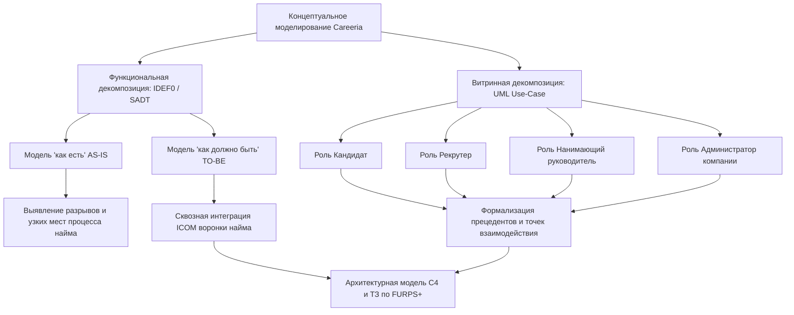

# 2.1. Выбор методологии и технологии концептуального моделирования ИС

В разделе сравниваются нотации и инструменты для моделирования процессов найма в Careeria. По результатам сравнения выбран способ описания текущего и целевого процессов.

Концептуальная модель нужна заказчикам, аналитикам и разработчикам как общее описание предметной области. На неё опираются архитектурная модель C4, требования **FURPS+** и техническое задание.

---

## 2.1.1. Сущность, цели и уровни концептуального моделирования

### Понятие и назначение концептуальной модели

**Концептуальная модель** описывает сущности предметной области, связи между ними, бизнес-правила и ограничения. Она не зависит от СУБД, формата передачи данных, языка программирования и оборудования.

Модель отвечает на три вопроса: какие сущности есть в системе, какие процессы с ними связаны и как они взаимодействуют. Её используют разные участники проекта:

- **Заказчик и бизнес-стейкхолдеры** проверяют, покрывает ли модель все целевые функции подбора персонала, оценки кандидатов и ведения переговоров.
- **Системные аналитики** используют модель для формализации сценариев использования, декомпозиции процессов на этапы воронки найма и формулирования функциональных требований.
- **Архитекторы и разработчики** используют модель как основу для дальнейшего проектирования хранения данных, доступа и обмена с внешними системами.

### Разграничение уровней абстракции моделирования

В таблице 1 сопоставлены концептуальный, логический и физический уровни модели.

*Таблица 1. Уровни абстракции моделирования информационной системы*

| Уровень моделирования | Цель и фокус внимания | Используемые артефакты в Careeria | Технологическая зависимость |
|---|---|---|---|
| **Концептуальный уровень** | Определение предметной области, бизнес-сущностей, акторов и их высокоуровневых отношений | IDEF0-диаграммы сквозных процессов найма; UML Use-Case сценарии взаимодействия ролей | Полная независимость от платформы, ОС, СУБД и языков |
| **Логический уровень** | Формализация структур данных, отношений, жизненных циклов и интерфейсов без привязки к конкретным продуктам | Правила доступа по ролям; конечные автоматы статусов отклика и вакансии; диаграммы действий | Независимость от конкретной реализации |
| **Физический уровень** | Описание способов хранения данных и взаимодействия программных компонентов | Схемы хранения, форматы обмена и параметры развёртывания | Определяется на следующем этапе проектирования |

### Пять этапов построения концептуальной модели Careeria

Концептуальная модель Careeria строится в пять шагов:

1. **Определение границ системы и участников.** Выделение ключевых ролей: кандидаты, рекрутеры, нанимающие руководители и администраторы компании. Отдельно обозначается кадровая система работодателя, от которой поступает подтверждение оформления.
2. **Идентификация доменных сущностей и их атрибутов.** Выделение устойчивых концептов предметной области: *Кандидат*, *Резюме*, *Компания*, *Вакансия*, *Отклик (Application)*, *Этап найма (Stage)*, *Интервью*, *Оценка (Assessment)*, *Оффер*, *Диалог*.
3. **Определение связей и кратностей.** Установление отношений между сущностями: принадлежность вакансий компании (1:N), подача кандидатом откликов на вакансии (1:N), прохождение откликом этапов настраиваемой воронки (1:N), проведение интервью по отклику (1:N) и формирование единой истории переходов.
4. **Формализация бизнес-правил и ограничений.** Определение правил перехода отклика между этапами, доступа к персональным данным по роли пользователя и разделения сведений разных работодателей.
5. **Верификация и согласование модели.** Сопоставление концептуальной модели со спецификацией требований по модели **FURPS+** и архитектурными ограничениями **DIIP**.

---

## 2.1.2. Сравнительный анализ методологий концептуального моделирования

### Система критериев сравнения на основе модели FURPS+

Методологии сравниваются по критериям, связанным с **FURPS+** (Robert Grady, Hewlett-Packard, 1992) и ограничениями **DIIP** (*Design, Implementation, Interface, Physical*):

1. **К1. Архитектурный охват и тип моделируемой архитектуры (согласовано с Design / D01, D02):** способность методологии выражать функциональные процессы, структуру программных подсистем и границы взаимодействия компонентов.
2. **К2. Поддержка функциональной декомпозиции (согласовано с Functionality):** возможность иерархического разбиения сложного бизнес-процесса от контекстного уровня (A-0) до элементарных процедур с фиксацией входов, выходов, управлений и механизмов.
3. **К3. Поддержка пользовательской декомпозиции (согласовано с Usability / Design D01):** наглядность действий участников и передачи результатов между ними.
4. **К4. Масштабируемость модели (согласовано с Supportability / Performance):** возможность добавлять новые этапы и уточнять правила процесса без потери связей между диаграммами.
5. **К5. Зрелость стандартизации и инструментальной поддержки (согласовано с Supportability / Implementation):** наличие признанных мировых стандартов (ISO/IEC, OMG, IEEE), открытых спецификаций и программных средств моделирования.
6. **К6. Поддерживаемость и порог освоения (согласовано с Supportability / Usability):** трудоёмкость изучения нотации командой и доступность диаграмм для восприятия непрограммистами (заказчиками, HR-специалистами).

### Анализируемые методологии и нотации

Для сравнения выбраны следующие нотации и методологии:

- **SADT / IDEF0 (Integration Definition for Function Modeling):** классическая методология структурного анализа и функционального моделирования сложных систем, регламентированная стандартом IEEE 1320.1 и Р 50.1.028-2001. Построена на блочной декомпозиции с правилом ICOM (*Input, Control, Output, Mechanism*).
- **BPMN 2.0 (Business Process Model and Notation):** стандартизированная OMG нотация описания сквозных бизнес-процессов, ориентированная на исполнение процессов (BPMS-движки, оркестрация) и моделирование временных потоков событий (*Event-driven process flows*).
- **UML (Unified Modeling Language):** семейство стандартизированных объектно-ориентированных нотаций (OMG). Для концептуального моделирования ключевыми выступают диаграммы прецедентов (*Use Case*), деятельностей (*Activity*) и состояний (*State Machine*).
- **ERD (Entity-Relationship Diagram):** нотация концептуального моделирования сущностей и связей (модели Чена, Мартина, Баркера), ориентированная преимущественно на реляционные структуры данных.
- **C4 Model:** специализированная архитектурная нотация (Simon Brown), ориентированная на контекстное, контейнерное и компонентное описание распределённых программных систем.

### Матрица сравнительного анализа методологий

*Таблица 2. Сравнительный анализ методологий концептуального моделирования*

| Критерий оценки (FURPS+) | IDEF0 (SADT) | BPMN 2.0 | UML (Use-Case / Activity) | ERD (Chen / Crow's Foot) | C4 Model |
|---|---|---|---|---|---|
| **К1. Архитектурный охват** | Функциональная и процессная архитектура | Бизнес-архитектура, оркестрация процессов | Программная, системная и объектная архитектура | Информационная архитектура, структуры данных | Программная и системная архитектура |
| **К2. Функциональная декомпозиция** | Иерархия блоков (A0, A1...) с входами, управлением, выходами и механизмами ICOM | Дорожки (*swimlanes*), подпроцессы и развилки потоков управления | Декомпозиция прецедентов через `<<include>>` и `<<extend>>` | Описывает статические сущности, а не процессы | Уровни Context → Container → Component |
| **К3. Витринная декомпозиция (акторы)** | Акторы показаны как механизмы или входящие стрелки | Акторы разделены дорожками участников | Показывает роли, границу системы и прецеденты | Не показывает действия акторов | Показывает взаимодействие акторов с системами и контейнерами |
| **К4. Масштабируемость** | Описывает функциональные потоки | Описывает бизнес-процессы и их подпроцессы | Подходит для моделей от прецедентов до классов | Описывает структуру данных, но не динамические процессы | Разделяет систему на контекст, контейнеры и компоненты |
| **К5. Зрелость стандартизации** | Международные стандарты IEEE 1320.1, ГОСТ Р 50.1.028 | Стандарт OMG BPMN 2.0, стандарты ISO/IEC 19510 | Стандарты ISO/IEC 19505, OMG UML 2.5 | Отраслевые стандарты моделирования данных | Открытый отраслевой стандарт де-факто |
| **К6. Поддерживаемость и порог входа** | Требует знания семантики стрелок ICOM и правил балансировки | Требует знания библиотеки графических символов | Use-Case связывает действия с ролями пользователей | Для реляционных структур требует меньше обозначений, но не описывает процессы | Использует четыре уровня и небольшой набор обозначений |

### Анализ применимости методологий к платформе Careeria

1. **IDEF0 (SADT):** Обладает максимальной строгостью при анализе сквозного функционала платформы найма. Правила ICOM позволяют детально отобразить:
   - *Входы (I):* резюме кандидатов, требования вакансий, тестовые задания, видеопотоки;
   - *Управления (C):* трудовое законодательство, корпоративные регламенты найма, правила доступа к данным и лимиты времени на собеседование;
   - *Выходы (O):* опубликованные вакансии, статусы откликов, протоколы оценок, офферы, отказы;
   - *Механизмы (M):* участники процесса и используемые ими инструменты.
   Методология подходит для сопоставления текущего процесса с целевым: на схемах видны действия участников и результаты каждого этапа.
2. **UML (Use-Case):** Диаграммы вариантов использования сопоставляют четыре роли Careeria (кандидат, рекрутер, нанимающий руководитель, администратор компании) с действиями, доступными им в системе.
3. **BPMN 2.0:** Высокоэффективна для моделирования длительных бизнес-процессов с явными таймерами и развилками, однако перегружена узкоспециализированными пиктограммами и уступает UML в выразительности программных границ интерфейсов.
4. **ERD:** Показывает сущности и связи, но не описывает последовательность действий участников подбора.
5. **C4 Model:** Исключительно полезна для описания компонентной архитектуры системы, контейнеров и инфраструктурного взаимодействия (уже внедрена в проекте Careeria в каталоге [`docs/architecture/c4-plant-uml/`](../../architecture/c4-plant-uml/README.md)), выступая прямым продолжением концептуального моделирования.

---

## 2.1.3. Сравнительный анализ инструментальных средств (технологий моделирования)

### Критерии выбора инструментальных средств

Инструменты моделирования сравниваются по стоимости, поддержке совместной работы и совместимости с **Docs-as-Code**. Эти критерии связаны с *Supportability* в **FURPS+** и ограничениями *Implementation* / *Design*:

1. **Стоимость владения и лицензионная чистота (TCO):** отсутствие дорогостоящих проприетарных лицензий, поддержка работы в студенческих и коммерческих командах без ограничений по триальным периодам.
2. **Командная работа и версионирование (VCS / Git):** хранение исходных диаграмм в текстовых форматах, позволяющее выполнять ветвление, слияние (*merge*), просмотр различий (*diff*) и рецензирование изменений (*pull request review*) без бинарных конфликтов.
3. **Парадигма создания диаграмм:** классическое визуальное рисование («мышью по холсту») против парадигмы *«Диаграмма как код» (Diagrams as Code)*.
4. **Кроссплатформенность и доступность:** работа на операционных системах Linux, macOS и Windows, а также возможность автономного запуска в изолированных Docker-контейнерах.
5. **Интеграция с контуром разработки и CI/CD:** автоматическая генерация векторных изображений (SVG/PNG), интеграция со статическими генераторами документации (MkDocs) и средами разработки (VS Code, GoLand).
6. **Автоматизация контроля качества:** возможность запуска линтеров синтаксиса диаграмм и автоматизированных тестов битых ссылок при коммитах.

### Анализируемые программные средства

В сравнительном анализе рассмотрены четыре характерных представителя инструментов моделирования:

- **Visual Paradigm:** тяжеловесный коммерческий визуальный CASE-пакет корпоративного уровня с поддержкой UML, BPMN, ERD и генерации исходного кода.
- **Enterprise Architect (Sparx Systems):** популярное в Enterprise-сегменте комплексное инструментальное средство моделирования с поддержкой широкого спектра нотаций и репозиториев моделей.
- **Draw.io (diagrams.net):** популярный визуальный веб- и десктоп-редактор схем общего назначения с открытым исходным кодом.
- **PlantUML (в стеке Docs-as-Code: MkDocs + Docker + Make):** специализированный инструмент декларативного описания диаграмм на предметно-ориентированном текстовом языке с компиляцией в SVG/PNG.

### Матрица сравнительного анализа CASE-инструментов

*Таблица 3. Сравнительный анализ инструментальных технологий моделирования*

| Критерий сравнения | Visual Paradigm | Enterprise Architect | Draw.io (diagrams.net) | PlantUML (Docs-as-Code) |
|---|---|---|---|---|
| **Стоимость и лицензия** | Коммерческая (высокая стоимость подписки на пользователя) | Коммерческая (проприетарная лицензия на рабочее место) | Бесплатная (Open Source / Web) | **Бесплатная** (Open Source, GPL/MIT) |
| **Версионирование в Git** | Затруднено (бинарные проекты `.vpp`, конфликты слияния) | Затруднено (бинарные `.eapx` или внешняя СУБД) | Ограниченно (XML-разметка, сложный семантический diff) | **Идеальное:** чистый plain text, построчный Git diff, бесконфликтные PR |
| **Основная парадигма** | Тяжеловесный GUI-редактор | Тяжеловесный GUI-редактор с репозиторием | Интерактивный визуальный векторный редактор | **Diagrams as Code:** декларативный исходный код диаграммы |
| **Кроссплатформенность** | Десктоп (Win, Mac, Linux) + урезанный Web | Ограниченная (нативно Windows, запуск под Wine) | Кроссплатформенный (Web, Win, Mac, Linux) | **Полная:** работает везде, где есть Java/Docker (Linux, macOS, Windows) |
| **Интеграция с CI/CD и документацией** | Через плагины экспорта и серверную часть | Через специализированные API и скрипты | Экспорт картинок вручную или CLI-рендеринг | **Бесшовная:** сборка внутри Makefile, прямой рендеринг в MkDocs через inline SVG |
| **Автоматизация тестирования** | Ручная проверка моделей | Встроенная валидация внутри пакета | Отсутствует | **Автоматическая:** проверка синтаксиса и связей (`make docs-test`, скрипт `check.py`) |

### Анализ результатов сравнения инструментов

- **Visual Paradigm** и **Enterprise Architect** предоставляют широкий набор средств моделирования, но требуют платных лицензий и хранят модели в форматах, которые труднее сравнивать при совместной работе. Для документации проекта удобнее текстовое представление, изменения которого видны в истории версий.
- **Draw.io** удобен для быстрого прототипирования набросков интерфейсов и единичных блок-схем, однако сохранение XML-координат блоков приводит к сильному зашумлению истории Git при малейшем сдвиге элементов мышью. Кроме того, Draw.io не поддерживает переиспользование общих библиотек элементов и стилей.
- **PlantUML** объединяет преимущества декларативного кода и автоматизированного пайплайна:
  - Исходные файлы диаграмм (`.puml`) сохраняются в стандартном текстовом представлении в репозитории Git;
  - Изменение архитектурных концептов отслеживается через стандартный `git diff`;
  - Поддерживается модульность через директивы `!include` и `!includesub`, что позволяет повторно использовать описания сущностей, палитры стилей и общие компоненты;
  - Компиляция выполняется внутри изолированного Docker-контейнера без требования установки специфического ПО на рабочие станции разработчиков.

---

## 2.1.4. Обоснование выбора методологий и технологий для платформы Careeria

### Методологический базис: Синергия IDEF0 и UML Use-Case

Для Careeria выбраны две нотации: IDEF0 описывает функции процесса найма, а UML Use-Case — действия пользователей и границы системы.

#### 1. Обоснование структурного анализа SADT в нотации IDEF0

1. **Полнота покрытия сквозного цикла подбора персонала.** Рекрутинг представляет собой сложный межфункциональный процесс, простирающийся от формирования заявки на вакансию до подписания оффера и оформления сотрудника. IDEF0 обеспечивает строгую функциональную декомпозицию этого процесса сверху вниз.
2. **Фиксация строгих ограничений и управлений (Control).** Правила ICOM позволяют наглядно отделить нормативные и регламентные ограничения (законодательство о персональных данных 152-ФЗ, правила конфиденциальности, политики компании, роли ReBAC) от прямых информационных входов (резюме, анкеты).
3. **Объективное сопоставление моделей «как есть» и «как должно быть».** В модели AS-IS методология IDEF0 наглядно обнажает критические разрывы традиционного найма: множественную ручную пересылку резюме по электронной почте, использование разрозненных мессенджеров для связи, потерю кандидатов и отсутствие централизованной аналитики. В модели TO-BE входы и выходы замыкаются в единый автоматизированный цифровой контур Careeria.

#### 2. Обоснование объектно-ориентированного анализа в нотации UML Use-Case

1. **Чёткая ролевая проекция системы.** В платформе Careeria строго специфицированы 4 пользовательские роли (Кандидат, Рекрутер, Нанимающий руководитель, Администратор компании). Диаграммы вариантов использования предоставляют наглядную «витрину» системы, демонстрирующую, какие целевые задачи решает каждая роль и через какие точки входа осуществляется доступ.
2. **Формализация интерфейсных взаимосвязей.** Нотация Use-Case позволяет с помощью отношений `<<include>>` и `<<extend>>` показать обязательные и дополнительные действия пользователя: проверку доступа при открытии отклика, видеоинтервью и практическую задачу.
3. **Прямая трассируемость в функциональные требования и тесты.** Каждый вариант использования UML выступает прямым источником для формулирования требований раздела *Functionality* модели FURPS+ и составления приёмочных пользовательских сценариев (*User Stories / Acceptance Criteria*).

#### 3. Дополнительные логические нотации UML

Для описания состояний и последовательности действий также используются:
- **UML State Machine (диаграммы состояний):** моделирование конечного автомата жизненного цикла вакансии (`DRAFT` → `PUBLISHED` → `PAUSED` → `CLOSED` → `ARCHIVED`) и основной цепочки статусов отклика (`APPLIED` → `SCREENING` → `TECH_ASSESSMENT` → `INTERVIEW` → `OFFER_PENDING` → `OFFER_ACCEPTED` → `HIRED`), а также отказа (`REJECTED`);
- **UML Activity (диаграммы деятельностей):** моделирование параллельных процессов оценки компетенций (прохождение теста, решение практической задачи и совместный Live Coding).

### Обоснование инструментального стека (PlantUML и Docs-as-Code)

Исходники диаграмм хранятся в репозитории. Для их создания используется **PlantUML**, для сборки документации — подход **Docs-as-Code**:

1. **Единый технологический контур с C4-моделью проекта.** Вся архитектура платформы Careeria уже описана на PlantUML (каталог [`docs/architecture/c4-plant-uml/plantuml/`](../../architecture/c4-plant-uml/README.md)). Использование PlantUML для концептуальных диаграмм исключает фрагментацию инструментария и обеспечивает сквозную стилевую преемственность.
2. **Хранение в Git и командное рецензирование.** Все диаграммы описываются декларативным кодом в файлах с расширением `.puml` и версионируются в едином репозитории. Архитектурные изменения проходят классический процесс рецензирования кода через Pull Requests.
3. **Автоматизированная валидация и сборка:**
   - Команда `make docs-test` выполняет строгую проверку синтаксиса диаграмм и валидирует целостность внутренних гиперссылок; порядок проверки описан в [руководстве по документации](../../contributing/index.md);
   - Команда `make architecture-validate` проверяет корректность всех подключений PlantUML;
   - Плагин `plantuml_markdown` генерирует встроенный интерактивный SVG, поддерживающий масштабирование и кликабельные ссылки на смежные сервисы системы.
4. **Изоляция в Docker.** Разработчикам не требуется настраивать Java, Graphviz или специализированные утилиты: окружение полностью упаковано в контейнере `docs/docker-compose.yml` и запускается локально командой `make docs`.

---

## 2.1.5. Взаимосвязь с требованиями к системе и последующими главами

Выбранные нотации и инструменты используются дальше в требованиях и архитектурной документации:

- **Связь с требованиями FURPS+:** критерии сравнения нотаций и CASE-средств (К1–К6) соотнесены с атрибутами **FURPS+** (*Supportability*, *Functionality*, *Usability*) и ограничениями **DIIP** (*Design, Implementation, Interface, Physical*). Сравнение продуктов по выбранным требованиям приведено в [пункте 1.5](../01-general/05-analogs-analysis.md); отдельной главы «Техническое задание» в текущей структуре нет.
- **Связь с архитектурой C4:** функциональные модели этой главы можно сопоставить с [контекстными, контейнерными и компонентными представлениями C4](../../architecture/c4-plant-uml/plantuml/README.md). Глава 4 описывает технологический стек и инфраструктуру, а каталог `architecture/c4-plant-uml/` хранит сами архитектурные диаграммы.

---

## Резюме и выводы

1. Для сравнения процессов до и после внедрения Careeria выбрана IDEF0: её входы, управления, выходы и механизмы показаны в [AS-IS](02-as-is.md) и [TO-BE](03-to-be.md).
2. На каждой диаграмме дочерние функции сохраняют входы и выходы родительского процесса; это позволяет проследить, на каком этапе исчезает ручная передача данных.
3. UML Use-Case выбран для отдельного описания действий четырёх пользовательских ролей. В пунктах 2.2 и 2.3 такие диаграммы пока не представлены; доступ к сценариям нельзя считать проверенным только по IDEF0.
4. Исходники диаграмм хранятся в репозитории. `make docs-test` проверяет их сборку и внутренние ссылки документации.

---

## Куда перейти дальше

- [Глава 2. Концепт программного продукта](index.md)
- [2.2. Разработка концептуальной модели ПО "как есть"](02-as-is.md)
- [2.3. Разработка концептуальной модели ПО "как должно быть"](03-to-be.md)
- [Системный контекст архитектуры C4 (L1)](../../architecture/c4-plant-uml/plantuml/context/system-context.md)
- [Контейнерная архитектура полной системы C4 (L2)](../../architecture/c4-plant-uml/plantuml/container/full-system.md)

