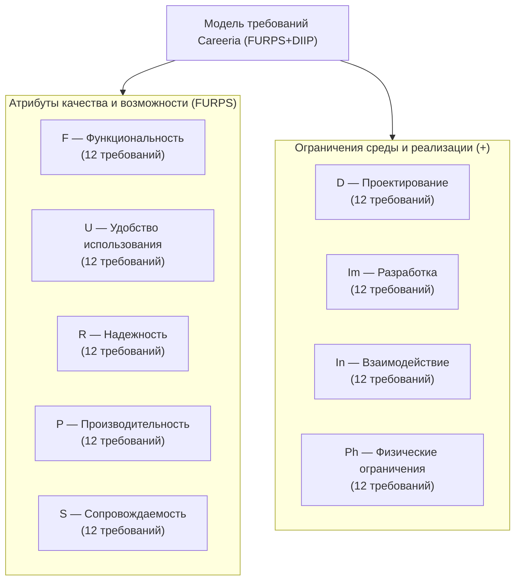
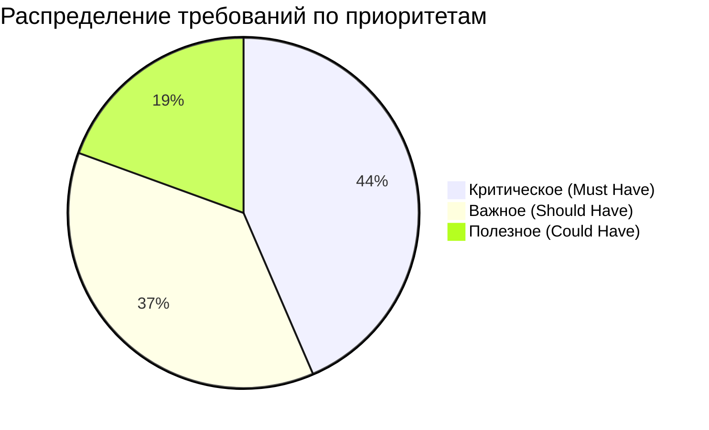
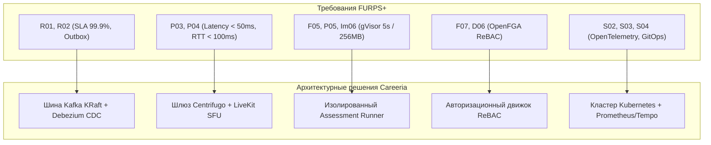

# 3.1. Классификация требований к ПО по методологии FURPS+

Раздел содержит детальную классификацию функциональных и нефункциональных требований, а также архитектурных ограничений программного комплекса цифровой платформы подбора персонала **Careeria**. 

Классификация выполнена в соответствии с международно признанной моделью **FURPS+** (разработанной Робертом Грейди в компании Hewlett-Packard) с расширением категории ограничений **+** по схеме **DIIP / DEEP** (*Design, Implementation, Interface, Physical*).

---

## 1. Методологические основы классификации FURPS+DIIP

Модель **FURPS+** делит все требования к программной системе на две фундаментальные группы:
1. **Атрибуты качества и функциональные характеристики (FURPS)**:
   - **Functionality (F) — Функциональность**: совокупность возможностей, бизнес-функций, сервисов, алгоритмов обработки, сценариев безопасности и управления платформой;
   - **Usability (U) — Удобство использования (эргономика)**: человеко-машинные факторы, эстетика интерфейса, согласованность дизайн-системы, защищенность от ошибок оператора, скорость освоения и справочная поддержка;
   - **Reliability (R) — Надежность**: показатели безотказности (MTBF), время восстановления (MTTR), допустимые границы потерь данных (RPO/RTO), точность вычислений, устойчивость к сбоям компонентов и предсказуемость поведения;
   - **Performance (P) — Производительность**: временные и количественные характеристики обработки транзакций, время отклика API, пропускная способность (RPS), задержки потокового мультимедиа, потребление системных ресурсов (CPU, RAM, диск, сеть);
   - **Supportability (S) — Сопровождаемость (пригодность к поддержке)**: модульность, масштабируемость, тестируемость, наблюдаемость (observability), управляемость конфигурациями, простота развертывания и обновления без простоя.

2. **Категории ограничений («+» / DIIP)**:
   - **Design (D) — Ограничения проектирования**: архитектурные стили, методологии моделирования (C4 Model, UML), паттерны проектирования (EDA, Outbox, ReBAC) и регламенты интеграции;
   - **Implementation (Im) — Ограничения разработки**: языки программирования, фреймворки, целевые версии СУБД, брокеров сообщений, рантаймов песочниц, стандарты кодирования и правила сборки;
   - **Interface (In) — Ограничения на интерфейсы и взаимодействие**: протоколы межсервисного и клиентского взаимодействия (gRPC, HTTPS, WebSocket, WebRTC), форматы сериализации данных (Protobuf, JSON, Avro) и интеграционные контракты внешних систем;
   - **Physical (Ph) — Физические ограничения**: требования к вычислительным ресурсам дата-центра (Tier III), аппаратным платформам серверов, топологии сетевого оборудования, климатическим условиям и резервированию питания.

### Структура и кодирование требований

Каждому требованию присваивается уникальный идентификатор вида `[Префикс][Номер]`:
- `F01`–`F12` — функциональные требования;
- `U01`–`U12` — требования к удобству использования;
- `R01`–`R12` — требования к надежности;
- `P01`–`P12` — требования к производительности;
- `S01`–`S12` — требования к сопровождаемости;
- `D01`–`D12` — ограничения проектирования;
- `Im01`–`Im12` — ограничения разработки;
- `In01`–`In12` — ограничения на интерфейсы взаимодействия;
- `Ph01`–`Ph12` — физические ограничения.

### Система атрибутов требований

В соответствии с требованиями академического стандарта курса, каждое требование фиксируется со следующим набором атрибутов:
- **Статус**: текущее состояние жизненного цикла требования (`Согл.` — согласовано, `Рассмотрено`, `Предложено`, `Реализовано`);
- **Приоритет**: важность требования для бизнеса и архитектуры (`Критическое`, `Важное`, `Полезное`, `Не важное`). **Внутри каждой таблицы требования строго упорядочены по убыванию приоритета**;
- **Трудоемкость**: экспертная оценка времени, необходимого для проектирования, реализации и валидации требования (в человеко-часах);
- **Риск**: вероятность и степень влияния потенциальных проблем при реализации (`Высокий`, `Средний`, `Низкий`);
- **Стабильность**: вероятность изменения формулировки и границ требования в процессе реализации проекта (`Высокая`, `Средняя`, `Низкая`).

В соответствии с методическими указаниями, **в каждой из 9 категорий сформулировано не менее 10 детальных требований** (суммарно 108 требований по платформе Careeria).

---

## 2. Функциональные требования (Functionality — F)

Функциональные требования определяют фундаментальные возможности платформы Careeria, обеспечивающие автоматизацию сквозного цикла подбора персонала: публикацию вакансий, прием откликов, фильтрацию кандидатов, автоматизированную оценку компетенций, проведение собеседований, скоринг и аналитику.

| Код | Требования к функциям | Статус | Приоритет | Трудоемкость | Риск | Стабильность |
|:---|:---|:---:|:---:|:---:|:---:|:---:|
| **F01** | **Управление жизненным циклом и публикацией вакансий:** система должна обеспечивать создание, редактирование, согласование, публикацию, архивацию и закрытие вакансий с поддержкой шаблонов, квалификационных требований, вилок компенсаций и этапов отбора. | Согл. | Критическое | 40 час. | Низкий | Высокая |
| **F02** | **Подача откликов и управление цифровым резюме:** система должна позволять соискателям формировать структурированный профиль (опыт, навыки, образование), прикреплять резюме в различных форматах (PDF, DOCX) с версионированием и подавать отклики на открытые вакансии. | Согл. | Критическое | 36 час. | Низкий | Высокая |
| **F03** | **Управление воронкой найма и стейт-машиной кандидата:** система должна реализовывать настраиваемый конечный автомат (FSM) статусов отклика (новый, скрининг, оценка, техническое интервью, оффер, нанят, отклонен) с фиксацией истории переходов и причин отказов. | Согл. | Критическое | 48 час. | Средний | Высокая |
| **F04** | **Автоматизированное тестирование компетенций (Assessment Engine):** платформа должна обеспечивать назначение кандидатам стандартизированных тестов, алгоритмических кейсов и опросников с ограничением по времени и автоматическим подсчетом баллов. | Согл. | Критическое | 54 час. | Средний | Высокая |
| **F05** | **Изолированная среда выполнения кода (Live Coding Sandbox):** система должна предоставлять веб-редактор кода с поддержкой совместного редактирования в реальном времени и безопасной компиляцией/запуском тестов в изолированном контейнере. | Согл. | Критическое | 60 час. | Высокий | Средняя |
| **F06** | **Проведение видеособеседований (WebRTC Audio/Video):** система должна обеспечивать проведение аудио- и видеоконференций между кандидатом и нанимающей командой внутри браузера с демонстрацией экрана, переключением медиа-устройств и чатом сессии. | Согл. | Критическое | 50 час. | Высокий | Средняя |
| **F07** | **Контекстная авторизация и управление доступом (RBAC/ReBAC):** система должна реализовывать разграничение прав доступа на основе ролей (кандидат, рекрутер, нанимающий менеджер, администратор компании) и связей владения ресурсами (доступ к откликам конкретной вакансии). | Согл. | Критическое | 44 час. | Средний | Высокая |
| **F08** | **Обмен сообщениями в реальном времени (Realtime Chat):** платформа должна поддерживать личные и групповые чаты участников отбора с мгновенной доставкой сообщений, статусами прочтения («доставлено», «прочитано») и индикацией набора текста. | Согл. | Важное | 32 час. | Средний | Высокая |
| **F09** | **Полнотекстовый и фасетный поиск:** система должна поддерживать фильтрацию и ранжирование резюме и вакансий по ключевым словам, требуемым грейдам, стеку технологий, локации и зарплатным ожиданиям. | Согл. | Важное | 36 час. | Низкий | Высокая |
| **F10** | **Неизменяемый журнал аудита действий (Audit Log):** система должна протоколировать все юридически и организационно значимые действия пользователей (изменение статуса отклика, изменение условий оффера, скачивание персональных данных) с фиксацией автора, IP и таймстемпа. | Согл. | Важное | 24 час. | Низкий | Высокая |
| **F11** | **Формирование аналитической отчетности по воронке найма:** система должна формировать графические и табличные отчеты по метрикам рекрутмента (Time-to-Hire, конверсия стадий, стоимость найма, нагрузка на рекрутеров) с выгрузкой в форматы Excel и PDF. | Согл. | Важное | 30 час. | Низкий | Средняя |
| **F12** | **Интеграция с почтовыми сервисами и внешними календарями:** система должна отправлять почтовые уведомления участникам процесса и формировать приглашения на собеседования с синхронизацией по протоколам iCalendar / CalDAV. | Согл. | Полезное | 28 час. | Низкий | Высокая |

---

## 3. Требования к удобству использования (Usability — U)

Требования эргономики определяют комфорт взаимодействия конечных пользователей с платформой, соответствие современным стандартам UX/UI, адаптивность под различные устройства, минимизацию ошибок оператора и простоту обучения персонала.

| Код | Требования к удобству использования | Статус | Приоритет | Трудоемкость | Риск | Стабильность |
|:---|:---|:---:|:---:|:---:|:---:|:---:|
| **U01** | **Единая дизайн-система и компонентный стиль:** интерфейс платформы должен быть реализован на базе унифицированной дизайн-системы компонентов, обеспечивающей единообразие типографики, отступов, цветовой палитры и состояний элементов управления. | Согл. | Критическое | 40 час. | Низкий | Высокая |
| **U02** | **Интуитивный визуальный канбан воронки подбора:** рабочее место рекрутера должно представлять отклики в виде интерактивной канбан-доски с поддержкой перемещения кандидатов между этапами методом Drag-and-Drop. | Согл. | Критическое | 36 час. | Низкий | Высокая |
| **U03** | **Адаптивность клиентского интерфейса:** веб-интерфейс платформы должен корректно и без потери функциональности отображаться на экранах настольных ПК (1920×1080, 1440×900), планшетов (768×1024) и мобильных устройств (375×667 и выше). | Согл. | Критическое | 32 час. | Низкий | Высокая |
| **U04** | **Клиентская и серверная валидация ввода с подсказками:** все экранные формы должны валидировать данные в режиме реального времени, подсвечивать некорректные поля и выводить однозначные, понятные пользователю сообщения об ошибках без перезагрузки страницы. | Согл. | Критическое | 24 час. | Низкий | Высокая |
| **U05** | **Защита от случайной потери данных и автосохранение:** при заполнении длинных форм (создание вакансии, составление резюме, фидбек по собеседованию) должно выполняться фоновое сохранение черновиков с возможностью восстановления при разрыве сессии. | Согл. | Важное | 20 час. | Средний | Высокая |
| **U06** | **Эргономика специализированной среды Live Coding:** интерфейс редактора кода для технических интервью должен поддерживать подсветку синтаксиса, нумерацию строк, сворачивание блоков, автодополнение и стандартные клавиатурные комбинации (Keymaps). | Согл. | Важное | 28 час. | Средний | Высокая |
| **U07** | **Полнотекстовая справочная система и контекстные подсказки:** система должна содержать встроенный справочный центр и контекстные всплывающие подсказки (Tooltips) для сложных настроек фильтрации и этапов найма. | Согл. | Важное | 18 час. | Низкий | Высокая |
| **U08** | **Полная русификация и поддержка терминологии предметной области:** весь интерфейс, системные уведомления и справочники должны быть переведены на русский язык с использованием общепринятой терминологии кадрового делопроизводства и рекрутмента. | Согл. | Важное | 16 час. | Низкий | Высокая |
| **U09** | **Доступность интерфейса по стандартам WCAG 2.1 (Level AA):** ключевые пользовательские сценарии должны быть оптимизированы по контрастности текста, поддерживать навигацию с клавиатуры и корректно читаться программами экранного доступа (Screen Readers). | Согл. | Важное | 24 час. | Средний | Средняя |
| **U10** | **Информативность и прозрачность системных статусов:** длительные фоновые процессы (компиляция кода, импорт базы резюме, генерация отчета) должны сопровождаться визуальными индикаторами выполнения (Progress Bars, Spinners) с оценкой оставшегося времени. | Согл. | Полезное | 14 час. | Низкий | Высокая |
| **U11** | **Поддержка темного и светлого режимов интерфейса:** интерфейс платформы должен предоставлять пользователям возможность переключения между светлой и темной темами оформления с автоматическим учетом системных настроек ОС. | Согл. | Полезное | 16 час. | Низкий | Средняя |
| **U12** | **Персонализация рабочего пространства:** пользователи с ролью рекрутера должны иметь возможность настраивать состав отображаемых колонок в списках кандидатов и закреплять избранные вакансии на стартовом экране. | Согл. | Полезное | 18 час. | Низкий | Высокая |

---

## 4. Требования к надежности (Reliability — R)

Требования к надежности определяют способность программного комплекса сохранять работоспособное состояние, обеспечивать целостность данных в условиях аппаратных сбоев, изолировать аварии и восстанавливать сервисы в регламентные сроки.

| Код | Требования к надежности | Статус | Приоритет | Трудоемкость | Риск | Стабильность |
|:---|:---|:---:|:---:|:---:|:---:|:---:|
| **R01** | **Высокий коэффициент доступности платформы (SLA 99.9%):** платформа должна обеспечивать непрерывное круглосуточное функционирование с общим временем доступности не менее 99.9% в месяц (не более 43 минут суммарного незапланированного простоя в месяц). | Согл. | Критическое | 40 час. | Высокий | Высокая |
| **R02** | **Гарантия транзакционной целостности без потери данных (RPO = 0):** при возникновении программно-аппаратных сбоев узлов кластера потеря зафиксированных транзакций (откликов, оценок, статусов) должна быть исключена за счет паттерна Transactional Outbox и репликации WAL. | Согл. | Критическое | 36 час. | Высокий | Высокая |
| **R03** | **Регламентное время восстановления работоспособности (MTTR < 1 часа):** среднее время полного восстановления доступности сервисов платформы после катастрофического сбоя серверного узла не должно превышать 60 минут. | Согл. | Критическое | 32 час. | Средний | Высокая |
| **R04** | **Автоматическое резервное копирование и верификация реплик:** система должна выполнять ежедневное инкрементальное и еженедельное полное резервное копирование баз данных с хранением копий в географически удаленном контуре и автоматической проверкой целостности. | Согл. | Критическое | 24 час. | Средний | Высокая |
| **R05** | **Идемпотентность обработки событий и API-запросов:** механизмы обработки сообщений из шины Kafka и клиентских мутирующих запросов должны быть идемпотентными для предотвращения дублирования записей при повторных отправках. | Согл. | Критическое | 28 час. | Средний | Высокая |
| **R06** | **Изоляция сбоев и предотвращение каскадных аварий (Circuit Breaker):** межсервисные вызовы должны быть защищены паттернами тайм-аутов, автоматического размыкания цепи (Circuit Breaker) и деградации функционала (Fallback) при недоступности смежных сервисов. | Согл. | Важное | 26 час. | Средний | Высокая |
| **R07** | **Отказоустойчивость брокера сообщений (Kafka KRaft HA):** брокер сообщений должен функционировать в кластерном режиме с кворумом KRaft (минимум 3 брокера) и фактором репликации топиков не менее 3 (min.insync.replicas=2). | Согл. | Важное | 22 час. | Средний | Высокая |
| **R08** | **Автоматический перезапуск упавших сервисов (Kubernetes Probes):** контейнеры приложений должны непрерывно контролироваться механизмами Liveness и Readiness Probes с автоматическим перезапуском деградировавших подов в течение 10 секунд. | Согл. | Важное | 16 час. | Низкий | Высокая |
| **R09** | **Автоматическое переподключение клиентов realtime-сессий:** при кратковременном обрыве сетевого соединения веб-клиент должен выполнять прозрачное автоматическое переподключение к WebSocket (Centrifugo) и WebRTC с досылкой недоставленных событий. | Согл. | Важное | 24 час. | Средний | Высокая |
| **R10** | **Изоляция аварий песочницы компиляции кода:** аварийное завершение, переполнение памяти или зависание исполняемого кода кандидата не должно оказывать влияния на стабильность родительского хоста и смежных контейнеров. | Согл. | Важное | 30 час. | Высокий | Высокая |
| **R11** | **Контроль целостности сохраняемых файлов и медиа:** все загружаемые файлы резюме и тестовых сьютов должны верифицироваться по контрольным суммам SHA-256 с отбраковкой поврежденных объектов при загрузке и скачивании. | Согл. | Полезное | 14 час. | Низкий | Высокая |
| **R12** | **Предотвращение атак типа «Отказ в обслуживании» (Rate Limiting):** публичный API Gateway должен ограничивать предельную частоту запросов с одного IP-адреса и токена пользователя для защиты от брутфорса и DoS-атак. | Согл. | Полезное | 18 час. | Низкий | Высокая |

---

## 5. Требования к производительности (Performance — P)

Требования к производительности регламентируют скорость реакции платформы на запросы пользователей, масштабируемость под нагрузкой, задержки мультимедийных и realtime-потоков, а также предельные нормы утилизации серверных ресурсов.

| Код | Требования к производительности | Статус | Приоритет | Трудоемкость | Риск | Стабильность |
|:---|:---|:---:|:---:|:---:|:---:|:---:|
| **P01** | **Время отклика API на типовые запросы:** время формирования ответа публичного API Gateway и внутренних сервисов на чтение/запись данных не должно превышать 150 мс для 95% запросов (p95 < 150 ms) при штатной нагрузке. | Согл. | Критическое | 32 час. | Средний | Высокая |
| **P02** | **Целевая пропускная способность системы:** инфраструктура платформы должна стабильно выдерживать суммарную нагрузку не менее 3000 HTTP/gRPC запросов в секунду (RPS) без деградации времени отклика. | Согл. | Критическое | 36 час. | Средний | Высокая |
| **P03** | **Минимальная задержка realtime-сообщений:** время доставки текстового сообщения или события изменения статуса кандидата через WebSocket-шлюз Centrifugo не должно превышать 50 мс в пределах одного региона. | Согл. | Критическое | 28 час. | Средний | Высокая |
| **P04** | **Низкая сетевая задержка в видеоконференциях (WebRTC RTT):** медиа-сервер LiveKit должен обеспечивать круговую задержку медиапотока (Round Trip Time) не более 100 мс при аудио/видеосвязи внутри РФ. | Согл. | Критическое | 34 час. | Высокий | Высокая |
| **P05** | **Жесткие ресурсные квоты и лимиты времени песочницы кода:** среда компиляции и выполнения алгоритмических тестов должна гарантировать завершение процесса с лимитом процессорного времени не более 5 секунд и объемом памяти не более 256 МБ на задачу. | Согл. | Критическое | 30 час. | Средний | Высокая |
| **P06** | **Поддержка масштабируемости по числу одновременных пользователей:** архитектура должна обеспечивать одновременную работу не менее 10 000 активных пользователей онлайн и 1 000 параллельных сессий собеседований. | Согл. | Важное | 38 час. | Средний | Высокая |
| **P07** | **Скорость фасетного поиска и фильтрации:** отклик поискового движка по каталогу из 500 000 вакансий и резюме с учетом многокритериальной фильтрации должен составлять не более 200 мс. | Согл. | Важное | 26 час. | Средний | Высокая |
| **P08** | **Быстрый холодный старт сервисов (Cold Start < 5 сек):** время инициализации и выхода в состояние готовности (Ready) нового пода микросервиса на базе Go в кластере Kubernetes не должно превышать 5 секунд. | Согл. | Важное | 18 час. | Низкий | Высокая |
| **P09** | **Эффективность кэширования профилей и справочников:** уровень попадания в распределенный кэш Redis (Cache Hit Ratio) для часто запрашиваемых публичных данных вакансий и справочников должен составлять не менее 85%. | Согл. | Важное | 20 час. | Низкий | Высокая |
| **P10** | **Пропускная способность шины событий Kafka:** брокеры Kafka должны обеспечивать стабильную запись и чтение сообщений с интенсивностью не менее 25 000 сообщений в секунду без роста задержки репликации (Consumer Lag). | Согл. | Важное | 24 час. | Средний | Высокая |
| **P11** | **Оптимизация времени первоначальной загрузки фронтенда:** метрика Largest Contentful Paint (LCP) клиентского приложения на Next.js не должна превышать 1.5 секунды при скорости подключения от 10 Мбит/с. | Согл. | Полезное | 22 час. | Низкий | Высокая |
| **P12** | **Скорость генерации сводных аналитических отчетов:** формирование комплексного PDF-отчета по результатам тестирования и собеседования кандидата объемом до 10 страниц должно выполняться не более чем за 2 секунды. | Согл. | Полезное | 16 час. | Низкий | Высокая |

---

## 6. Требования к сопровождению и поддержке (Supportability — S)

Требования к сопровождению определяют трудоемкость технического обслуживания платформы, локализации дефектов, масштабирования функционала, автоматизации сборки и развертывания, а также полноту мониторинга и телеметрии.

| Код | Требования к поддержке | Статус | Приоритет | Трудоемкость | Риск | Стабильность |
|:---|:---|:---:|:---:|:---:|:---:|:---:|
| **S01** | **Высокий уровень автоматизированного тестового покрытия:** кодовая база backend-сервисов должна быть покрыта модульными (Unit) и интеграционными тестами не менее чем на 80% строк бизнес-логики. | Согл. | Критическое | 44 час. | Низкий | Высокая |
| **S02** | **Централизованное структурированное логирование (JSON Logging):** все сервисы должны формировать логи в едином формате Structured JSON с обязательными полями `trace_id`, `span_id`, `service`, `level`, `timestamp` и передавать их в векторный агрегатор логов. | Согл. | Критическое | 24 час. | Низкий | Высокая |
| **S03** | **Сквозная распределенная трассировка вызовов (OpenTelemetry):** все межсервисные вызовы (HTTP, gRPC, Kafka) должны провязываться сквозным контекстом трассировки W3C Trace Context с экспортом данных в систему Jaeger / Tempo. | Согл. | Критическое | 28 час. | Средний | Высокая |
| **S04** | **Непрерывная интеграция и доставка без простоя (Zero-Downtime CI/CD):** развертывание новых релизов микросервисов должно производиться полностью автоматически через GitOps пайплайны по стратегии Rolling Update без перерыва в обслуживании пользователей. | Согл. | Критическое | 36 час. | Средний | Высокая |
| **S05** | **Автоматизированное версионирование схем баз данных:** все изменения структуры PostgreSQL должны фиксироваться в виде парных файлов миграций (up/down) и накатываться автоматически при старте сервиса с контролем блокировок. | Согл. | Критическое | 20 час. | Низкий | Высокая |
| **S06** | **Семантическое версионирование сервисов и API:** все микросервисы, библиотеки и protobuf-контракты должны следовать спецификации Semantic Versioning (SemVer 2.0.0) с гарантией обратной совместимости в рамках мажорной версии. | Согл. | Важное | 16 час. | Низкий | Высокая |
| **S07** | **Сбор и визуализация метрик производительности (Prometheus & Grafana):** сервисы платформы должны экспортировать метрики в формате Prometheus, а для дежурной смены должны быть развернуты дашборды по четырем золотым сигналам (Latency, Traffic, Errors, Saturation). | Согл. | Важное | 26 час. | Низкий | Высокая |
| **S08** | **Конфигурирование в соответствии с принципами Twelve-Factor App:** конфигурация сервисов должна быть строго отделена от кода и передаваться исключительно через переменные окружения и Kubernetes ConfigMaps / Secrets. | Согл. | Важное | 16 час. | Низкий | Высокая |
| **S09** | **Интерактивная документация прикладных программных интерфейсов:** для всех публичных и внутренних REST API должны автоматически генерироваться актуальные спецификации OpenAPI 3.0 с интерактивным интерфейсом Swagger UI. | Согл. | Важное | 18 час. | Низкий | Высокая |
| **S10** | **Автоматическое сканирование уязвимостей в коде и контейнерах:** пайплайн сборки должен включать автоматические этапы статического анализа безопасности (SAST), проверки зависимостей (Dependency Check) и сканирования базовых образов (Trivy). | Согл. | Важное | 22 час. | Средний | Высокая |
| **S11** | **Модульность и слабая связанность кодовой базы:** архитектура каждого сервиса должна строиться по принципу разделения на независимые слои (домен, юзкейсы, адаптеры портов), исключая циклические зависимости между пакетами. | Согл. | Полезное | 20 час. | Низкий | Высокая |
| **S12** | **База знаний и регламенты технической поддержки:** платформа должна сопровождаться регламентом действий дежурного инженера (Runbooks) по типовым инцидентам: деградация брокера, переполнение диска, утечка соединений с БД. | Согл. | Полезное | 16 час. | Низкий | Высокая |

---

## 7. Ограничения проектирования (Design Constraints — D)

Ограничения проектирования задают жесткие архитектурные рамки, методологии визуализации, шаблоны проектирования и регламенты интеграции, обязательные к соблюдению при построении программного комплекса.

| Код | Ограничения проектирования | Статус | Приоритет | Трудоемкость | Риск | Стабильность |
|:---|:---|:---:|:---:|:---:|:---:|:---:|
| **D01** | **Архитектурное моделирование системы в нотации C4 Model:** проектирование архитектурных представлений системы должно выполняться строго в модели C4 на четырех уровнях абстракции (System Context, Container, Component, Code/Deployment). | Согл. | Критическое | 30 час. | Низкий | Высокая |
| **D02** | **Разработка диаграмм в текстовом формате с C4PlantUML:** архитектурные диаграммы должны описываться в виде версионируемого исходного кода с использованием библиотек C4PlantUML и храниться в репозитории проекта. | Согл. | Критическое | 20 час. | Низкий | Высокая |
| **D03** | **Микросервисный событийно-ориентированный архитектурный стиль (EDA):** система должна проектироваться как совокупность слабосвязанных независимых микросервисов, взаимодействующих асинхронно через шину сообщений. | Согл. | Критическое | 40 час. | Средний | Высокая |
| **D04** | **Применение чистой архитектуры (Clean / Hexagonal Architecture):** внутренняя структура каждого микросервиса должна разделяться на доменную модель, прикладные сценарии и инфраструктурные адаптеры портов. | Согл. | Критическое | 24 час. | Низкий | Высокая |
| **D05** | **Отказоустойчивая публикация событий через Transactional Outbox:** синхронизация состояния локальных баз данных микросервисов с брокером сообщений Kafka должна проектироваться исключительно по паттерну Transactional Outbox с CDC-демоном. | Согл. | Критическое | 28 час. | Средний | Высокая |
| **D06** | **Модель авторизации на основе отношений (ReBAC) с OpenFGA:** авторизация доступа к доменным сущностям должна проектироваться на базе графовой модели отношений ReBAC в соответствии со спецификацией OpenFGA (Zanzibar-like). | Согл. | Критическое | 32 час. | Высокий | Высокая |
| **D07** | **Проектирование пользовательского интерфейса в Figma:** дизайн экранов, интерактивные прототипы и компоненты дизайн-системы должны создаваться и согласовываться в графической среде Figma до этапа верстки. | Согл. | Важное | 36 час. | Низкий | Высокая |
| **D08** | **Предметно-ориентированное проектирование (Domain-Driven Design):** границы микросервисов и схемы данных должны определяться на основе выделенных ограниченных контекстов (Bounded Contexts) предметной области найма персонала. | Согл. | Важное | 22 час. | Низкий | Высокая |
| **D09** | **Обеспечение свойства Stateless для сервисов бизнес-логики:** все экземпляры сервисов обработки прикладных запросов должны проектироваться как не сохраняющие внутреннего состояния (Stateless) для обеспечения горизонтального автомасштабирования. | Согл. | Важное | 16 час. | Низкий | Высокая |
| **D10** | **Классификация требований по модели FURPS+DIIP:** категоризация функциональных и нефункциональных требований проекта должна строго соответствовать 9 категориям модели FURPS+DIIP. | Согл. | Важное | 14 час. | Низкий | Высокая |
| **D11** | **Приоритезация требований по методологии MoSCoW:** категоризация требований при формировании скоупа спринтов должна осуществляться по принципам Must have, Should have, Could have, Won't have. | Согл. | Полезное | 10 час. | Низкий | Высокая |
| **D12** | **Ведение разработки в гибком фреймворке Agile / Scrum:** организация процессов проектирования и поставки должна строиться по двухнедельным итерационным спринтам с обязательными церемониями планирования, демо и ретроспективы. | Согл. | Полезное | 12 час. | Низкий | Высокая |

---

## 8. Ограничения разработки (Implementation Constraints — Im)

Ограничения разработки задают утвержденный технологический стек реализации программного обеспечения, языки программирования, компиляторы, версии систем управления базами данных, рантаймы песочниц и нормативные требования к оформлению проектной документации.

| Код | Ограничения разработки | Статус | Приоритет | Трудоемкость | Риск | Стабильность |
|:---|:---|:---:|:---:|:---:|:---:|:---:|
| **Im01** | **Оформление ТЗ по стандарту ГОСТ 34.602-2020:** техническое задание на автоматизированную систему должно быть оформлено в строгом соответствии с актуальным национальным стандартом ГОСТ 34.602-2020. | Согл. | Критическое | 40 час. | Низкий | Высокая |
| **Im02** | **Язык программирования backend-сервисов — Go 1.23+:** вся серверная бизнес-логика, за исключением клиентских шлюзов, должна разрабатываться на компилируемом языке Go версии не ниже 1.23 с использованием стандартных идиом. | Согл. | Критическое | 30 час. | Низкий | Высокая |
| **Im03** | **Стек веб-интерфейса — Next.js 14, React 18, TypeScript 5:** фронтенд-приложение должно разрабатываться на базе фреймворка Next.js 14 (App Router) с использованием React 18, языка TypeScript в строгом режиме (strict mode) и Tailwind CSS. | Согл. | Критическое | 35 час. | Низкий | Высокая |
| **Im04** | **Основная реляционная СУБД — PostgreSQL 16:** хранение персистентных реляционных данных сервисов должно быть реализовано исключительно на базе свободно распространяемой СУБД PostgreSQL версии 16. | Согл. | Критическое | 20 час. | Низкий | Высокая |
| **Im05** | **Распределенный брокер сообщений — Apache Kafka (KRaft):** асинхронный обмен событиями и реализация шины данных должны строиться на базе кластера Apache Kafka версии не ниже 3.7 с отказом от ZooKeeper в пользу кворума KRaft. | Согл. | Критическое | 28 час. | Средний | Высокая |
| **Im06** | **Изолированный рантайм для запуска кода — gVisor (runsc):** исполнение недоверенного кода соискателей в модуле онлайн-оценки должно выполняться исключительно внутри контейнеров под управлением ядра безопасности gVisor (`runsc`). | Согл. | Критическое | 42 час. | Высокий | Высокая |
| **Im07** | **Контейнеризация всех компонентов в стандарте Docker (OCI):** все модули, сервисы и фоновые демоны системы должны собираться в минималистичные OCI-совместимые Docker-образы (на базе Alpine Linux или distroless). | Согл. | Важное | 18 час. | Низкий | Высокая |
| **Im08** | **In-memory хранилище и кэширование — Redis 7.2:** кэширование результатов вычислений, хранение временных токенов и распределенные сессии должны реализовываться с использованием Redis версии 7.2. | Согл. | Важное | 16 час. | Низкий | Высокая |
| **Im09** | **Объектное хранилище артефактов — MinIO (S3-compatible):** долговременное хранение файлов резюме, исходных кодов тестов и видеозаписей собеседований должно осуществляться в кластере объектного хранилища MinIO. | Согл. | Важное | 20 час. | Низкий | Высокая |
| **Im10** | **Медиасервер видеоконференций — LiveKit:** серверная обработка аудио- и видеопотоков WebRTC, мультиплексирование (SFU) и запись комнат должны строиться на базе специализированного open-source сервера LiveKit. | Согл. | Важное | 26 час. | Средний | Высокая |
| **Im11** | **Шлюз мгновенных сообщений — Centrifugo:** доставка realtime-событий в пользовательские веб-браузеры по протоколу WebSocket должна осуществляться через масштабируемый сервер Centrifugo версии не ниже 5. | Согл. | Полезное | 18 час. | Низкий | Высокая |
| **Im12** | **Статический анализ кода и линтинг:** сборка в CI должна блокироваться при наличии ошибок линтеров golangci-lint (для Go) и ESLint / Prettier (для TypeScript/React) с соблюдением порога цикломатической сложности кода. | Согл. | Полезное | 14 час. | Низкий | Высокая |

---

## 9. Ограничения на интерфейсы и взаимодействие (Interface Constraints — In)

Ограничения на интерфейсы определяют перечень протоколов сетевого взаимодействия, стандарты шифрования трафика, форматы сериализации данных и механизмы интеграции с внешними системами.

| Код | Ограничения взаимодействия | Статус | Приоритет | Трудоемкость | Риск | Стабильность |
|:---|:---|:---:|:---:|:---:|:---:|:---:|
| **In01** | **Использование протокола HTTPS (TLS 1.3):** все публичные сетевые соединения между клиентскими веб-браузерами и API Gateway должны использовать защищенный протокол HTTPS с шифрованием по стандарту TLS 1.3 и HSTS. | Согл. | Критическое | 16 час. | Низкий | Высокая |
| **In02** | **Синхронное межсервисное взаимодействие по gRPC/Protobuf:** весь внутренний синхронный обмен данными между микросервисами должен осуществляться по протоколу gRPC поверх HTTP/2 с описанием контрактов на Protocol Buffers v3. | Согл. | Критическое | 32 час. | Низкий | Высокая |
| **In03** | **Realtime-транспорт событий через WebSocket (WSS):** передача двусторонних потоков событий в веб-клиенты должна осуществляться по защищенному протоколу WebSocket поверх TLS с бинарным или JSON фреймингом. | Согл. | Критическое | 20 час. | Низкий | Высокая |
| **In04** | **Медиа-протоколы видеоконференцсвязи WebRTC:** обмен аудио- и видеопотоками между браузерами и SFU-сервером LiveKit должен выполняться по спецификациям WebRTC (протоколы SRTP/SRTCP поверх UDP, сигнальный транспорт ICE/STUN/TURN). | Согл. | Критическое | 36 час. | Высокий | Высокая |
| **In05** | **Формат и валидация событий брокера в Apache Avro / JSON Schema:** сообщения, публикуемые в шину данных Kafka, должны сериализоваться в строгом соответствии с контрактами схем, валидируемыми через Schema Registry. | Согл. | Важное | 26 час. | Средний | Высокая |
| **In06** | **Аутентификация клиентов по стандарту OAuth 2.0 / OpenID Connect:** авторизация клиентских сессий должна осуществляться с использованием токенов доступа JWT (JSON Web Tokens) с асимметричной цифровой подписью RS256. | Согл. | Важное | 24 час. | Средний | Высокая |
| **In07** | **Интеграция с корпоративной почтой по протоколам SMTP / STARTTLS:** отправка системных уведомлений и приглашений соискателям должна осуществляться через защищенный шлюз SMTP с обязательным использованием шифрования STARTTLS. | Согл. | Важное | 14 час. | Низкий | Высокая |
| **In08** | **Интеграционный шлюз вебхуков (Webhooks API):** для передачи событий во внешние кадровые учетные системы (1С:ЗУП, Huntflow) система должна предоставлять механизм отправки подписанных HMAC-SHA256 вебхуков. | Согл. | Важное | 22 час. | Средний | Высокая |
| **In09** | **Взаимодействие с хранилищем файлов по протоколу Amazon S3 API:** микросервисы должны взаимодействовать с распределенным хранилищем файлов MinIO исключительно по стандартному протоколу AWS S3 REST API v4. | Согл. | Полезное | 16 час. | Низкий | Высокая |
| **In10** | **Экспорт метрик и трейсов по стандарту OpenTelemetry (OTLP):** передача телеметрических данных из сервисов в коллекторы мониторинга должна выполняться по стандартизированному протоколу OTLP/gRPC. | Согл. | Полезное | 14 час. | Низкий | Высокая |
| **In11** | **Форматы экспорта аналитических данных (JSON, XLSX, PDF):** выгрузка аналитики и списков кандидатов должна поддерживать сериализацию в машиночитаемый формат JSON, а также в офисные стандарты XLSX и PDF/A. | Согл. | Полезное | 18 час. | Низкий | Высокая |
| **In12** | **Интеграция с сервисами календарей по стандарту iCalendar (RFC 5545):** вложения к приглашениям на технические собеседования должны формироваться в формате `.ics` для нативной синхронизации с Google Calendar, Yandex Calendar и Outlook. | Согл. | Полезное | 12 час. | Низкий | Высокая |

---

## 10. Физические ограничения (Physical Constraints — Ph)

Физические ограничения определяют требования к надежности дата-центра, характеристикам серверного оборудования, организации сетевых подключений, электропитания, систем кондиционирования и безопасности серверных стоек.

| Код | Физические ограничения | Статус | Приоритет | Трудоемкость | Риск | Стабильность |
|:---|:---|:---:|:---:|:---:|:---:|:---:|
| **Ph01** | **Размещение инфраструктуры в ЦОД уровня надежности Tier III:** серверное оборудование платформы должно быть размещено в специализированном коммерческом дата-центре уровня надежности не ниже Tier III по классификации Uptime Institute. | Согл. | Критическое | 16 час. | Низкий | Высокая |
| **Ph02** | **Бесперебойное электропитание серверных стоек по схеме 2N:** питание серверных шкафов должно осуществляться от двух независимых лучей с автоматическим вводом резерва (АВР), источниками бесперебойного питания (ИБП) и дизель-генераторами (ДГУ). | Согл. | Критическое | 12 час. | Низкий | Высокая |
| **Ph03** | **Резервирование магистральных интернет-каналов (Multi-homed BGP):** подключение дата-центра к сети Интернет должно быть обеспечено минимум от двух независимых операторов связи 1-го уровня (Tier-1) с анонсированием маршрутов по протоколу BGP4. | Согл. | Критическое | 14 час. | Низкий | Высокая |
| **Ph04** | **Высокоскоростная дисковая подсистема серверов БД (NVMe SSD RAID 10):** физические серверы СУБД PostgreSQL и брокеров Kafka должны быть оснащены промышленными накопителями NVMe SSD корпоративного класса, объединенными в аппаратный массив RAID 10. | Согл. | Критическое | 20 час. | Средний | Высокая |
| **Ph05** | **Поддержка аппаратной виртуализации и изоляции ядер CPU:** физические процессоры серверов должны поддерживать расширения аппаратной виртуализации (Intel VT-x / AMD-V) и защиту границ страниц памяти (EPT/NPT) для безопасной работы gVisor. | Согл. | Критическое | 16 час. | Средний | Высокая |
| **Ph06** | **Пропускная способность сетевых интерфейсов серверов:** узлы кластера Kubernetes и медиасерверы должны быть подключены к коммутационной фабрике ЦОД дублированными сетевыми портами с пропускной способностью не менее 10 Гбит/с (10 GbE LACP). | Согл. | Важное | 18 час. | Низкий | Высокая |
| **Ph07** | **Выделенные физические узлы с Host Networking для WebRTC:** серверы медиапотоков LiveKit должны размещаться на выделенных узлах с прямым подключением сетевого интерфейса (Host Networking) для исключения накладных расходов виртуализации сети Kubernetes (CNI). | Согл. | Важное | 24 час. | Средний | Высокая |
| **Ph08** | **Климатический режим серверных залов ЦОД:** система прецизионного кондиционирования должна поддерживать температуру воздуха в «холодных коридорах» в диапазоне 20–22°C и относительную влажность в пределах 45–55%. | Согл. | Важное | 8 час. | Низкий | Высокая |
| **Ph09** | **Газовое автоматическое пожаротушение:** серверные помещения должны быть оснащены автоматической системой пожаротушения на базе безопасного газового огнетушащего состава (хладон / Novec 1230), исключающего повреждение радиоэлектронных плат. | Согл. | Важное | 8 час. | Низкий | Высокая |
| **Ph10** | **Многоуровневый физический контроль доступа (СКУД):** доступ к серверным стойкам должен быть защищен биометрическими считывателями, видеокамерами высокого разрешения с архивом записей от 90 дней и журналом регистрации посещений. | Согл. | Полезное | 10 час. | Низкий | Высокая |
| **Ph11** | **Защита от электромагнитных наводок и виброизоляция:** серверные шкафы должны быть заземлены по контуру защитного заземления (сопротивление не более 4 Ом) и установлены на вибродемпфирующие подставки на фальшполе. | Согл. | Полезное | 8 час. | Низкий | Высокая |
| **Ph12** | **Резервирование запасных частей и горячая замена (Hot Swap):** серверные платформы должны поддерживать горячую замену блоков питания и дисковых накопителей с наличием резервного ЗИП на складе дежурной инженерной службы (SLA 4 часа). | Согл. | Полезное | 12 час. | Низкий | Высокая |

---

## 11. Сводный анализ требований и матрица влияния

### 11.1. Статистическое распределение требований

В соответствии с классификацией FURPS+DIIP в проект включено **108 детализированных требований**, равномерно распределенных по 9 группам (по 12 требований в каждой, что строго соответствует методическому требованию «не менее 10 в каждой категории»).

| Категория FURPS+DIIP | Код группы | Всего требований | Критическое | Важное | Полезное | Суммарная трудоемкость (чел.-ч) |
|:---|:---:|:---:|:---:|:---:|:---:|:---:|
| **Функциональность (Functionality)** | `F` | 12 | 7 | 4 | 1 | 492 час. |
| **Удобство использования (Usability)** | `U` | 12 | 4 | 5 | 3 | 284 час. |
| **Надежность (Reliability)** | `R` | 12 | 5 | 5 | 2 | 308 час. |
| **Производительность (Performance)** | `P` | 12 | 5 | 5 | 2 | 306 час. |
| **Сопровождаемость (Supportability)** | `S` | 12 | 5 | 5 | 2 | 278 час. |
| **Ограничения проектирования (Design)** | `D` | 12 | 6 | 4 | 2 | 278 час. |
| **Ограничения разработки (Implementation)** | `Im` | 12 | 6 | 4 | 2 | 299 час. |
| **Ограничения взаимодействия (Interface)** | `In` | 12 | 4 | 4 | 4 | 248 час. |
| **Физические ограничения (Physical)** | `Ph` | 12 | 5 | 4 | 3 | 166 час. |
| **ИТОГО ПО СИСТЕМЕ** | — | **108** | **47** | **40** | **21** | **2 659 час.** |

### 11.2. Анализ приоритетов и трудозатрат

Распределение приоритетов демонстрирует фокус на критически важных архитектурных механизмах и фундаментальной бизнес-функциональности платформы:
- **Критические требования (47 требований, 43.5%)**: формируют фундамент MVP и ключевые архитектурные паттерны Careeria — стейт-машина найма (FSM), изоляция песочницы компиляции кода (gVisor), видеоконференцсвязь (WebRTC), транзакционная целостность (Transactional Outbox) и SLA доступности 99.9%;
- **Важные требования (40 требований, 37.0%)**: определяют эксплуатационную зрелость платформы — сквозная трассировка (OpenTelemetry), непрерывная доставка без простоя (GitOps), масштабируемость очередей сообщений (Kafka KRaft) и развитая аналитика;
- **Полезные требования (21 требование, 19.5%)**: включают сервисную оптимизацию, персонализацию интерфейса, экспортные форматы и дополнительные меры физической защиты ЦОД.

### 11.3. Архитектурная матрица влияния FURPS+ на модули платформы Careeria

Нефункциональные требования и категории ограничений оказывают прямое структурообразующее воздействие на ключевые подсистемы и микросервисы платформы Careeria:

---

## 12. Выводы по разделу

1. Выполненная классификация по модели **FURPS+DIIP** охватывает все аспекты создания и эксплуатации распределенной облачной платформы подбора персонала **Careeria**, объединяя 108 формализованных требований.
2. Каждое требование снабжено полным профилем атрибутов (статус, приоритет, трудоемкость в человеко-часах, уровень риска и стабильность), что обеспечивает прямую преемственность с техническим заданием по ГОСТ 34.602-2020.
3. Соблюдено правило строгой сортировки требований по убыванию приоритета внутри всех аналитических таблиц.
4. Сформированная спецификация требований выступает базисом для проектирования архитектурных контейнеров (C4 Level 2), интерфейсов взаимодействия (API) и развертывания инфраструктуры в гетерогенном облачном окружении.

